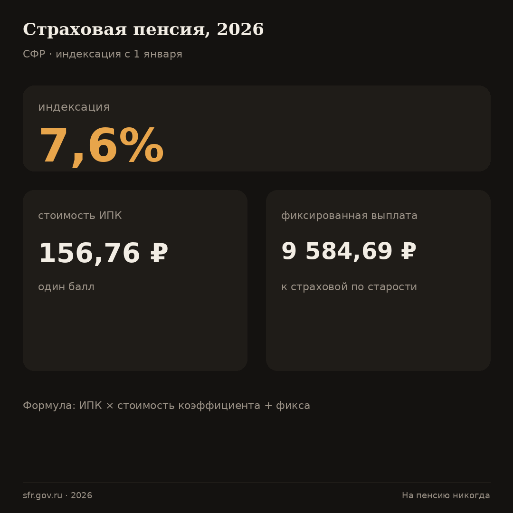
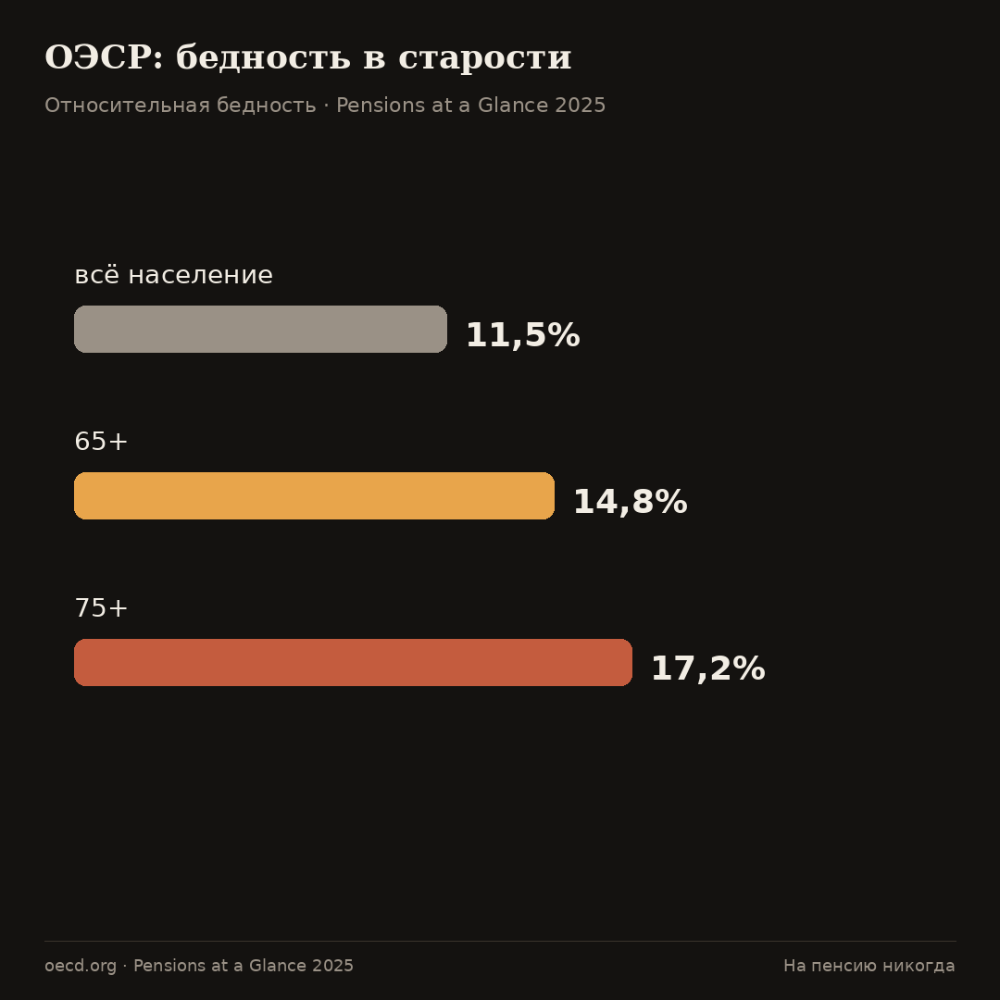
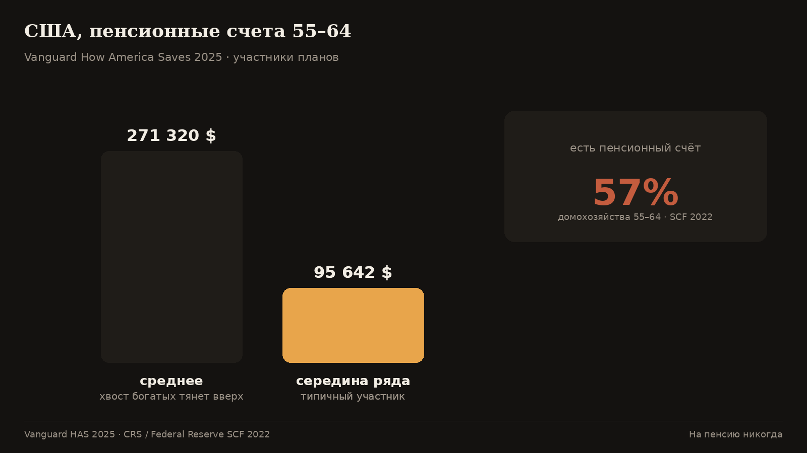
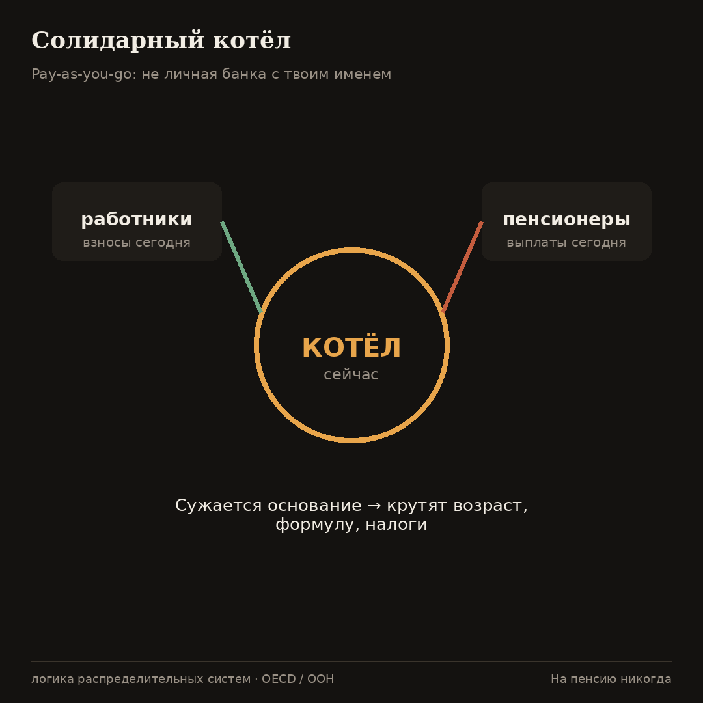
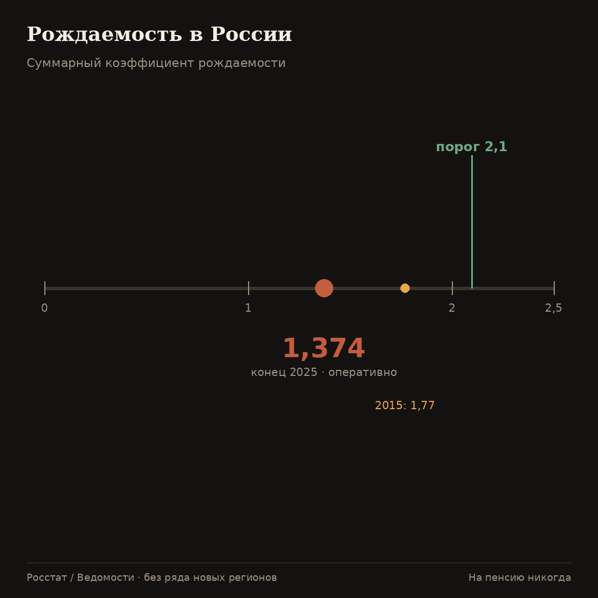
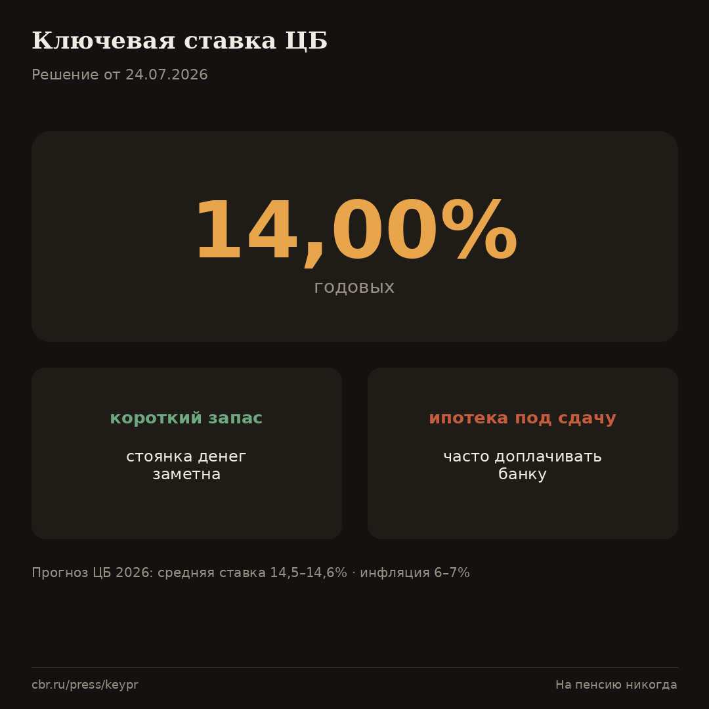
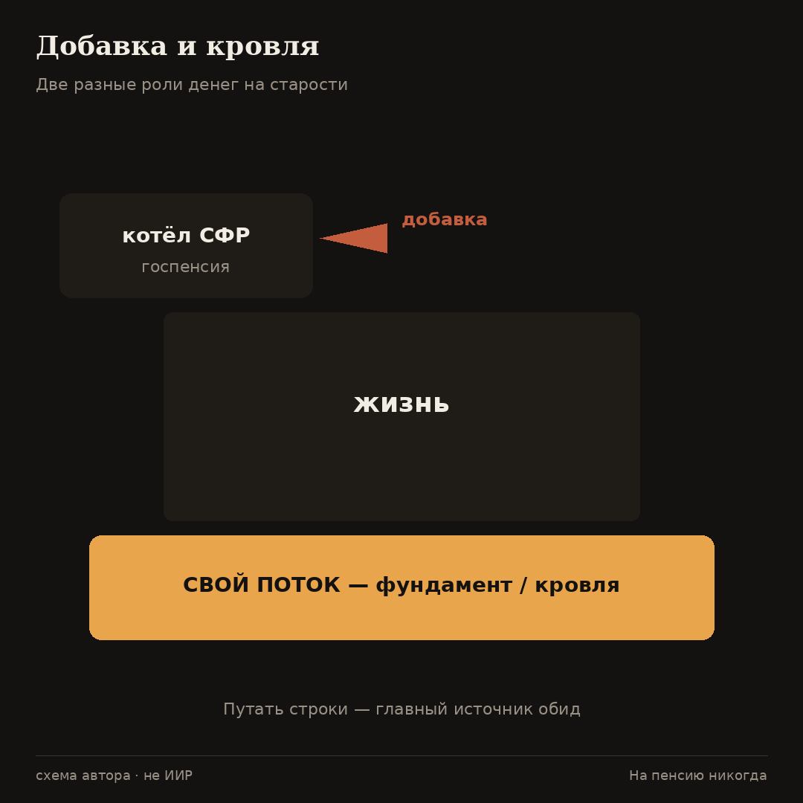

# Пенсия — выдумка. Что стоит за словами «на пенсию никогда»

Эту картинку мы видели сотни раз. Пожилой, но удивительно бодрый мужчина в светлых льняных брюках неспешно бредёт вдоль кромки прибоя. На фоне играют скрипки, а в углу кадра мерцает логотип страховой компании. Нам продают мечту: отработал своё — и вот она, заслуженная свобода без будильника.

С 1 января 2026 года государство [проиндексировало пенсии на 7,6%](https://sfr.gov.ru/grazhdanam/pensionnoe_obespechenie/indeksacia_strahovth_pensij). Теперь один [пенсионный балл](https://sfr.gov.ru/grazhdanam/pensionnoe_obespechenie/strahovaya_pensiya_po_starosti/opredelenie_razmera/) стоит **156 рублей 76 копеек**, а [гарантированная добавка](https://sfr.gov.ru/branches/moscow/news~2026/01/12/277996) к выплате составляет **9 584 рубля 69 копеек**.

Я смотрю на эти цифры, а потом перевожу взгляд на обычный чек из магазина у дома. Однажды я сел с этим чеком и прикинул: хватит ли средней выплаты просто на еду и лекарства? Не хватило. Это мой личный расчёт, не претензия к методике Росстата. Суть здесь другая: официальные проценты живут в одном мире, а реальные цены на молоко и хлеб — совсем в другом. Новость о повышении звучит громко. Чек на кассе отвечает тише.

Ниже объясняется, почему формула «на пенсию никогда» — это не поза ради красного словца, а трезвая рабочая установка для обычного человека.

**Во-первых.** Рекламному деду лет шестьдесят. Статистика богатых стран разбивает этот образ.

Если бы реклама была правдой, старость везде выглядела бы как вечный отпуск. Но данные Организации экономического сотрудничества и развития говорят об обратном. [Бедность среди людей старше 65 лет](https://www.oecd.org/en/publications/2025/11/pensions-at-a-glance-2025_76510fe4/full-report/old-age-income-poverty_3cd946d7.html) там выше, чем у населения в целом: почти **15%** против **11,5%**. А если человеку исполнилось 75, риск остаться почти ни с чем вырастает до **17,2%**. Чем дальше от рекламного возраста «только-только отдых», тем жёстче картина.

В теории пенсия должна заменять часть зарплаты. В реальности при полной трудовой жизни она покрывает лишь [половину прежнего дохода — около 52%](https://www.oecd.org/en/publications/pensions-at-a-glance-2025_e40274c1-en/full-report/gross-replacement-rates-public-vs-private-mandatory-vs-voluntary-schemes_ec20db6a.html). Причём чисто государственные деньги дают ещё меньше — около **43%**. Работать сорок лет, чтобы потом получать половину привычного бюджета — это вовсе не «жить так же, только без начальника». К тому же сама идея непрерывной карьеры сегодня выглядит сказкой. Болезни, декреты, вынужденные подработки без оформления — всё это оставляет дыры в стаже, которые система видит, но прощать не собирается.

В США дела обстоят похожим образом. Только у [57% семей](https://www.congress.gov/crs-product/IF12928) предпенсионного возраста вообще есть хоть какие-то накопления на старость. Если посмотреть на балансы реальных счетов американцев, картинка становится грустнее. Средний счёт кажется внушительным — более **270 тысяч долларов**. Но эта цифра обманчива: её сильно завышают богачи. У обычного человека (ровно посередине списка) на счету всего [около 95 тысяч долларов](https://finance.yahoo.com/news/average-401-k-balance-age-234838861.html). Богатые тянут среднее вверх, скрывая реальное положение дел большинства.

Возражение «это всё Америка, у нас другой путь» справедливо лишь отчасти. Столбы разные, архитектура систем отличается, но суть обещания одна и та же: нам показывают красивые проценты на бумаге, пока наша реальная корзина пустеет.

**Во-вторых.** Нас дурит сам язык: фраза «заслуженный отдых» программирует на провал.

Это уже не сухие таблицы экономистов, а наблюдение за нашей речью. Мы произносим слова «заслуженный отдых» автоматически. В этой фразе спрятаны два коварных обещания. Первое — что мы имеем моральное право остановиться (нам обязаны). Второе — что наступившая жизнь будет именно отдыхом (тихой гаванью).

Когда вместо покоя приходит нехватка денег, обострение старых болячек и звенящая пустота в расписании, мозг воспринимает это как предательство. Даже если разумом человек понимал, что пенсия будет скромной. Язык готовил его к триумфу, а получил он тихое угасание.

Книга, давшая название этому каналу — «На пенсию никогда» — формулирует мысль жёстко. То, что принято называть «покоем», слишком часто превращается в репетицию смерти, если единственный план — просто перестать работать. Слово «финиш» убивает волю. Жизнь после шестидесяти требует другого сценария: новых задач, движения тела и постоянного притока денег, а не просто отметки в календаре.

**В-третьих.** Пенсионный договор держится на честном слове демографии.

Распределительная система работает просто: те, кто работают сегодня, своими взносами оплачивают пенсии тех, кто уже состарился. Ваши отчисления сейчас — это не монеты, бережно сложенные в именную банку с вашей фамилией на крышке. Это топливо для общего котла, которое сгорает мгновенно. Когда количество пенсионеров растёт, а число работников падает, котёл начинает остывать. [Старение населения](https://population.un.org/wpp/) — глобальный сюжет, наглядно показанный и на [графиках демографической нагрузки](https://ourworldindata.org/grapher/age-dependency-ratio-old).

В России ситуация усугубляется демографической ямой. [Суммарный коэффициент рождаемости](https://www.vedomosti.ru/society/articles/2026/01/23/1171174-summarnii-koeffitsient-rozhdaemosti-prodolzhil-snizhatsya) к концу 2025 года опустился до критической отметки **1,374** ребёнка на женщину; тот же ряд подтверждает [НАПФ](https://www.napf.ru/news/napf_news_market/summarnyy-koeffitsient-rozhdaemosti-prodolzhil-snizhatsya-v-2025-godu/). Чтобы население хотя бы не сокращалось, нужно значение около **2,1**. Пирамида, которая когда-то стояла на широком основании, сужается — а обязательства перед теми, кто подошёл к котлу с тарелкой, никуда не делись.

[Накопительную часть пенсий](http://www.consultant.ru/document/cons_doc_LAW_155146/) фактически заморозили ещё в 2014 году, направив взносы в общий страховой котёл. Мораторий продлевали много раз. Более того, на 2026 год законодательно зафиксирован [ожидаемый период выплаты](https://www.consultant.ru/document/cons_doc_LAW_518981/) накопительной части — целых **270 месяцев**. Это технический параметр формулы. Простыми словами: уже накопленное будут делить на большее число выплат, поэтому ежемесячная прибавка станет тоньше.

Для вашего кошелька вывод один: правила игры будут меняться. Государство может честно индексировать выплаты и одновременно честно менять условия доступа к ним. Эти жесты прекрасно уживаются друг с другом. Ваша задача — понимать, что госпенсия — это переменная величина, а не гарантированная крыша над головой.

**В-четвёртых.** Остановка разрушает человека быстрее, чем заканчиваются деньги.

Здесь снова придётся обратиться к человеческой природе, а не к финансовым отчётам. Человек устроен так, что без дела он ржавеет и рассыпается. Западное движение раннего выхода на покой строится на идее скопить капитал и выйти из гонки. Но у многих после нажатия кнопки «Стоп» случается глубокий кризис смысла. Дни сливаются в один серый ком, тело теряет тонус, социальные связи рвутся. Деньги вроде бы есть, а жизни в них нет.

«На пенсию никогда» — это не призыв вкалывать до гробовой доски на износ. Это отказ ржаветь. Можно снизить темп, сменить сферу деятельности, уехать в деревню. Но нельзя добровольно сдавать своё право быть нужным — семье, обществу, самому себе — только потому, что какой-то чиновник поставил печать в документе.

**В-пятых.** Живые деньги с имущества и погода процентных ставок.

Пока у вас идёт активный доход, нужно строить стену. И речь не о миллионах на брокерском счёте. Речь о реальном имуществе и навыках, которые способны приносить живые деньги здесь и сейчас: плата от жильцов за квартиру, выплаты по ценным бумагам, денежная подушка на случай форс-мажора или золото как защита от инфляционных шоков. Детали сборки такого портфеля мы разберём позже. Сейчас важно понять погоду вокруг стройки.

[24 июля 2026 года Банк России снизил ключевую ставку до 14,00%](https://www.cbr.ru/press/keypr/) годовых. Прогноз регулятора на текущий год держит среднюю ставку в диапазоне **14,5–14,6%** при инфляции **6,0–7,0%**. Высокая ставка меняет всю математику. Для владельца квартиры, взятой в ипотеку ради сдачи, это может стать ловушкой: платёж банку съедает всю аренду, превращая актив в тяжёлое обязательство доплачивать из своего кармана. Зато для хранения короткого денежного запаса такая погода заметнее: стоянка денег наконец-то перестаёт быть пустой формальностью.

Мой собственный портфель состоит из недвижимости, драгоценных металлов, бумаг компаний, которые платят дивиденды, и коротких банковских инструментов. Там принципиально нет длинных государственных облигаций. Лично мне странно доверять роль главного защитного актива государству, которое само печатает валюту, которой обещает вернуть долг. Это моё личное решение, основанное на логике сохранения капитала, а не инвестиционная рекомендация.

**В-шестых.** Что «на пенсию никогда» значит на практике.

Формула простая, выполнение — нет.

Госпенсия — это **добавка**, не план всей жизни. Считайте её приятным бонусом к своему потоку денег, а не фундаментом, на котором всё держится.

Свой денежный поток — это ваша **обязанность**, пока есть силы и здоровье. Норма сбережений, имущество, которое приносит доход, забота о теле и профессиональные навыки.

Полная остановка — это **риск**, а не приз. Приз — когда вы сами выбираете, сколько и когда работать, а не пустой календарь, от которого хочется лезть на стену.

Серия материалов далее разберёт чертёж пирамиды, сборку портфеля своими руками и действия государств — с цифрами, ссылками и без рекламных образов.

**Наконец.** Ответы на типичные возражения.

«Родителям хватало». У родителей было другое время. Другое соотношение работающих и пенсионеров, другие цены на жильё, крепче институт большой семьи. Данные ОЭСР неумолимы: даже в самых благополучных странах [старость статистически беднее](https://www.oecd.org/en/publications/2025/11/pensions-at-a-glance-2025_76510fe4/full-report/old-age-income-poverty_3cd946d7.html) среднего уровня жизни.

«Но ведь индексация происходит!» Происходит. Те самые [7,6%](https://sfr.gov.ru/grazhdanam/pensionnoe_obespechenie/indeksacia_strahovth_pensij) — реальный факт. Но ценники в магазине — тоже факт. Индексация часто бежит позади реальной корзины у дома.

«Наверху что-нибудь придумают». Придумают. Например, [во Франции в 2023 году](https://www.reuters.com/world/europe/french-pension-reform-heads-final-vote-2023-03-16/) правительство продавило повышение пенсионного возраста через жёсткий механизм статьи **49.3** конституции, обойдя обычное голосование в парламенте. Придумали спасение системы за чужой счёт. Ваша финансовая стена — это ваша личная кожа, спасать которую кроме вас некому.

«Мне ещё рано об этом думать». Тем лучше. Привычка откладывать часть дохода со студенческой скамьи обходится в разы дешевле, чем попытки героически спасти ситуацию в пятьдесят лет. Молодость даёт главное преимущество — время. И не отменяет [сужение демографического основания](https://population.un.org/wpp/).

**Получается.**

[Индексация на 7,6%](https://sfr.gov.ru/grazhdanam/pensionnoe_obespechenie/indeksacia_strahovth_pensij) и стоимость балла **156,76 ₽** — это сухая бухгалтерия Социального фонда. Коэффициент рождаемости [1,374](https://www.vedomosti.ru/society/articles/2026/01/23/1171174-summarnii-koeffitsient-rozhdaemosti-prodolzhil-snizhatsya) при необходимом минимуме около **2,1** — это неумолимая демография. Реальные накопления обычных людей на Западе бесконечно далеки от образов рекламных проспектов. Язык «заслуженного отдыха» программирует нас на пассивное ожидание финиша, но жизнь после остановки работы без собственного потока денег и целей быстро мстит болезнями и пустотой. Название канала — про отказ ржаветь и про свой финансовый поток. Госпенсию оставим государству — пусть числится в справке как добавка. Основную крышу каждый должен класть сам.

**Что делать.**

Зайдите на [сайт Социального фонда](https://sfr.gov.ru/grazhdanam/pensionnoe_obespechenie/strahovaya_pensiya_po_starosti/opredelenie_razmera/), посмотрите ориентиры по баллам и выпишите сумму будущей выплаты. Положите этот листок рядом с недавним чеком из супермаркета. Посмотрите им в глаза одновременно.

Откройте банковское приложение и посчитайте норму сбережений за последние три месяца. Сколько пришло на карту и сколько ушло в копилку? Без этого базового числа любой разговор о будущем бессмыслен.

Наведите порядок в голове. Чётко разделите понятия «добавка от государственного котла» и «мой собственный денежный поток». Путаница между ними — главный источник горьких разочарований в зрелом возрасте.

Не принимайте текущую [ключевую ставку 14%](https://www.cbr.ru/press/keypr/) за вечную истину. Это временная погода. Правила солидарной системы — это климат, который меняется медленно, но почти всегда не в пользу получателя.

Читайте дальше. В следующих текстах мы подробно разберём чертёж демографической пирамиды и поймём, почему старый общественный договор «я плачу — мне вернут» трещит по швам.

## Источники

1. СФР — индексация 7,6% (2026): https://sfr.gov.ru/grazhdanam/pensionnoe_obespechenie/indeksacia_strahovth_pensij  
2. СФР — ИПК 156,76 ₽, ФВ 9 584,69 ₽: https://sfr.gov.ru/grazhdanam/pensionnoe_obespechenie/strahovaya_pensiya_po_starosti/opredelenie_razmera/  
3. СФР Москва: https://sfr.gov.ru/branches/moscow/news~2026/01/12/277996  
4. ЦБ РФ — ключевая ставка 14% (24.07.2026): https://www.cbr.ru/press/keypr/  
5. OECD Pensions at a Glance 2025 — бедность 65+: https://www.oecd.org/en/publications/2025/11/pensions-at-a-glance-2025_76510fe4/full-report/old-age-income-poverty_3cd946d7.html  
6. OECD — gross replacement rates: https://www.oecd.org/en/publications/pensions-at-a-glance-2025_e40274c1-en/full-report/gross-replacement-rates-public-vs-private-mandatory-vs-voluntary-schemes_ec20db6a.html  
7. Vanguard How America Saves 2025 (разбор балансов): https://finance.yahoo.com/news/average-401-k-balance-age-234838861.html  
8. CRS / SCF 2022: https://www.congress.gov/crs-product/IF12928  
9. Росстат (Ведомости) — СКР 1,374: https://www.vedomosti.ru/society/articles/2026/01/23/1171174-summarnii-koeffitsient-rozhdaemosti-prodolzhil-snizhatsya  
10. НАПФ / Росстат: https://www.napf.ru/news/napf_news_market/summarnyy-koeffitsient-rozhdaemosti-prodolzhil-snizhatsya-v-2025-godu/  
11. ООН WPP: https://population.un.org/wpp/  
12. Our World in Data — old-age dependency: https://ourworldindata.org/grapher/age-dependency-ratio-old  
13. 351-ФЗ (мораторий накопительной): http://www.consultant.ru/document/cons_doc_LAW_155146/  
14. 415-ФЗ — период выплаты 270 мес. на 2026: https://www.consultant.ru/document/cons_doc_LAW_518981/  
15. Франция / пенсионная реформа 2023: https://www.reuters.com/world/europe/french-pension-reform-heads-final-vote-2023-03-16/  

*Материал носит образовательный характер и не является индивидуальной инвестиционной рекомендацией. Упоминания личного опыта автора помечены отдельно.*

Объём: 15728 символов с пробелами
