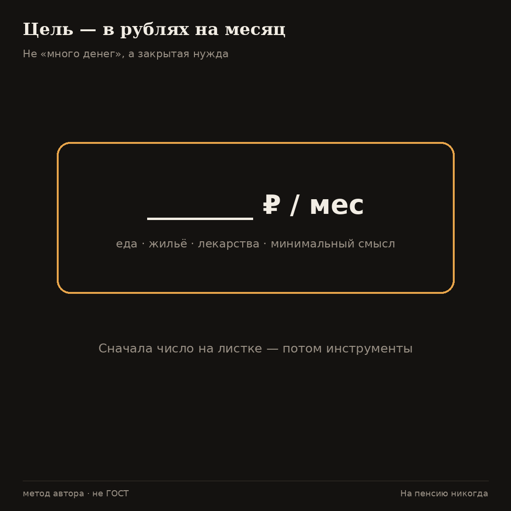
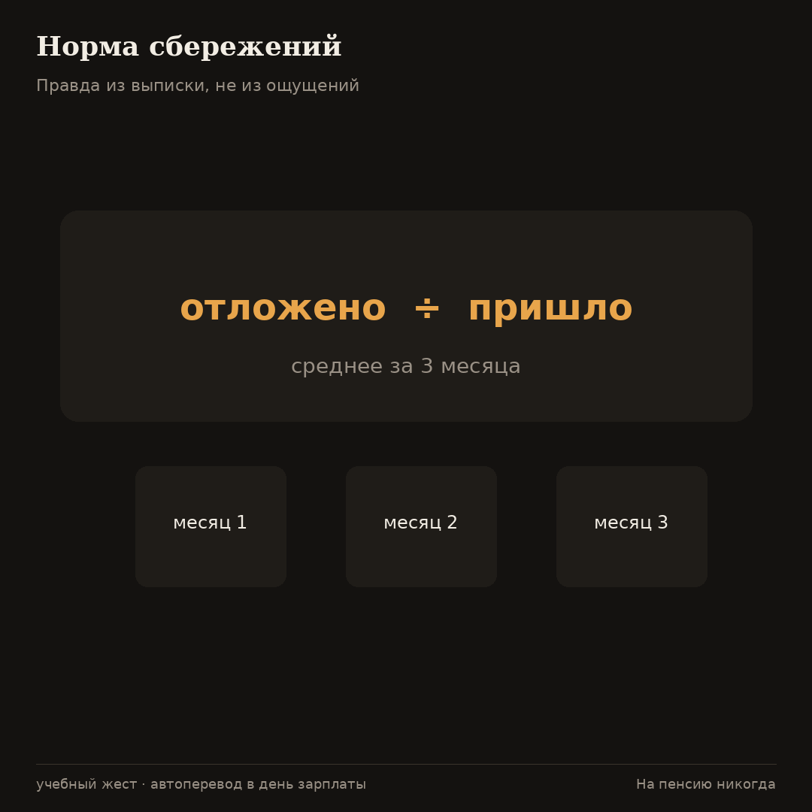
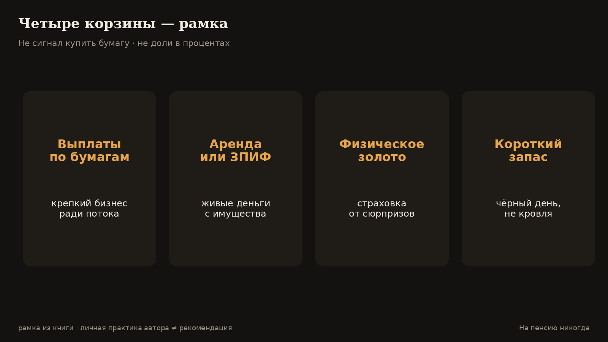
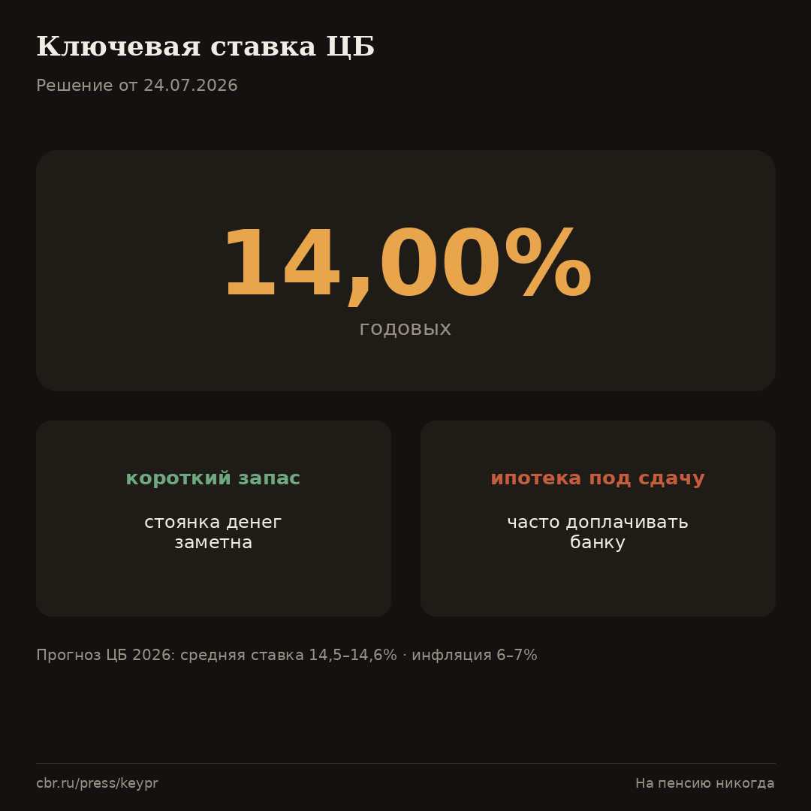
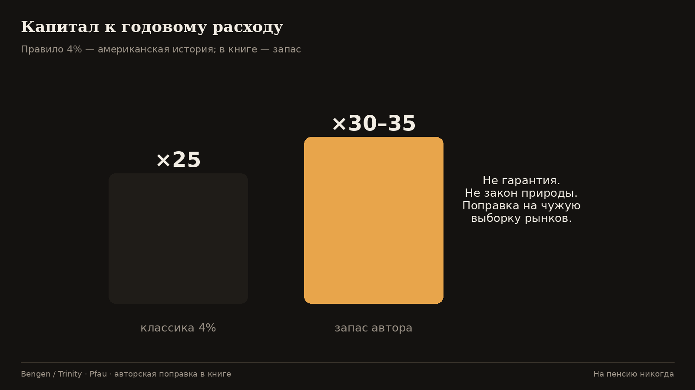

# Пенсия своими руками

Диагноз прошлого текста: солидарный котёл под давлением демографии [OECD](https://www.oecd.org/en/publications/2025/11/pensions-at-a-glance-2025_76510fe4/full-report/old-age-income-poverty_3cd946d7.html) [СКР РФ](https://www.vedomosti.ru/society/articles/2026/01/23/1171174-summarnii-koeffitsient-rozhdaemosti-prodolzhil-snizhatsya). Чертёж сам по себе не кормит. Дальше — что делать руками, пока идёт доход.

Ниже — рамка из книги «На пенсию никогда». Где есть внешние цифры — ссылки. Где личный метод автора — пометка. Это не сигнал купить конкретную бумагу и не обещание Бали к пятнице.

---

**Во-первых.** Цель с размером в рублях.

«Много денег» не имеет финиша. Рабочая формулировка: сколько живых рублей в месяц закрывают нужду. Это метод автора, не ГОСТ.

Без размера цели разговор о «пенсии» превращается в коллекционирование нулей. Спроси иначе: какая сумма живых рублей в месяц закрывает нужду — еда, жильё, лекарства, минимальный смысл жизни — без геройства. Запиши число. Потом умножь на подушку прочности. Это учебный жест автора, не ГОСТ и не индивидуальная рекомендация.

Возражение «нужду не угадаешь» принимается. Тогда возьми сегодняшний расход по выписке и добавь запас на здоровье. Лучше грубая цифра на бумаге, чем туман «когда-нибудь много».

**Во-вторых.** Норма сбережений.

Посчитай по выписке за три месяца: отложено / пришло. Таблица сроков в книге — учебный ориентир при нулевой реальной доходности; это модель, не прогноз рынка.

Норма — главный рычаг, пока доход идёт. Автоперевод в день зарплаты работает лучше героизма в конце месяца. Три месяца выписок дают правду без самообмана.

В книге есть учебная таблица сроков при нулевой реальной доходности: сколько лет копить долю расхода при разной норме. Это модель «если просто складывать», а не прогноз рынка. Смысл таблицы — показать цену низкого процента откладывания, а не обещать доходность.

**В-третьих.** Имущество должно кормить.

Вопрос «сколько капает на счёт» — учётный. Квартира для жилья и объект с арендой — разные экономические роли (потребление vs доход).

Квартира, в которой живёшь, — прежде всего потребление: крыша, тепло, адрес. Объект, который стабильно капает на счёт после налогов, ремонта и простоя, — другая экономическая роль. Путать их удобно разговору «у меня же недвижимость». Для потока важнее вопрос: сколько живых денег приходит, а не сколько «стоит в объявлении».

**В-четвёртых.** Четыре корзины — рамка, не сигнал к сделке.

Дивидендное ядро / доходная недвижимость или ЗПИФ / физическое золото / короткий запас. Длинные ОФЗ в роли «стены» автор исключает осознанно: это обязательство эмитента, который печатает деньги. Короткие инструменты денежного рынка — парковка запаса, другая функция. **Конкретные бумаги и доли — не рекомендация.**

Четыре корзины в рамке автора: дивидендное ядро (крепкий бизнес ради растущих выплат); доходная недвижимость или ЗПИФ; физическое золото как страховка от сюрпризов; короткий запас на чёрный день.

Длинные ОФЗ в роли «стены» автор исключает осознанно: это обязательство эмитента, который печатает деньги. Короткие инструменты денежного рынка — временно держать запас, другая функция. **Конкретные бумаги и доли — не рекомендация.** Состав моего портфеля — личная практика, не чертёж для копирования один в один.

**В-пятых.** Ключевая ставка 14%: погода, не стратегия навсегда.

24.07.2026 ЦБ снизил ставку до **[14,00%](https://www.cbr.ru/press/keypr/)**; в базовом сценарии средняя ставка 2026 — **14,5–14,6%**, инфляция **6–7%** [пресс-релиз ЦБ](https://www.cbr.ru/press/keypr/). Ипотека под сдачу, где процент банку выше аренды, на этих уровнях часто превращает «актив» в обязательство доплачивать.

Ставка — погода стройки. При ключе около **14%** дорогая «инвестиционная» ипотека под сдачу часто превращает мечту в обязанность доплачивать банку разницу. Считай аренду после налогов и ремонта против платежа — на калькуляторе, не на эмоции.

Для короткого запаса та же погода делает стоянку денег заметной. Не путай стоянку с кровлей на двадцать лет. Прогноз ЦБ на 2026 (средняя ставка **14,5–14,6%**, инфляция **6–7%**) — ориентир среды, не приказ портфелю.

**В-шестых.** Правило «4% / ×25» — американская история, не закон природы.

Правило безопасного съёма около 4% связано с работой Бенгена (1994) и проверками вроде Trinity Study [обзор истории 4%](https://www.kitces.com/blog/the-4-safe-withdrawal-rate-the-history-of-a-retirement-rule-of-thumb/) [Trinity Study PDF](https://www.retailinvestor.org/pdf/TrinityStudy.pdf). Уэйд Пфау и другие показывали, что вне удачной американской выборки безопасные ставки часто ниже [Pfau / safe savings rates](https://retirementresearcher.com/safe-savings-rates-a-new-approach-to-retirement-planning-versus-safe-withdrawal-rates/). Отсюда в книге запас: ориентир капитала ближе к **30–35** годовым расходам и более осторожный съём — **авторская поправка**, не гарантия.

Правило «снимай около 4%, держи ×25 годовых расходов» выросло из американской истории рынков и работ вроде Бенгена и Trinity Study. Вне удачной выборки безопасный съём часто оказывается ниже — об этом писали Уэйд Пфау и другие.

Отсюда в книге запас: ориентир капитала ближе к **30–35** годовым расходам и более осторожный съём — **авторская поправка**, не гарантия и не закон природы. Госпенсию считай добавкой по формуле СФР (балл **156,76 ₽**, фикса **9 584,69 ₽** после индексации 2026), а не фундаментом.

**Наконец.** Ранний выход и поздний старт.

Риск «скопил и лёг» — про остановку задач (книга). Поздний старт после сорока — смещение рычагов на норму, доход и тело; полной независимости к 65 с нуля может не быть. Это честный горизонт, не обещание Бали.

---

Ещё про погоду ставки простыми словами. Когда ключ двузначный, мозг любит две крайности: «надо срочно купить бетон в кредит, пока не поздно» и «надо всё держать на вкладе и не дышать». Обе крайности плохи как единственный план. Считай поток: что капает после налогов и ремонта. Считай платёж банку. Если платёж больше потока — это не актив, а подписка на банк. Короткую стоянку запаса при том же ключе можно любить спокойнее: она не притворяется кровлей на двадцать лет.

И про «4%». Американская история рынков — не проклятие и не индульгенция. Она учит порядку мысли: сколько капитала на год жизни. Чужие проценты съёма не отменяют твою корзину у дома и твою [добавку от СФР](https://sfr.gov.ru/grazhdanam/pensionnoe_obespechenie/strahovaya_pensiya_po_starosti/opredelenie_razmera/). Авторский запас ×30–35 — способ не притворяться, что ты живёшь внутри чужого учебника.

**Получается.** Цель — в рублях на месяц, а не в слове «много». Норма — по выписке, лучше автопереводом в день зарплаты. Имущество должно кормить живыми деньгами, а не только цифрой в объявлении. Четыре корзины — рамка без культа бумаг. Ключ [14%](https://www.cbr.ru/press/keypr/) — погода: осторожность с дорогой ипотекой под сдачу, осмысленная стоянка короткого запаса. Правило 4% / ×25 — американская история; в книге запас 30–35 годовых расходов как авторская поправка. Ранний выход без задач ржавеет; поздний старт честно сужает потолок. Госпенсию оставляем добавкой [СФР](https://sfr.gov.ru/grazhdanam/pensionnoe_obespechenie/strahovaya_pensiya_po_starosti/opredelenie_razmera/).

**Что делать.**

Норма по банку — в первую очередь. Автоперевод в день зарплаты. Силовая и талия. ИИС / первый кирпич стены. Тетрадь решений. Не брать ипотеку, которая доит тебя при ставке около 14% [источник](https://www.cbr.ru/press/keypr/).

Ещё раз коротко: госпенсия — строка «добавка»; свой поток — строка «кровля»; ставка ЦБ — погода; правило 4% — чужая история с авторским запасом; тело и тетрадь — часть сборки, а не приложение для слабаков.

Тело, навык и тетрадь решений.

Стена без тела — хрупкая. Силовая и талия — не мораль, а страховка трудоспособности: пока можешь зарабатывать и чинить, у тебя больше ручек, чем у человека, который сдался дивану.

Навык — вторая страховка: то, что кормит вне одной должности. Тетрадь решений — третья: зачем купил, при каких условиях продашь, чего не трогаешь в панике. Без записи память врёт.

Госпенсия как добавка в таблице.

Открой [расчёт СФР](https://sfr.gov.ru/grazhdanam/pensionnoe_obespechenie/strahovaya_pensiya_po_starosti/opredelenie_razmera/) и внеси ориентир в свою таблицу отдельной строкой «добавка». Рядом — свой поток. Если строки смешались, вернись к манифесту: путаница источника обиды.

Риск раннего «скопил и лёг» — про остановку задач (книга). Поздний старт после сорока — смещение рычагов на норму, доход и тело; полной независимости к 65 с нуля может не быть. Это честный горизонт, не обещание пальм.

Типовые ошибки сборки.

Первая: копить «ощущением», без нормы по выписке. Тогда любой магазинный соблазн сильнее абстрактной старости. Автоперевод в день зарплаты лечит это лучше лекции.

Вторая: считать квартиру для жилья потоком. Крыша над головой бесценна как быт и бесполезна как аргумент «у меня уже пенсия в квадратных метрах», если счёт не пополняется.

Третья: принять среднюю доходность чужого графика за свою судьбу. Правило 4% выросло из чужой истории рынков ([Kitces / Bengen](https://www.kitces.com/blog/the-4-safe-withdrawal-rate-the-history-of-a-retirement-rule-of-thumb/), [Trinity](https://www.retailinvestor.org/pdf/TrinityStudy.pdf)). Авторская поправка 30–35 годовых расходов — про запас, не про гарантию [Pfau](https://retirementresearcher.com/safe-savings-rates-a-new-approach-to-retirement-planning-versus-safe-withdrawal-rates/).

Четвёртая: купить «инвестицию» в бетон в кредит при ключе около **14%** [ЦБ](https://www.cbr.ru/press/keypr/), не посчитав аренду после налогов и ремонта. Калькулятор здесь честнее настроения.

Пятая: довести стену до цифры и лечь. Ржавчина задач бьёт раньше, чем кончаются выплаты — об этом манифест и книга. Сборка руками включает тело и смысл дня, иначе получается сейф без хозяина.

Минимальный порядок на ближайшие 30 дней.

Неделя 1: выписка за три месяца, норма, цель в рублях/мес на листке рядом с [цифрами СФР](https://sfr.gov.ru/grazhdanam/pensionnoe_obespechenie/strahovaya_pensiya_po_starosti/opredelenie_razmera/).

Неделя 2: автоперевод короткого запаса; запрет на импульсивные «инвестиции» до записи в тетради решений.

Неделя 3: инвентаризация имущества — что кормит, что только стоит; без самообмана «потом сдам».

Неделя 4: силовая два раза, талия, сон. Скучно. Дешевле больницы.

Это не финансовый план под ключ. Это порядок человека, который больше не ждёт, пока котёл станет кровлей.

**Дальше.** Дополнение к пункту 2 (цифры, не «ощущения»).

Пока копишь короткий запас, ориентир доходности коротких рублёвых инструментов денежного рынка связан с уровнем ключевой ставки. На 24.07.2026 ключ — **14%** [ЦБ](https://www.cbr.ru/press/keypr/). Это не обещание конкретной доходности фонда: читай правила, комиссии, риски.

Страховую пенсию как добавку считай по формуле СФР [СФР](https://sfr.gov.ru/grazhdanam/pensionnoe_obespechenie/strahovaya_pensiya_po_starosti/opredelenie_razmera/): после индексации 2026 балл **156,76 ₽**, фикса **9 584,69 ₽** [СФР](https://sfr.gov.ru/grazhdanam/pensionnoe_obespechenie/indeksacia_strahovth_pensij).

## Источники

1. ЦБ РФ 14% (24.07.2026): https://www.cbr.ru/press/keypr/  
2. СФР — как устроена страховая пенсия: https://sfr.gov.ru/grazhdanam/pensionnoe_obespechenie/strahovaya_pensiya_po_starosti/opredelenie_razmera/  
3. Bengen / 4% rule (обзор): https://www.kitces.com/blog/the-4-safe-withdrawal-rate-the-history-of-a-retirement-rule-of-thumb/  
4. Trinity Study: https://www.retailinvestor.org/pdf/TrinityStudy.pdf  
5. Wade Pfau: https://retirementresearcher.com/safe-savings-rates-a-new-approach-to-retirement-planning-versus-safe-withdrawal-rates/  
6. OECD / СКР РФ (контекст диагноза): https://www.oecd.org/en/publications/2025/11/pensions-at-a-glance-2025_76510fe4/full-report/old-age-income-poverty_3cd946d7.html · https://www.vedomosti.ru/society/articles/2026/01/23/1171174-summarnii-koeffitsient-rozhdaemosti-prodolzhil-snizhatsya

*Материал образовательный и не является индивидуальной инвестиционной рекомендацией.*

Объём: 12361 символов с пробелами
