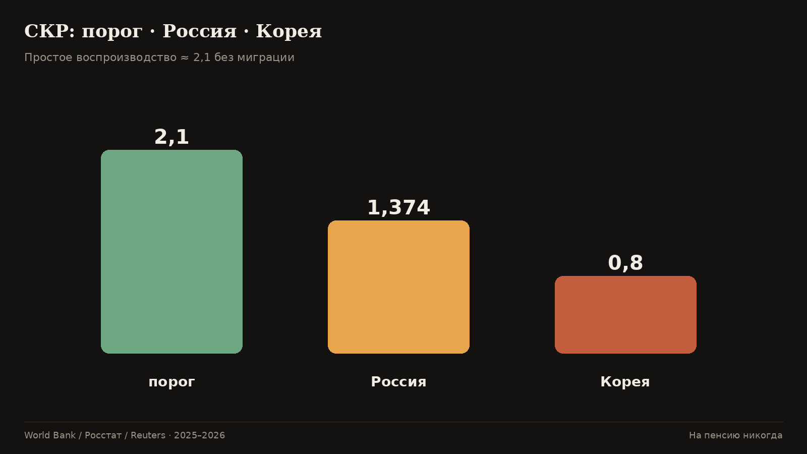
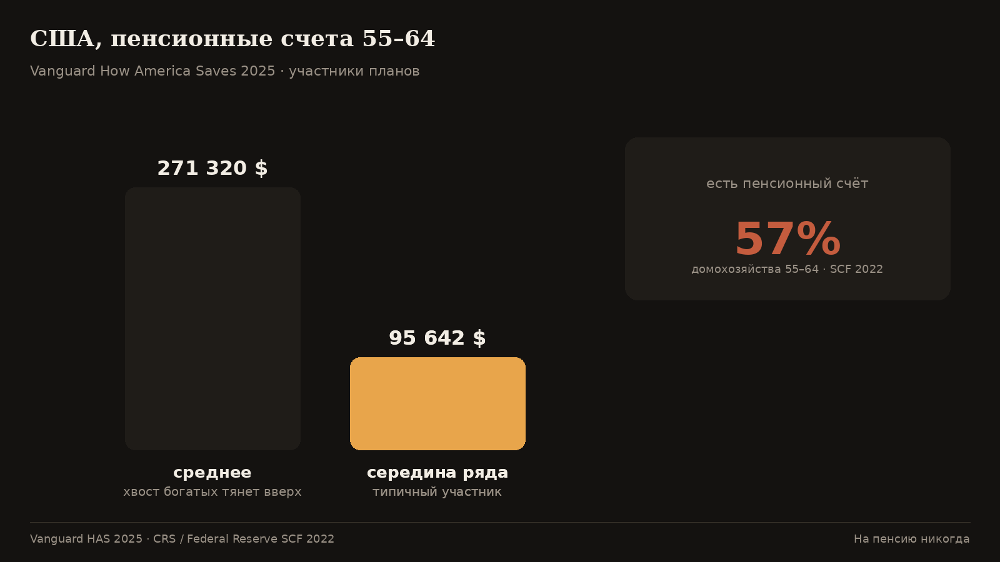
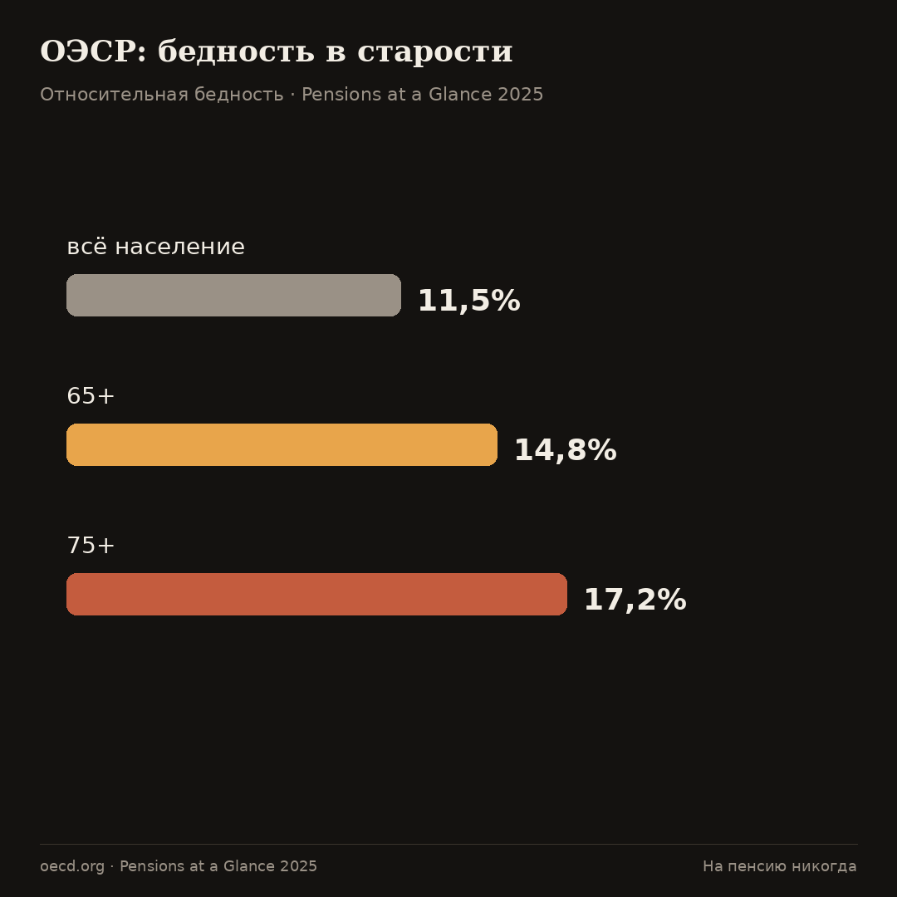
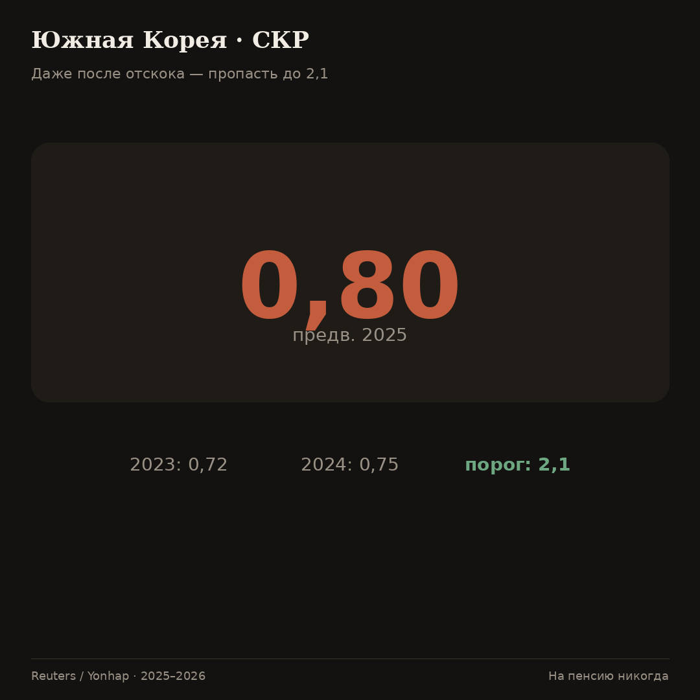
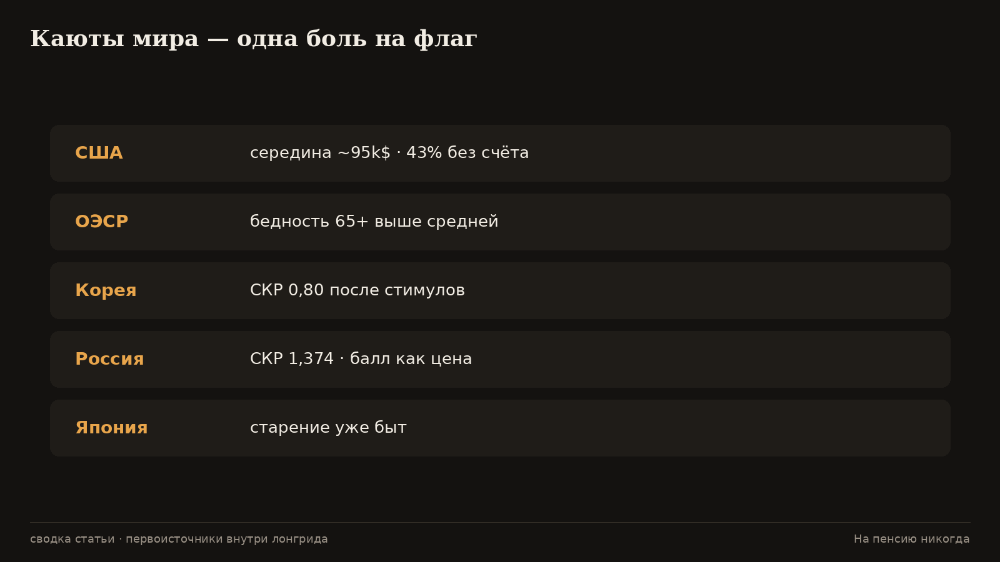

# Пенсии мира. Почему рекламный Запад тоже на дырявом днище

Миф: «там на пенсии человек» — стоит переехать / родиться / дотерпеть, и рекламный дед станет правдой. Ниже — каюты с цифрами. Богатые страны тоже стареют, тоже крутят ручки, тоже показывают середину ряда далековато от гольфа.

Смотри первичные источники: ОЭСР, ООН, ФРС/Vanguard, Росстат, СФР. Середина ряда важнее среднего, среднее важнее рекламы.

---

**Во-первых.** Порог воспроизводства около 2,1.

Суммарный коэффициент рождаемости около **2,1** — ориентир простого воспроизводства населения без миграции (стандарт демографии; см. пояснения Росстата/учебников и ряды [World Bank TFR](https://data.worldbank.org/indicator/SP.DYN.TFRT.IN)).

Россия, оперативно на конец 2025: **1,374** [Ведомости / Росстат](https://www.vedomosti.ru/society/articles/2026/01/23/1171174-summarnii-koeffitsient-rozhdaemosti-prodolzhil-snizhatsya).  
Южная Корея, 2025 (предв.): **0,80** (после 0,75 в 2024 и антирекорда 0,72 в 2023) [Reuters](https://www.reuters.com/business/healthcare-pharmaceuticals/south-koreas-birthrate-worlds-lowest-rises-again-amid-signs-easing-demographic-2026-02-25/) [Yonhap](https://en.yna.co.kr/view/AEN20260225002600320).

Порог **2,1** — не мораль и не приговор одной стране. Это ориентир простого воспроизводства без миграции. Всё, что устойчиво ниже, через поколение меняет форму пирамиды. Россия **1,374** и Корея **0,80** — разные глубины одной воронки. Отскок корейского коэффициента с антирекорда — хорошая новость статистики и плохая замена порогу воспроизводства.

**Во-вторых.** Америка: середина ряда, не гольф.

Vanguard, How America Saves 2025 (данные 2024): у участников 55–64 **средний** баланс плана ~**271 320 $**, **серединный** ~**95 642 $**

 [разбор Vanguard](https://finance.yahoo.com/news/average-401-k-balance-age-234838861.html).

Survey of Consumer Finances 2022: у домохозяйств 55–64 пенсионный счёт есть у [57%](https://www.congress.gov/crs-product/IF12928) [CRS / Fed SCF](https://www.congress.gov/crs-product/IF12928). Полный отчёт ФРС: https://www.federalreserve.gov/publications/files/scf23.pdf.

ОЭСР: [бедность 65+](https://www.oecd.org/en/publications/2025/11/pensions-at-a-glance-2025_76510fe4/full-report/old-age-income-poverty_3cd946d7.html) выше, чем у населения в целом [OECD PaG 2025](https://www.oecd.org/en/publications/2025/11/pensions-at-a-glance-2025_76510fe4/full-report/old-age-income-poverty_3cd946d7.html).

Американский пенсионный счёт 401(k) и родственные планы — культура личной копилки. Копилка помогает дисциплине. Она не отменяет хвост богатых в среднем и дыру у тех, у кого счёта нет: **43%** домохозяйств 55–64 без пенсионного счёта по SCF 2022.

Серединные **~95 642 $** у участников Vanguard 55–64 — не вилла. Это подушка, которую ещё надо правильно снимать двадцать лет. Средние **~271 320 $** показывают, как опасен разговор «американцы обеспечены» без разделения среднего и середины.

**В-третьих.** Европа: столб толще — перепись больнее.

Грубая валовая замещаемость обязательных пенсий (полная карьера, средняя зарплата) в агрегате ОЭСР — порядка **половины** зарплаты, не «сто процентов плюс курорт» [OECD replacement rates](https://www.oecd.org/en/publications/pensions-at-a-glance-2025_e40274c1-en/full-report/gross-replacement-rates-public-vs-private-mandatory-vs-voluntary-schemes_ec20db6a.html). Франция 2023 — пример жёсткой переписи возраста через 49.3 [Reuters](https://www.reuters.com/world/europe/french-pension-reform-heads-final-vote-2023-03-16/).

Толстый государственный столб даёт более высокий процент замещения в рекламе ожидания — и более жёсткую политическую боль, когда столб не сходится. Франция 2023 подняла возраст через **49.3**: процедура важнее слогана «европейская пенсия». Грубая замещаемость обязательных схем в агрегате ОЭСР — порядка половины зарплаты при полной карьере, не «сто процентов плюс курорт».

**В-четвёртых.** Япония: старение уже произошло.

См. рост old-age dependency и сравнения с Кореей в проекциях на базе ООН [OWID](https://ourworldindata.org/grapher/age-dependency-ratio-old) [KDI](https://kdijep.org/v.48/1/5/Addressing+the+Demographic+Decline+in+South+Korea). Бытовой символ серой зоны труда — [*madogiwa-zoku*](https://kotobank.jp/word/%E7%AA%93%E9%9A%9B%E6%97%8F-178526) [Japan Times](https://kotobank.jp/word/%E7%AA%93%E9%9A%9B%E6%97%8F-178526).

Япония — страна, где старение уже стало бытом, а не прогнозом. Коэффициент нагрузки пожилыми и серые зоны труда (включая *madogiwa-zoku*) — часть пейзажа. Сравнивать себя с Японией полезно не для ужаса, а для снятия иллюзии «у нас ещё успеем как в рекламе 1990-х».

**В-пятых.** Корея: деньги стимулов и коэффициент 0,8.

Отскок рождаемости 2025 к **0,80** — факт [источник](https://www.reuters.com/business/healthcare-pharmaceuticals/south-koreas-birthrate-worlds-lowest-rises-again-amid-signs-easing-demographic-2026-02-25/) [источник](https://en.yna.co.kr/view/AEN20260225002600320). До **2,1** далеко. Оценки совокупных расходов на pronatalist-политику за годы идут на сотни триллионов вон; обзор контекста — [KDI](https://kdijep.org/v.48/1/5/Addressing+the+Demographic+Decline+in+South+Korea).

Сотни триллионов вон стимулов и коэффициент около **0,8** после отскока — урок смирения для любого министерства, которое верит в быстрый ремонт демографии чеком. Деньги могут смягчить быт семей. Они редко за год поднимают культуру, жильё и ритм города до порога **2,1**.

**В-шестых.** Африка и «вечный приток».

Рождаемость в мире падает с урбанизацией; ряды по странам — [World Bank TFR](https://data.worldbank.org/indicator/SP.DYN.TFRT.IN) и [UN WPP](https://population.un.org/wpp/). Стереотип «Африка навсегда закроет чужие пирамиды» не опирается на вечную высокую рождаемость.

Рождаемость в мире падает с урбанизацией — ряды Всемирного банка и ООН это показывают по странам. Стереотип «Африка навсегда закроет чужие пирамиды» предполагает вечную высокую рождаемость и бесконечную готовность чужих молодых кормить чужих стариков. Оба допущения хрупки. Строить личную кровлю на чужом континенте как на вечном насосе — слабый план.

**Наконец.** Три устройства систем.

Солидарная / накопительная / смешанная — разные дыры (приток работников vs дисциплина медианы vs бюрократия). Давление старения на солидарные схемы — сквозной сюжет ОЭСР и ООН [источник](https://www.oecd.org/en/publications/2025/11/pensions-at-a-glance-2025_76510fe4/full-report/old-age-income-poverty_3cd946d7.html) [источник](https://population.un.org/wpp/).

Солидарная система дырявится притоком работников. Накопительная — дисциплиной медианы и риском рынка/издержек. Смешанная — бюрократией стыков. Давление старения сквозное: его видно в ОЭСР и проекциях ООН независимо от флага на обложке учебника.

Выбор устройства меняет форму дыры, не отменяет работу над своим потоком.

Как сравнивать страны без самообмана. Сравнивай одинаковое с одинаковым. Замещаемость при полной карьере не равна жизни человека с дырами в стаже. Средний баланс плана не равен серединному. Наличие счёта у [57%](https://www.congress.gov/crs-product/IF12928) означает, что у остальных его нет.

Сравнивай климат, не открытку. Корея с [0,80](https://www.reuters.com/business/healthcare-pharmaceuticals/south-koreas-birthrate-worlds-lowest-rises-again-amid-signs-easing-demographic-2026-02-25/) — климат. Рекламный ролик про счастливого пенсионера у моря — открытка. Где столб толще, боль переписи громче. Где копилка личная, дыра смещается в медиану. Россия с СКР [1,374](https://www.vedomosti.ru/society/articles/2026/01/23/1171174-summarnii-koeffitsient-rozhdaemosti-prodolzhil-snizhatsya) и баллом [156,76 ₽](https://sfr.gov.ru/grazhdanam/pensionnoe_obespechenie/strahovaya_pensiya_po_starosti/opredelenie_razmera/) сидит в той же семье задач. Уникальность декораций не отменяет общий чертёж.

**Получается.** 

**Что делать.**

Смотри середину ряда и первичные источники (gov / OECD / UN / Vanguard / СФР). Госпенсию любой страны клади добавкой. Сборка — своими руками.

Переезд.

Иногда разумен по работе и безопасности. Как замена собственной сборки потока — редко: входишь в чужую систему снизу, без их стажа и без их серединных накоплений [источник](https://finance.yahoo.com/news/average-401-k-balance-age-234838861.html) [источник](https://www.oecd.org/en/publications/pensions-at-a-glance-2025_e40274c1-en/full-report/gross-replacement-rates-public-vs-private-mandatory-vs-voluntary-schemes_ec20db6a.html).

---

Что это значит для читателя в России.

Сверяй СКР [1,374](https://www.vedomosti.ru/society/articles/2026/01/23/1171174-summarnii-koeffitsient-rozhdaemosti-prodolzhil-snizhatsya) и балл **156,76 ₽** с каютами мира без комплекса неполноценности и без гордыни. Воронка общая. Ручки знакомые. Добавка от котла — строка в таблице. Кровля — норма сбережений, имущество с живыми деньгами, тело, отказ ржаветь.

Переезд иногда разумен по работе и безопасности. Как замена собственной сборки потока — редко: входишь в чужую систему снизу, без их стажа и без их серединных накоплений. Смотри середину ряда Vanguard и долю без счёта по SCF, прежде чем верить рекламному деду «там».

Как сравнивать страны без самообмана.

Сравнивай одинаковое с одинаковым. Замещаемость при полной карьере не равна жизни человека с дырами в стаже. Средний баланс плана не равен серединному. Наличие счёта у **57%** означает, что у остальных его нет [CRS / SCF](https://www.congress.gov/crs-product/IF12928).

Сравнивай климат, не открытку. Корея с **0,80** и расходами на стимулы ([Reuters](https://www.reuters.com/business/healthcare-pharmaceuticals/south-koreas-birthrate-worlds-lowest-rises-again-amid-signs-easing-demographic-2026-02-25/), [KDI](https://kdijep.org/v.48/1/5/Addressing+the+Demographic+Decline+in+South+Korea)) — климат. Рекламный ролик про счастливого пенсионера у моря — открытка.

Сравнивай ручки. Где столб толще, боль переписи громче — Франция это показала. Где копилка личная, дыра смещается в медиану и в долю людей без счёта — Америка это показывает. Где старение уже быт — Япония. Где стимулы бьют рекорды, а коэффициент всё равно около нуля целых восьми — Корея.

Россия с СКР **1,374** и баллом **156,76 ₽** сидит в той же семье задач. Уникальность декораций не отменяет общий чертёж: котёл — добавка, кровля — своими руками, отказ ржаветь — условие, чтобы кровля имела хозяина.

Закрытие серии (пока).

Манифест назвал установку. Пирамида показала чертёж. Сборка дала руки. Ручки А–Ж научили читать новости. Мир показал, что «там» не курорт по умолчанию.

Дальше начинается скучная жизнь: норма, автоперевод, тетрадь, тело, сверка СФР раз в год, сверка ставки ЦБ как погоды, а не как религии. Если после пяти текстов хочется только поспорить в комментариях — текст не сработал. Если хочется открыть выписку — сработал.

Получается. | Каюта | Опора | Боль (с источником) |
|-------|--------|---------------------|
| США | личные счета | середина ~95k$ у 55–64 (Vanguard); 43% без счёта (SCF) |
| ОЭСР/Европа | госстолб | бедность 65+ 14,8%; замещаемость ~50% |
| Корея | стимулы | TFR 0,80 |
| Россия | баллы+котёл | СКР 1,374; балл 156,76 ₽ |
| Япония | старение | dependency / madogiwa |

## Источники

1. Vanguard HAS 2025: https://finance.yahoo.com/news/average-401-k-balance-age-234838861.html  
2. Fed SCF / CRS: https://www.federalreserve.gov/publications/files/scf23.pdf · https://www.congress.gov/crs-product/IF12928  
3. OECD PaG 2025: https://www.oecd.org/en/publications/2025/11/pensions-at-a-glance-2025_76510fe4/full-report/old-age-income-poverty_3cd946d7.html · https://www.oecd.org/en/publications/pensions-at-a-glance-2025_e40274c1-en/full-report/gross-replacement-rates-public-vs-private-mandatory-vs-voluntary-schemes_ec20db6a.html  
4. Корея: https://www.reuters.com/business/healthcare-pharmaceuticals/south-koreas-birthrate-worlds-lowest-rises-again-amid-signs-easing-demographic-2026-02-25/ · https://en.yna.co.kr/view/AEN20260225002600320 · https://kdijep.org/v.48/1/5/Addressing+the+Demographic+Decline+in+South+Korea  
5. Росстат СКР: https://www.vedomosti.ru/society/articles/2026/01/23/1171174-summarnii-koeffitsient-rozhdaemosti-prodolzhil-snizhatsya  
6. UN WPP / OWID: https://population.un.org/wpp/ · https://ourworldindata.org/grapher/age-dependency-ratio-old  
7. World Bank TFR: https://data.worldbank.org/indicator/SP.DYN.TFRT.IN  
8. Франция: https://www.reuters.com/world/europe/french-pension-reform-heads-final-vote-2023-03-16/  
9. Japan Times (madogiwa): https://kotobank.jp/word/%E7%AA%93%E9%9A%9B%E6%97%8F-178526  
10. СФР / ЦБ (связка с РФ): https://sfr.gov.ru/grazhdanam/pensionnoe_obespechenie/strahovaya_pensiya_po_starosti/opredelenie_razmera/ · https://www.cbr.ru/press/keypr/

*Материал образовательный и не является индивидуальной инвестиционной рекомендацией.*

Объём: 13052 символов с пробелами
