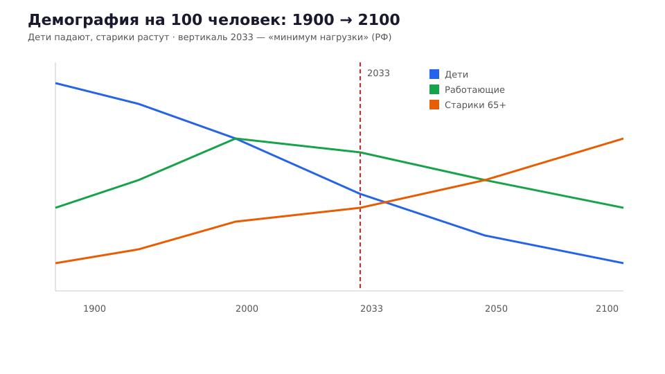
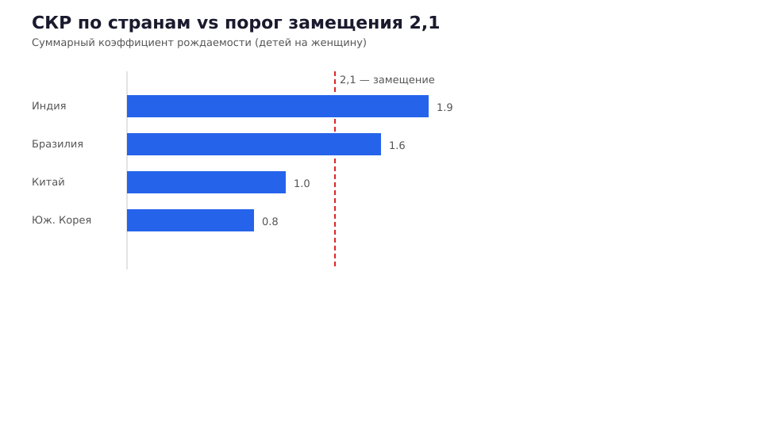
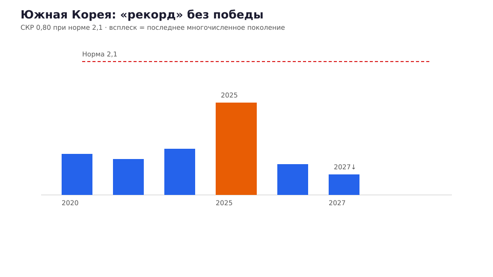
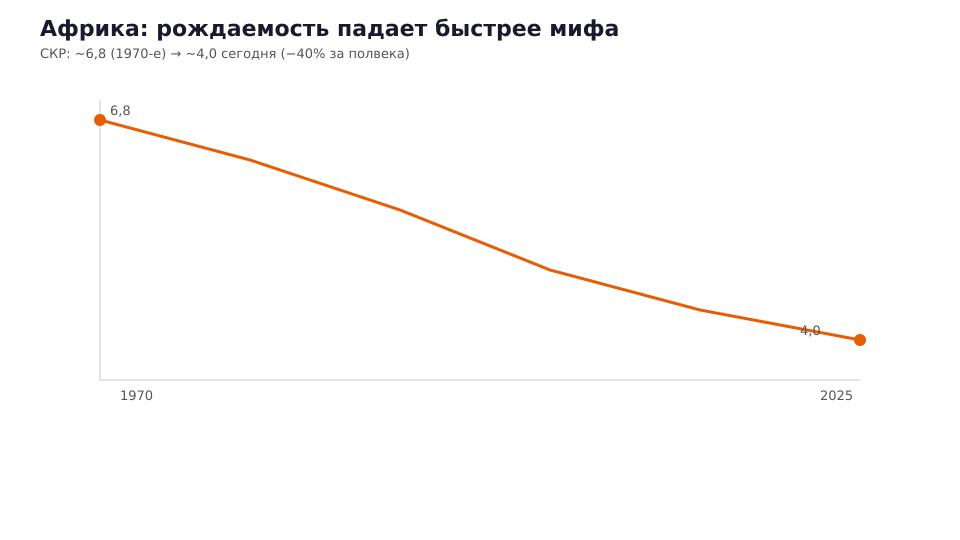

# Демографическое Понци: почему пенсия математически не сходится (и это не только Россия)

**Дзен / VK · выпуск 1 · neverretire.ru**

*Сжатая выжимка из [книги «На пенсию никогда»](https://neverretire.ru/book?utm_source=longread&utm_medium=article&utm_campaign=longread-01) (редакция v14), **гл. 1** · после пилота — [выпуск 2 про баллы](02_bally_ne_rubli.md).*

---

Пенсионный фонд — конвейер: деньги от работающих к неработающим. Пока работающих много — конвейер едет. Пока основание пирамиды широкое — всё выглядит прилично.

Пирамида **перевернулась** — теперь это сосулька, висящая остриём вниз. Это не прогноз «пессимистов из интернета». Это арифметика рождения и смерти, которую двадцать лет рисовали пунктиром «когда-нибудь».

Разберём по слоям: **история**, **глобальная картина**, **мифы про пособия**, **цифровая атрофия желания** — и что из этого следует для вас. В книге это **§ 1.1–1.4**.

---

## Когда математика была на вашей стороне

1950-е. Бэби-бум. Заводы дымят. На одного пенсионера — **8–10** работающих.

Это как стартап в эпоху доткомов: денег навалом, здравого смысла мало. Когда пузырь лопнул, выжили те, у кого была **реальная** модель. У пенсии модели не было — была **демография**, скрывавшая грехи архитектуры.

---

## XX век жил в кредит у детей, которых не родил

Счёт на 100 человек (упрощённая модель; в книге — **инфографика 1**, гл. 1):

| Эпоха | Старики 65+ | Дети 0–14 | Трудоспособные | СКР (ориентир) |
|--------|-------------|-----------|----------------|----------------|
| Середина XIX в. | 5 | 50 | 45 | >4 |
| Начало XXI в. | 30 | 10 | 60 | ~1,5–2 |
| **Около 2033 г.** | 35 | 9 | 56 | <1,5 |
| Конец XXI в. | 50 | 5 | 45 | <1,0 |

*Файл для Дзен/VK: `data/pension/longreads/graphics/01/01_demography_lines.svg`*

В «золотой» период начала XXI века казалось: рабочих рук стало больше — экономика пёрла. Но это был **пройденный кредит**: меньше детей, больше карьер, ипотека, потребление «без последствий».

Наследники — мы. Платим **ускромнением** жизни (термин из книги: сужение горизонта, меньше детей, выше нагрузка на каждого работающего).

К **2033 году** — «пройденный минимум демографической нагрузки» в российской риторике власти. Трудоспособных **чуть меньше**, чем в пике. Дальше — только хуже, если не произойдёт чуда, которого статистика не обещает.

**Ключевое:** в XIX веке «лишние» были **детьми** (будущие руки). В конце XXI «лишняя нагрузка» — **старики** (уход, медицина, пенсии). Разница принципиальная.

---

## Глобально: это не «российская болезнь»

**СКР** (суммарный коэффициент рождаемости) — сколько детей в среднем рожает одна женщина. Для **простого замещения** населения нужно **2,1–2,2** ([ООН, World Population Prospects](https://population.un.org/wpp/)).

Сегодня ниже порога — не только «мы»:

| Страна / регион | СКР (ориентир) | Статус vs 2,1 |
|-----------------|----------------|---------------|
| Индия | ~1,9 | ниже замещения |
| Бразилия | ~1,6 | ([Всемирный банк](https://data.worldbank.org/indicator/SP.DYN.TFRT.IN)) |
| Турция, Иран | ~1,6–1,7 | |
| Таиланд | ~1,2 | |
| **Китай** | ~**1,0** | ([Всемирный банк, Китай](https://data.worldbank.org/country/china)) |
| **Южная Корея** | ~**0,80** | рекорд среди развитых стран |

По оценкам ООН, мировая рождаемость пересекла 2,1 **вниз** — предположительно ещё в 2024 году. Пик населения Земли — порядка **2046 года**, потом сокращение.

---

## Южная Корея: «победа», которой нет

В 2025–2026 в СМИ мелькали заголовки: рождаемость «выросла» — рекорд за шесть лет!

Что на самом деле: в репродуктивный возраст вступило **последнее** относительно многочисленное поколение — «дети бумеров», которые к 30+ поняли: **сейчас или никогда**. СКР за год — **0,80** при норме 2,1. За двадцать лет государство потратило на стимулирование рождаемости **свыше 200 млрд $** ([Всемирный банк, СКР Кореи](https://data.worldbank.org/indicator/SP.DYN.TFRT.IN?locations=KR)).

Через год-полтора волна снова **рухнет**: следующее поколение меньше. Это не пессимизм — **экстраполяция** (книга, § 1.2).

---

## Африка: последний бастион, который сдаётся

Принято думать: Африка размножается — там будущее человечества.

Рождаемость в Африке **упала** с пика ~6,8 детей на женщину (1970-е) до ~4,0 — падение на **40%+** за полвека ([Всемирный банк, Африка к югу от Сахары](https://data.worldbank.org/region/sub-saharan-africa)). С 2020-х темп ~**1,3% в год**.

| Показатель | Было | Стало |
|------------|------|-------|
| СКР Африки (пик) | ~6,8 (1970-е) | |
| СКР сейчас | | ~4,0 |
| Нигерия 2016→2021 | 5,8 | 4,6 |

Городское население Африки — уже **больше половины**; к 2050 — ~65%. **Город = малодетность** — это проверено **всеми** странами без исключения.

«Чёрного века» — демографического господства глобального Юга — **не будет** (формулировка из книги, § 1.2). Будет **общепланетарное ускромнение**.

---

## Почему пособия за детей не поднимут рождаемость

Польша: ~3,6% ВВП на семейные пособия — СКР **1,33** (2021) → **1,099** (2024) ([GUS, Польша](https://stat.gov.pl/)). Исландия: рекорд среди стран ОЭСР — СКР **1,82** → **1,56**.

| Страна | Расходы на семью | СКР (динамика) |
|--------|------------------|----------------|
| Польша | ~3,6% ВВП | 1,33 → 1,10 |
| Исландия | рекорд ОЭСР | 1,82 → 1,56 |

Закономерность: деньги за детей **растут**, детей **меньше**.

Почему? Женщина не рожает, потому что **может не рожать**. Никакое государство не компенсирует **полную** цену материнства. «Бэби-бум сверху» **не будет**. Точка (книга, § 1.2).

---

## Тиктоковая смерть желания (почему демография хуже прогнозов)

Классические модели не учитывают **перенос жизни в экран** (книга, § 1.3).

Потребности закрываются **дешёво** — даже куцо. Куцое удовлетворение **убивает** желание искать живое. Родить ребёнка в такой парадигме — шаг **нелогичный**.

Демографический прогноз без этого слоя — **оптимистичен**.

---

## Что это значит для пенсии и для вас

1. **Меньше молодых** → меньше взносов в общий котёл.
2. **Больше старых** → больше выплат из того же котла.
3. **Политика** → индексация «как получится», возраст ↑, баллы переоценивают, льготы режут — **шаблон мира**, не только РФ (книга, § 1.4).

**Вывод:** рассчитывать на «государство дожмёт» — ошибка индейки (§ 1.1). Рассчитывать на «перееду — там лучше» — смена валюты обещания, не отмена старения.

**Действие:**
- Строить **личный кэшфлоу** (не «коплю баллы»).
- Инвестировать в **человеческий капитал** и **тело** (гл. 4–5 книги).
- Не откладывать жизнь до «пенсии», которой в привычном смысле **не будет**.

**Следующий лонгрид** — [как именно устроены российские баллы и заморозка накоплений](02_bally_ne_rubli.md) (книга, § 1.5).

Полная книга: **[neverretire.ru/book](https://neverretire.ru/book?utm_source=longread&utm_medium=article&utm_campaign=longread-01-book)**

---

## Атрибуты публикации

- Формат: longread (Дзен + VK).
- Канон книги: `docs/НА_ПЕНСИЮ_НИКОГДА_редактура_v14.docx`
- Канонический URL: https://neverretire.ru/book
- UTM Дзен: `?utm_source=dzen&utm_medium=article&utm_campaign=longread-01`
- UTM VK: `?utm_source=vk&utm_medium=article&utm_campaign=longread-01`
- CTA: «Следующий выпуск — баллы и реформы в РФ» · «Пилот серии — выпуск 0».

*Не является индивидуальной инвестиционной рекомендацией.*
