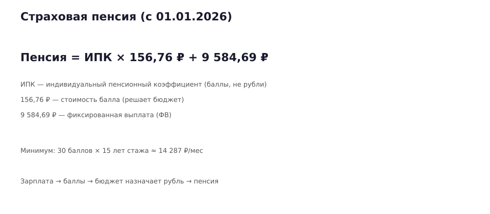
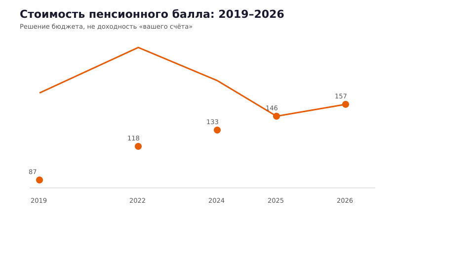
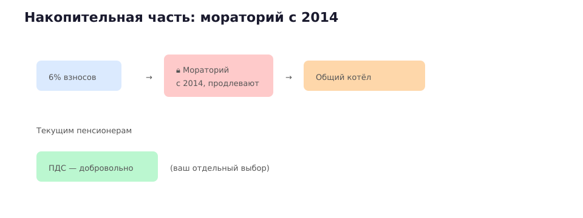
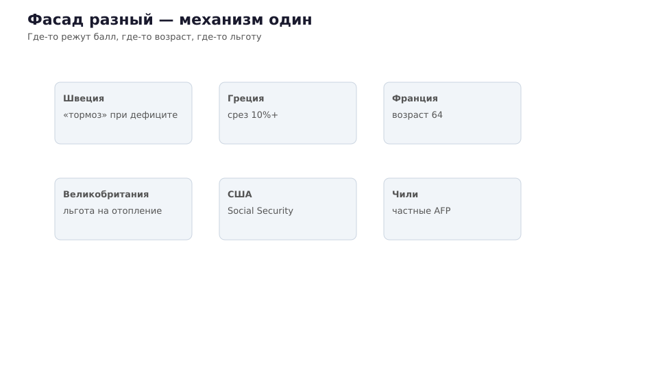

# Вы копите баллы, а не рубли: как устроена пенсия в России после всех реформ

**Дзен / VK · выпуск 2 · neverretire.ru**

*Сжатая выжимка из [книги «На пенсию никогда»](https://neverretire.ru/book?utm_source=longread&utm_medium=article&utm_campaign=longread-02) (редакция v14), **гл. 1, § 1.5** · предыдущий выпуск — [демография](01_demografiya_ponzi.md) · дальше — [FIRE](03_fire_kapitulyaciya.md).*

---

«Сколько у вас на пенсионном счёте?» — человек думает, что спрашивают про **накопления**, как вклад. На самом деле у большинства — **баллы** (ИПК — индивидуальный пенсионный коэффициент) и обещание, что когда-нибудь их **пересчитают в рубли** по правилам, которые пишет бюджет **того года**, когда вы выйдете.

Это не паранойя. Это **[400-ФЗ](https://www.consultant.ru/document/cons_doc_LAW_156525/)** и два десятилетия реформ. В книге: «баллы — валюта, которую не потратишь».

---

## Страховая пенсия: формула из трёх слов

**Пенсия = ИПК × стоимость балла + фиксированная выплата**

- **ИПК** — не рубль. «Пенсионное право» в относительных единицах (ст. 3, 400-ФЗ).
- **Стоимость балла** — объявляет государство (ст. 15, 400-ФЗ).
- **ФВ** (фиксированная выплата) — тоже от государства.

С **1 января 2026**: **156,76 ₽** за балл, ФВ **9 584,69 ₽**, индексация страховых пенсий **7,6%** ([бюджет СФР / ГАРАНТ](https://www.garant.ru/news/1920138/)).

Минимум: **30 баллов**, **15 лет** стажа. Арифметика: 30 × 156,76 + 9 584,69 ≈ **14 287 ₽** ([разбор на Клерке](https://www.klerk.ru/buh/articles/651570/)) — до надбавок и регионов.

*Файл для Дзен/VK: `data/pension/longreads/graphics/02/01_pension_formula.svg`*

Один балл в год «стоит» примерно **зарплаты от ~24 825 ₽/мес** (2026, предельная база взносов) — если зарабатываете меньше, баллы копятся медленнее.

**Фраза из книги:** вы копите **баллы**. Рубль за балл **пишет бюджет** — «долговая расписка без суммы, срока и механизма исполнения».

---

## Динамика: политическая валюта

Стоимость балла **растёт**, но **не по вашим правилам**:

| Год | ₽ за балл | Рост к прошлому году |
|-----|-----------|----------------------|
| 2019 | 87,24 | — |
| 2022 | 118,10 | +35% (июнь) |
| 2024 | 133,05 | |
| 2025 | 145,69 | |
| 2026 | 156,76 | +7,6% (янв.) |

Источник динамики: **[350-ФЗ](https://base.garant.ru/57743802/)**, ч. 7 ст. 10.

Каждый скачок — **решение бюджета**, не доходность вашего «счёта». Сравните с вкладом: там ставку вы **видите** в договоре. Здесь — **переменная**, которую меняют те, кому выгодно.

---

## Накопительная часть: заморожена с 2014

С 2014 года **мораторий** на формирование накопительной части — продлевают **ежегодно**. Деньги, которые должны были идти на **ваш** инвестиционный счёт, остаются в **распределительной** системе — платят **текущим** пенсионерам.

В книге это названо прямо: «конфискация с улыбкой». С 2002-го ввели накопительную часть — в 2014-м «заморозили» без исключений.

Отдельная история — **ПДС** (программа долгосрочных сбережений): добровольный слой. Это **ваш** выбор — не путать с «государство всё накопит».

Средняя **накопительная** выплата у тех, у кого она есть — порядка **1,8–1,9 тыс. ₽** после индексации 2026.

**«Возраст дожития»** — самый честный термин в пенсионном праве: «ожидаемый период выплаты пенсии» — срок, за который вы обязаны исчезнуть с минимальными потерями для бюджета (книга, § 1.5).

---

## Реформы одним абзацем

| Период | Что изменили |
|--------|--------------|
| 1990–2000-е | Балльная модель, рост возраста |
| 2014 | «Временная» заморозка 6% → постоянная |
| 2018–2019 | Возраст 55→60 ж, 60→65 м |
| Постоянно | Индексация ниже реальной инфляции в кризис |

Каждая реформа — **переписывание контракта** с уже работавшими.

---

## Мир: тот же спектакль, другие декорации

| Страна | Как режут обещание | Источник |
|--------|---------------------|----------|
| **Швеция** | накопительная система NDC + «тормоз» при дефиците | ([OECD, бедность 65+](https://www.oecd.org/en/publications/2025/11/pensions-at-a-glance-2025_76510fe4/full-report/old-age-income-poverty_3cd946d7.html)) |
| **Греция** | Срезы пенсий 10%+ (2010-е) | ([МВФ, Греция](https://www.imf.org/en/Countries/GRC)) |
| **Франция** | Возраст 62→64 (2023) | реформа 2023 г. |
| **Великобритания** | льгота на отопление: 10,6 млн → 1,3 млн получателей | ([DWP, Winter Fuel Payment](https://www.gov.uk/government/statistics/winter-fuel-payment-statistics-for-winter-2024-to-2025/winter-fuel-payment-statistics-for-winter-2024-to-2025)) |
| **США** | госпенсия Social Security + риск накопительного плана 401(k) | ([Federal Reserve SCF 2022](https://www.federalreserve.gov/publications/files/scf23.pdf)) |
| **Чили** | частные пенсионные фонды AFP: комиссии и кризисы | ([OECD, замещаемость](https://www.oecd.org/en/publications/pensions-at-a-glance-2025_e40274c1-en/full-report/gross-replacement-rates-public-vs-private-mandatory-vs-voluntary-schemes_ec20db6a.html)) |

**Вывод:** фасад разный, механизм один — **обещание длиннее, чем деньги** (книга, § 1.4–1.5).

---

## Что делать, если вы «в системе», но не **на** систему

1. **Считать баллы** — да, но **не путать** с финансовой независимостью.
2. **ИИС / ПДС / собственные активы** — диверсификация снижает удар (книга, гл. 8–11).
3. **Кэшфлоу** — дивиденды, купоны, аренда.
4. **Подушка 12 месяцев** — не продавать активы в панике при «реформе».

Пенсионная реформа 2030-х **уже пишется** демографией 2020-х ([выпуск 1](01_demografiya_ponzi.md)).

**Дальше по серии:** [почему FIRE в 40 — та же капитуляция](03_fire_kapitulyaciya.md) (книга, введение + гл. 8).

Полная книга: **[neverretire.ru/book](https://neverretire.ru/book?utm_source=longread&utm_medium=article&utm_campaign=longread-02-book)**

---

## Атрибуты публикации

- Формат: longread (Дзен + VK).
- Канон книги: `docs/НА_ПЕНСИЮ_НИКОГДА_редактура_v14.docx`
- Канонический URL: https://neverretire.ru/book
- UTM Дзен: `?utm_source=dzen&utm_medium=article&utm_campaign=longread-02`
- UTM VK: `?utm_source=vk&utm_medium=article&utm_campaign=longread-02`
- CTA: «Дальше — почему FIRE не спасает».

*Не является индивидуальной инвестиционной рекомендацией.*
