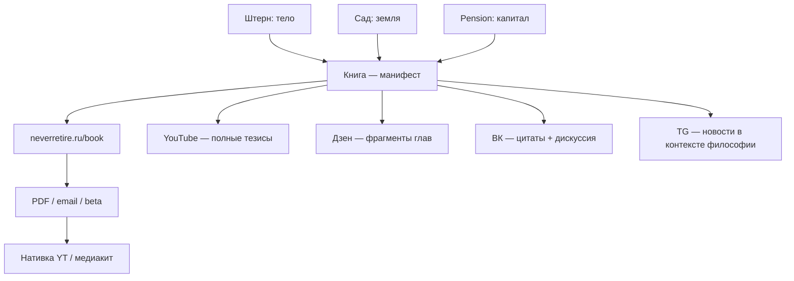

# Empire · Итоговая стратегия 2026

**Статус:** рабочий документ (июнь 2026).  
**Основание:** аудиты RAG/кода, Media Buyer ROI, диагностика заказчика, пивот на 2 флагмана, `empire_decisions_2026-05.md`, `empire_master_plan_rf_2026.md`, `pension_book_publish_tz.md`, `pension_youtube_roadmap_12m_2026.md`.  
**Чекпоинты:** `docs/gdepar_checkpoints.md`, `docs/empire_master_checkpoints.md`.

---

## 0. Главный вывод всех аудитов

| Что строили | Что получилось | Решение |
|-------------|----------------|---------|
| 4 TG-канала + RAG как **бизнес** | ~119 постов/нед, дистрибуция = только автопост, слабая реакция ЦА | **Не бизнес.** Спутники → воронки двух флагманов |
| Omni-media factory | Сильный **код** (gdepar.ru, парсеры, дашборд, approve) | Код **переиспользуем**, объём LLM **режем** |
| «Сначала аудитория» | Нет платящего клиента, нет каналов роста | Метрика = **лиды / продажи / подписчики на продукт**, не «посты в день» |

**Формула 2026:** 80% усилий → **Пенсия (книга + движение)** и **Где Пар (B2B-лиды)**. 20% → инфраструктура, Lenin-хобби, обслуживание спутников.

---

## 1. Два флагмана

### 1.1. Где Пар (gdepar.ru) — деньги B2B

**Продукт:** не «размещение на сайте», а **целевые лиды** (звонок, WhatsApp, бронь).

| Слой | Статус (июнь 2026) | Следующий шаг |
|------|-------------------|---------------|
| Каталог | OSM EUROPE_RU: **2233** бань, 56 регионов | Yandex enrich (телефоны, рейтинги) |
| MVP-схема | `banya_leads`, `partner_tier`, цены/вместимость | Owner dashboard + отчёт лидов |
| Лиды | `POST /api/banya/lead`, кнопка «Показать телефон» | Call tracking (Mango/Zadarma) |
| B2B | `/partners` | Первые 10 владельцев вручную, пилот Premium |
| Marketplace | — | Фаза 2 (веники, килты) |

**Монетизация (порядок):**
1. Бесплатное размещение + отчёт лидов → доверие  
2. Premium / «топ района» (фикс ₽/мес)  
3. CPA за подтверждённый звонок  
4. Marketplace (комиссия)

**KPI 90 дней:** 50+ опубликованных бань в MO/MSK/SPB, 100+ лидов/мес, 3 платящих партнёра.

### 1.2. На пенсию НИКОГДА — движение + книга

**Продукт:** книга = **манифест + trust asset + тематический движок** для neverretire.ru, YouTube, ВК, Дзен.

| Слой | Роль |
|------|------|
| **Книга** | Ядро философии: антихрупкость, вечное движение, анти-пенсия |
| **Сайт** | `/book` — чтение; `/buy` — PDF; email pre-launch |
| **YouTube** | 1 ролик/нед → нативная реклама (основной доход 12 мес) |
| **TG Pension** | Сырьё новостей + редкие `[ANALYSIS]` + цитаты из книги |
| **ВК + Дзен** | Лонгриды из глав и разборов → воронка на сайт |

**Связка тем движения** (единый манифест, не 4 отдельных бизнеса):
- Антихрупкость / смысл жизни (ядро книги)
- Тело: гиревой спорт, активность ← канал **Штерн** как спутник
- Земля: огород, автономия ← канал **Сад** как спутник
- Капитал: недвижимость, фондовый рынок РФ, золото ← **Pension** `[ANALYSIS]`

**Правило 70/30 до launch книги** (`pension_book_publish_tz.md`):
- 70% времени — текст книги + beta-читатели  
- 20% — сайт + 2–3 поста/нед из материала книги  
- 10% — оформление ВК/Дзен/YouTube  

**KPI 90 дней:** 70% черновика книги, 5 beta-отзывов, YouTube 4+ выпуска, Метрика на сайте, 8+ недель «присутствия» в ленте.

---

## 2. Спутники (не дойные коровы — lead-магниты)

| Персона | Режим | Постов/нед (цель) | CTA / воронка |
|---------|-------|-------------------|---------------|
| **Lenin** | Хобби, минимум API | 7–10 (было 21) | Донаты; без продуктов |
| **Garden** | Срез частоты | 7–10 (было 28) | Ссылка на neverretire.ru «земля и автономия»; PDF waitlist |
| **Stern** | Срез + живее | 7–10 (было 35) | Ссылка на neverretire.ru «тело и движение»; без агрессивных продаж курса |
| **Gdepar** | Поддержка карты | 10–14 (было 21) | UTM на gdepar.ru; 1 лонгрид/2 нед на Дзен |
| **Pension** | Ядро ленты | 7–10 | Книга, сайт, YouTube |

**Что выключить / не развивать:**
- Spy → черновик для Сад/Ленин  
- Нейрокомментинг вне Gdepar + Pension  
- LLM-слоты без уникальной базы (commodity-советы)  
- Масштабирование постов ради объёма  

**Что оставить из кода:**
- Curated: classic_banya, lenin PSS/book, raw_news Pension  
- RAG только где база уникальна (Lenin, Gdepar книги, Pension voices)  
- Approve в дашборде для всего публичного  

---

## 3. Дистрибуция (РФ без VPN)

```
Приоритет: ВК + Дзен + сайты  →  YouTube (Pension)  →  TG (ядро + модерация)
```

| Площадка | Gdepar | Pension | Спутники |
|----------|--------|---------|----------|
| **ВК** | Сообщество + карта | Группа «мысли» | Репост лучшего → ссылка на флагман |
| **Дзен** | Обзоры бань, UTM | Главы/разборы (фрагменты) | 1 статья/2 нед из лучшего поста |
| **YouTube** | — | 1 ролик/нед | Клип из ролика → ВК |
| **TG** | Промо карты | Новости + анонсы | Автопост с approve |

**Технический бэклог:** `VK_ACCESS_TOKEN` → `vk_wall` + `dzen_rss` из approve (код готовится).

---

## 4. Партизанщина (только флагманы)

| Механика | Gdepar | Pension | Остальные |
|----------|--------|---------|-----------|
| Spy (Telethon) | ✅ пилот | ✅ пилот | ❌ |
| Нейрокомментинг | ✅ после 7 д dry-run | ✅ осторожно | ❌ |
| OSM/Yandex парсер | ✅ | — | — |

`data/empire_flags.json`: `stop_spy: true` до готовности SIM/сессии.

---

## 5. Книга как движок экосистемы



**Контент-правило:** в соцсетях — **углы и фрагменты**; на сайте — **чтение**; в PDF — **полная версия**. Не лить всю книгу в Дзен.

---

## 6. Unit-экономика и время

| Ресурс | Потолок | Комментарий |
|--------|---------|-------------|
| Деньги | ~5 000 ₽/мес сейчас | VPS + домены + минимум API |
| Время заказчика | **уточнить** | Цель: 15–20 ч/нед, из них 12–16 на флагманы |
| LLM | Резать Stern/Garden слоты | Экономия 40–60% токенов |
| Посты | ≤50/нед суммарно | Было ~119 |

**Первые деньги (короткая дорога):**
1. Gdepar: 3 партнёра Premium вручную  
2. Pension: beta-книга + pre-sale PDF  
3. Garden/Stern: waitlist, не агрессивные продажи  

---

## 7. Дорожная карта по кварталам

### Q2 2026 (июнь – август) — «Фундамент»

| Неделя | Gdepar | Pension |
|--------|--------|---------|
| 1–2 | Yandex enrich MO/MSK/SPB; публикация топ-100 | Книга: +2 главы; `/book` актуален |
| 3–4 | Outreach 20 владельцам; отчёт лидов | YouTube №1–2; beta 3 читателя |
| 5–8 | Premium пилот; owner dashboard MVP | YouTube №3–6; ВК/Дзен оформление |
| 8+ | Marketplace ТЗ | 70% книги; медиакит v0 |

### Q3 2026 — «Launch»

- Книга: launch PDF + `/buy`  
- Gdepar: 10+ платящих партнёров  
- YouTube: outreach рекламодателям с 5k subs  
- VK wall live для всех персон  

### Q4 2026 — «Масштаб»

- Pension: стабильная нативка 70–120k ₽/мес (цель)  
- Gdepar: CPA-модель лидов  
- Spy/нейро в production на флагманах  

---

## 8. Что НЕ делать (антипаттерны из аудитов)

1. Не считать успехом «посты вышли без ошибки».  
2. Не плодить LLM-слоты без дистрибуции.  
3. Не продавать «размещение» владельцам бань — только лиды.  
4. Не запускать книгу без 8 недель присутствия и beta.  
5. Не тратить Spy/нейро на Сад/Ленин.  
6. Не обещать в Stern/Garden то, что ведёт в Pension, без явного CTA.  

---

## 9. Решения заказчика (июнь 2026) и рекомендации

### Зафиксировано

| Вопрос | Ответ |
|--------|--------|
| Приоритет 90 дней | **Параллельно 50/50** — оба флагмана |
| Время | **20+ ч/нед** (основная работа) |
| Книга | **Черновик 70%+**; дописать + вычитка к **концу июля 2026** |
| Лицо бренда | **Иосиф Борода** везде (сайт, YT, книга) |
| YouTube | Канал есть, **выпусков нет**; пока не занимался |
| ВК/Дзен | **Токен есть**, сообщества созданы; лонгриды **после финала книги** (черновики есть) |
| Сайт / TG Pension | Ведутся **время от времени** |
| **Launch PDF** | **Сентябрь 2026** — подтверждено |
| **Инвестиции в книге** | Общие принципы + **несколько тикеров для ориентира** + дисклеймер ИИР |

### Рекомендации (TBD → решение)

**Книга — роль в экосистеме** (было «не решил»):

| Модель | Вердикт |
|--------|---------|
| Манифест бесплатно | ❌ Обесценивает труд при 70% готовности |
| Премиум 1990+ без бренда | ❌ Рано |
| **Манифест + продукт** | ✅ **Рекомендуется** |

Конкретно:
- Бесплатно на сайте: введение + 1–2 главы  
- PDF: **690 ₽ pre-launch** (beta-читатели) → **990 ₽** после launch  
- Email за «полный оглавление + уведомление о выходе»  
- Дзен/ВК: **фрагменты**, не полный текст  

**Воронки в тексте книги → TG** (ваше сомнение обосновано):

| В книге | Не в книге |
|---------|------------|
| CTA → **neverretire.ru/book**, email, QR | «Подпишись на @канал» в каждой главе |
| Сноска: «углубить тему тела — раздел на сайте / канал Штерн» | Жёсткие воронки на 4 разных TG |
| Единый нарратив **антихрупкости** | 4 разрозненных «продажника» |

Книга продаёт **движение и автора**, сайт собирает **базу**; TG-каналы — **спутники**, не цель главы.

**Структура книги** (4 темы движения):

1. **Часть I — Манифест:** анти-пенсия, антихрупкость, вечное движение  
2. **Часть II — Тело:** гири, активность, офисное здоровье (тон Штерна, голос Бороды)  
3. **Часть III — Земля:** огород как автономия (тон Сада)  
4. **Часть IV — Капитал:** принципы + **2–5 тикеров как ориентиры** (не «купи X»)  
5. **Эпилог:** один CTA — сайт + движение  

**Инвестиции в книге** (зафиксировано июнь 2026):

→ **Общие принципы** (антихрупкость, классы активов, РФ-контекст) + **несколько тикеров для ориентира** (пример: ETF/ОФЗ/золото — без рекомендации «покупать»).  
Обязательно: **дисклеймер ИИР** на обложке, в PDF, в футере (`pension_book_publish_tz.md` §2.2).  
Формулировка: «упоминание не является рекомендацией»; нативка брокеров — на **YouTube**, не в теле книги.

**Дзен / лонгриды:** черновики есть; **приоритет — дописать книгу** (beta к концу июля), лонгриды — **после** финала текста, не параллельно с основным потоком.

**Где Пар — outreach:** `docs/gdepar_premium_outreach.md` + `scripts/gdepar_outreach_draft.py`

→ **Гибрид, тест на 10 владельцах:**  
- База бесплатно + еженедельный отчёт лидов  
- Premium **2 990 ₽/мес** — топ района + бейдж + приоритет в выдаче  
- Пилот CPA **300–500 ₽** за подтверждённый звонок (ручной учёт)  

**Launch-календарь (предложение):**

| Дата | Событие |
|------|---------|
| **Конец июля 2026** | Финал черновика + 5 beta-читателей |
| **Август** | Дописать книгу + beta; `/buy` pre-sale; публикация топ-100 бань MO/MSK/SPB; **лонгриды Дзен — не в приоритете** |
| **Сентябрь** | **Launch PDF** (подтверждено); YouTube выпуск №1 (из готовой главы) |
| **Октябрь+** | Outreach рекламодателям; Premium Gdepar |

### Распределение 25 ч/нед (50/50)

| Блок | ч/нед | Действия |
|------|-------|----------|
| **Пенсия** | ~13 | Книга 10 · сайт 1 · подготовка YT 2 *(лонгриды — после книги)* |
| **Где Пар** | ~12 | Outreach владельцам 4 · модерация/публикация 3 · продукт (лиды, enrich) 5 |

Спутники (Lenin/Garden/Stern/Gdepar TG): **≤3 ч/нед** — только approve лучших + 1 кросс-ссылка на флагман.

---

## 10. Еженедельный ритм (30–45 мин)

1. Лиды gdepar.ru + опубликованные бани  
2. Прогресс книги (главы / beta)  
3. YouTube + Дзен (1 метрика роста)  
4. Approve: ≤10 лучших постов спутников, остальное — skip  
5. Расходы API vs потолок  

Шаблон KPI: `docs/empire_kpi_sheets_template.md`.

**Детализация монетизации:** `docs/EMPIRE_EARNINGS_PLAN_2026.md` · unit-экономика Где Пар: `docs/gdepar_market_analysis_2026.md`

---

*Версия: 2026-06-22b. Launch PDF: сентябрь 2026.*
