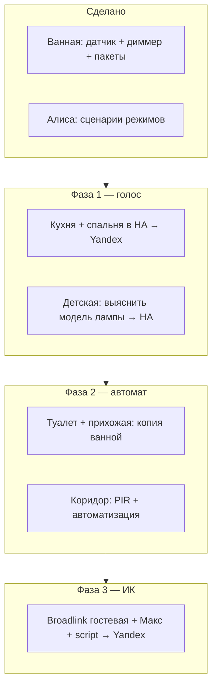

# Освещение и Алиса: план по комнатам (empire)

**Дата:** май 2026  
**HA:** ZHA + LocalTuya/Sonoff, Yandex Smart Home (Yaha Cloud)  
**Связанные гайды:** `HA_YANDEX_ALICE_SETUP.md`, `HA_MOTION_DIMMER.md`, `HA_DIMMER_INVERT.md`, `HA_YANDEX_IR_ALICE.md`

---

## 1. Принципы (рекомендации)

| Принцип | Зачем |
|---------|--------|
| **Один «источник правды» на комнату** | Либо автоматика HA, либо голос Алисы, либо ИК — не смешивать два облака на одну лампу |
| **Ванная / туалет / прихожая — без Алисы для света** | Только датчик + сценарий; меньше путаницы и рассинхрона |
| **Кухня, спальня, детские — Алиса «включи/выключи»** | `light.*` или `switch.*` в HA → Yandex Smart Home |
| **Гостевая + Макс — ИК, не «лампа 50%»** | В Алису отдавать **script** (сцены пульта), не притворяться `light` |
| **Имена и комнаты в HA = фразы Алисы** | Area **«Кухня»** → «включи свет **на кухне**» |
| **Не отдавать в УДЯ** | `input_boolean`, сырые диммеры с багом, тесты, `unavailable` |
| **Сначала HA, потом Алиса** | Устройство стабильно в HA → тест службами → одна строка в `yandex_smart_home.yaml` → reload → обновить УДЯ |

---

## 2. Матрица по комнатам

| Комната | Area (slug) | Свет | Алиса (голос) | Автоматика | Железо (план) |
|---------|-------------|------|---------------|------------|----------------|
| **Ванная** | `vannaya` | Диммер + присутствие | **Да** (`light.empire_vannaya_svet`) | Да: SNZB-06P, 20% ночью 01:00–05:50, выкл 30 с | ZHA — **готово** (`empire_motion_light.yaml`) |
| **Туалет** | уточнить* | Как ванная | **Нет** | Копия ванной: датчик + диммер/реле | ZHA датчик + диммер/реле |
| **Прихожая** | `prihozhaya` | Как ванная | **Нет** | То же | ZHA (датчик в пути / отдельная закупка) |
| **Коридор** | `koridor` | По **PIR** | **Нет** (обычно) | Вкл по движению, выкл через N с/мин | ZHA PIR + реле/лампа |
| **Кухня** | `kuhnya` | Ручной + розетки | **Да** вкл/выкл | По желанию позже | LocalTuya выключатель/лампа |
| **Спальня** | `spalnya_roditeley` | Ручной | **Да** | По желанию | Выключатель Wi‑Fi / Zigbee |
| **Детская 1** | `komnata_semiona` или др. | Уже в Алисе через стороннее приложение | **Да** (после переноса в HA) | Позже | См. §4 |
| **Детская 2 (Макс)** | `komnata_maksa` | Пульт ИК | **Да** — **сценарии** | Опционально позже | Broadlink + script |
| **Гостевая** | `gostevaya` | Пульт ИК | **Да** — **сценарии** | Опционально | Broadlink + script |

\*Отдельная area **«Туалет»** в HA — создать, если ещё нет (не путать с «Ванной»).

---

## 3. Типы сценариев (шаблоны)

### A. «Умная ванная» (ванная, туалет, прихожая)

Уже реализовано для ванной. Для туалета/прихожей — **скопировать** пакет с новыми `entity_id` и `id` автоматизаций.

| Параметр | Ванная (сейчас) | Туалет / прихожая (настроить) |
|----------|-----------------|-------------------------------|
| Датчик | `binary_sensor.sonoff_snzb_06p` | свой SNZB-06P или аналог |
| Свет | `light.empire_vannaya_svet` (template) | `light.empire_<komnata>_svet` |
| Ночь 20% | 01:00–05:50 МСК (только расписание) | тот же или свой интервал |
| Выкл после ухода | 30 с | 30–60 с (PIR/mmWave) |
| Алиса | не в `yandex_smart_home.yaml` | не включать |

Файлы: `empire_motion_light.yaml` → позже `empire_motion_light_tualet.yaml`, `empire_motion_light_prihozhaya.yaml`.

### B. «Коридор по PIR»

Отличие от mmWave: PIR даёт импульс «движение», часто **короче** задержка выкл.

```text
PIR on  → light.turn_on (100% или ночь 20% если rezhim_noch / расписание)
PIR off → подождать 1–2 мин → light.turn_off
```

Рекомендации:

- **Не** ставить `for: 30 seconds` на `off` PIR, если датчик мигает — лучше таймер «нет движения N мин» или `wait_for_trigger` с restart.
- Ночь: те же 20% что в ванной **или** свой % — одно правило на весь дом проще (`rezhim_noch`).
- Ложные срабатывания: чувствительность в ZHA, положение датчика не на батарею отопления.

Пакет: `empire_motion_pir_koridor.yaml` (когда будет entity PIR).

### C. «Голос вкл/выкл» (кухня, спальня, детская после HA)

| В HA | В Алисе |
|------|---------|
| `light.kuhnya_*` или `switch.kuhnya_svet` | «включи свет на кухне» |
| Area = **Кухня**, имя в YAML: **Свет** | |

Добавление в `yandex_smart_home.yaml`:

```yaml
filter:
  include_entities:
    - light.kuhnya_potolok   # подставить реальный entity_id
entity_config:
  light.kuhnya_potolok:
    name: Свет
    room: Кухня
```

Только **`light`** даёт «на пятьдесят процентов»; **`switch`** — только вкл/выкл.

### D. «ИК-лампа» (гостевая, Макс)

| В HA | В Алисе |
|------|---------|
| `script.gostevaya_svet_vkl` / `vykl` / `teplyy` | «запусти сценарий свет гостевая» |
| **Не** `light.*` без обратной связи | |

Подробно: `HA_YANDEX_IR_ALICE.md`.

---

## 4. Детская: Citilux Smart (лампа в Алисе, не в HA)

**У вас:** **Citilux Smart** → приложение **Smart Life** → чип **Tuya Wi‑Fi** → Алиса сейчас через партнёра в «Дом с Алисой», в HA пусто.

**Путь:** **LocalTuya** (как остальной Tuya в квартире) → `light.*` → Yandex Smart Home.

Пошагово: **`docs/HA_CITILUX_SMART.md`**.

После HA — **убрать дубликат** люстры из прямой привязки Smart Life/Tuya в УДЯ, оставить только **Yaha Cloud**.

Другие бренды (если вдруг не Citilux):

| Приложение / бренд | Путь в HA | Комментарий |
|--------------------|-----------|-------------|
| **Tuya / Smart Life** | **LocalTuya** | Citilux Smart, многие «умные» люстры |
| **Xiaomi / Mi Home** | Xiaomi Miio / BLE | Иногда только облако |
| **Yeelight** | Yeelight | Локально возможно |
| **Свет от Яндекса** (лампа-партнёр УДЯ) | Часто **только** в приложении Дом с Алисой | Перенос в HA сложен; рассмотреть замену на Tuya/Zigbee |
| **Неизвестный Wi‑Fi** | Поиск по MAC в роутере | [Tuya-Convert](https://github.com/ct-Open-Source/tuya-convert) только старые прошивки — осторожно |

**Чеклист диагностики (15 мин):**

1. Какое **приложение** на телефоне управляет лампой?  
2. **Настройки → О устройстве** в приложении — модель, Wi‑Fi 2.4 GHz?  
3. В роутере — **IP/MAC** лампы; по MAC узнать производителя.  
4. HA → **Настройки → Устройства → Добавить** — ищется ли интеграция?  
5. Если Tuya — **удалить Tuya Cloud** в HA, добавить **LocalTuya** (ключи с [tuya-local](https://github.com/make-all/tuya-local-keys) или подобное).

**Рекомендация:** не держать лампу **только** в облаке Яндекса и **отдельно** в HA — выберите **HA как центр**, Алиса — голос поверх HA (как для всей квартиры).

---

## 5. Алиса: что отдавать в УДЯ (актуальный список)

### Сейчас (без света ванной)

- Сценарии режимов: **Ночь**, **Ушёл**, **Дети спят**, **Отпуск** (+ выключить каждый).  
- **Без** `light.empire_vannaya_svet` и без сырого `light.tz3000_*`.

### По мере монтажа (добавлять в `yandex_smart_home.yaml`)

| Комната | Сущности в Алисе |
|---------|------------------|
| Кухня | `light.*` или `switch.*` |
| Спальня | `light.*` / `switch.*` (в Алисе комната **«Спальня»**) |
| Детская (после HA) | `light.*` |
| Гостевая / Макс | `script.*` (ИК), не light |

### Никогда не отдавать

- Ванная, туалет, прихожая, коридор — **автосвет** (если не передумаете).  
- `input_boolean.rezhim_*` напрямую — только через **script**.  
- `binary_sensor.*` датчиков, template ночи ванной.  
- `script.empire_test_telegram`.

Гайд по шагам: `HA_YANDEX_ALICE_SETUP.md`.

---

## 6. Очередность внедрения (рекомендуемая)



| # | Задача | Результат |
|---|--------|-----------|
| 1 | Залить `empire_vannaya_dimmer_fix.yaml`, обновить `yandex_smart_home.yaml` (без ванной) | Стабильная ванная, Алиса без света там |
| 2 | LocalTuya/Sonoff: **кухня**, **спальня** | Голос «включи свет…» |
| 3 | Детская лампа: модель → HA | Один голосовой контур |
| 4 | Туалет + прихожая: датчики + yaml-пакеты | Как ванная |
| 5 | Коридор: PIR + `empire_motion_pir_koridor.yaml` | Свет по движению |
| 6 | 2× Broadlink (или 1 с проверкой дальности) | Гостевая + Макс |

---

## 7. Что усовершенствовать в репозитории (по желанию)

| Улучшение | Зачем |
|-----------|--------|
| `empire_motion_light_tualet.yaml` / `_prihozhaya.yaml` | Копии ванной с комментариями «подставь entity» |
| `empire_motion_pir_koridor.yaml` | Отдельная логика PIR |
| `empire_ir_gostevaya.yaml`, `empire_ir_maks.yaml` | ИК-скрипты + Yandex |
| Общий template **ночная яркость** `binary_sensor.empire_noch_svet` | Один интервал 01:00–05:50 для всех автокомнат |
| Ярлык HA `alice` на сущностях | Альтернатива YAML-фильтру для точечного добавления |
| Строка в `HA_DEVICE_INVENTORY.md` | Туалет / прихожая / коридор |

Скажите, когда будут entity_id туалета/коридора — можно сразу сгенерировать yaml-пакеты.

---

## 8. Риски и как их избежать

| Риск | Мера |
|------|------|
| Два «дома» (лампа в приложении Tuya + Алиса напрямую) | Только HA + Yandex Smart Home |
| ИК и настенный выключатель 220 V | Пользователь выключил стеной — HA не знает; принять или умная лампа в цепи |
| PIR в коридоре дергает часто | Задержка выкл 90–120 с, не 30 с |
| Диммер с инверсией on/off | Template `light.empire_*_svet` (как ванная) |
| Перегруз УДЯ лишними устройствами | YAML `filter` строго по списку |

---

## 9. Фразы Алисы (шпаргалка)

| Задача | Пример |
|--------|--------|
| Режим ночь | «Алиса, запусти сценарий ночь» |
| Свет кухня | «Алиса, включи свет на кухне» |
| Свет спальня | «Алиса, включи свет в спальне» |
| ИК гостевая | «Алиса, запусти сценарий свет гостевая» (имя = `entity_config.name`) |
| Ванная | голосом не управляем — только датчик |

---

## Связанные файлы

| Файл | |
|------|--|
| `homeassistant/yandex_smart_home.yaml` | список для УДЯ |
| `homeassistant/packages/empire_motion_light.yaml` | ванная |
| `homeassistant/packages/empire_vannaya_dimmer_fix.yaml` | template-свет |
| `docs/HA_YANDEX_ALICE_SETUP.md` | настройка Yaha Cloud |
| `docs/HA_DEVICE_INVENTORY.md` | железо |
