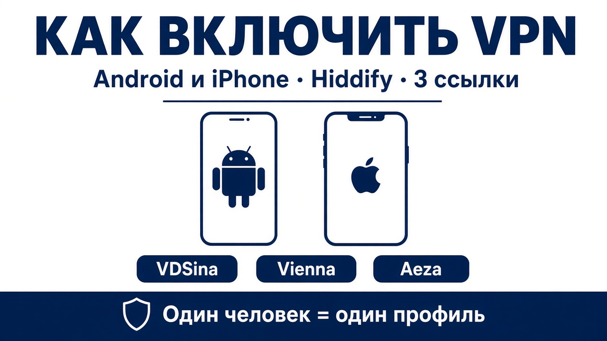
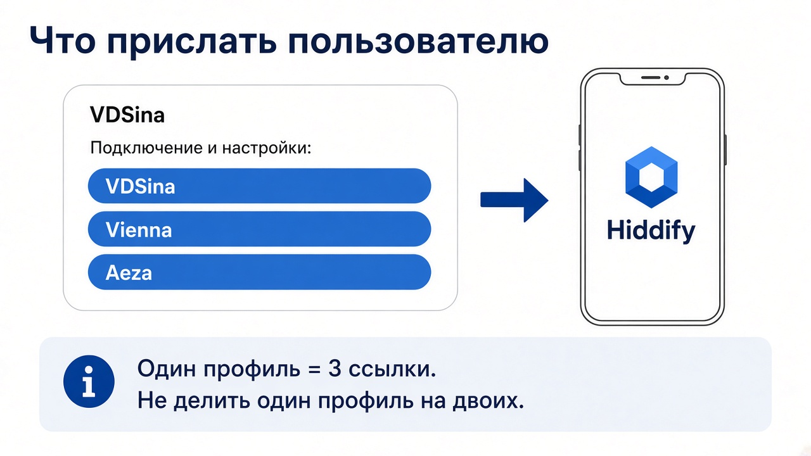
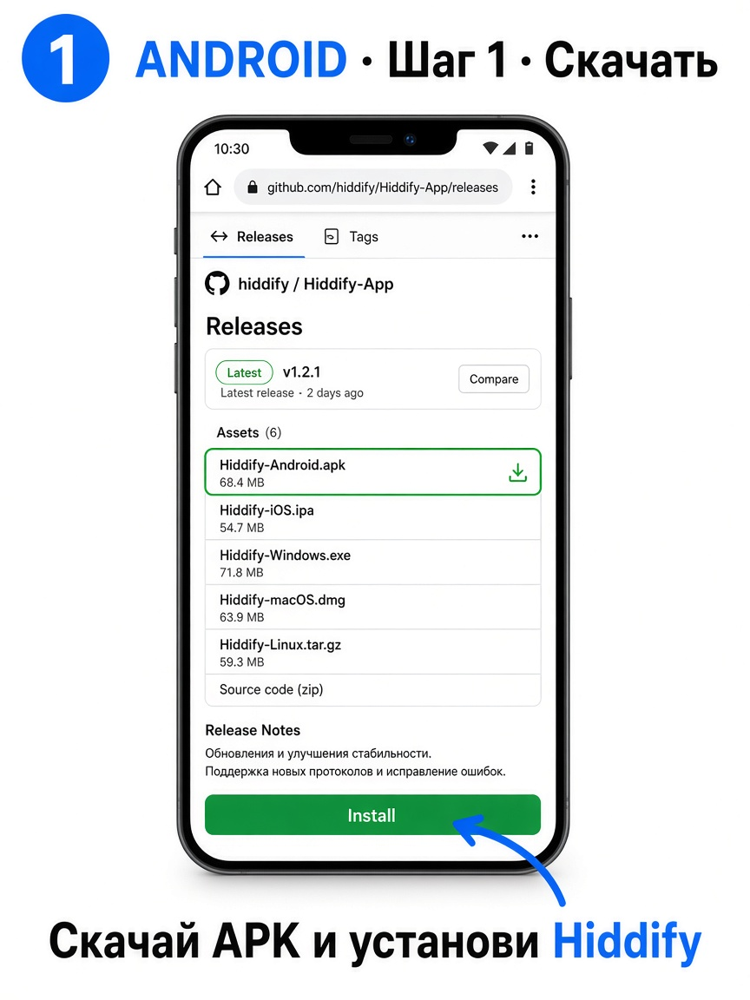
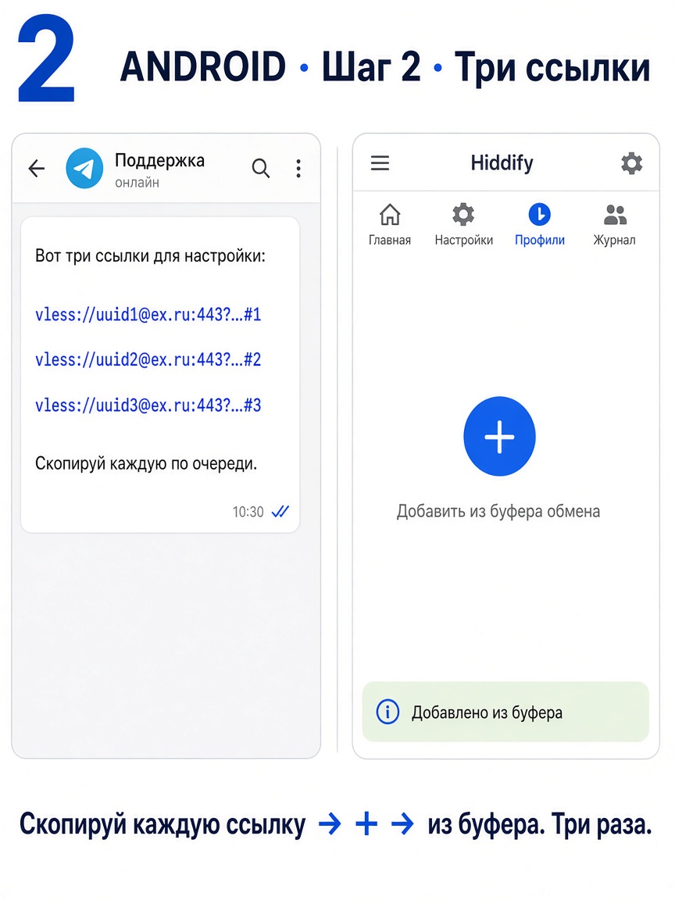
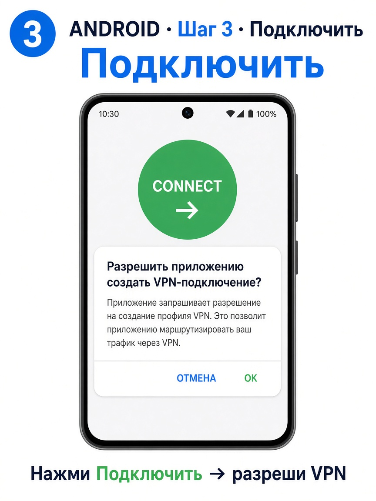
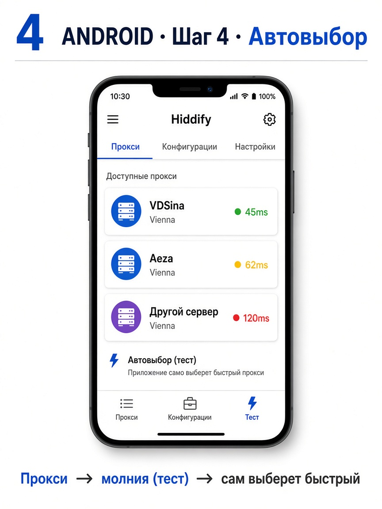
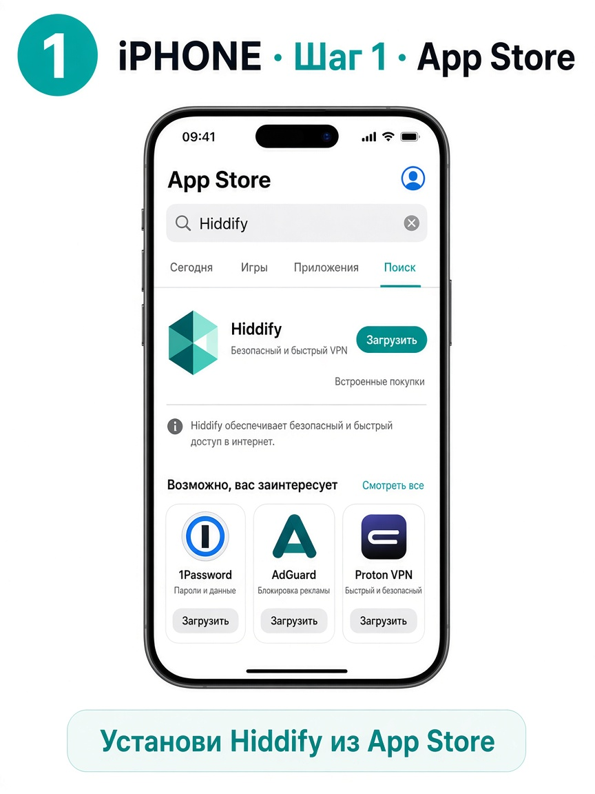
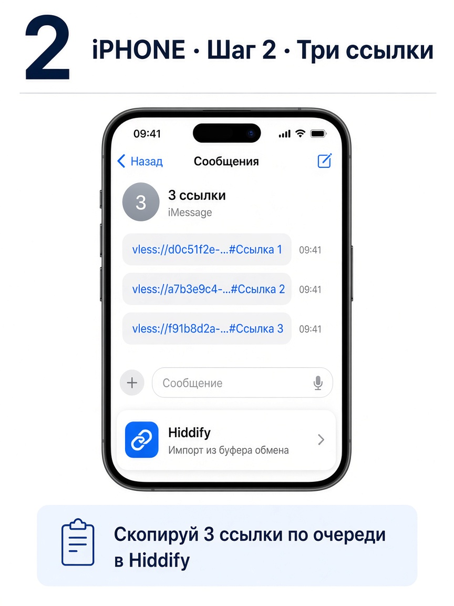
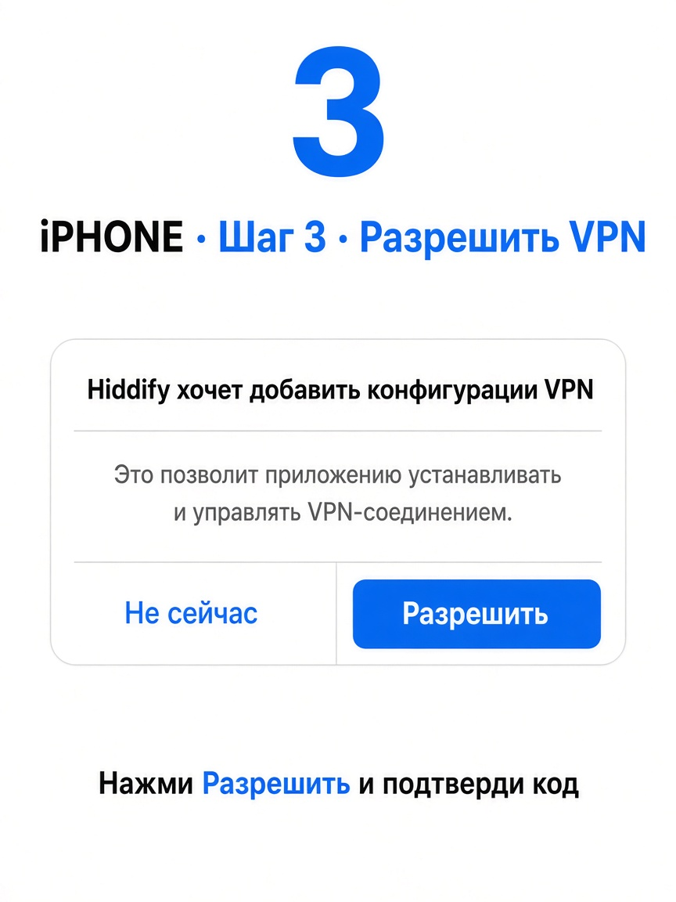
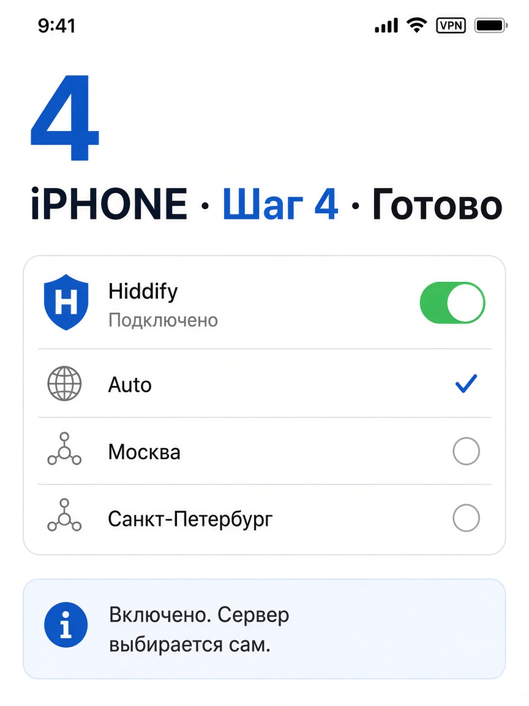

# Как включить VPN (картинки)

Только **Hiddify**. Вам пришлют **3 ссылки** — вставьте все.

---

## Обложка

---

## Android

Ссылка на APK: https://github.com/hiddify/hiddify-app/releases

---

## iPhone

---

## Если дома на Wi‑Fi Destroy

VPN на телефоне **не нужен** — интернет уже через роутер.  
Hiddify включайте **вне дома** (мобильный интернет, гости).
