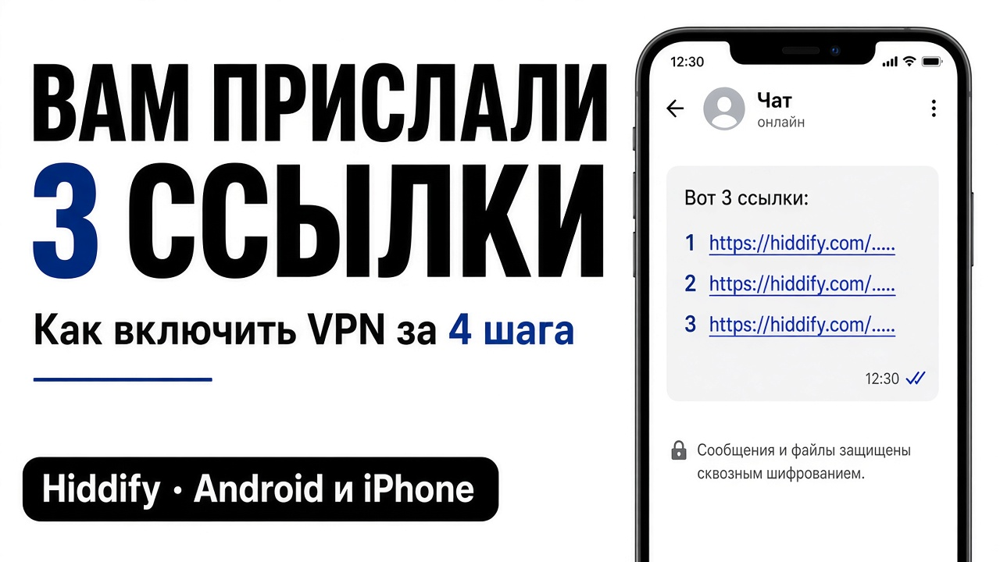
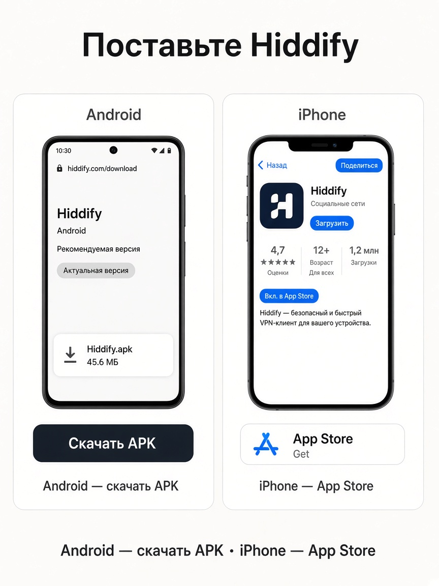
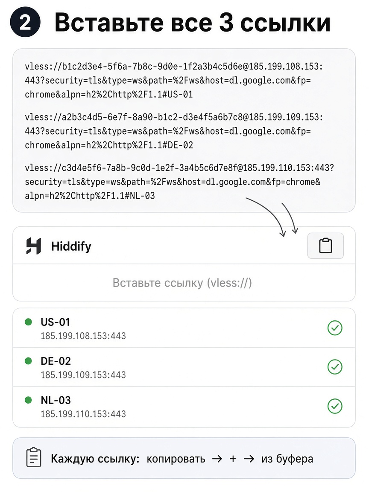
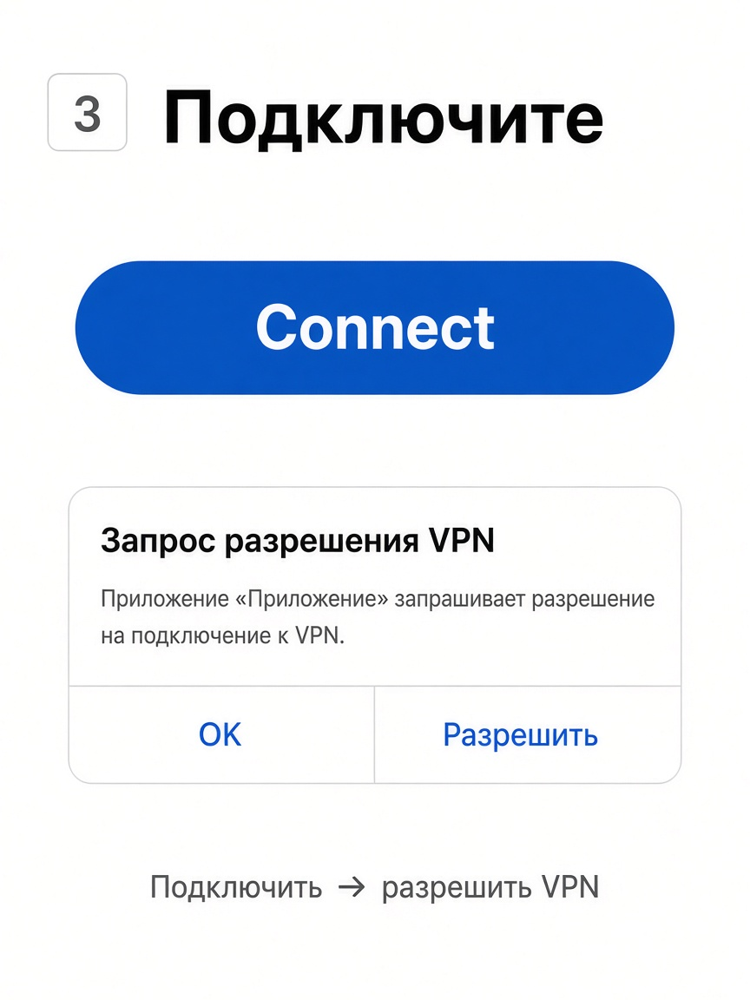
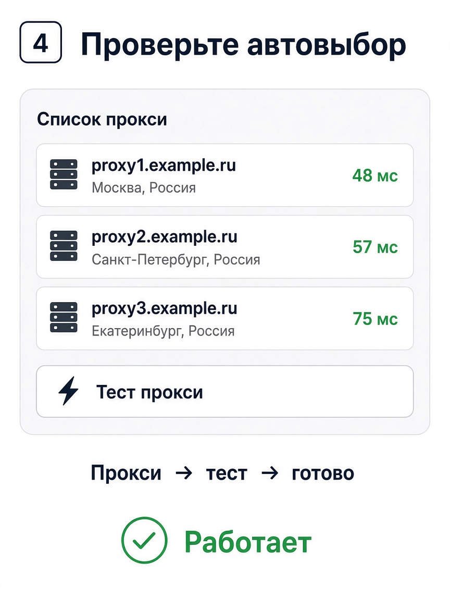

# Вам прислали 3 ссылки — как включить VPN

Это инструкция **для вас**, с момента, когда в чат пришли три строки `vless://…`.

---

## Шаг 1. Поставьте Hiddify

- **Android:** скачайте APK → https://github.com/hiddify/hiddify-app/releases → установите  
- **iPhone:** App Store → найдите **Hiddify** → Установить  

---

## Шаг 2. Вставьте все 3 ссылки

1. Откройте сообщение с тремя ссылками.  
2. Скопируйте **первую** целиком (`vless://…`).  
3. В Hiddify нажмите **+** → **из буфера**.  
4. Так же **вторую** и **третью**.  

В списке должно быть **три** сервера. Одну ссылку пропускать нельзя.

Имена примерно: `1-VDSina-…`, `2-Aeza-…`, `3-CF-…`. Третий — запас через Cloudflare (может быть чуть медленнее).

---

## Шаг 3. Подключите

1. Нажмите **Подключить**.  
2. Разрешите **VPN**, когда спросит телефон.  
3. Дождитесь зелёного статуса.

---

## Шаг 4. Автовыбор

1. Откройте вкладку **Прокси**.  
2. Нажмите кнопку **теста** (молния).  
3. Готово — приложение само выберет рабочий сервер.

Проверка: откройте YouTube. Должен грузиться.

---

## Важно

- Ссылки **только ваши** — никому не пересылайте.  
- Если один сервер «не коннектится» — это нормально, работают другие.  
- Дома на своём Wi‑Fi VPN на телефоне часто **не нужен**. Включайте в метро, в гостях, на LTE.  
- На Android выключите **Частный DNS** (Настройки → Сеть → Частный DNS → Выкл). Иначе телефон шлёт DNS в пустой адрес и Telegram не открывается, хотя VPN «подключён».  
- Пока проверяете Hiddify, выключите Amnezia. Два VPN сразу ломают DNS.  
- В самом Telegram прокси должен быть выключен.
