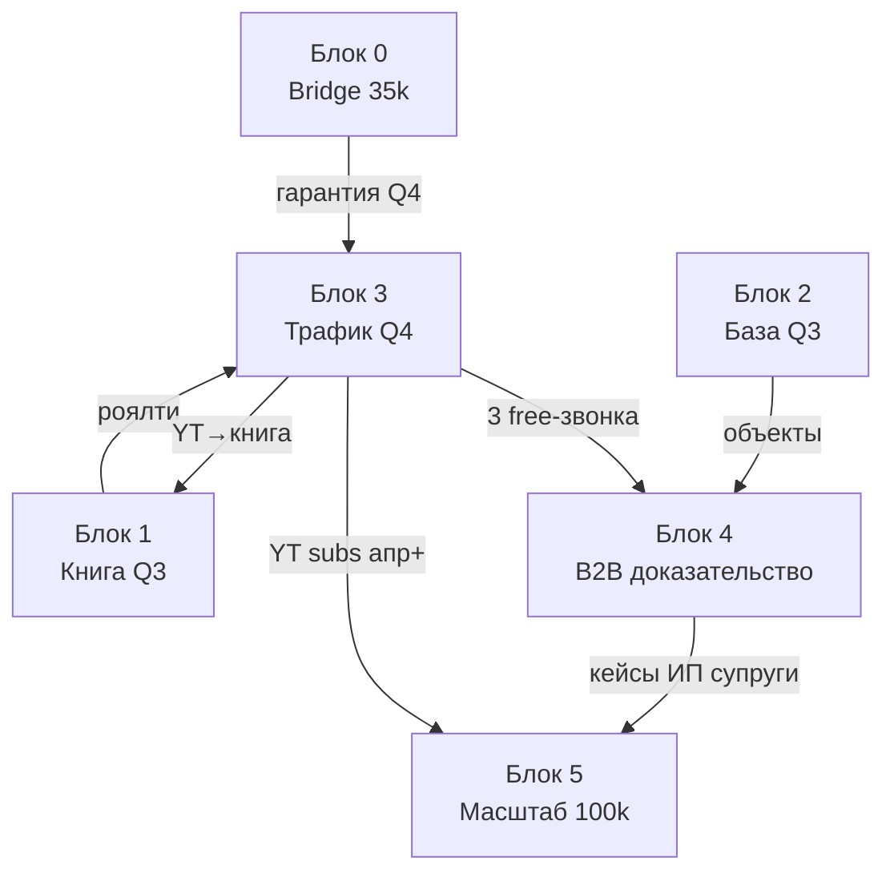

# Пайплайн · 6 блоков Canvas v3 (Gemini R3)

`data/obsidian_vault/Empire/_canvas/empire-pipeline-2026.canvas`

---

## Блок 0 · Bridge Capital [NEW]

| | |
|--|--|
| **Сумма** | **35 000 ₽** |
| **Функция** | Директ до 15.11 независимо от launch книги |
| **Не путать** | С выручкой книги (16 250 ₽ net ≠ хватает на окт) |

---

## Блок 1 · Пенсия контент (Q3)

- Книга + TG, **14–16 ч/нед**
- Деньги на **автора** (роялти)
- Выход: launch **299 ₽**, warm-база

---

## Блок 2 · Где Пар база (Q3)

- Парсинг 500+, SEO-закладка, **2–3 ч/нед**
- **0** продаж, **0** Директа

---

## Блок 3 · Трафик (Q4)

- Директ 12k + коллтрек, **стоп-лосс 15.11**
- YT 1/нед → **только книга 399 ₽**, **0 внешней рекламы**
- Финансирование: **Bridge 0** + книга (доп.)

---

## Блок 4 · B2B доказательство (Q4 – Q1)

- **ИП супруги:** депозиты, Premium
- **20 free Premium** + **триал 3 звонка → блок → 4k**
- **Январь 1–15:** 0 продаж
- **10–28 фев:** первые Premium

---

## Блок 5 · Масштаб (Q2–Q4 27)

- Premium 3–4 новых/мес (churn 12%)
- **Первая нативка 8k: апр–май 27**
- **100k net: ноябрь 27**

---

## Edges

1. B0 → B3: гарантия Q4  
2. B1 → B3: роялти (недостаточно alone)  
3. B2 → B4: объекты  
4. B3 → B4: звонки, триал  
5. B3 → B1: YT → книга  
6. B4 → B5: кейсы  
7. B3 → B5: нативки (с апр)

---

*R3: `12_GEMINI_R3.md` · Календарь: `08_PIPELINE_YEAR.md`*
