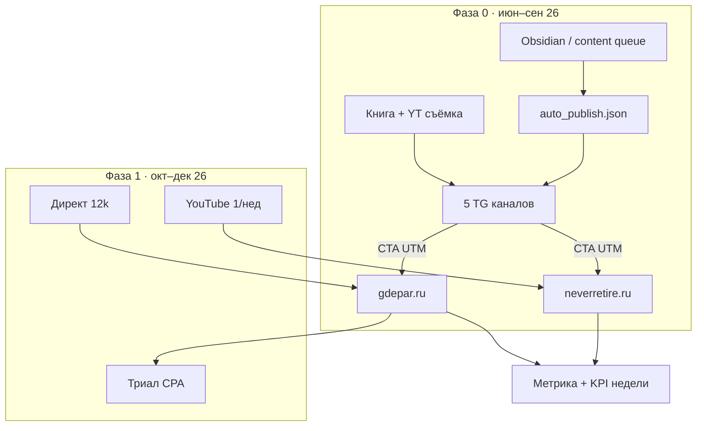

# Пайплайн R5 · автопост + метрики (июнь 2026)

**Дата:** 2026-06-29  
**Предыдущая ревизия:** R4 (`08_PIPELINE_YEAR.md`, `13_GEMINI_R4.md`)  
**Что изменилось:** единый автопост во **все 5 TG** (`data/auto_publish.json`); ручной approve сжат до ритуала.

**Финмодель по деньгам не переписываем** — см. `05_FINANCIAL_MODEL.md`. R5 меняет **операционку**, **метрики** и **перераспределение времени**.

---

## 1. Пайплайн (обновлённая схема)



### Слой Omni-publish (✅ июнь 26)

| Персона | Постов/день | Curated | LLM approve |
|---------|-------------|---------|-------------|
| Gdepar | 3 | 15:00 | 11, 21 |
| Lenin | 3 | 12:00 | 10, 19 |
| Stern | 4–5 | 09:00 | техника, рутина |
| Garden | 2–3 | — | все |
| Pension | 2 | — | raw + analysis |

Детали: `docs/empire_autopost_strategy_2026.md` · ритуал: `02-omni-publish.md`.

### Что **не** меняется (монетизация R3/R4)

| Веха | Дата |
|------|------|
| Pre-sale PDF **149 ₽** | август 26 |
| **Launch 299 ₽** | **15 сентября 26** |
| YT публикация №1 | **1 сентября 26** (монтаж в августе) |
| Bridge **35k** + НПД супруги | до **01.10.26** |
| Директ + триал CPA | октябрь 26 |
| Стоп-лосс CPL **450 ₽** | **15.11.26** |
| Premium платный | **10–28 фев 27** |
| 1-я нативка **8k** | **апр–май 27** |
| **100k net/мес** | **ноябрь 27** |

---

## 2. Перераспределение времени (главный эффект R5)

| Блок | ч/нед было | ч/нед R5 | Куда ушли часы |
|------|------------|----------|----------------|
| Книга (финал, beta) | 14–16 | **14–16** | защитить |
| YT съёмка/монтаж | 2–4 | **6–8** | ↑ критический путь |
| TG ручной approve | 3–5 | **1** | ритуал + queue |
| Автопост smoke | 0 | **~1** | 15 мин/день |
| Gdepar парсинг/SEO | 2–3 | 2–3 | без изменений |

**Правило:** освобождение от ручного TG **не** тратить на новые фичи сайта — только **книга + yt-001…002 к августу**.

---

## 3. Метрики (три уровня)

### Уровень A · еженедельный ритуал (воскресенье)

Заполнять в дашборде **P&L · Финансы** или CSV `templates/empire_weekly_kpi_template.csv`.

| Метрика | Колонка KPI | Зелёный ориентир Q3 | Зачем |
|---------|-------------|---------------------|-------|
| Посты опубликованы | `tg_posts_published` | ≥70/нед (5 каналов × ~14) | автопост жив |
| Сбои автопоста | `autopost_failures` | **0** | качество пайплайна |
| Email `/gift` | `gift_emails` | **50** к 31.08 | воронка launch |
| Показы телефона gdepar | `gdepar_phone_reveals` | рост с окт | B2B-доказательство |
| Pension TG subs | `pension_tg_subs` | +30–50/мес | прогрев книги |
| Сессии neverretire | `pension_site_sessions` | ≥500/мес к launch | трафик с TG |
| Клики `/buy` | `pension_buy_clicks` | рост к 15.09 | готовность launch |
| OpenRouter ₽/нед | `openrouter_spend_rub` | ≤400 | маржа LLM |

Как считать `tg_posts_published` / `autopost_failures`:

```bash
journalctl -u empire --since "7 days ago" | grep -c '\[autopublish\] published'
journalctl -u empire --since "7 days ago" | grep -c '\[autopublish\] skip'
```

### Уровень B · Метрика (после счётчиков)

**gdepar.ru** — `docs/metrika_goals_setup.md`:

| KPI | Цели Метрики | Решение |
|-----|--------------|---------|
| CR1 ассистента | `submit` → `pick` / `phone` | LLM_PCT 25→50? |
| Воронка карты | `gdepar_phone_click` | кейс для Premium |
| TG-трафик | UTM `telegram` | посты с CTA работают? |

**neverretire.ru** — отдельный счётчик:

| KPI | Цель | Решение |
|-----|------|---------|
| `/gift` submit | `pension_gift_email` | посевы август |
| `/buy` click | `pension_buy_click` | launch 15.09 |
| YT переход | UTM `youtube` | ролики конвертят |

### Уровень C · бэклог (август+)

В `analytics.db` (пока вручную или дашборд):

- `tg_post_published` + `views_24h`, `forwards`
- отчёт «лучший слот по persona» раз в 2 недели
- A/B: 3 vs 4 поста/день на одном канале (4 недели)

---

## 4. Триггеры решений (когда менять план)

| Сигнал | Когда смотреть | Действие |
|--------|----------------|----------|
| `autopost_failures` >3/нед | еженедельно | smoke + queue + `verify_posting_matrix.py` |
| OpenRouter >600 ₽/нед | еженедельно | срезать LLM-слоты, больше curated |
| `gift_emails` <20 к 15.08 | 15 августа | усилить посевы TG, не сдвигать launch |
| `pension_buy_clicks` = 0 к 01.09 | 1 сентября | **блокер launch** — `/buy` + Метрика |
| CR1 gdepar <5% после 4 нед Метрики | ноябрь | CPL-стоп 15.11, не повышать LLM |
| Launch <25 продаж к 30.09 | 30 сентября | не стартовать Директ 12k без bridge |

---

## 5. Чувствительность финмодели (автопост)

Автопост даёт **+10–20%** к launch-книге только при стабильном TG **и** работающей воронке `/gift` → email.

```bash
# база
./venv/bin/python scripts/empire_finance_simulator.py

# оптимистичный launch (+20% продаж)
./venv/bin/python scripts/empire_finance_simulator.py --book-launch 60
```

Δ net на launch: **~+2 600 ₽** — не меняет годовую картину (120–180k).

---

## 6. Сводка «что делать в июле»

1. **Метрика** — оба счётчика (блокер измерений).
2. **Книга** — 100% черновик + beta 5.
3. **YT** — канал + съёмка yt-001, yt-002 (монтаж в августе).
4. **`/buy` + pre-sale** — tripwire к 1 августа.
5. **KPI недели** — первую строку с новыми колонками.
6. **Автопост** — только ритуал + подпитка queue (не масштабировать слоты).

---

*Связь: `EMPIRE_PIPELINE_CHECKLIST.md` · `09_PROGRESS_TRACKER.md` · `empire_kpi_sheets_template.md`*
