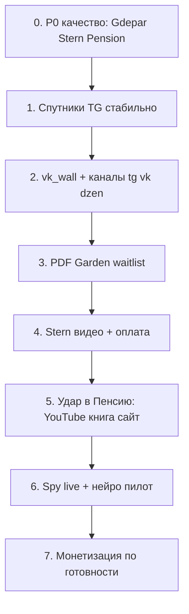

# Мастер-план Empire 2026 (РФ без VPN): дистрибуция, монетизация, качество

**Статус:** утверждено заказчиком (май 2026).  
**Решения:** `docs/empire_decisions_2026-05.md`  
**Включено в:** `TZ_OMNI_MEDIA_EMPIRE_FINAL.md` §14–17.  
**Бизнес-план, расходы, доходы, KPI:** `docs/empire_business_plan_2026.md` · учёт: `data/empire_finance_ledger.json`  
**Рост без MAX + чеклисты Obsidian:** `docs/growth_rf_no_max_2026.md` · `templates/obsidian_growth_rf_2026.md`

---

## 1. Контекст

| Факт | Следствие для Empire |
|------|---------------------|
| Telegram в РФ — в основном через VPN | TG = архив/модерация/автоген, **не** главный канал роста |
| ВК, Дзен, MAX — без VPN | **Привлечение и удержание** — там |
| 7 подписчиков Garden | сначала **аудитория**, потом жёсткая монетизация |
| Инфопродукты Garden + Stern | контент PDF/бот готов частично |

---

## 2. Дистрибуция по персонам (ВК → Дзен → связка)

### 2.1. Сводная таблица

| Персона | ВК / сообщество | Дзен | MAX | TG Empire | Приоритет роста |
|---------|-----------------|------|-----|-----------|-----------------|
| **Garden** (Степаныч) | **Да, №1** | **Да, №1** | Позже | Вспомогательный | **Сейчас** — матрица 14 рубрик: `docs/garden_posting_matrix_2026.md` |
| **Stern** (Штерн) | **Да** | Да (статьи из постов) | Позже | Вспомогательный | После 3 уроков на видео |
| **Gdepar** (Михалыч) | **Да** | Да (обзоры, карта) | Позже | Промо сайта | Параллельно с картой |
| **Pension** | Группа + сайт | **Да** (статьи → neverretire.ru) | Опционально | Сводки/сайт | По желанию редактора |
| **Lenin** | **Да, осторожно** | **Да, нишево** | Нет приоритета | Донаты (VPN) | После оформления ВК |

### 2.2. Garden — эталонная схема

Подробно: `docs/garden_growth_rf_no_vpn.md`. **Телеграм-рубрики и слоты (14 тем):** `docs/garden_posting_matrix_2026.md`.

| Шаг | Действие |
|-----|----------|
| 1 | Сообщество ВК: оформление, закреп, 10–15 постов из tripwire |
| 2 | Дзен: статья «7 ошибок», в конце — ссылка на ВК |
| 3 | Клипы ВК 1/нед |
| 4 | PDF в документах ВК / продажа позже |
| 5 | Empire: автопост TG; ВК+Дзен — **та же кнопка publish** после `VK_ACCESS_TOKEN` |

### 2.3. Stern

| Элемент | Рекомендация |
|---------|----------------|
| ВК | «Железная спина · офисный размин» — короткие посты, 1 упражнение/нед + ссылка на бот |
| Дзен | Статьи «поясница / сидячая работа» (из постов канала) |
| TG | Автопост + бот tripwire (VPN-аудитория) |
| Не делать | Агрессивные продажи до съёмки 3 уроков |

### 2.4. Gdepar

| Элемент | Рекомендация |
|---------|----------------|
| ВК | Сообщество «Где пар · баня» — **не** только Михалыч, акцент на **карту gdepar.ru** |
| Дзен | «Как выбрать баню», «ошибки в парилке» — с UTM на карту |
| TG | Еженедельный промо карты (уже в расписании) |
| Контент | Исправить повторы в автопосте (§6) |

### 2.5. Pension

| Элемент | Рекомендация |
|---------|----------------|
| Якорь | **neverretire.ru** (уже есть) |
| Дзен | Статьи с канала + книга; RSS `dzen_rss` |
| ВК | Опционально «На пенсию никогда — мысли» |
| Режим постов | **Два режима** (§8): сырьё новостей vs разбор — см. доработку |

### 2.6. Lenin — нужен ли ВК/Дзен?

**Да, но иначе чем Garden.**

| Зачем | Как |
|-------|-----|
| Охват без VPN | ВК-сообщество «история / марксизм» — спокойный тон |
| Дзен | Длинные разборы, календарь «в этот день» |
| Донаты | **ВК** + Stars/TG вторично; тексты «фонд канала» (уже в `lenin_support_copy.json`) |
| Риски | Без лозунгов, без призывов к уличным действиям; только анализ и архив |

TG-канал Ленина можно оставить для ядра; рост — **ВК + Дзен**.

---

## 3. Очередность работ (рекомендуемая)



**Порядок спутников (12B):** Сад → Гдепар → Штерн → Ленин → **Пенсия (главный проект)**.

### Фаза A — срочно (1–2 недели)

| # | Задача | Артефакт |
|---|--------|----------|
| A1 | **Gdepar:** усилить анти-повторы (семейства тем + бан клише) | меньше «верхняя полка» |
| A2 | **Stern:** превью в TG — фото+текст одним сообщением где возможно | правка `notify_admin` |
| A3 | **Garden:** автопост TG; оформление ВК/Дзен (один раз) + vk_wall после токена | рост без ручного копипаста |
| A4 | **Pension:** режим «лента новостей» без водянистой сводки | §8, код |

### Фаза B — продукт (2–4 недели)

| # | Задача |
|---|--------|
| B1 | Garden: выдача PDF в боте (без оплаты или waitlist) |
| B2 | Stern: съёмка 3 уроков → tripwire 390 ₽ |
| B3 | `VK_TOKEN` + публикация `vk_wall` из дашборда |
| B4 | Дзен RSS для garden/stern после approve |

### Фаза C — рост (1–3 месяца)

| # | Задача |
|---|--------|
| C1 | Telethon Spy **live** (🔑 сессия) |
| C2 | Нейрокомментинг: 7 дней dry-run → 5 комм/день live |
| C3 | Spy → черновик для «взлётевших» постов конкурентов |
| C4 | Shorts сценарии → ВК клипы |
| C5 | YooKassa + продажи PDF Garden / Stern |

### Фаза D — не сейчас

- Покупка подписчиков  
- Масштаб рекламы до 100+ подписчиков ВК  
- PostgreSQL, видео-рендер  

---

## 4. Чеклист реализации ТЗ (сводный)

### 4.1. Дистрибуция РФ (все персоны)

- [ ] Garden: ВК сообщество + Дзен + закреп  
- [ ] Stern: ВК + описание + ссылка на бот  
- [ ] Gdepar: ВК + UTM на gdepar.ru в каждом посте Дзен  
- [ ] Lenin: ВК + Дзен (после согласования тона)  
- [ ] Pension: решение по ВК; Дзен/RSS — по желанию  
- [ ] `VK_*` в `.env`, тест `empire_publish` → vk_wall  
- [ ] `dzen_rss` автоматом для одобренных постов  
- [ ] MAX — после VK  

### 4.2. Инфопродукт Garden

- [x] Тексты tripwire + гайд 4 недели  
- [x] PDF сборка `scripts/build_garden_pdfs.py`  
- [ ] Выкладка PDF в ВК  
- [ ] Бот: превью PDF + waitlist  
- [ ] Оплата VK/ЮKassa  
- [ ] 50+ подписчиков ВК  

### 4.3. Инфопродукт Stern

- [x] `empire_stern_bot` lead + дисклеймер  
- [x] `sales.db` продукты  
- [ ] 3 урока видео  
- [ ] YooKassa live  
- [ ] ВК + Дзен посев  

### 4.4. Качество контента (бэклог кода)

- [ ] Gdepar: жёстче family cooldown + пост-фильтр клише  
- [ ] Stern: `notify_admin` — caption до 1024 или всегда link preview  
- [ ] Pension: `pension_mode=raw_news` + ручной выбор новостей в дашборде  
- [ ] Pension: RAG — авторы Antonov/Crimson как **стиль**, не единственные источники  
- [ ] Spy: опция «создать тему из сигнала» в слоте расписания  

### 4.5. Партизанщина

- [ ] Telethon 🔑 + `telethon_spy` live  
- [ ] 7 дней dry-run нейро — просмотр в дашборде  
- [ ] Флаг `neurocomment_live=1` — пилот 5/день  
- [ ] Лог `comment_posted` в analytics  

### 4.6. Lenin монетизация

- [x] `empire_donate_bot` (только TG/VPN)  
- [ ] Донат через ВК (позже)  
- [ ] Воскресный пост support в канале  

---

## 5. Партизанщина — что есть и чего нет

### 5.1. Состав «партизанщины» в Empire

| Компонент | Файл | Статус | Назначение |
|-----------|------|--------|------------|
| Scout RSS | `scout.py` → `current_trends.json` | ✅ работает | заголовки в **prompt** автопоста |
| News DB | `news_rss.py` | ✅ | сырьё в БД |
| Telethon Spy | `telethon_spy.py` | ⬜ dry-run / 🔑 | посты **конкурентов**, anomaly_score |
| Spy → draft | `spy_to_draft.py`, `/spy` | ✅ | черновик **вручную** из дашборда |
| Нейрокомментинг | `neurocomment.py` | 🟡 **только dry-run** | план комментария, **без отправки** |
| Я.Карты бани | парсер | ✅ | gdepar.ru |

### 5.2. Учитываем ли «взлётевшие» посты конкурентов в автопостах?

**Сейчас: нет, не автоматически.**

| Что есть | Что нет |
|----------|---------|
| Spy кладёт сигнал в БД с высоким `anomaly_score` | Планировщик **не** подставляет текст конкурента в тему |
| `/spy draft` — редактор создаёт черновик | Нет правила «раз в неделю пост по лучшему spy» |
| Scout даёт **заголовки новостей** в prompt | Это не ER-посты конкурентов в TG |

**Рекомендация (добавить в бэклог):**

1. Раз в N дней слот `type: spy_inspired` — тема = переработка лучшего `spy_signal` за 7 дней.  
2. В prompt: «не копируй, новый ракурс + полевой тест».  
3. Дашборд: кнопка «в расписание» у сигнала.

### 5.3. Нейрокомментинг — пора ли «качать»?

| За | Против |
|----|--------|
| Бесплатный охват в чужих каналах | Нужен **техаккаунт TG** (VPN) |
| Уже есть dry-run и лимиты | Шаблонные фразы в dry-run — **слабые** |
| Spy даёт цели | Риск бана / репутации при плохом LLM |

**Рекомендация:**

1. **Сначала** Telethon Spy live + 7 дней смотреть dry-run в дашборде.  
2. **Потом** нейро с **LLM-генерацией** (не 3 шаблона), 3–5 комментариев/день, только каналы garden/stern/gdepar из `spy_competitors.json`.  
3. **Не** параллельно с запуском ВК — иначе распыление.  
4. Для **ВК** нейрокомментинг — отдельная фаза (комментарии под постами в группах), без Telethon.

**Приоритет роста без VPN:** ВК органика + Дзен **выше**, чем нейро в TG.

---

## 6. Замечания по качеству (статус и действия)

### 6.1. Stern — текст и картинка отдельно

**Причина:** в `notify_admin` при тексте **> 1000** символов бот шлёт link preview без фото в одном сообщении, иначе двумя сообщениями.

**Действие:** сократить превью для админа / caption до 1024 / всегда `send_photo` с усечённым caption + «читать полностью» — задача **A2** в бэклоге.

### 6.2. Gdepar — повтор «верхняя полка», температура

**Сделано ранее:** семейства тем, анти-клише в prompt, `gdepar_angle_families.json`.

**Матрица 14 треков + слоты + картинки + RAG/ИИ:** `docs/gdepar_posting_matrix_2026.md`.

**Действие:** усилить — пост-фильтр: если в посте есть клише из списка без рубрики «полки» — selfcritique rewrite; понизить порог Jaccard до 0.45 для gdepar. Расширить `variants` в `content_config.json` по матрице.

### 6.3. Pension — плоские сводки, одни Талеб/Марк

**Причины:**

- Prompt требует «разбор с цитатами из KB» → модель ходит по **топ** чанкам FAISS (одни и те же PDF).  
- Scout даёт новости, но pension **пересказывает** в один шаблон.  
- Нет ротации «голосов» авторов.

**Действия (§8):**

1. Режим **`raw_news`** — пост = список 5–8 заголовков с ссылками, без «аналитики».  
2. Режим **`analysis`** — только когда редактор выбрал 1–2 новости в дашборде.  
3. В KB добавить чанки **стиля** (Antonov, Crimson) с меткой `kind=voice`, не `kind=fact`.  
4. Правило: **не более 1 цитаты Талеба** на пост, чередовать авторов.

### 6.4. Antonov / Crimson / Google NotebookLM

| Вопрос | Ответ |
|--------|--------|
| NotebookLM «скачать много текстов» и комментировать новости? | **Как лаборатория стиля — да.** Как автоматический пайплайн Empire — **нет** (ручной экспорт, нет API, риск однообразия). |
| Юридически | Публичные посты Antonov/Crimson — **пересказ + ссылка**, не копипаста книг. Книги/PDF в RAG — только фрагменты с источником. |
| Технически в Empire | 1) Экспорт 30–50 постов Antonov (TG) + тексты Crimson в `kb_sources/pension/voice/`. 2) `build_rag.py` с `kind=voice`. 3) В prompt: «тон как у [голос], факты — из новости дня». |
| NotebookLM | Загрузить PDF/экспорт → сгенерировать **примеры фраз** → вручную отобрать в `data/pension_voice_samples.json`. Не подключать к продакшену без ревью. |

**Кримсон / Antonov для комментирования новостей:** цель — **очеловечить** pension, не имитировать 1:1. LLM + 2–3 few-shot из отобранных вами фраз эффективнее NotebookLM в cron.

### 6.5. Новости выбирает редактор

**Согласовано.** Предлагаемая схема:

```
RSS → дашборд «Новости» (чекбоксы)
    → кнопка «Сводка сырья» (raw, 10 строк)
    → кнопка «Разбор» (1 выбранная новость + KB + голос)
```

Автопост pension по расписанию **по умолчанию** — только `raw_news`, разбор — **вручную** из дашборда.

---

## 7. Связанные документы

| Документ | Содержание |
|----------|------------|
| `docs/garden_growth_rf_no_vpn.md` | Garden ВК+Дзен |
| `docs/garden_positioning.md` | УТП Степаныча |
| `docs/garden_infoproduct_tz.md` | Продукты Garden |
| `docs/channel_monetization.md` | Кто как монетизируется |
| `docs/empire_master_backlog.md` | Статусы фаз |
| `docs/empire_content_quality_backlog.md` | Задачи по §6 |
| `docs/pension_book_publish_tz.md` | Книга Pension: текст, сайт, издание, метрики, launch |
| `docs/empire_business_plan_2026.md` | **Бизнес-план:** платежи, P&L, KPI всех линий, регламент обзора |
| `docs/pension_analytics_accounts_guide.md` | Метрика, соцсети, телефоны, сводка в Око Саурона |
| `docs/PROJECT_OS.md` | Inbox, еженедельный review + KPI, карта папок |

---

*Утверждение заказчиком: правки в приоритетах §3 и режиме pension §6.5.*
