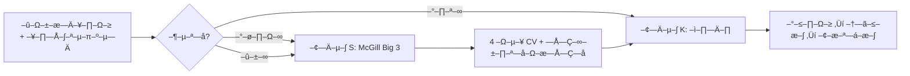

# Empire — полный контекст-пак для Gemini (сгенерировано 2026-10-21T17:48Z)

> –≠—Ç–æ –ø—Ä–∏–ª–æ–∂–µ–Ω–∏–µ –∫ –ø—Ä–æ–º–ø—Ç—É `docs/GEMINI_HANDOFF_CURSOR_EXIT_LOCAL_LLM_2026-10.md`.
> –°–µ–∫—Ä–µ—Ç—ã (.env, —Ç–æ–∫–µ–Ω—ã, UUID VPN) **–Ω–µ** –≤–∫–ª—é—á–µ–Ω—ã. –†–∞–±–æ—Ç–∞–π —Ç–æ–ª—å–∫–æ —Å —ç—Ç–∏–º –ø–∞–∫–æ–º + –ø—Ä–æ–º–ø—Ç–æ–º.

---


# ========== FILE: docs/PROJECT_OS.md ==========

# Project OS — куда что класть (Empire + vault)

**Три слоя:** Obsidian (мышление) · git `docs/` (канон) · Око Саурона (цифры и ops).

Полный контекст: обсуждение «3 слоя» · мастер-план `docs/empire_master_plan_rf_2026.md`.

---

## 1. –ü—Ä–∞–≤–∏–ª–æ inbox (—Ä–∞–∑ –≤ 2 –Ω–µ–¥–µ–ª–∏, 15 –º–∏–Ω)

**Inbox** = `–í—Ö–æ–¥—è—â–∏–µ/` –≤ –∫–æ—Ä–Ω–µ vault (–Ω–µ –ø—É—Ç–∞—Ç—å —Å `Empire/*/inbox/`).

| –í–æ–ø—Ä–æ—Å | –ö—É–¥–∞ |
|--------|------|
| –≠—Ç–æ –ø–æ—Å—Ç –≤ –∫–∞–Ω–∞–ª Empire? | `Empire/{persona}/inbox/` ‚Üí –∫–æ–≥–¥–∞ –≥–æ—Ç–æ–≤–æ ‚Üí `queue/` |
| Это статья «навсегда» (инвестиции, референсы)? | `База знаний/{тема}/` |
| –≠—Ç–æ –ª–∏—á–Ω–∞—è –∑–∞–¥–∞—á–∞ / –±—ã—Ç? | `Life/tasks/inbox.md` –∏–ª–∏ Tasks.org |
| –≠—Ç–æ **—É—Ç–≤–µ—Ä–∂–¥—ë–Ω–Ω–∞—è** –ø–æ–ª–∏—Ç–∏–∫–∞, –¢–ó, —á–µ–∫–ª–∏—Å—Ç –¥–ª—è –∫–æ–¥–∞/VPS? | `docs/` –≤ —Ä–µ–ø–æ–∑–∏—Ç–æ—Ä–∏–∏ empire (git) |
| Это решение «делаем так»? | `docs/empire_decisions_YYYY-MM.md` + строка в review |
| Устаревший черновик ТЗ v2–v9? | `_archive/tz-superseded/` (не править) |
| Рецепт, fiction, разовая заметка? | `Life/` или `База знаний/` — или удалить |
| –ù–µ –ø–æ–Ω—è—Ç–Ω–æ –∑–∞ 30 —Å–µ–∫ | –û—Å—Ç–∞–≤–∏—Ç—å –≤–æ `–í—Ö–æ–¥—è—â–∏–µ/` **–Ω–µ –±–æ–ª—å—à–µ 2 –Ω–µ–¥–µ–ª—å** |

**Запрет:** токены ботов, API-ключи, пароли — только `.env` на VPS, **не** в Obsidian.

---

## 2. Еженедельный review (воскресенье, 30–45 мин)

### –ü–æ—Ä—è–¥–æ–∫

1. **Око Саурона → P&L · Финансы → KPI недели** — заполнить форму (или обновить `data/empire_weekly_kpi.json`).
2. **Obsidian** — новая заметка из шаблона `_templates/weekly_project_review.md` → папка `_reviews/`.
3. Поле **«Решение недели»** в KPI (`notes`) = одна фраза из review (дублируется осмысленно).
4. Если решение меняет приоритеты — правка в `docs/empire_master_backlog.md` или `empire_decisions_*.md`.

### –®–∞–±–ª–æ–Ω –∏ –∞—Ä—Ö–∏–≤ review

- –®–∞–±–ª–æ–Ω: `data/obsidian_vault/Empire/_templates/weekly_project_review.md`
- –ì–æ—Ç–æ–≤—ã–µ –æ–±–∑–æ—Ä—ã: `Empire/_reviews/YYYY-Www.md`
- **Ежедневный хаб Obsidian:** `Empire/00-СЕГОДНЯ.md` · пайплайн `00-ПАЙПЛАЙН.md` · индекс `00-ДОКУМЕНТАЦИЯ.md`
- **Sync docs/финансы:** `scripts/sync_empire_obsidian.py` → `Empire/_canon/`, `Empire/_finance/` · гайд `docs/obsidian_sync_empire_ru.md`

### Пороги «зелёный / красный»

`docs/empire_business_plan_2026.md` §6.2 — не выдумывать новые KPI без причины.

---

## 3. –ö–∞—Ä—Ç–∞ –ø–∞–ø–æ–∫ vault

```text
–í—Ö–æ–¥—è—â–∏–µ/              ‚Üê –±—ã—Å—Ç—Ä—ã–π —Å–±—Ä–æ—Å (—Å README-–º–∞—Ä—à—Ä—É—Ç–∏–∑–∞—Ü–∏–µ–π)
_archive/              ‚Üê —É—Å—Ç–∞—Ä–µ–≤—à–µ–µ, –Ω–µ —É–¥–∞–ª—è—Ç—å –≤—Å–ª–µ–ø—É—é
Empire/
  _canvas/ _scenarios/ ‚Üê –ø–ª–∞–Ω–∏—Ä–æ–≤–∞–Ω–∏–µ, –Ω–µ –∏–º–ø–æ—Ä—Ç
  _templates/ _reviews/
  {persona}/inbox|queue|published/
Life/tasks/            ‚Üê –ª–∏—á–Ω—ã–µ –¥–µ–ª–∞ (–Ω–µ —Å–∏–Ω–∫ –Ω–∞ VPS)
–ë–∞–∑–∞ –∑–Ω–∞–Ω–∏–π/           ‚Üê —Å—Ç–∞—Ç—å–∏ –∏ —Ä–µ—Ñ–µ—Ä–µ–Ω—Å—ã
```

–†–µ–ø–æ–∑–∏—Ç–æ—Ä–∏–π:

```text
docs/          ‚Üê –∫–∞–Ω–æ–Ω: –¢–ó, –ø–ª–∞–Ω—ã, –≥–∞–π–¥—ã, —á–µ–∫–ª–∏—Å—Ç—ã
data/*.json    ‚Üê KPI, ledger (–¥–∞—à–±–æ—Ä–¥)
analytics.db   ‚Üê —Å–æ–±—ã—Ç–∏—è (–∞–≤—Ç–æ)
```

---

## 4. –ö–∞–Ω–æ–Ω –¢–ó (–µ–¥–∏–Ω—Å—Ç–≤–µ–Ω–Ω—ã–π –∏—Å—Ç–æ—á–Ω–∏–∫)

| –î–æ–∫—É–º–µ–Ω—Ç | –ù–∞–∑–Ω–∞—á–µ–Ω–∏–µ |
|----------|------------|
| `docs/TZ_OMNI_MEDIA_EMPIRE_FINAL.md` | –ú–∞—Å—Ç–µ—Ä-–¢–ó |
| `docs/empire_master_plan_rf_2026.md` | –ü–ª–∞–Ω –¥–∏—Å—Ç—Ä–∏–±—É—Ü–∏–∏ –†–§ 2026 |
| `docs/empire_business_plan_2026.md` | P&L, KPI, –º–æ–Ω–µ—Ç–∏–∑–∞—Ü–∏—è |
| `docs/empire_master_backlog.md` | –°—Ç–∞—Ç—É—Å—ã —Ñ–∞–∑ |
| `docs/empire_decisions_2026-05.md` | –ó–∞—Ñ–∏–∫—Å–∏—Ä–æ–≤–∞–Ω–Ω—ã–µ —Ä–µ—à–µ–Ω–∏—è |

Старые версии v2–v9 — только в `_archive/tz-superseded/`.

---

## 5. –°–≤—è–∑–∞–Ω–Ω—ã–µ –¥–æ–∫—É–º–µ–Ω—Ç—ã

| –î–æ–∫—É–º–µ–Ω—Ç | –°–æ–¥–µ—Ä–∂–∞–Ω–∏–µ |
|----------|------------|
| `docs/obsidian_practical_guide_ru.md` | Obsidian ‚Üí Telegram |
| `docs/empire_obsidian_integration.md` | –ò–º–ø–æ—Ä—Ç queue |
| `docs/empire_kpi_sheets_template.md` | Google Sheets (–æ–ø—Ü–∏–æ–Ω–∞–ª—å–Ω–æ) |
| `data/obsidian_vault/Empire/README.md` | –ü—Ä–∞–≤–∏–ª–∞ vault Empire |


---

# ========== FILE: docs/EMPIRE_PORTFOLIO_AUDIT_2026-07.md ==========

# –ê—É–¥–∏—Ç –ø–æ—Ä—Ç—Ñ–µ–ª—è Empire (–ø—Ä–æ—Å—Ç—ã–º —è–∑—ã–∫–æ–º)

**–î–∞—Ç–∞:** 2026-07-18 (—Ä–µ–¥–∞–∫—Ü–∏—è —Å –Ω–æ–≤—ã–º–∏ –≤–≤–æ–¥–Ω—ã–º–∏)  
**–î–ª—è –∫–æ–≥–æ:** –≤–ª–∞–¥–µ–ª–µ—Ü, –±–µ–∑ –∂–∞—Ä–≥–æ–Ω–∞  

### –ù–æ–≤—ã–µ —Ä–µ—à–µ–Ω–∏—è –≤–ª–∞–¥–µ–ª—å—Ü–∞ (–∑–∞—Ñ–∏–∫—Å–∏—Ä–æ–≤–∞–Ω–æ)

1. **Сад, Штерн, Ленин** — пока **только автопостинг в Telegram**. Без продаж, курсов, PDF-магазинов, донатов «в полный рост».  
2. **VPS** — оставляем: на нём сайты, автопост, «Пар?», всё живое.  
3. **–®—Ç–µ—Ä–Ω ‚Üí –ø–æ–∑–∂–µ** –º–æ–∂–Ω–æ –Ω–∞—Ä–∞—Å—Ç–∏—Ç—å –≤ **—Å–∏–ª—å–≤–µ—Ä-—Ñ–∏—Ç–Ω–µ—Å** + —Ä–∞–∑–±–æ—Ä —Ç–µ—Ö–Ω–∏–∫–∏ –≥–∏—Ä–∏ —á–µ—Ä–µ–∑ **–ò–ò / –º–∞—à–∏–Ω–Ω–æ–µ –∑—Ä–µ–Ω–∏–µ** (–ø—Ä–æ–µ–∫—Ç –°–Ω–µ–≥–∏—Ä–∏).  
4. Вопрос: **Пенсия и Где Пар — флагманы?** → ответ ниже: **да, оба**, но с разной ролью.

---

## 1. –ì–ª–∞–≤–Ω—ã–π –≤—ã–≤–æ–¥ (–æ–¥–Ω–∞ –º–∏–Ω—É—Ç–∞ —á—Ç–µ–Ω–∏—è)

У вас не «хаос из десяти бизнесов», если честно зафиксировать роли:

| –†–æ–ª—å | –ß—Ç–æ —ç—Ç–æ | –°–µ–π—á–∞—Å |
|---|---|---|
| **–§–ª–∞–≥–º–∞–Ω ‚Ññ1** | **–ù–∞ –ø–µ–Ω—Å–∏—é –Ω–∏–∫–æ–≥–¥–∞** | –ì–ª–∞–≤–Ω—ã–π –ª–∏—á–Ω—ã–π –±—Ä–µ–Ω–¥ –∏ –ø–µ—Ä–≤–∞—è –≤—ã—Ä—É—á–∫–∞ (–∫–Ω–∏–≥–∞, YouTube) |
| **–§–ª–∞–≥–º–∞–Ω ‚Ññ2** | **–ì–¥–µ –ü–∞—Ä** | –°–µ–º–µ–π–Ω—ã–π B2B (–±–∞–Ω–∏ ‚Üí –∑–≤–æ–Ω–∫–∏/–ø–æ–¥–ø–∏—Å–∫–∞), —á–∞—Å—Ç–æ –≤–µ–¥—ë—Ç —Å—É–ø—Ä—É–≥–∞ |
| **–†–∞–¥–∏–æ –Ω–∞ –∞–≤—Ç–æ–º–∞—Ç–µ** | –°–∞–¥, –®—Ç–µ—Ä–Ω, –õ–µ–Ω–∏–Ω | –ü–æ—Å—Ç—ã —Å–∞–º–∏; –≤—ã –ø–æ—á—Ç–∏ –Ω–µ —Ç—Ä–æ–≥–∞–µ—Ç–µ |
| **–ò–¥–µ—è –Ω–∞ –ø–æ–ª–∫–µ** | –°–∏–ª—å–≤–µ—Ä-—Ñ–∏—Ç–Ω–µ—Å / –°–Ω–µ–≥–∏—Ä–∏ (–ò–ò+–≥–∏—Ä—è) | –ü–æ—Å–ª–µ —Ç–æ–≥–æ –∫–∞–∫ —Ñ–ª–∞–≥–º–∞–Ω—ã –Ω–∞—á–Ω—É—Ç –∫–æ—Ä–º–∏—Ç—å |
| **–ù–µ –æ—Ç–¥–µ–ª—å–Ω—ã–π –±–∏–∑–Ω–µ—Å** | –ú–æ–∏ –ø–∞–∏ | –†—É–±—Ä–∏–∫–∞ –≤–Ω—É—Ç—Ä–∏ –ø–µ–Ω—Å–∏–∏ |
| **–î–æ–º, –Ω–µ –±–∏–∑–Ω–µ—Å** | –£–º–Ω—ã–π –¥–æ–º (Home Assistant) | –ü–æ –∂–µ–ª–∞–Ω–∏—é –≤ —Å–≤–æ–±–æ–¥–Ω–æ–µ –≤—Ä–µ–º—è |
| **–ò–Ω—Ñ—Ä–∞—Å—Ç—Ä—É–∫—Ç—É—Ä–∞** | VPS | –ù—É–∂–µ–Ω –≤—Å–µ–≥–¥–∞ |

**Флагманы — да: Пенсия и Где Пар.**  
Остальное — не флагманы, пока вы сами не решите иначе.

---

## 2. Что такое «флагман» простыми словами

**Флагман** — проект, ради которого вы **осознанно тратите время и деньги**, потому что он должен **приносить деньги или сильный бренд**.

- **Пенсия** — флагман *вашего* имени: «государство пенсию не спасёт → копи сам». Книга, сайт, ролики.  
- **Где Пар** — флагман *сервиса для бань*: люди ищут баню → звонок владельцу → владелец платит вам/супруге.

**Не флагман:** канал, который просто «крутится», чтобы не молчал. Это Сад / Штерн / Ленин при вашем решении.

---

## 3. –ü–æ–ª–Ω—ã–π —Å–ø–∏—Å–æ–∫ –ø—Ä–æ–µ–∫—Ç–æ–≤ (—á—Ç–æ —É –≤–∞—Å –µ—Å—Ç—å)

### 3.1. –§–ª–∞–≥–º–∞–Ω—ã

**А) «На пенсию никогда»**  
- –°–∞–π—Ç: neverretire.ru  
- –ï—Å—Ç—å: —á–µ—Ä–Ω–æ–≤–∏–∫ –∫–Ω–∏–≥–∏, —Å–∞–π—Ç, –∑–∞–≥–æ—Ç–æ–≤–∫–∞ YouTube, Telegram  
- –ù–µ—Ç –∏–ª–∏ —Å–ª–∞–±–æ: —Å—á—ë—Ç—á–∏–∫ –ú–µ—Ç—Ä–∏–∫–∏, –ø—Ä–æ–¥–∞–∂–∞ –∫–Ω–∏–≥–∏, —Å–Ω—è—Ç—ã–µ —Ä–æ–ª–∏–∫–∏  
- –î–µ–Ω—å–≥–∏: –ø—Ä–æ–¥–∞–∂–∞ PDF-–∫–Ω–∏–≥–∏, –ø–æ—Ç–æ–º —Ä–µ–∫–ª–∞–º–∞ –Ω–∞ YouTube  

**Б) «Где Пар»**  
- –°–∞–π—Ç: gdepar.ru  
- Есть: карта бань, помощник «Пар?», много кода  
- –ñ–¥—ë—Ç –≤–∞—Å: –Ø–Ω–¥–µ–∫—Å.–ú–µ—Ç—Ä–∏–∫–∞ (—Å—á—ë—Ç—á–∏–∫), –æ—Ñ–æ—Ä–º–ª–µ–Ω–∏–µ –¥–µ–Ω–µ–≥ (–ù–ü–î —Å—É–ø—Ä—É–≥–∏), —Å—Ö–µ–º–∞ –æ–ø–ª–∞—Ç—ã –∑–∞ –∑–≤–æ–Ω–∫–∏  
- –î–µ–Ω—å–≥–∏: –≤–ª–∞–¥–µ–ª—å—Ü—ã –±–∞–Ω—å –ø–ª–∞—Ç—è—Ç –∑–∞ –ª–∏–¥—ã/–ø–æ–¥–ø–∏—Å–∫—É  

### 3.2. Автоканалы (без продаж — ваше решение)

| –ö–∞–Ω–∞–ª | –û —á—ë–º | –ß—Ç–æ –¥–µ–ª–∞—Ç—å —Å–µ–π—á–∞—Å |
|---|---|---|
| **–°–∞–¥ (–°—Ç–µ–ø–∞–Ω—ã—á)** | –û–≥–æ—Ä–æ–¥ | –¢–æ–ª—å–∫–æ –∞–≤—Ç–æ–ø–æ—Å—Ç—ã |
| **Штерн** | Гиря, спина, офис | Только автопосты; позже — задел под сильвер-фитнес |
| **–õ–µ–Ω–∏–Ω** | –ü–æ–ª–∏–≥–æ–Ω/—ç–∫—Å–ø–µ—Ä–∏–º–µ–Ω—Ç—ã | –¢–æ–ª—å–∫–æ –∞–≤—Ç–æ–ø–æ—Å—Ç—ã |

Продажи PDF, курсы, боты оплаты по этим трём — **заморожены**. Код можно не удалять, просто не включать.

### 3.3. –ü–æ–ª–∫–∞ (–ø–æ–∑–∂–µ)

**–°–∏–ª—å–≤–µ—Ä-—Ñ–∏—Ç–Ω–µ—Å + –ò–ò –ø–æ –≥–∏—Ä–µ (–°–Ω–µ–≥–∏—Ä–∏)**  
Идея: человек снимает упражнение → программа смотрит технику → подсказки. Канал Штерн готовит аудиторию «словами», продукт — отдельно.  
Пока: есть ТЗ и черновик сайта, домен/оплаты/договор с тренером — не закрыты.  
**–ù–µ –Ω–∞—á–∏–Ω–∞—Ç—å –≤—Å–µ—Ä—å—ë–∑**, –ø–æ–∫–∞ –ø–µ–Ω—Å–∏—è –∏ gdepar –Ω–µ –≤ —Ä–∞–±–æ—á–µ–º —Ä–∏—Ç–º–µ.

**«Мои паи»**  
Отдельный сайт/канал — **не нужен**. Имеет смысл как **редкие посты внутри пенсии** («рента / паи как кусок своей пенсии»).

**–û–º–Ω–∏-—Ñ–∞–±—Ä–∏–∫–∞** (–∞–≤—Ç–æ–ø–æ—Å—Ç–∏–Ω–≥ –≤–µ–∑–¥–µ, —à–ø–∏–æ–Ω—Å–∫–∏–µ –∞–∫–∫–∞—É–Ω—Ç—ã, –∫—É—á–∞ –ø–ª–æ—â–∞–¥–æ–∫)  
Красиво в ТЗ, опасно для фокуса. Пока — не трогать live-режим.

**–ì–æ–ª–æ—Å–æ–≤–æ–π –±–æ—Ç –¥–ª—è –±–∞–Ω—å**  
–ü–æ–∑–∂–µ, –∫–æ–≥–¥–∞ Gdepar —É–∂–µ –∑–∞—Ä–∞–±–∞—Ç—ã–≤–∞–µ—Ç.

### 3.4. –ù–µ –±–∏–∑–Ω–µ—Å

**Умный дом (Home Assistant)** — удобство квартиры. Не путать с Empire.

**VPS** — компьютер в интернете, на котором крутятся сайты и автопосты. Отказаться нельзя, если хотите сайты. Это не «ещё один проект», это **электричество для всех**.

---

## 4. Пенсия и Где Пар — точно флагманы?

| | –ü–µ–Ω—Å–∏—è | –ì–¥–µ –ü–∞—Ä |
|---|---|---|
| –ó–∞—á–µ–º —Å—É—â–µ—Å—Ç–≤—É–µ—Ç | –í–∞—à –≥–æ–ª–æ—Å, –¥–æ–≤–µ—Ä–∏–µ, –¥–æ–ª–≥–∞—è –∏–≥—Ä–∞ | –î–µ–Ω—å–≥–∏ —Å –±–∏–∑–Ω–µ—Å–∞ –±–∞–Ω—å |
| Кто «лицо» | Вы | Сайт + супруга (по playbook) |
| Готовность «железка» | Высокая по тексту, низкая по запуску | Высокая по сайту, низкая по деньгам |
| Конкурируют ли друг с другом? | За **ваше** время — да | За время супруги / часть вашего — да |

**–í—ã–≤–æ–¥:** –¥–∞, –æ–±–∞ —Ñ–ª–∞–≥–º–∞–Ω–∞. –ù–æ –Ω–µ–ª—å–∑—è –∫–∞–∂–¥—ã–π –¥–µ–Ω—å –Ω–∞ 100% –¥–µ–ª–∞—Ç—å –æ–±–∞. –ü—Ä–∞–∫—Ç–∏—á–Ω–æ:

- **Вы лично:** 60–70% времени — Пенсия.  
- **Gdepar:** 20–30% вашего времени **или** супруга тянет операционку, вы — техника/решение.  
- **–ê–≤—Ç–æ–∫–∞–Ω–∞–ª—ã:** —Å–º–æ—Ç—Ä–µ—Ç—å —Ä–∞–∑ –≤ –Ω–µ–¥–µ–ª—é, —á—Ç–æ –æ—á–µ—Ä–µ–¥—å –Ω–µ –ø—É—Å—Ç–∞—è.

Если когда-нибудь Gdepar начнёт стабильно кормить семью, а пенсия «застрянет» — можно поменять доли. Сейчас логичнее **сначала закрыть воронку пенсии** (книга + хоть один ролик + Метрика), параллельно не убивая gdepar.

---

## 5. Простые «финмодели» (сколько примерно могут дать)

–≠—Ç–æ –Ω–µ –æ–±–µ—â–∞–Ω–∏–µ, –∞ **–ø–æ—Ä—è–¥–æ–∫ —Ü–∏—Ñ—Ä**, —á—Ç–æ–±—ã —Å—Ä–∞–≤–Ω–∏–≤–∞—Ç—å.

### –ü–µ–Ω—Å–∏—è (12 –º–µ—Å—è—Ü–µ–≤, –µ—Å–ª–∏ –¥–æ–∂–∞—Ç—å –∑–∞–ø—É—Å–∫)

| –°—Ü–µ–Ω–∞—Ä–∏–π | –ß—Ç–æ –ø—Ä–æ–∏—Å—Ö–æ–¥–∏—Ç | –î–µ–Ω—å–≥–∏ –ø—Ä–∏–º–µ—Ä–Ω–æ |
|---|---|---|
| Плохой | Книга вышла слабо, роликов мало | 20–40 тыс ₽ за год |
| Нормальный | Книга + регулярные ролики | **50–120 тыс ₽** |
| Хороший | Рост YouTube + реклама | 150–300+ тыс ₽ |

–ì–ª–∞–≤–Ω—ã–π —Ç–æ—Ä–º–æ–∑: –≤—Å—ë –Ω–∞–ø–∏—Å–∞–Ω–æ, –Ω–æ **–Ω–µ –≤–∫–ª—é—á–µ–Ω–∞ –ø—Ä–æ–¥–∞–∂–∞ –∏ –Ω–µ —Å–Ω—è—Ç —Ä–æ–ª–∏–∫**.

### –ì–¥–µ –ü–∞—Ä (12 –º–µ—Å—è—Ü–µ–≤)

| –°—Ü–µ–Ω–∞—Ä–∏–π | –î–µ–Ω—å–≥–∏ –ø—Ä–∏–º–µ—Ä–Ω–æ |
|---|---|
| Без Метрики и оплаты | **0** (сайт «для красоты») |
| Первые владельцы платят | **30–80 тыс ₽** |
| –ü–æ—à–ª–æ | 100+ —Ç—ã—Å ‚ÇΩ |

Главный тормоз: нет счётчика статистики и схемы «баня заплатила».

### Сад / Штерн / Ленин (при «только автопост»)

| | |
|---|---|
| –ü—Ä—è–º–∞—è –≤—ã—Ä—É—á–∫–∞ | **~0** (–∏ —ç—Ç–æ –Ω–æ—Ä–º–∞–ª—å–Ω–æ –ø–æ –≤–∞—à–µ–º—É —Ä–µ—à–µ–Ω–∏—é) |
| –ü–æ–ª—å–∑–∞ | –ö–∞–Ω–∞–ª—ã –∂–∏–≤—ã–µ, –ø—Ä–∏–≤—ã—á–∫–∞ –∞—É–¥–∏—Ç–æ—Ä–∏–∏, –∑–∞–¥–µ–ª –ø–æ–¥ –±—É–¥—É—â–µ–µ |
| –†–∞—Å—Ö–æ–¥ | –ß—É—Ç—å —ç–ª–µ–∫—Ç—Ä–∏—á–µ—Å—Ç–≤–∞ VPS + –Ω–µ–º–Ω–æ–≥–æ –ò–ò –Ω–∞ —Ç–µ–∫—Å—Ç—ã (—É–∂–µ –≤ –æ–±—â–µ–º –±—é–¥–∂–µ—Ç–µ) |

### –°–∏–ª—å–≤–µ—Ä-—Ñ–∏—Ç–Ω–µ—Å / –°–Ω–µ–≥–∏—Ä–∏ (–∫–æ–≥–¥–∞ –¥–æ–π–¥—ë—Ç–µ)

Красивые таблицы «окупимся за 2 месяца» в старых расчётах — **слишком оптимистичны**. Реалистично: месяцы подготовки, зависимость от тренера/съёмок, техсложность «камера смотрит на гирю».  
Пока флагманы не дают ритм — **не вкладывать сюда основные силы**.

### –ú–æ–∏ –ø–∞–∏ –æ—Ç–¥–µ–ª—å–Ω–æ

Как отдельный бизнес — **слабо** (мало людей, много труда, долго до денег).  
Как тема внутри пенсии — **нормально и дёшево**.

### VPS

Расход порядка **2–3 тыс ₽/мес** — плата за то, что сайты и автопост существуют. Это не проект для отмены.

---

## 6. Где проекты «ломаются» (уязвимости)

| –ü—Ä–æ–µ–∫—Ç | –ì–ª–∞–≤–Ω–∞—è –¥—ã—Ä–∞ | –ü—Ä–æ—Å—Ç—ã–º–∏ —Å–ª–æ–≤–∞–º–∏ |
|---|---|---|
| Пенсия | Нет запуска | Есть рукопись, нет «нажми купить» и «посмотри ролик» |
| Gdepar | –ù–µ—Ç –∏–∑–º–µ—Ä–µ–Ω–∏—è –∏ –∫–∞—Å—Å—ã | –ù–µ –≤–∏–¥–Ω–æ, –æ—Ç–∫—É–¥–∞ –ª—é–¥–∏, –Ω–µ–∫–æ–º—É –≤—ã—Å—Ç–∞–≤–ª—è—Ç—å —Å—á—ë—Ç |
| –ê–≤—Ç–æ–∫–∞–Ω–∞–ª—ã | –ü—É—Å—Ç–∞—è –æ—á–µ—Ä–µ–¥—å –ø–æ—Å—Ç–æ–≤ | –ö–∞–Ω–∞–ª –∑–∞–º–æ–ª–∫–∞–µ—Ç, –µ—Å–ª–∏ –Ω–µ –ø–æ–¥–∫–∏–¥—ã–≤–∞—Ç—å —Ç–µ–∫—Å—Ç—ã |
| –°–Ω–µ–≥–∏—Ä–∏/–ò–ò-–≥–∏—Ä—è | –°–ª–æ–∂–Ω–æ—Å—Ç—å + —á—É–∂–æ–π —Ç—Ä–µ–Ω–µ—Ä | –õ–µ–≥–∫–æ –∑–∞–∫–æ–ø–∞—Ç—å—Å—è –≤ —Ç–µ—Ö–Ω–æ–ª–æ–≥–∏—é –±–µ–∑ –∫–ª–∏–µ–Ω—Ç–æ–≤ |
| Мои паи отдельно | Узкая тема + закон про советы | Можно случайно «советовать купить» без права |
| –û–º–Ω–∏/—à–ø–∏–æ–Ω—ã | –†–∏—Å–∫ –±–∞–Ω–æ–≤ –∏ –≤—Ä–µ–º–µ–Ω–∏ | –ú–Ω–æ–≥–æ –≤–æ–∑–Ω–∏, –º–∞–ª–æ –¥–µ–Ω–µ–≥ –Ω–∞ —Å—Ç–∞—Ä—Ç–µ |
| Умный дом | Расползание | «Ещё одна лампочка» съедает вечер вместо ролика |

**–û–±—â–∞—è –¥—ã—Ä–∞:** –º–Ω–æ–≥–æ –∫—Ä–∞—Å–∏–≤—ã—Ö –ø–ª–∞–Ω–æ–≤, –º–∞–ª–æ **–∑–∞–∫—Ä—ã—Ç—ã—Ö –ø—Ä–æ—Å—Ç—ã—Ö —à–∞–≥–æ–≤** (—Å—á—ë—Ç—á–∏–∫, –∫–Ω–æ–ø–∫–∞ –æ–ø–ª–∞—Ç—ã, –æ–¥–Ω–æ –≤–∏–¥–µ–æ).

---

## 7. –ß—Ç–æ –¥–µ–ª–∞—Ç—å –ø–æ –ø–æ—Ä—è–¥–∫—É (–æ—á–µ—Ä–µ–¥—å)

### Сейчас — очередь №1 (Пенсия)

1. –í–∫–ª—é—á–∏—Ç—å **–Ø–Ω–¥–µ–∫—Å.–ú–µ—Ç—Ä–∏–∫—É** –Ω–∞ neverretire.ru (—á—Ç–æ–±—ã –≤–∏–¥–µ—Ç—å –ø–æ—Å–µ—Ç–∏—Ç–µ–ª–µ–π).  
2. Страница подарка **/gift** (письма взамен на PDF «принципы»).  
3. –í–æ–∑–º–æ–∂–Ω–æ—Å—Ç—å **–∫—É–ø–∏—Ç—å –∫–Ω–∏–≥—É** (—Å–Ω–∞—á–∞–ª–∞ –¥–µ—à–µ–≤–ª–µ, –ø–æ—Ç–æ–º –æ–±—ã—á–Ω–∞—è —Ü–µ–Ω–∞).  
4. –û—Ç–∫—Ä—ã—Ç—å/–æ—Ñ–æ—Ä–º–∏—Ç—å **YouTube** –∏ —Å–Ω—è—Ç—å **–ø–µ—Ä–≤—ã–π —Ä–æ–ª–∏–∫** (—Å—Ü–µ–Ω–∞—Ä–∏–π —É–∂–µ –µ—Å—Ç—å).  

Пока это не сделано — новые большие идеи почти всегда вредны.

### –û—á–µ—Ä–µ–¥—å ‚Ññ2 (–ì–¥–µ –ü–∞—Ä)

5. –ú–µ—Ç—Ä–∏–∫–∞ –Ω–∞ gdepar.ru.  
6. Оформление приёма денег (как у вас в семье решено — часто НПД супруги).  
7. –ü—Ä–æ—Å—Ç–∞—è —Å—Ö–µ–º–∞: –≤–ª–∞–¥–µ–ª–µ—Ü –±–∞–Ω–∏ –ø–æ–ª—É—á–∞–µ—Ç –∑–≤–æ–Ω–∫–∏ ‚Üí –ø–ª–∞—Ç–∏—Ç.  
8. Помощник «Пар?» — проверить, что работает; долю умного ИИ крутить позже по цифрам.

### –û—á–µ—Ä–µ–¥—å ‚Ññ3 (–∞–≤—Ç–æ–∫–∞–Ω–∞–ª—ã)

9. –†–∞–∑ –≤ –Ω–µ–¥–µ–ª—é: –æ—á–µ—Ä–µ–¥—å –ø–æ—Å—Ç–æ–≤ –¥–ª—è –°–∞–¥–∞ / –®—Ç–µ—Ä–Ω–∞ / –õ–µ–Ω–∏–Ω–∞ –Ω–µ –ø—É—Å—Ç–∞—è.  
10. В постах Штерна иногда мягко копить тему «техника / зрелый возраст» — **без продаж**.

### –û—á–µ—Ä–µ–¥—å ‚Ññ4 (—Å–∏–ª—å–≤–µ—Ä-—Ñ–∏—Ç–Ω–µ—Å / –ò–ò, –∫–æ–≥–¥–∞ –º–æ–∂–Ω–æ)

Только если очереди 1–2 уже «дышат» (есть продажи или ясные лиды):

11. –î–æ–º–µ–Ω —Å–∞–π—Ç–∞ –°–Ω–µ–≥–∏—Ä–∏.  
12. –î–æ–≥–æ–≤–æ—Ä—ë–Ω–Ω–æ—Å—Ç—å —Å —Ç—Ä–µ–Ω–µ—Ä–æ–º / —Å—ä—ë–º–∫–∞.  
13. Простой платный тест «пришли видео — получи разбор».  
14. Усложнять машинное зрение — **после** первых денег, не до.

### –û—á–µ—Ä–µ–¥—å ‚Ññ5 (–≥–æ—Ä–∞–∑–¥–æ –ø–æ–∑–∂–µ)

- Рубрика «паи» внутри пенсии  
- –ì–æ–ª–æ—Å-–±–æ—Ç –¥–ª—è –±–∞–Ω—å  
- –ú–∞—Å—Å–æ–≤—ã–π –∞–≤—Ç–æ–ø–æ—Å—Ç–∏–Ω–≥ –Ω–∞ –≤—Å–µ –ø–ª–æ—â–∞–¥–∫–∏ / —à–ø–∏–æ–Ω—Å–∫–∏–µ –∞–∫–∫–∞—É–Ω—Ç—ã  
- Отдельный бренд «Мои паи»

### –ú–æ–∂–Ω–æ –Ω–µ –¥–µ–ª–∞—Ç—å

- Продажи по Саду / Штерну / Ленину — **пока вы так решили**  
- –í—Ç–æ—Ä–æ–π –ø–æ–ª–Ω–æ—Ü–µ–Ω–Ω—ã–π –º–µ–¥–∏–∞–±—Ä–µ–Ω–¥ –ø—Ä–æ –ó–ü–ò–§  
- Идеальный умный дом «на все комнаты сразу»

---

## 8. –ö–∞–∫ —Ä–∞—Å–ø—Ä–µ–¥–µ–ª–∏—Ç—å –Ω–µ–¥–µ–ª—é (~20 —á–∞—Å–æ–≤)

| –ß–∞—Å—ã | –ù–∞ —á—Ç–æ |
|---|---|
| 12–14 | Пенсия (книга, ролик, сайт) |
| 4–6 | Gdepar (или помощь супруге) |
| 1–2 | Проверить автоканалы |
| 0 в «рабочем» слоте | Новые ТЗ, Снегири «поиграться», HA |

VPS просто платите — это фон.

---

## 9. –û—Ç–≤–µ—Ç—ã –Ω–∞ –≤–∞—à–∏ —Ñ–æ—Ä–º—É–ª–∏—Ä–æ–≤–∫–∏ –Ω–∞–ø—Ä—è–º—É—é

**«По саду и штерну и ленину не хочу распыляться на продажи»**  
‚Üí –ü—Ä–∞–≤–∏–ª—å–Ω–æ. –§–∏–∫—Å–∏—Ä—É–µ–º: **—Ç–æ–ª—å–∫–æ –∞–≤—Ç–æ–ø–æ—Å—Ç**. –ü—Ä–æ–¥–∞–∂–∏ = –ø–æ–ª–∫–∞.

**«VPS мне всё равно нужен»**  
‚Üí –î–∞. –≠—Ç–æ –Ω–µ –∫–æ–Ω–∫—É—Ä–µ–Ω—Ç —Ñ–ª–∞–≥–º–∞–Ω–∞–º, —ç—Ç–æ **—Ç—Ä—É–±–∞**, –ø–æ –∫–æ—Ç–æ—Ä–æ–π –≤—Å—ë —Ç–µ—á—ë—Ç.

**«Штерн далее можно прикрутить сильвер фитнес и ИИ»**  
‚Üí –î–∞, —ç—Ç–æ **–ª–æ–≥–∏—á–Ω–æ–µ –ø—Ä–æ–¥–æ–ª–∂–µ–Ω–∏–µ –®—Ç–µ—Ä–Ω–∞**, –Ω–æ **—á–µ—Ç–≤—ë—Ä—Ç–∞—è –æ—á–µ—Ä–µ–¥—å**, –Ω–µ —Å–µ–≥–æ–¥–Ω—è. –°–Ω–∞—á–∞–ª–∞ –±—Ä–µ–Ω–¥-–∫–∞–Ω–∞–ª —Å–ª–æ–≤–∞–º–∏, –ø–æ—Ç–æ–º –∫–∞–º–µ—Ä–∞ –∏ –ø–æ–¥–ø–∏—Å–∫–∞.

**«Пенсия и гдепар флагманы?»**  
→ **Да.** Пенсия — флагман личного бренда. Где Пар — флагман семейного сервиса. Сад/Штерн/Ленин — не флагманы. Снегири — будущий кандидат во флагман №3, пока нет.

---

## 10. –û–¥–Ω–∞ —Ñ—Ä–∞–∑–∞ –Ω–∞ —Ö–æ–ª–æ–¥–∏–ª—å–Ω–∏–∫

> Закрой пенсию до «можно купить и можно посмотреть».  
> Держи Где Пар живым до «банщик может заплатить».  
> –¢—Ä–∏ –∫–∞–Ω–∞–ª–∞ –ø—É—Å—Ç—å –ø–∏—à—É—Ç —Å–∞–º–∏.  
> Гирю с ИИ и паи — потом.

---

*–í–Ω—É—Ç—Ä–µ–Ω–Ω–∏–π –¥–æ–∫—É–º–µ–Ω—Ç –ø—Ä–∏–æ—Ä–∏—Ç–∏–∑–∞—Ü–∏–∏. –ù–µ —Ñ–∏–Ω–∞–Ω—Å–æ–≤–∞—è —Ä–µ–∫–æ–º–µ–Ω–¥–∞—Ü–∏—è —Å—Ç–æ—Ä–æ–Ω–Ω–∏–º –ª–∏—Ü–∞–º.*


---

# ========== FILE: docs/EMPIRE_PIPELINE_CHECKLIST.md ==========

# Empire — общий пайплайн и чеклисты

**–û–±–Ω–æ–≤–ª–µ–Ω–æ:** 2026-09-06 (R6 dual-flagship)  
**Зачем один файл:** видеть **что сделано / что осталось** по двум продуктовым линиям — **Pension** (neverretire.ru, YouTube) и **gdepar** (карта бань, «Пар?»), плюс **omni-publish** (5 TG) и инфраструктура.

**–†–µ–≤–∏–∑–∏—è R5:** `docs/audit/14_PIPELINE_R5_AUTOPOST.md`  
**Ревизия R6 (факты + деньги + 90 дней):** `docs/audit/15_FINANCIAL_MODEL_R6_2026-09-05.md` · `docs/audit/17_MILESTONES_R6_90D.md` · `docs/audit/18_GDEPAR_CONTENT_MONEY_R6.md` · промпт Gemini `docs/audit/16_GEMINI_PROMPT_DUAL_FLAGSHIP_R6.md`

Статусы: `⬜` не начато · `🔄` в работе · `✅` готово · `⏸` ждёт вас (внешний сервис / ключ)

---

## –û–±—â–∞—è –∏–Ω—Ñ—Ä–∞—Å—Ç—Ä—É–∫—Ç—É—Ä–∞ Empire

| # | –ó–∞–¥–∞—á–∞ | –°—Ç–∞—Ç—É—Å | –ö–∞–∫ –ø—Ä–æ–≤–µ—Ä–∏—Ç—å |
|---|--------|--------|----------------|
| I1 | VPS / `empire_gdepar` / `empire` сервисы живы | 🔄 | `curl -s https://gdepar.ru/api/gdepar/health` |
| I2 | OpenRouter ключ в env (gdepar assistant + генерация) | ⬜ | health → `assistant` / логи без 401 |
| I3 | Obsidian vault синхрон с `data/obsidian_vault/Empire/` | 🔄 | посты в `pension/queue/` |
| I4 | Еженедельные метрики Pension | ⬜ | `data/pension_weekly_metrics.json` |
| I5 | Финансы P&L | ⬜ | `data/empire_finance_ledger.json` |
| I6 | **–ê–≤—Ç–æ–ø–æ—Å—Ç 5 TG** (`auto_publish.json`) | ‚úÖ | `journalctl -u empire \| grep autopublish` |
| I7 | **KPI недели** (вкл. автопост + email) | ⬜ | `data/empire_weekly_kpi.json` · шаблон CSV |
| I8 | Метрика **оба** сайта | ⏸ | gdepar + neverretire — блокер воронки |
| I9 | **DR: docs/infra + Я.Диск** | ✅ | `docs/infra/README.md` · `vps_restore_from_yandex.sh` |

---

## Блок D — Omni-publish · все TG

**Док:** `docs/empire_autopost_strategy_2026.md` · **Ритуал:** ежедневно ~15 мин.

```
content/*/queue + —Ä—É–±—Ä–∏–∫–∏ JSON
  ‚Üí auto_publish.json (—Å–ª–æ—Ç—ã –ø–æ persona)
  ‚Üí 5 TG: gdepar, pension, stern, lenin, garden
  ‚Üí CTA UTM ‚Üí neverretire.ru / gdepar.ru
  ‚Üí KPI: tg_posts_published, autopost_failures (–µ–∂–µ–Ω–µ–¥–µ–ª—å–Ω–æ)
```

| # | –ó–∞–¥–∞—á–∞ | –°—Ç–∞—Ç—É—Å | –ü—Ä–∏–º–µ—á–∞–Ω–∏–µ |
|---|--------|--------|------------|
| D1 | –°–ª–æ—Ç—ã –≤—Å–µ—Ö 5 –ø–µ—Ä—Å–æ–Ω –≤ `auto_publish.json` | ‚úÖ | –∏—é–Ω—å 26 |
| D2 | Curated-—Ä—É–±—Ä–∏–∫–∏ (gdepar, stern, lenin) | ‚úÖ | `activate_curated_rubrics.sh` |
| D3 | Подпитка queue (Obsidian → content) | 🔄 | не допускать пустых слотов |
| D4 | `views_24h` в analytics.db | ⬜ | бэклог август |
| D5 | Частота постов по данным | ⬜ | после 4–6 нед логов |

**Не делать:** добавлять слоты >5/день на «медленных» каналах без A/B.

---

## Блок A — Pension · «На пенсию НИКОГДА»

**Сайт:** https://neverretire.ru · **Книга:** `data/pension/book_complete (1).md`  
**Дорожная карта YT:** `docs/pension_youtube_roadmap_12m_2026.md` · **Запуск YT:** `docs/pension_youtube_launch_guide.md`

### A1. –ö–æ–Ω—Ç–µ–Ω—Ç –∏ –∑–Ω–∞–Ω–∏—è (—Å–¥–µ–ª–∞–Ω–æ / –≤ —Ä–∞–±–æ—Ç–µ)

| # | –ó–∞–¥–∞—á–∞ | –°—Ç–∞—Ç—É—Å | –ü—Ä–∏–º–µ—á–∞–Ω–∏–µ |
|---|--------|--------|------------|
| A1.1 | –ß–µ—Ä–Ω–æ–≤–∏–∫ –∫–Ω–∏–≥–∏ (7666 —Å—Ç—Ä–æ–∫) | ‚úÖ | |
| A1.2 | Кримсон в `kb_sources/pension/crimson/` (24 файла) | ✅ | PDF + mhtml «Индексные фонды» |
| A1.3 | RAG pension –ø–µ—Ä–µ–∏–Ω–¥–µ–∫—Å–∏—Ä–æ–≤–∞–Ω (—Ç–æ–ª—å–∫–æ `kb_sources/pension`, 6428 —á–∞–Ω–∫–æ–≤) | ‚úÖ | –±–µ–∑ `scripts/` –∏ `reference/` |
| A1.4 | –≠—Ç–∞–ª–æ–Ω—ã –ú—è—á–∏–Ω–∞ –≤ `data/pension/scripts/myachin/` | ‚úÖ | 2 PDF-—Å—Ü–µ–Ω–∞—Ä–∏—è |
| A1.5 | Книги-источники в `data/pension/reference/books/` | ✅ | Марков, Талеб — **не** в RAG постов |
| A1.6 | –°–ø—Ä–∞–≤–æ—á–Ω–∏–∫ —Ñ–æ—Ä–º–∞—Ç–∞ –ú—è—á–∏–Ω–∞ | ‚úÖ | `docs/pension_reference_myachin.md` |
| A1.7 | –®–∞–±–ª–æ–Ω—ã —Å—Ü–µ–Ω–∞—Ä–∏–µ–≤ YT | ‚úÖ | `data/pension/scripts/` |
| A1.8 | –ü—Ä–∏–º–µ—Ä —Å—Ü–µ–Ω–∞—Ä–∏—è YT ‚Ññ1 (–ü–æ–Ω—Ü–∏) | ‚úÖ | `data/pension/scripts/pension_yt/yt-001_pension_ponzi.md` |
| A1.9 | Очередь лонгридов Obsidian | 🔄 | `data/obsidian_vault/Empire/pension/queue/` |
| A1.10 | –ö–æ–Ω—Ç–µ–Ω—Ç-–∫–∞–ª–µ–Ω–¥–∞—Ä—å 12 –Ω–µ–¥ | ‚úÖ | `docs/pension_content_calendar_2026.md` |
| A1.11 | –õ–æ–Ω–≥—Ä–∏–¥—ã –î–∑–µ–Ω/VK (5 —à—Ç.) | ‚úÖ | `data/pension/longreads/` |

### A2. –°–∞–π—Ç neverretire.ru

| # | –ó–∞–¥–∞—á–∞ | –°—Ç–∞—Ç—É—Å | –î–æ–∫—É–º–µ–Ω—Ç |
|---|--------|--------|----------|
| A2.1 | –°–∞–π—Ç –æ–ø—É–±–ª–∏–∫–æ–≤–∞–Ω, —Ä–∞–∑–¥–µ–ª—ã –∫–Ω–∏–≥–∞/—Ä–∞–∑–±–æ—Ä—ã | ‚úÖ | |
| A2.2 | **Яндекс.Метрика** — отдельный счётчик | ⏸ | `docs/pension_analytics_accounts_guide.md` |
| A2.3 | Цели Метрики (email, book, youtube UTM) | ⏸ | `docs/pension_book_publish_tz.md` §6 |
| A2.4 | PDF книги + `/buy` | 🔄 | `docs/pension_book_publish_tz.md` |
| A2.5 | Email pre-launch база | ⬜ | **R6:** ≥40 к 31.10, ≥50 к 30.11 (август сорван, waitlist=0) |
| A2.6 | TG→сайт дедуп + RSS timer | ✅ | `pension_site_sync` · `empire-pension-site-sync.timer` |

### A3. YouTube «Иосиф Борода» / @neverretire

| # | –ó–∞–¥–∞—á–∞ | –°—Ç–∞—Ç—É—Å | –ù–µ–¥–µ–ª—è |
|---|--------|--------|--------|
| A3.1 | Google-аккаунт + канал + оформление | ⬜ | 1 |
| A3.2 | Шаблон превью + дисклеймер ИИР | ⬜ | 1 |
| A3.3 | Выпуск №1 снят (сценарий yt-001) | ⬜ | 1–2 |
| A3.4 | 12 роликов без пропуска >2 нед | ⬜ | Q1 2026 |
| A3.5 | Дзен из сценариев (раз в 2 нед) | ⬜ | с нед. 3 |
| A3.6 | Launch книги **299 ₽** | ⬜ | **R6 soft delay → 01.11.2026** (не 15.09) |
| A3.7 | Pre-sale **149 ₽** | ⬜ | **R6:** октябрь soft sale, цель 5–10 |
| A3.8 | YT №1–2 | ⬜ | **R6:** публикация до **15.10.2026** (август/1 сен сорваны) |

### A4. –ü–∞–π–ø–ª–∞–π–Ω –∫–æ–Ω—Ç–µ–Ω—Ç–∞ Pension (–æ–¥–Ω–∞ —Å—Ç—Ä–æ–∫–∞)

```
–ö–Ω–∏–≥–∞ / Crimson RAG + –Ω–æ–≤–æ—Å—Ç—å –¥–∞—à–±–æ—Ä–¥–∞
  ‚Üí —Å—Ü–µ–Ω–∞—Ä–∏–π YT (—à–∞–±–ª–æ–Ω –ú—è—á–∏–Ω–∞) ‚Üí —Å—ä—ë–º–∫–∞ ‚Üí YT (—Å 1 —Å–µ–Ω)
  ‚Üí –∞–≤—Ç–æ–ø–æ—Å—Ç TG Pension + —Å–ø—É—Ç–Ω–∏–∫–∏ (CTA /book, /gift)
  ‚Üí –Ω–∞—Ä–µ–∑–∫–∞ –ª–æ–Ω–≥—Ä–∏–¥–∞ –î–∑–µ–Ω (–ø–æ—Å–ª–µ —Ñ–∏–Ω–∞–ª–∞ –∫–Ω–∏–≥–∏)
```

**–ö–æ–º–∞–Ω–¥—ã:**

```bash
# RAG —Ç–æ–ª—å–∫–æ kb_sources (–ö—Ä–∏–º—Å–æ–Ω + mhtml), –±–µ–∑ scripts/reference
cd /root/projects/empire
./venv/bin/python tools/build_rag.py --persona pension --force \
  --input-dir kb_sources/pension

# –ü—Ä–æ–≤–µ—Ä–∫–∞ –∏–Ω–¥–µ–∫—Å–∞
test -f data/rag_manifest_pension.json && cat data/rag_manifest_pension.json
```

---

## Блок B — gdepar.ru · «Пар?»

**Сайт:** https://gdepar.ru · **ТЗ помощника:** `docs/gdepar_ai_assistant_tz.md`  
**–°—Ç–∞—Ç—É—Å –≤—ã–∫–∞—Ç–∞:** `docs/gdepar_checkpoints.md` (CP-20260520)

### B1. –¢–µ—Ö–Ω–∏–∫–∞ (—Å–¥–µ–ª–∞–Ω–æ –∞–≥–µ–Ω—Ç–æ–º)

| # | –ó–∞–¥–∞—á–∞ | –°—Ç–∞—Ç—É—Å |
|---|--------|--------|
| B1.1 | Помощник «Пар?», SSE, кэш, RL | ✅ |
| B1.2 | `GET /api/gdepar/health` | ‚úÖ |
| B1.3 | LLM rollout `GDEPAR_ASSISTANT_LLM_PCT=25` | ‚úÖ |
| B1.4 | –ö–æ–¥ —Ü–µ–ª–µ–π –ú–µ—Ç—Ä–∏–∫–∏ –≤ —à–∞–±–ª–æ–Ω–∞—Ö | ‚úÖ |

### B2. –¢–æ–ª—å–∫–æ –≤–ª–∞–¥–µ–ª–µ—Ü

| # | –ó–∞–¥–∞—á–∞ | –°—Ç–∞—Ç—É—Å | –î–µ–π—Å—Ç–≤–∏–µ |
|---|--------|--------|----------|
| B2.1 | –°–æ–∑–¥–∞—Ç—å —Å—á—ë—Ç—á–∏–∫ –ú–µ—Ç—Ä–∏–∫–∏ | ‚è∏ | metrika.yandex.ru |
| B2.2 | `YANDEX_METRIKA_ID` –≤ `/etc/empire/gdepar.env` | ‚è∏ | + `systemctl restart empire_gdepar` |
| B2.3 | JS-—Ü–µ–ª–∏ –≤ –∫–∞–±–∏–Ω–µ—Ç–µ | ‚è∏ | `docs/metrika_goals_setup.md` |
| B2.4 | Неделя 1: «Пар?», стриминг, OpenRouter | ⬜ | после B2.2 |
| B2.5 | 2–4 нед: решение по `GDEPAR_ASSISTANT_LLM_PCT` | ⬜ | 25 / 50–100 / 0 |
| B2.6 | Мастер-ТЗ империи | ⬜ | `docs/TZ_OMNI_MEDIA_EMPIRE_FINAL.md` |

### B3. –ü–∞–π–ø–ª–∞–π–Ω gdepar

```
–ü–æ—Å–µ—Ç–∏—Ç–µ–ª—å ‚Üí gdepar.ru ‚Üí –ú–µ—Ç—Ä–∏–∫–∞
  → «Пар?» → submit → pick / phone (CR1)
  ‚Üí (–æ–ø—Ü.) —Å–∞–º–º–∞—Ä–∏ –ø–æ–ø–∞–ø–∞
```

**–ü—Ä–æ–≤–µ—Ä–∫–∞:**

```bash
curl -s https://gdepar.ru/api/gdepar/health | python3 -m json.tool
journalctl -u empire_gdepar | grep 'timing route='   # –µ—Å–ª–∏ —Ç–æ—Ä–º–æ–∑–∏—Ç
```

---

## Блок C — Формат «как у Мячина» (общий для Pension YT)

| –í–∞—Ä–∏–∞–Ω—Ç | –ö–æ–≥–¥–∞ | –°—Ç–∞—Ä—Ç | –ê—Ä—Ç–µ—Ñ–∞–∫—Ç |
|---------|-------|-------|----------|
| **C1 Сценарий → видео** (основной) | Evergreen, 15–25 мин | Книга + цифры | `.md` в `scripts/pension_yt/` |
| **C2 –õ–æ–Ω–≥—Ä–∏–¥ ‚Üí —Ä–∞—Å—à–∏—Ä–µ–Ω–∏–µ** | –ù–æ–≤–æ—Å—Ç—å –Ω–µ–¥–µ–ª–∏ | Obsidian queue | –ø–æ—Å—Ç ‚Üí +10 –º–∏–Ω –≤ —Å—Ü–µ–Ω–∞—Ä–∏–π |
| **C3 Книга → серия** | 22 главы | Оглавление книги | 1–2 ролика на главу |

Детали: `docs/pension_reference_myachin.md` · шаблон: `data/pension/scripts/_template_myachin_script.md`

---

## Сводка «что сделать в первую очередь» (сентябрь 26, R6)

1. **Метрика** — оба счётчика (без этого KPI слепые) — всё ещё блокер.
2. **Pension:** –Ω–µ —Ñ–æ—Ä—Å–∏—Ä–æ–≤–∞—Ç—å launch 15.09 ‚Üí PDF+–æ–ø–ª–∞—Ç–∞+email+YT –∫ **01.11**; Obsidian queue (18 —Ñ–∞–π–ª–æ–≤) ‚Üí TG ‚â•2/–Ω–µ–¥.
3. **gdepar:** Metrika + UTM-–≥–∏–¥—ã 1√ó/–Ω–µ–¥ + phone enrich MSK; –∫–∞—Ä—Ç–∞ 2045 —É–∂–µ –æ–∫.
4. **Omni-publish:** pension persona **оставить disabled**; классика/curated — да.
5. **–î–µ–Ω—å–≥–∏:** –≤–µ—Å—Ç–∏ ledger; bridge 35k –Ω–µ –∂–µ—á—å –Ω–∞ –î–∏—Ä–µ–∫—Ç –±–µ–∑ Metrika.
6. –ö–∞–ª–µ–Ω–¥–∞—Ä—å 90 –¥–Ω–µ–π: `docs/audit/17_MILESTONES_R6_90D.md`.

---

## –°–≤—è–∑–∞–Ω–Ω—ã–µ —Ñ–∞–π–ª—ã

| –§–∞–π–ª | –°–æ–¥–µ—Ä–∂–∞–Ω–∏–µ |
|------|------------|
| `docs/REMINDERS_gdepar.md` | –ö–æ—Ä–æ—Ç–∫–∞—è –≤—ã–∂–∏–º–∫–∞ B2 (–∫–∞–ª–µ–Ω–¥–∞—Ä—å) |
| `docs/pension_reference_myachin.md` | PDF‚ÜîYT, —Å—Ç—Ä—É–∫—Ç—É—Ä–∞ –±–ª–æ–∫–æ–≤ |
| `docs/pension_content_calendar_2026.md` | 12 –Ω–µ–¥ + –≥–æ–¥ |
| `kb_sources/pension/README.md` | –ö–∞–∫ –∫–ª–∞—Å—Ç—å Crimson |
| `data/pension/scripts/README.md` | –ü–∞–ø–∫–∏ scripts / reference |
| `docs/audit/14_PIPELINE_R5_AUTOPOST.md` | R5: –∞–≤—Ç–æ–ø–æ—Å—Ç, –º–µ—Ç—Ä–∏–∫–∏, —Å—Ä–æ–∫–∏ |
| `docs/empire_kpi_sheets_template.md` | –ö–æ–ª–æ–Ω–∫–∏ KPI + –ø–æ—Ä–æ–≥–∏ |
| `docs/infra/README.md` | –°–µ—Ç—å Flint, VPS runbook, –±—ç–∫–∞–ø/restore –Ø.–î–∏—Å–∫ |
| `docs/YANDEX_RCLONE_START.md` | rclone + –Ø–Ω–¥–µ–∫—Å (—Å—Ç–∞—Ä—Ç) |


---

# ========== FILE: docs/empire_decisions_2026-05.md ==========

# –†–µ—à–µ–Ω–∏—è –∑–∞–∫–∞–∑—á–∏–∫–∞ (–º–∞–π 2026)

–ó–∞—Ñ–∏–∫—Å–∏—Ä–æ–≤–∞–Ω–æ –ø–æ –æ–ø—Ä–æ—Å—É. –ü–ª–∞–Ω: `empire_master_plan_rf_2026.md`.

## –î–∏—Å—Ç—Ä–∏–±—É—Ü–∏—è –∏ –∞–≤—Ç–æ–ø–æ—Å—Ç

| –†–µ—à–µ–Ω–∏–µ | –ó–Ω–∞—á–µ–Ω–∏–µ |
|---------|----------|
| Garden / Lenin / Stern | **–ê–≤—Ç–æ–ø–æ—Å—Ç Empire** (—Ä–∞—Å–ø–∏—Å–∞–Ω–∏–µ ‚Üí —á–µ—Ä–Ω–æ–≤–∏–∫ ‚Üí approve) |
| Каналы сейчас | **Только Telegram** (B); ВК+Дзен — одной настройкой после токена |
| –¶–µ–ª–µ–≤—ã–µ –∫–∞–Ω–∞–ª—ã | `tg + vk_wall + dzen_rss` (A1), –∫–æ–≥–¥–∞ –µ—Å—Ç—å `VK_ACCESS_TOKEN` |
| –ú–æ–¥–µ—Ä–∞—Ü–∏—è | **Approve –¥–ª—è –≤—Å–µ—Ö**, –ø–æ–∫–∞ –∫–∞—á–µ—Å—Ç–≤–æ –Ω–µ —É—Å—Ç—Ä–æ–∏—Ç (B) |
| VK-—Ç–æ–∫–µ–Ω | –û–∂–∏–¥–∞–µ—Ç—Å—è **–≤ —Ç–µ—á–µ–Ω–∏–µ –Ω–µ–¥–µ–ª–∏**; –∫–æ–¥ vk_wall –≥–æ—Ç–æ–≤–∏—Ç—Å—è –∑–∞—Ä–∞–Ω–µ–µ |

## Пенсия — главный проект

| –†–µ—à–µ–Ω–∏–µ | –ó–Ω–∞—á–µ–Ω–∏–µ |
|---------|----------|
| Роль | **Основная деятельность**; Сад/Штерн/Пар/Ленин — спутники для её раскрутки |
| –°–µ–π—á–∞—Å | Telegram –≤ –ø—Ä–∏–æ—Ä–∏—Ç–µ—Ç–µ |
| Позже | ВК, Дзен, MAX, YouTube, сайт, книга — см. `docs/pension_book_publish_tz.md` (параллельно с текстом, launch после beta) |
| –ê–≤—Ç–æ–ø–æ—Å—Ç | **–°—ã—Ä–∞—è –ª–µ–Ω—Ç–∞ –Ω–æ–≤–æ—Å—Ç–µ–π** (–±–µ–∑ –≤–æ–¥—è–Ω–∏—Å—Ç–æ–π —Å–≤–æ–¥–∫–∏) |
| –†–∞–∑–±–æ—Ä—ã | –í—Ä—É—á–Ω—É—é; —Ç–µ–º–∞ —Å –ø—Ä–µ—Ñ–∏–∫—Å–æ–º `[ANALYSIS]` |
| Голоса | [@auantonov](https://t.me/auantonov), [@crimsondigest](https://t.me/crimsondigest) — тон в RAG, не копипаста |

## –°–ø—É—Ç–Ω–∏–∫–∏

| –ü–µ—Ä—Å–æ–Ω–∞ | –†–µ—à–µ–Ω–∏–µ |
|---------|---------|
| Gdepar | –ö–∞–∫ –°–∞–¥: TG; –ø–æ–∑–∂–µ –í–ö+–î–∑–µ–Ω —Å UTM –Ω–∞ gdepar.ru; —á–∏–Ω–∏—Ç—å –ø–æ–≤—Ç–æ—Ä—ã |
| Stern | –ö–∞–∫ –°–∞–¥; –æ–ø–ª–∞—Ç–∞ tripwire –ø–æ—Å–ª–µ 3 —É—Ä–æ–∫–æ–≤ |
| Lenin | –¢–æ—Ç –∂–µ –∞–≤—Ç–æ–ø–æ—Ç–æ–∫ –∏ –∫–∞–Ω–∞–ª—ã, —á—Ç–æ –°–∞–¥/–®—Ç–µ—Ä–Ω |
| –ü–æ—Ä—è–¥–æ–∫ –¥–æ–∂–∏–º–∞ (12B) | **–°–∞–¥ ‚Üí –ì–¥–µ–ø–∞—Ä ‚Üí –®—Ç–µ—Ä–Ω ‚Üí –õ–µ–Ω–∏–Ω ‚Üí –ü–µ–Ω—Å–∏—è** |

## –ö–æ–¥ (–ø–µ—Ä–≤—ã–π —Å–ø—Ä–∏–Ω—Ç)

| # | –ó–∞–¥–∞—á–∞ | –°—Ç–∞—Ç—É—Å |
|---|--------|--------|
| 1 | Gdepar: –∞–Ω—Ç–∏-–ø–æ–≤—Ç–æ—Ä—ã + –∫–ª–∏—à–µ | –≤ —Ä–∞–±–æ—Ç–µ |
| 2 | Stern: –ø—Ä–µ–≤—å—é —Ñ–æ—Ç–æ+caption | –≤ —Ä–∞–±–æ—Ç–µ |
| 3 | Pension: raw_news + voice config | –≤ —Ä–∞–±–æ—Ç–µ |
| 4 | vk_wall + `publish_channels.json` | –≤ —Ä–∞–±–æ—Ç–µ |
| 5 | –ü–∞—Ä—Ç–∏–∑–∞–Ω—â–∏–Ω–∞ | –ø–æ—Å–ª–µ P0: Spy live ‚Üí –Ω–µ–π—Ä–æ +2 –Ω–µ–¥ |
| 6 | Spy –≤ –∫–æ–Ω—Ç–µ–Ω—Ç | **—Ç–æ–ª—å–∫–æ Gdepar + Stern**, —Ç–æ–ª—å–∫–æ **–∂–∏–≤–æ–π Telethon** (–æ—Ç–¥–µ–ª—å–Ω—ã–π TG); –Ω–µ –°–∞–¥/–õ–µ–Ω–∏–Ω/–ü–µ–Ω—Å–∏—è |
| 6b | Пенсия | RSS + TG-источники (ТАСС, «раньше всех…») → вкладка «Пенсия · новости», голоса Антонов/Кримсон, approve |
| 6c | –ê–≤—Ç–æ spy‚Üídraft | **–≤—ã–∫–ª** (—Ç–æ–∫–µ–Ω—ã); –∫–Ω–æ–ø–∫–∞ –≤ –¥–∞—à–±–æ—Ä–¥–µ –ø–æ—Å–ª–µ Telethon |
| 6d | stop_spy | `true` –≤ `data/empire_flags.json` –¥–æ –≥–æ—Ç–æ–≤–Ω–æ—Å—Ç–∏ –∞–∫–∫–∞—É–Ω—Ç–∞ |
| 7 | Монетизация Garden | waitlist/бесплатно; оплата по «готово» |


---

# ========== FILE: docs/empire_business_plan_2026.md ==========

# –ë–∏–∑–Ω–µ—Å-–ø–ª–∞–Ω Empire 2026: –¥–µ–Ω—å–≥–∏, —Å—Ä–æ–∫–∏, –º–µ—Ç—Ä–∏–∫–∏

**–°—Ç–∞—Ç—É—Å:** —Ä–∞–±–æ—á–∏–π –¥–æ–∫—É–º–µ–Ω—Ç (–º–∞–π 2026).  
**Подшит к:** `docs/TZ_OMNI_MEDIA_EMPIRE_FINAL.md` §17 (ниже в FINAL добавлена ссылка).  
**Связь:** `empire_master_plan_rf_2026.md`, `empire_decisions_2026-05.md`, `channel_monetization.md`, `pension_book_publish_tz.md` §6.

---

## 0. –ß—Ç–æ —É–∂–µ –±—ã–ª–æ –∏ —á–µ–≥–æ –Ω–µ —Ö–≤–∞—Ç–∞–ª–æ

| –ï—Å—Ç—å –≤ —Ä–µ–ø–æ–∑–∏—Ç–æ—Ä–∏–∏ | –ß–µ–≥–æ –Ω–µ –±—ã–ª–æ –≤ –æ–¥–Ω–æ–º –º–µ—Å—Ç–µ |
|--------------------|----------------------------|
| Фазы, бюджет API ~3 000 ₽/мес (`TZ_FINAL` §7) | Календарь «когда и кому платить» |
| –ú–æ–Ω–µ—Ç–∏–∑–∞—Ü–∏—è –ø–æ –∫–∞–Ω–∞–ª–∞–º (`channel_monetization.md`) | –ï–¥–∏–Ω—ã–π P&L (—Ä–∞—Å—Ö–æ–¥—ã ‚Üî –¥–æ—Ö–æ–¥—ã) |
| KPI книги Pension (`pension_book_publish_tz.md` §6) | Сводные метрики **всех** персон |
| Ориентиры роста ВК/Дзен (`growth_rf_no_max_2026.md`) | Пороги «пошло не туда / туда» |
| Схема `analytics.db`, `sales.db` | Регламент еженедельного обзора 30–45 мин |

**Этот файл закрывает пробел.** Отслеживание — вручную + дашборд/Obsidian + по мере готовности — автоматизация в `analytics.db` / `sales.db`.

---

## 1. –°—Ç—Ä–∞—Ç–µ–≥–∏—è –≤ –æ–¥–Ω–æ–º –∞–±–∑–∞—Ü–µ

**Главный проект:** Pension («На пенсию НИКОГДА») — **YouTube + нативная реклама** (основной доход), сайт, книга, Дзен.  
**Спутники:** Garden, Gdepar, Stern, Lenin — трафик и прогрев к Pension; не отдельные бизнес-линии.  
**–î–æ—Ä–æ–∂–Ω–∞—è –∫–∞—Ä—Ç–∞ 12 –º–µ—Å:** `docs/pension_youtube_roadmap_12m_2026.md`.  
**Принцип 2026:** рост **без VPN** (ВК + Дзен + сайты); TG — ядро и модерация.  
**–Æ—Ä. —Ä–µ–∂–∏–º:** **–ù–ü–î (—Å–∞–º–æ–∑–∞–Ω—è—Ç—ã–π)** –¥–æ ~2,4 –º–ª–Ω ‚ÇΩ/–≥–æ–¥ –≤—ã—Ä—É—á–∫–∏; —á–µ–∫–∏ –Ω–∞ –∫–∞–∂–¥—É—é –æ–ø–ª–∞—Ç—É.  
**Инфра:** VPS + API ≤ целевого потолка расходов (см. §3).

---

## 2. –î–æ—Ä–æ–∂–Ω–∞—è –∫–∞—Ä—Ç–∞: –∫–æ–≥–¥–∞ —á—Ç–æ –¥–µ–ª–∞—Ç—å –∏ –∫–æ–≥–¥–∞ –ø–ª–∞—Ç–∏—Ç—å

### 2.1. –§–∞–∑—ã (—Å–∏–Ω—Ö—Ä–æ–Ω —Å `TZ_FINAL` –∏ `empire_master_plan_rf_2026.md`)

| –§–∞–∑–∞ | –°—Ä–æ–∫ | –§–æ–∫—É—Å | –ü–ª–∞—Ç–Ω—ã–µ –¥–µ–π—Å—Ç–≤–∏—è |
|------|------|-------|------------------|
| **A** P0 качество | 1–2 нед | Gdepar/Stern/Pension контент, VK-токен | VPS (ежемес.), домены (годовые) |
| **B** Продукт | 2–4 нед | Garden PDF, Stern 3 урока, vk_wall | Опционально: реклама ВК 3–5 тыс. |
| **C** Рост | 1–3 мес | Spy live, нейро пилот, Shorts сценарии | LLM, прокси Telethon, SIM |
| **D** –ú–æ–Ω–µ—Ç–∏–∑–∞—Ü–∏—è | –ø–æ –≥–æ—Ç–æ–≤–Ω–æ—Å—Ç–∏ | YooKassa Stern ‚Üí Garden ‚Üí Pension PDF | –ö–æ–º–∏—Å—Å–∏—è –ÆKassa; —á–µ–∫–∏ –ù–ü–î |
| **E** Pension launch | –ø–æ `pension_book_publish_tz` | –ö–Ω–∏–≥–∞, `/buy`, –î–∑–µ–Ω, YT | Ridero/—Å–∞–º–∏–∑–¥–∞—Ç, —Ä–µ–∫–ª–∞–º–∞ –ø–æ KPI |

### 2.2. –ö–∞–ª–µ–Ω–¥–∞—Ä—å —Ä–µ–≥—É–ª—è—Ä–Ω—ã—Ö –ø–ª–∞—Ç–µ–∂–µ–π

| –°—Ç–∞—Ç—å—è | –ö–æ–º—É | –ö–æ–≥–¥–∞ | –û—Ä–∏–µ–Ω—Ç–∏—Ä ‚ÇΩ/–º–µ—Å | –û–±—è–∑–∞—Ç–µ–ª—å–Ω–æ—Å—Ç—å |
|--------|------|-------|----------------|----------------|
| **VPS** (VIEs-3, 4/8/120) | Хостер (Австрия/РФ) | Ежемесячно, до даты продления | **~2 400–2 500** (факт на 2026-05) | Обязательно |
| **Домены** neverretire.ru, gdepar.ru, зеркала | Reg.ru / Timeweb / CF | Годовой продление | ~500–150/мес в пересчёте | Обязательно |
| **Cloudflare** | CF | Год/мес по тарифу | 0–1 500 | По факту |
| **Cursor IDE** | Cursor | Ежемес. подписка | **~1 500–3 000** (Pro; USD×курс) | Разработка Empire |
| **OpenRouter** | OpenRouter | По факту usage | **500–1 500** | LLM: gdepar, контент, модерация |
| **fal.ai** | fal.ai | По факту usage | **0–500** | Картинки Flux (дашборд, не Сад) |
| **LLM прочее** | — | Редко | 0–300 | Категория `llm` в ledger |
| **S3** архив | Selectel/Yandex | Ежемес. | 100–300 | После включения бэкапа media |
| **Прокси IPv4** (Telethon) | Провайдер | Ежемес. | 500–800 | При Spy live |
| **SIM** —Ç–µ—Ö. Telegram | –û–ø–µ—Ä–∞—Ç–æ—Ä | –†–∞–∑–æ–≤–æ + –º–∏–Ω–∏–º—É–º | ~200 —Ä–∞–∑–æ–≤–æ | –ü—Ä–∏ Spy live |
| **ЮKassa** | Комиссия с оборота | С каждой продажи | ~3–4% + фикс | При продажах |
| **Реклама ВК** | VK Ads | По кампании | 3 000–5 000 опционально | Только при KPI §5.2 |
| **–ü–µ—á–∞—Ç—å –∫–Ω–∏–≥–∏** | Ridero/Ozon | –ü–æ —Å–æ–±—ã—Ç–∏—é | —Ä–∞–∑–æ–≤–æ | –§–∞–∑–∞ Pension launch |
| **НПД налог** | ФНС | С каждого чека | 4–6% от дохода | При поступлении |

**Не смешивать:** личные траты и Empire — одна таблица учёта, две категории в §4.

### 2.3. Разовые / отложенные (триггеры из `TZ_FINAL` §10)

| –¢—Ä–∏–≥–≥–µ—Ä | –î–µ–π—Å—Ç–≤–∏–µ | –û—Ä–∏–µ–Ω—Ç–∏—Ä |
|---------|----------|----------|
| RAM > 7 GB неделю | Апгрейд VPS | +1 000–2 000 ₽/мес |
| –ù—É–∂–µ–Ω GPU-—Ä–µ–Ω–¥–µ—Ä | –õ–æ–∫–∞–ª—å–Ω—ã–π –ü–ö (–æ—Ç–¥–µ–ª—å–Ω—ã–π –±—é–¥–∂–µ—Ç) | `docs/pc_build_montage_llm_2026-07.md` |
| SQLite > 1 GB | PostgreSQL | –≤—Ä–µ–º—è, –Ω–µ —Å—Ä–æ—á–Ω–æ –¥–µ–Ω—å–≥–∏ |
| LLM > 1 500 ‚ÇΩ/–º–µ—Å 2 –º–µ—Å—è—Ü–∞ –ø–æ–¥—Ä—è–¥ | –†–µ–≤–∏–∑–∏—è –ø—Ä–æ–º–ø—Ç–æ–≤, DeepSeek-only | —ç–∫–æ–Ω–æ–º–∏—è |

---

## 3. –ë—é–¥–∂–µ—Ç —Ä–∞—Å—Ö–æ–¥–æ–≤ (–ø–æ—Ç–æ–ª–∫–∏)

### 3.1. –ú–∏–Ω–∏–º–∞–ª—å–Ω—ã–π —Ä–µ–∂–∏–º (—Å–µ–π—á–∞—Å, –±–µ–∑ Spy live –∏ —Ä–µ–∫–ª–∞–º—ã)

| –°—Ç–∞—Ç—å—è | ‚ÇΩ/–º–µ—Å |
|--------|-------|
| VPS | 2 400 |
| –î–æ–º–µ–Ω—ã (–ø–µ—Ä–µ—Å—á—ë—Ç) | 300 |
| Cursor | 1 500 |
| OpenRouter | 500 |
| fal.ai | 0–200 |
| **Итого** | **~4 700–5 000** |

### 3.2. Рабочий режим (мастер-ТЗ, фазы 1–3)

| –°—Ç–∞—Ç—å—è | ‚ÇΩ/–º–µ—Å |
|--------|-------|
| VPS | 2 400 |
| Cursor | 2 000 |
| OpenRouter | 1 500 |
| fal.ai | 300 |
| S3 + –ø—Ä–æ–∫—Å–∏ | 800 |
| **–ò—Ç–æ–≥–æ** | **~7 000** |

### 3.3. –ü–æ—Ç–æ–ª–æ–∫ –∏–∑ —Ä–µ—à–µ–Ω–∏–π –∑–∞–∫–∞–∑—á–∏–∫–∞

**≤ 3 000 ₽/мес** — цель только на **LLM + S3 + мелочь** (`TZ_FINAL` §0).  
**VPS ~2 400 ₽** — **отдельно**, иначе суммарно **~5 500–6 000 ₽/мес** на всю Empire — закладывать в план реалистично.

**Правило:** если **сумма расходов Empire > 6 000 ₽/мес** два месяца подряд без роста выручки — стоп реклама, ревизия LLM, отложить необязательные API.

---

## 4. –£—á—ë—Ç —Ä–∞—Å—Ö–æ–¥–æ–≤ –∏ –¥–æ—Ö–æ–¥–æ–≤

### 4.1. –ì–¥–µ –≤–µ—Å—Ç–∏ (–≤—ã–±–µ—Ä–∏—Ç–µ –æ–¥–Ω–æ –æ—Å–Ω–æ–≤–Ω–æ–µ + –±—ç–∫–∞–ø)

| –ò–Ω—Å—Ç—Ä—É–º–µ–Ω—Ç | –ù–∞–∑–Ω–∞—á–µ–Ω–∏–µ |
|------------|------------|
| **`data/empire_finance_ledger.json`** | –ü–æ–º–µ—Å—è—á–Ω—ã–µ —Å—Ç—Ä–æ–∫–∏: —Ä–∞—Å—Ö–æ–¥/–¥–æ—Ö–æ–¥ (—à–∞–±–ª–æ–Ω –Ω–∏–∂–µ) |
| **Google Sheets / Excel** | –£–¥–æ–±–Ω—ã–µ –≥—Ä–∞—Ñ–∏–∫–∏; —ç–∫—Å–ø–æ—Ä—Ç –∏–∑ JSON |
| **`sales.db`** | –§–∞–∫—Ç –æ–ø–ª–∞—Ç: `orders`, `donations`, `receipts` |
| **`analytics.db`** | `daily_revenue`, —Å–æ–±—ã—Ç–∏—è –≤–æ—Ä–æ–Ω–∫–∏ |
| **«Мой налог»** | Юридически значимые чеки НПД |
| **Obsidian** | Чеклист недели: `templates/obsidian_growth_rf_2026.md` § Empire |

### 4.2. –§–æ—Ä–º–∞—Ç —Å—Ç—Ä–æ–∫–∏ —Ä–∞—Å—Ö–æ–¥–∞

```json
{
  "date": "2026-05-27",
  "type": "expense",
  "category": "vps|domain|cursor|openrouter|fal|llm|ads|proxy|tax|other",
  "amount_rub": 2373,
  "vendor": "VPS provider",
  "persona": null,
  "note": "VIEs-3 –ø—Ä–æ–¥–ª–µ–Ω–∏–µ",
  "receipt_url": null
}
```

### 4.3. –§–æ—Ä–º–∞—Ç —Å—Ç—Ä–æ–∫–∏ –¥–æ—Ö–æ–¥–∞

```json
{
  "date": "2026-06-15",
  "type": "income",
  "category": "yookassa|stars|vk|manual",
  "amount_rub": 390,
  "product_id": "stern_tripwire",
  "persona": "stern",
  "source_id": "vk_wall_2026w24",
  "order_id": "from sales.db",
  "npd_receipt": true
}
```

**Правило:** каждая продажа в `sales.db` → в тот же день строка в ledger + чек в «Мой налог».

### 4.4. P&L –ø–æ–º–µ—Å—è—á–Ω–æ (—à–∞–±–ª–æ–Ω)

| –ú–µ—Å—è—Ü | –†–∞—Å—Ö–æ–¥—ã —Ñ–∏–∫—Å | –†–∞—Å—Ö–æ–¥—ã –ø–µ—Ä–µ–º | –î–æ—Ö–æ–¥ | –ú–∞—Ä–∂–∞ | –ù–∞–∫–æ–ø–∏—Ç–µ–ª—å–Ω–æ –ù–ü–î –ª–∏–º–∏—Ç |
|-------|--------------|---------------|-------|-------|-------------------------|
| 2026-05 | | | | | 0 / 2 400 000 |

---

## 5. –î–æ—Ö–æ–¥—ã: –ø—Ä–æ–¥—É–∫—Ç—ã, —Å—Ä–æ–∫–∏, –∫–æ–º—É –ø–ª–∞—Ç—è—Ç

| –ü–µ—Ä—Å–æ–Ω–∞ / –ø—Ä–æ–¥—É–∫—Ç | –¶–µ–Ω–∞ (–æ—Ä–∏–µ–Ω—Ç–∏—Ä) | –ö–æ–≥–¥–∞ –≤–∫–ª—é—á–∞—Ç—å | –ü–ª–∞—Ç—ë–∂ | –°—Ç–∞—Ç—É—Å –∫–æ–¥–∞ |
|-------------------|-----------------|----------------|--------|-------------|
| **Lenin** –¥–æ–Ω–∞—Ç—ã | Stars / –ø—Ä–æ–∏–∑–≤–æ–ª—å–Ω–æ | –£–∂–µ | TG Stars ‚Üí –ù–ü–î | ‚úÖ donate bot |
| **Stern** tripwire 3 —É—Ä–æ–∫–∞ | 390 ‚ÇΩ | –ü–æ—Å–ª–µ **3 –≤–∏–¥–µ–æ** | YooKassa | ‚úÖ lead, üîí –æ–ø–ª–∞—Ç–∞ |
| **Stern** –∫—É—Ä—Å 21 –¥–µ–Ω—å | –≤—ã—à–µ | –ü–æ—Å–ª–µ tripwire | YooKassa | –±—ç–∫–ª–æ–≥ |
| **Garden** tripwire PDF | 290 ₽ | После ВК оформления | VK + ЮKassa | ⬜ |
| **Garden** гайд 4 недели | 1 290 ₽ | После tripwire | ЮKassa | ⬜ |
| **Gdepar** | –†–µ–∫–ª–∞–º–∞ –Ω–∞ –∫–∞—Ä—Ç–µ / –ø–∞—Ä—Ç–Ω—ë—Ä—ã | –ü—Ä–∏ —Ç—Ä–∞—Ñ–∏–∫–µ | B2B –ø–æ–∑–∂–µ | –ø—Ä–æ–º–æ UTM |
| **Pension** PDF –∫–Ω–∏–≥–∞ | TBD | Launch –Ω–µ–¥. 10 `pension_book_publish_tz` | –ÆKassa `/buy` | –≤ —Ä–∞–±–æ—Ç–µ |
| **Pension** печать/Ozon | TBD | После 10+ продаж PDF | Маркетплейс | ⬜ |

**Порядок монетизации (решение 2026-05):** Stern (после видео) → Garden → Pension launch. Gdepar — трафик, не прямой чек на старте.

---

## 6. –ú–µ—Ç—Ä–∏–∫–∏: —á—Ç–æ –æ—Ç—Å–ª–µ–∂–∏–≤–∞—Ç—å

### 6.1. –£—Ä–æ–≤–Ω–∏

| –£—Ä–æ–≤–µ–Ω—å | –í–æ–ø—Ä–æ—Å | –ß–∞—Å—Ç–æ—Ç–∞ |
|---------|--------|---------|
| **L0 –ò–Ω—Ñ—Ä–∞** | VPS –∂–∏–≤, –±—ç–∫–∞–ø—ã, –±—é–¥–∂–µ—Ç LLM | –µ–∂–µ–¥–Ω–µ–≤–Ω–æ –∞–≤—Ç–æ / –∞–ª—ë—Ä—Ç |
| **L1 –û—Ö–≤–∞—Ç** | –ü–æ–¥–ø–∏—Å—á–∏–∫–∏, –ø—Ä–æ—Å–º–æ—Ç—Ä—ã, —Å–µ—Å—Å–∏–∏ —Å–∞–π—Ç–∞ | **–µ–∂–µ–Ω–µ–¥–µ–ª—å–Ω–æ** |
| **L2 –í–æ–≤–ª–µ—á–µ–Ω–∏–µ** | ER, –¥–æ—á–∏—Ç—ã–≤–∞–Ω–∏—è, approve‚Üípublish | –µ–∂–µ–Ω–µ–¥–µ–ª—å–Ω–æ |
| **L3 –í–æ—Ä–æ–Ω–∫–∞** | –ö–ª–∏–∫ ‚Üí –ª–∏–¥ ‚Üí –æ–ø–ª–∞—Ç–∞ | –µ–∂–µ–Ω–µ–¥–µ–ª—å–Ω–æ –ø—Ä–∏ –ø—Ä–æ–¥–∞–∂–∞—Ö |
| **L4 –î–µ–Ω—å–≥–∏** | –í—ã—Ä—É—á–∫–∞, –º–∞—Ä–∂–∞, CAC, ROMI | **–µ–∂–µ–º–µ—Å—è—á–Ω–æ** |

### 6.2. –°–≤–æ–¥–Ω–∞—è —Ç–∞–±–ª–∏—Ü–∞ –º–µ—Ç—Ä–∏–∫ –ø–æ —Å–æ—Å—Ç–∞–≤–ª—è—é—â–∏–º

Заполнять **каждую неделю** (30–45 мин). Источники в скобках.

| –ë–ª–æ–∫ | –ú–µ—Ç—Ä–∏–∫–∞ | –ö—É–¥–∞ —Å–º–æ—Ç—Ä–µ—Ç—å | –ó–µ–ª—ë–Ω—ã–π (–∏–¥—ë—Ç —Ç—É–¥–∞) | –ö—Ä–∞—Å–Ω—ã–π (–Ω–µ —Ç—É–¥–∞) |
|------|---------|---------------|---------------------|-------------------|
| **Empire infra** | Uptime worker/main | `systemctl`, –¥–∞—à–±–æ—Ä–¥ | 7 –¥–Ω–µ–π –±–µ–∑ –ø–∞–¥–µ–Ω–∏–π | ‚â•3 –æ—à–∏–±–∫–∏ publish –ø–æ–¥—Ä—è–¥ |
| | RAM peak VPS | –¥–∞—à–±–æ—Ä–¥ / `free` | < 7 GB | > 7 GB 5 –¥–Ω–µ–π |
| | OpenRouter ₽/мес | ledger `openrouter` | ≤ 1 500 | > 1 500 2 мес |
| | Cursor ‚ÇΩ/–º–µ—Å | ledger `cursor` | –ø–æ —Ç–∞—Ä–∏—Ñ—É | –Ω–µ–æ–∂–∏–¥–∞–Ω–Ω—ã–π —Ä–æ—Å—Ç |
| | fal.ai ₽/мес | ledger `fal` | ≤ 500 | > 500 без публикаций |
| **Garden** | –ü–æ–¥–ø–∏—Å—á–∏–∫–∏ –í–ö | VK | +20/–º–µ—Å (—Å—Ç–∞—Ä—Ç) | 0 –∑–∞ 4 –Ω–µ–¥ |
| | –ü–æ—Å—Ç–æ–≤ –í–ö / –î–∑–µ–Ω | —Ä—É—á–Ω–æ–π | ‚â•2 —Å—Ç / 2 –¥–∑–µ–Ω/–º–µ—Å | –Ω–µ—Ç –ø—É–±–ª–∏–∫–∞—Ü–∏–π 2 –Ω–µ–¥ |
| | Waitlist / –≤—ã–¥–∞—á–∞ PDF | –±–æ—Ç | —Ä–æ—Å—Ç | 0 —Ä–µ–≥–∏—Å—Ç—Ä–∞—Ü–∏–π |
| | –ü—Ä–æ–¥–∞–∂–∏ ‚ÇΩ | sales.db | ‚â•1/–º–µ—Å –ø–æ—Å–ª–µ —Å—Ç–∞—Ä—Ç–∞ –æ–ø–ª–∞—Ç—ã | 0 –ø—Ä–∏ 500+ –æ—Ö–≤–∞—Ç–µ |
| **Gdepar** | –°–µ—Å—Å–∏–∏ gdepar.ru | –ú–µ—Ç—Ä–∏–∫–∞ | —Ä–æ—Å—Ç –Ω–µ–¥/–Ω–µ–¥ | ‚àí30% 4 –Ω–µ–¥ –ø–æ–¥—Ä—è–¥ |
| | UTM tg_promo | analytics | –∫–ª–∏–∫–∏ –µ—Å—Ç—å | 0 –∫–ª–∏–∫–æ–≤ –ø—Ä–∏ –ø–æ—Å—Ç–∞—Ö |
| | –ü–æ–≤—Ç–æ—Ä—ã –≤ –ø–æ—Å—Ç–∞—Ö | —Ä–µ–¥–∞–∫—Ç–æ—Ä | < 1/10 –ø–æ—Å—Ç–æ–≤ | > 3/10 |
| | –ë–∞–Ω–∏ –Ω–∞ –∫–∞—Ä—Ç–µ published | –ë–î | ‚â•200 | —Å—Ç–∞–≥–Ω–∞—Ü–∏—è |
| **Stern** | Lead –≤ –±–æ—Ç–µ | sales.db | +5/–º–µ—Å | 0 –ø—Ä–∏ –í–ö –∞–∫—Ç–∏–≤–Ω–æ–º |
| | Tripwire –æ–ø–ª–∞—Ç—ã | sales.db | CR ‚â•2% –ª–∏–¥–æ–≤ | 0 –ø–æ—Å–ª–µ 50 –ª–∏–¥–æ–≤ |
| **Lenin** | Донаты ₽/мес | donations | любой рост | — |
| **Pension** | TG subs | TG | +50/–º–µ—Å (—Ñ–∞–∑–∞ —Ä–æ—Å—Ç–∞) | ‚àí10% –º–µ—Å |
| | `/book` sessions | –ú–µ—Ç—Ä–∏–∫–∞ | ‚â•500/–º–µ—Å –∫ launch | <100 –∫ launch |
| | TOC open / read 70% | –ú–µ—Ç—Ä–∏–∫–∞ —Ü–µ–ª–∏ | —Ä–æ—Å—Ç | –ø–∞–¥–µ–Ω–∏–µ 4 –Ω–µ–¥ |
| | Email –±–∞–∑–∞ | —Ñ–æ—Ä–º–∞ | +20/–Ω–µ–¥ pre-launch | 0 |
| | Buy click ‚Üí pay | –ú–µ—Ç—Ä–∏–∫–∞ + sales | CR ‚â•3% | <1% –ø—Ä–∏ —Ç—Ä–∞—Ñ–∏–∫–µ |
| | Заказы книги | sales.db | см. `pension_book_publish_tz` §6.4 | 0 launch+30д |
| **–ü–∞—Ä—Ç–∏–∑–∞–Ω—â–∏–Ω–∞** | spy_signals / –Ω–µ–¥ | analytics | ‚â•30 —É–Ω–∏–∫ | 0 –ø—Ä–∏ live spy |
| | neuro dry-run | –ª–æ–≥ | 7 –¥–Ω–µ–π —Ä–µ–≤—å—é | –≤–∫–ª—é—á–∏–ª–∏ live –±–µ–∑ —Ä–µ–≤—å—é |
| **–°–∫–≤–æ–∑–Ω–∞—è** | source_id –Ω–∞ –ø–æ–¥–ø–∏—Å—á–∏–∫–∞—Ö | analytics | ‚â•80% –∞—Ç—Ä–∏–±—É—Ü–∏—è | <50% |
| **–§–∏–Ω–∞–Ω—Å—ã** | –î–æ—Ö–æ–¥ ‚àí —Ä–∞—Å—Ö–æ–¥ | ledger | –¥–æ—Ö–æ–¥ ‚â• —Ä–∞—Å—Ö–æ–¥ | —Ä–∞—Å—Ö–æ–¥ > 2√ó –¥–æ—Ö–æ–¥ 3 –º–µ—Å |

### 6.3. Pension — деталь (дублирует §6 `pension_book_publish_tz.md`)

–ï–∂–µ–Ω–µ–¥–µ–ª—å–Ω—ã–µ –∫–æ–ª–æ–Ω–∫–∏: `–ù–µ–¥–µ–ª—è | TG subs | VK | Dzen reads | YT views | Sessions | Book TOC | Buy clicks | Orders | Revenue ‚ÇΩ | Top UTM`

–§–∞–π–ª: `data/pension_weekly_metrics.json` (–º–∞—Å—Å–∏–≤ –æ–±—ä–µ–∫—Ç–æ–≤ –ø–æ –Ω–µ–¥–µ–ª—è–º).

### 6.4. –ê–≤—Ç–æ–º–∞—Ç–∏–∑–∞—Ü–∏—è (—É–∂–µ –≤ –∫–æ–¥–µ / –ø–ª–∞–Ω)

| –î–∞–Ω–Ω—ã–µ | –ì–¥–µ |
|--------|-----|
| –°–æ–±—ã—Ç–∏—è publish, promo | `analytics.db` ‚Üí `events` |
| –í—ã—Ä—É—á–∫–∞ –ø–æ source | `daily_revenue`, `sales.db` |
| AI Insights | `data/insights/insights_YYYY-MM-DD.json` |
| –§–ª–∞–≥–∏ —Å—Ç–æ–ø–æ–≤ | `data/empire_flags.json` |

**Дашборд:** вкладки Источники / Аналитика — по мере заполнения `analytics.db`.

---

## 7. –†–µ–≥–ª–∞–º–µ–Ω—Ç –∫–æ–Ω—Ç—Ä–æ–ª—è

### 7.1. Еженедельно (воскресенье или понедельник, 30–45 мин)

1. Заполнить строку в **сводной таблице** §6.2 (или Obsidian growth checklist).  
2. –û–±–Ω–æ–≤–∏—Ç—å `data/pension_weekly_metrics.json` –µ—Å–ª–∏ —Ç—Ä–æ–≥–∞–ª–∏ Pension.  
3. –°–≤–µ—Ä–∏—Ç—å **—Ä–∞—Å—Ö–æ–¥—ã** –∑–∞ –Ω–µ–¥–µ–ª—é —Å ledger.  
4. –ü—Ä–æ—Å–º–æ—Ç—Ä–µ—Ç—å **–¥–∞—à–±–æ—Ä–¥**: –æ—á–µ—Ä–µ–¥—å approve, –æ—à–∏–±–∫–∏ publish, spy/neuro.  
5. –û–¥–Ω–æ —Ä–µ—à–µ–Ω–∏–µ: **–ø—Ä–æ–¥–æ–ª–∂–∞—Ç—å / —É—Å–∫–æ—Ä–∏—Ç—å / –æ—Å—Ç–∞–Ω–æ–≤–∏—Ç—å** (—Ä–µ–∫–ª–∞–º–∞, –Ω–µ–π—Ä–æ, –Ω–æ–≤—ã–π –ø—Ä–æ–¥—É–∫—Ç).

### 7.2. –ï–∂–µ–º–µ—Å—è—á–Ω–æ (1-–µ —á–∏—Å–ª–æ)

1. P&L §4.4.  
2. –ù–ü–î: —Å—É–º–º–∞ –≤—ã—Ä—É—á–∫–∏, % –æ—Ç –ª–∏–º–∏—Ç–∞ 2,4 –º–ª–Ω.  
3. Сравнить **факт LLM** с потолком §3.  
4. –û–±–Ω–æ–≤–∏—Ç—å —Å—Ç–∞—Ç—É—Å—ã –≤ `empire_master_backlog.md` / checkpoints.  
5. –ó–∞–ø–∏—Å–∞—Ç—å **3 –≥–∏–ø–æ—Ç–µ–∑—ã** –Ω–∞ —Å–ª–µ–¥—É—é—â–∏–π –º–µ—Å—è—Ü (–∏–∑ AI Insights –∏–ª–∏ –≤—Ä—É—á–Ω—É—é).

### 7.3. –ö–≤–∞—Ä—Ç–∞–ª—å–Ω–æ

- –ü–µ—Ä–µ—Å–º–æ—Ç—Ä –ø—Ä–∏–æ—Ä–∏—Ç–µ—Ç–æ–≤ –ø–µ—Ä—Å–æ–Ω (Pension vs —Å–ø—É—Ç–Ω–∏–∫–∏).  
- –†–µ—à–µ–Ω–∏–µ: —Ä–µ–∫–ª–∞–º–∞ –í–ö, launch –∫–Ω–∏–≥–∏, –∞–ø–≥—Ä–µ–π–¥ VPS/–ü–ö.  
- Сверка с `empire_master_plan_rf_2026.md` фазы A–D.

---

## 8. Сигналы «стоп / ускорить»

| –°–∏–≥–Ω–∞–ª | –î–µ–π—Å—Ç–≤–∏–µ |
|--------|----------|
| 2 –º–µ—Å—è—Ü–∞ —Ä–∞—Å—Ö–æ–¥—ã > 6 000 ‚ÇΩ, –¥–æ—Ö–æ–¥ 0 | –°—Ç–æ–ø —Ä–µ–∫–ª–∞–º–∞, LLM —Ä–µ–≤–∏–∑–∏—è, –Ω–µ –º–∞—Å—à—Ç–∞–±–∏—Ä–æ–≤–∞—Ç—å Spy |
| Garden –í–ö >300, –ø—Ä–æ–¥–∞–∂ 0 | –í–∫–ª—é—á–∏—Ç—å –æ–ø–ª–∞—Ç—É / tripwire, –ø—Ä–æ–≤–µ—Ä–∏—Ç—å CTA |
| gdepar.ru —Ä–æ—Å—Ç, –∫–∞—Ä—Ç–∞ —Å—Ç–∞–≥–Ω–∏—Ä—É–µ—Ç | –ü—Ä–∏–æ—Ä–∏—Ç–µ—Ç –ø–∞—Ä—Å–µ—Ä/–∫–æ–Ω—Ç–µ–Ω—Ç –∫–∞—Ä—Ç—ã, –Ω–µ LLM |
| Pension launch, CR buy <1% | –ü—Ä–∞–≤–∫–∞ `/buy`, —Ü–µ–Ω–∞, –æ—Ç–∑—ã–≤—ã, –Ω–µ —Ä–µ–∫–ª–∞–º–∞ |
| –ù–ü–î >80% –ª–∏–º–∏—Ç–∞ | –ü–ª–∞–Ω –ø–µ—Ä–µ—Ö–æ–¥–∞ –ò–ü –∏–ª–∏ –ø–∞—É–∑–∞ –ø–ª–∞—Ç–Ω—ã—Ö –ø—Ä–æ–¥—É–∫—Ç–æ–≤ |
| Всё зелёное 2 месяца | +реклама 3–5 тыс. на **один** канал, A/B UTM |

---

## 9. Чеклист «бизнес-план заведён»

- [x] –°–æ–∑–¥–∞–Ω `data/empire_finance_ledger.json` (—Ö–æ—Ç—è –±—ã —Ä–∞—Å—Ö–æ–¥ VPS –∑–∞ —Ç–µ–∫—É—â–∏–π –º–µ—Å—è—Ü)
- [ ] В «Мой налог» отражена категория деятельности под инфопродукты
- [ ] Таблица §6.2 первая строка заполнена (дашборд **P&L · Финансы** или Google Sheets)
- [ ] `pension_weekly_metrics.json` — первая неделя при активной Pension
- [ ] –í `.env` –∑–∞–≤–µ–¥–µ–Ω—ã `YANDEX_METRIKA_ID` (pension + gdepar –ø–æ –≥–∞–π–¥–∞–º)
- [ ] –†–µ—à–µ–Ω–∏–µ –ø–æ Stern: –¥–∞—Ç–∞ —Å—ä—ë–º–∫–∏ 3 —É—Ä–æ–∫–æ–≤ ‚Üí –¥–∞—Ç–∞ –≤–∫–ª—é—á–µ–Ω–∏—è YooKassa
- [ ] Напоминание в календаре: еженедельный обзор §7.1

### –ê–≤—Ç–æ–º–∞—Ç–∏–∑–∞—Ü–∏—è (2026-05)

| –ò–Ω—Å—Ç—Ä—É–º–µ–Ω—Ç | –ù–∞–∑–Ω–∞—á–µ–Ω–∏–µ |
|------------|------------|
| Дашборд → **P&L · Финансы** | P&L по месяцам, журнал ledger, KPI недели, CSV |
| `finance_ledger.py` | –ê–≥—Ä–µ–≥–∞—Ü–∏—è ledger + `sales.db` |
| `docs/empire_kpi_sheets_template.md` | –ò–º–ø–æ—Ä—Ç –≤ Google Sheets |
| `templates/empire_weekly_kpi_template.csv` | –°—Ç–∞—Ç–∏—á–µ—Å–∫–∏–π —à–∞–±–ª–æ–Ω CSV |

---

## 10. –ò–Ω–¥–µ–∫—Å –¥–æ–∫—É–º–µ–Ω—Ç–æ–≤ (—Ñ–∏–Ω–∞–Ω—Å—ã –∏ –º–µ—Ç—Ä–∏–∫–∏)

| –î–æ–∫—É–º–µ–Ω—Ç | –°–æ–¥–µ—Ä–∂–∞–Ω–∏–µ |
|----------|------------|
| **`empire_business_plan_2026.md`** (—ç—Ç–æ—Ç) | P&L, –∫–∞–ª–µ–Ω–¥–∞—Ä—å –ø–ª–∞—Ç–µ–∂–µ–π, KPI –≤—Å–µ—Ö –ª–∏–Ω–∏–π |
| **`pension_youtube_roadmap_12m_2026.md`** | Pension-only: subs, –ø—Ä–æ—Å–º–æ—Ç—Ä—ã, –ø—Ä–∞–π—Å –∏–Ω—Ç–µ–≥—Ä–∞—Ü–∏–π, –¥–æ—Ö–æ–¥ –ø–æ –∫–≤–∞—Ä—Ç–∞–ª–∞–º |
| `TZ_OMNI_MEDIA_EMPIRE_FINAL.md` §7, §8, §10, §17 | Бюджет API, НПД, триггеры, ссылка сюда |
| `empire_master_plan_rf_2026.md` | –û—á–µ—Ä–µ–¥—å —Ä–∞–±–æ—Ç, –¥–∏—Å—Ç—Ä–∏–±—É—Ü–∏—è |
| `channel_monetization.md` | –ö—Ç–æ –∫–∞–∫ –∑–∞—Ä–∞–±–∞—Ç—ã–≤–∞–µ—Ç |
| `pension_book_publish_tz.md` §6 | KPI книги и launch |
| `pension_analytics_accounts_guide.md` | –ú–µ—Ç—Ä–∏–∫–∞, –∞–∫–∫–∞—É–Ω—Ç—ã, –û–∫–æ –°–∞—É—Ä–æ–Ω–∞ |
| `growth_rf_no_max_2026.md` | –û—Ä–∏–µ–Ω—Ç–∏—Ä—ã –ø–æ–¥–ø–∏—Å—á–∏–∫–æ–≤ |
| `gdepar_ai_assistant_tz.md` §5 | Когда LLM на gdepar окупается |
| `data/empire_finance_ledger.json` | –§–∞–∫—Ç —Ä–∞—Å—Ö–æ–¥–æ–≤/–¥–æ—Ö–æ–¥–æ–≤ |
| `data/pension_weekly_metrics.json` | –ù–µ–¥–µ–ª—å–Ω—ã–µ KPI Pension |
| `data/empire_weekly_kpi.json` | KPI –≤—Å–µ—Ö –ª–∏–Ω–∏–π (–¥–∞—à–±–æ—Ä–¥) |
| `docs/empire_kpi_sheets_template.md` | Google Sheets §6.2 |
| `finance_ledger.py` | P&L API –¥–ª—è –¥–∞—à–±–æ—Ä–¥–∞ |

---

*–û–±–Ω–æ–≤–ª—è—Ç—å –ø—Ä–∏ —Å–º–µ–Ω–µ —Ç–∞—Ä–∏—Ñ–∞ VPS, –≤–∫–ª—é—á–µ–Ω–∏–∏ –ø—Ä–æ–¥–∞–∂ –∏–ª–∏ launch Pension.*


---

# ========== FILE: docs/REMINDERS_gdepar.md ==========

# –ù–∞–ø–æ–º–∏–Ω–∞–Ω–∏—è: gdepar.ru (–ø–æ—Å–ª–µ –≤—ã–∫–∞—Ç–∞ –ò–ò-–ø–æ–º–æ—â–Ω–∏–∫–∞)

**Создано:** май 2026 · **Статус gdepar по ТЗ:** `docs/gdepar_checkpoints.md` (CP-20260520)

> **Общий пайплайн Empire (Pension + gdepar, статусы):** [`docs/EMPIRE_PIPELINE_CHECKLIST.md`](EMPIRE_PIPELINE_CHECKLIST.md) — блок **B**.

> Я (агент в Cursor) **не могу** прислать push в 19:00 — только этот файл и правило в `.cursor/rules/`. Поставьте будильник/событие в телефоне (текст ниже).

---

## Четыре пункта — не забыть

### 1. –°–µ–π—á–∞—Å (–æ–±—è–∑–∞—Ç–µ–ª—å–Ω–æ)

- [ ] **–Ø–Ω–¥–µ–∫—Å.–ú–µ—Ç—Ä–∏–∫–∞:** —Å—á—ë—Ç—á–∏–∫ ‚Üí `YANDEX_METRIKA_ID` –≤ `/etc/empire/gdepar.env` ‚Üí `sudo systemctl restart empire_gdepar`
- [ ] **Цели** в кабинете Метрики — см. `docs/metrika_goals_setup.md`

### 2. –ü–µ—Ä–≤–∞—è –Ω–µ–¥–µ–ª—è –ø–æ—Å–ª–µ –ú–µ—Ç—Ä–∏–∫–∏

- [ ] Сайт: Ctrl+Shift+R, кнопка **«Пар?»** внизу справа, стриминг ответа
- [ ] Раз в 2–3 дня: счёт **OpenRouter**
- [ ] –í –ú–µ—Ç—Ä–∏–∫–µ: `gdepar_assistant_submit` ‚Üí –∑–≤–æ–Ω–æ–∫ / –∫–ª–∏–∫ –ø–æ —Ä–µ–∫–æ–º–µ–Ω–¥–∞—Ü–∏–∏

### 3. Через 2–4 недели (по цифрам)

- [ ] Решить про **`GDEPAR_ASSISTANT_LLM_PCT`**: оставить 25% / поднять до 50–100% / выключить LLM
- [ ] –ü—Ä–∏ –º–µ–¥–ª–µ–Ω–Ω—ã—Ö –æ—Ç–≤–µ—Ç–∞—Ö: `journalctl -u empire_gdepar | grep 'timing route='`

### 4. –ù–µ —Å—Ä–æ—á–Ω–æ

- [ ] p95-–∞–ª–µ—Ä—Ç—ã –Ω–∞ —Ö–æ—Å—Ç–∏–Ω–≥–µ (–æ–ø—Ü–∏–æ–Ω–∞–ª—å–Ω–æ)
- [ ] Монетизация / CPL — отдельно от техники
- [ ] **Голосовой бот** (callback, пре-квалификация) — не раньше CPA-депозитов; `docs/gdepar_voice_bot.md`

---

## –°–ª–µ–¥—É—é—â–∏–π –∫—Ä—É–ø–Ω—ã–π —à–∞–≥ –ø–æ –ø—Ä–æ–µ–∫—Ç—É

- [ ] –ü—Ä–æ–π—Ç–∏—Å—å –ø–æ **–º–∞—Å—Ç–µ—Ä-–¢–ó:** `docs/TZ_OMNI_MEDIA_EMPIRE_FINAL.md`  
  (gdepar — ветка внутри империи; детали помощника — `docs/gdepar_ai_assistant_tz.md`)

---

## –¢–µ–∫—Å—Ç –¥–ª—è –∫–∞–ª–µ–Ω–¥–∞—Ä—è (—Å–∫–æ–ø–∏—Ä–æ–≤–∞—Ç—å)

**–°–µ–≥–æ–¥–Ω—è –≤–µ—á–µ—Ä–æ–º:**  
«Gdepar: Metrika ID + цели (metrika_goals_setup.md). Проверить Пар? на сайте.»

**–ó–∞–≤—Ç—Ä–∞ –≤–µ—á–µ—Ä–æ–º:**  
«Gdepar: OpenRouter + воронка в Метрике. Запланировать разбор TZ_OMNI_MEDIA_EMPIRE_FINAL.»

---

## –ü—Ä–æ–≤–µ—Ä–∫–∞ –æ–¥–Ω–æ–π –∫–æ–º–∞–Ω–¥–æ–π

```bash
curl -s https://gdepar.ru/api/gdepar/health | python3 -m json.tool
```


---

# ========== FILE: docs/RESTORE_INDEX.md ==========

# Empire — восстановление и документация (оглавление)

**–ù–∞—á–Ω–∏ –∑–¥–µ—Å—å**, –µ—Å–ª–∏ VPS/—Ä–æ—É—Ç–µ—Ä/–±–æ—Ç —Å–ª–æ–º–∞–ª–∏—Å—å –∏–ª–∏ –Ω—É–∂–Ω–æ –ø–æ–¥–Ω—è—Ç—å –≤—Å—ë —Å –Ω—É–ª—è.

---

## –ë—ã—Å—Ç—Ä—ã–µ —Å—Å—ã–ª–∫–∏

| –°–∏—Ç—É–∞—Ü–∏—è | –î–æ–∫—É–º–µ–Ω—Ç | –ö–æ–º–∞–Ω–¥–∞ |
|----------|----------|---------|
| –£–ø–∞–ª VPS, –Ω—É–∂–µ–Ω –∫–æ–¥ –∏ —Å–µ–∫—Ä–µ—Ç—ã | [VPS_RESTORE_RUNBOOK.md](VPS_RESTORE_RUNBOOK.md) | `sudo bash scripts/vps_restore_from_yandex.sh latest` |
| Сломался Flint / нет YouTube/TG/Samba | [HOME_NETWORK_RUNBOOK.md](HOME_NETWORK_RUNBOOK.md) | см. раздел «Восстановление роутера» |
| –ù–µ –ø–æ–Ω–∏–º–∞—é, —á—Ç–æ –∏ –∫—É–¥–∞ –±—ç–∫–∞–ø–∏—Ç—Å—è | [BACKUP_AND_DR.md](BACKUP_AND_DR.md) | `sudo bash scripts/vps_backup_to_yandex.sh` |
| rclone / –Ø–Ω–¥–µ–∫—Å –Ω–µ –Ω–∞—Å—Ç—Ä–æ–µ–Ω | [YANDEX_RCLONE_START.md](YANDEX_RCLONE_START.md) | `sudo bash scripts/rclone_setup_yandex_webdav.sh` |
| Home Assistant | [HA_GOOGLE_DRIVE_BACKUP.md](HA_GOOGLE_DRIVE_BACKUP.md) | GDrive addon –Ω–∞ HA |
| Cursor ‚Üí VPS | [cursor_vps_ssh_ru.md](cursor_vps_ssh_ru.md) | Tailscale + SSH key |
| Flint –º–∏–≥—Ä–∞—Ü–∏—è (–¥–µ—Ç–∞–ª–∏) | [FLINT2_SETUP.md](FLINT2_SETUP.md) | bootstrap `:8789` |
| YouTube –Ω–∞ Flint (VPS –∏ –±–µ–∑) | [FLINT2_YOUTUBE_DUAL.md](FLINT2_YOUTUBE_DUAL.md) | `20-mode-vps.sh` / `21-mode-novps.sh` |

---

## –ì–¥–µ –ª–µ–∂–∏—Ç –±—ç–∫–∞–ø –Ω–∞ –Ø–Ω–¥–µ–∫—Å.–î–∏—Å–∫–µ

```
YandexDisk/
├── VPS-backup/
│   └── <hostname>/          # например moderate-amethys
│       ├── latest/          # ← последний снимок (для restore)
│       │   ├── empire/      # код проекта (без venv)
│       │   ├── etc-empire.tar.gz
│       │   ├── sqlite-backups/
│       │   ├── systemd/
│       │   ├── nginx/
│       │   ├── infra/       # домашняя сеть + manifest
│       │   └── backup-manifest.json
│       └── YYYY-MM-DD/      # дневные снимки (14 дней)
├── obsidian (2)/Empire/     # Obsidian ↔ VPS (отдельный sync)
└── Empire-large/            # тяжёлые файлы (night pipeline)
```

---

## –†–∞—Å–ø–∏—Å–∞–Ω–∏–µ (VPS)

| –ó–∞–¥–∞—á–∞ | –ö–æ–≥–¥–∞ (MSK) | –°–∫—Ä–∏–ø—Ç / unit |
|--------|-------------|---------------|
| SQLite —Å–Ω–∏–º–∫–∏ | ~06:15 | cron ‚Üí `backup_empire_db.sh` |
| –ü–æ–ª–Ω—ã–π –±—ç–∫–∞–ø ‚Üí –Ø–Ω–¥–µ–∫—Å | ~01:00 (night pipeline) | `empire_night_pipeline.sh` ‚Üí `vps_backup_to_yandex.sh` |
| Obsidian pull | –∫–∞–∂–¥—ã–µ 10 –º–∏–Ω | `obsidian-rclone-sync.timer` |
| –î–æ–º–∞—à–Ω—è—è –∏–Ω—Ñ—Ä–∞ –≤ –±—ç–∫–∞–ø | –≤–º–µ—Å—Ç–µ —Å VPS | `home_infra_backup.sh` |

–†—É—á–Ω–æ–π –±—ç–∫–∞–ø –≤—Å–µ–≥–æ:

```bash
cd /root/projects/empire
sudo bash scripts/home_infra_backup.sh
sudo bash scripts/vps_backup_to_yandex.sh
```

---

## –°—Ö–µ–º–∞ (–æ–¥–Ω–∏–º –≤–∑–≥–ª—è–¥–æ–º)

```
–ò–Ω—Ç–µ—Ä–Ω–µ—Ç
   │
   ├── Flint 2 (192.168.1.1) ── LAN ── HA, ПК, TV, камеры
   │      podkop → VLESS Empire :8443 (YouTube, TG, Gemini)
   │      awg0 → Amnezia :39182 (AI — когда туннель живой)
   │      USB → Samba \\192.168.1.1\download, Transmission
   │
   └── Empire VPS (193.233.232.48 / Tailscale 100.84.19.35)
          empire_main (TG –±–æ—Ç), gdepar, webapp, nginx
          bootstrap :8789, Amnezia docker, VLESS :8443
          –±—ç–∫–∞–ø ‚Üí –Ø–Ω–¥–µ–∫—Å VPS-backup/
```

---

## –°–µ–∫—Ä–µ—Ç—ã (–Ω–µ –≤ git)

| –§–∞–π–ª | –ù–∞–∑–Ω–∞—á–µ–Ω–∏–µ |
|------|------------|
| `/etc/empire/*.env` | –ø—Ä–æ–¥-—Å–µ–∫—Ä–µ—Ç—ã –±–æ—Ç–æ–≤ –∏ —Å–µ—Ä–≤–∏—Å–æ–≤ |
| `/root/.config/rclone/rclone.conf` | –Ø–Ω–¥–µ–∫—Å + GDrive |
| `/root/projects/empire/.env` | –ª–æ–∫–∞–ª—å–Ω—ã–µ –∫–ª—é—á–∏ (–µ—Å–ª–∏ –µ—Å—Ç—å) |
| `scripts/flint2/amnezia-client.env` | –∫–ª—é—á–∏ Amnezia (—Ç–æ–ª—å–∫–æ –Ω–∞ VPS, –Ω–µ –∫–æ–º–º–∏—Ç–∏—Ç—å) |
| `/root/.keenetic-admin.env`, `/root/.flint-admin.env` | –ø–∞—Ä–æ–ª–∏ —Ä–æ—É—Ç–µ—Ä–æ–≤ |

–í –±—ç–∫–∞–ø –ø–æ–ø–∞–¥–∞–µ—Ç `/etc/empire/` (tar) –∏ rclone.conf (–æ—Ç–¥–µ–ª—å–Ω—ã–π tar –≤ infra).

---

## Чеклист «всё живо»

**–î–æ–º:**
- [ ] `ping 192.168.1.1`
- [ ] YouTube –Ω–∞ TV/—Ç–µ–ª–µ—Ñ–æ–Ω–µ
- [ ] Telegram –Ω–∞ –ü–ö –±–µ–∑ Amnezia
- [ ] `\\192.168.1.1\download` –æ—Ç–∫—Ä—ã–≤–∞–µ—Ç—Å—è
- [ ] `awg show awg0` — handshake < 2 мин (если нужен AI через Amnezia)

**VPS:**
- [ ] `systemctl is-active empire_main empire_gdepar nginx`
- [ ] `curl -s http://127.0.0.1:8001/api/gdepar/health`
- [ ] `rclone lsd yandex:VPS-backup/$(hostname -s)/latest`

–û–±–Ω–æ–≤–ª–µ–Ω–æ: 2026-07-15


---

# ========== FILE: docs/pc_build_montage_llm_2026-07.md ==========

# –ü–æ–∫—É–ø–∫–∞ –ü–ö –¥–ª—è –º–æ–Ω—Ç–∞–∂–∞ –∏ –õ–õ–ú

**–î–∞—Ç–∞ –ø–µ—Ä–µ—Å—á—ë—Ç–∞:** 17 –∏—é–ª—è 2026 (–ú–æ—Å–∫–≤–∞)  
**Предыдущий разбор:** 18 июня 2026 · чат [три сборки ПК](9b8d6e21-49a2-44d6-9b74-b843e1ff3e40)  
**–ò–Ω–≤–µ–Ω—Ç–∞—Ä–∏–∑–∞—Ü–∏—è —Å—Ç–∞—Ä–æ–≥–æ –ü–ö:** `docs/TZ_OMNI_MEDIA_EMPIRE_13.md`  
**Obsidian:** `data/obsidian_vault/Empire/–ø–æ–∫—É–ø–∫–∞ –ü–ö –¥–ª—è –º–æ–Ω—Ç–∞–∂–∞ –∏ –õ–õ–ú.md`

> **–ó–∞–¥–∞—á–∞:** —Ä–∞–±–æ—á–∞—è —Å—Ç–∞–Ω—Ü–∏—è –ø–æ–¥ Canon R8, DaVinci/Premiere, YouTube (Pension), –ª–æ–∫–∞–ª—å–Ω–∞—è LLM (Ollama), –∞—Ä—Ö–∏–≤ –Ω–∞ —Å–≤–æ–∏—Ö HDD.  
> **Видеокарта:** RTX 4060 8 ГБ — уже есть, во все сборки.  
> **Цены:** ориентир на день документа — перед оплатой сверить наличие.  
> **Рекомендация:** Сборка 2 «Оптимум» (~134 000 ₽ без GPU).

---

## –ò—Å—Ç–æ—á–Ω–∏–∫–∏ (–≥–¥–µ –∏—Å–∫–∞–ª–∏ —Ä–∞–Ω—å—à–µ)

| –ß—Ç–æ | –ì–¥–µ |
|-----|-----|
| Диалог «5 задач дома» + 3 сборки | [чат Cursor](9b8d6e21-49a2-44d6-9b74-b843e1ff3e40) |
| Железо сейчас | `docs/TZ_OMNI_MEDIA_EMPIRE_13.md` — i7-3770, DDR3, RTX 4060, диски 95–99% |
| Архитектура GPU-воркера | `docs/TZ_OMNI_MEDIA_EMPIRE_13.md` §3.A |
| –ë—é–¥–∂–µ—Ç GPU –≤ –±–∏–∑–Ω–µ—Å-–ø–ª–∞–Ω–µ | `docs/empire_business_plan_2026.md` |

---

## –ß—Ç–æ –ø–µ—Ä–µ–∏—Å–ø–æ–ª—å–∑–æ–≤–∞—Ç—å —Å–æ —Å—Ç–∞—Ä–æ–≥–æ –ü–ö

| –ö–æ–º–ø–æ–Ω–µ–Ω—Ç | –ë–µ—Ä—ë–º? | –ö–æ–º–º–µ–Ω—Ç–∞—Ä–∏–π |
|-----------|--------|-------------|
| **RTX 4060** | ‚úÖ | –í–æ –≤—Å–µ —Ç—Ä–∏ —Å–±–æ—Ä–∫–∏ |
| **HDD 3.5"** | ‚úÖ | –ê—Ä—Ö–∏–≤ –≤–∏–¥–µ–æ, –Ω–µ —Å–∏—Å—Ç–µ–º–∞ |
| **Корпус ATX** | ⚠️ | Если GPU ≤37 см и кулер ≤165 мм — можно (экономия ~10k) |
| **–ë–ü** | ‚ùå | –° i7-3770 –æ–±—ã—á–Ω–æ 10+ –ª–µ—Ç; –Ω—É–∂–µ–Ω –Ω–æ–≤—ã–π 650 W |
| **DDR3 / CPU / –º–∞—Ç–µ—Ä–∏–Ω–∫–∞** | ‚ùå | AM5 —Ç–æ–ª—å–∫–æ DDR5 |

**–ù–µ –ø–æ–∫—É–ø–∞–µ–º:** –≤–∏–¥–µ–æ–∫–∞—Ä—Ç—É, HDD (–µ—Å–ª–∏ —É–∂–µ –µ—Å—Ç—å).

---

## –†—ã–Ω–æ–∫ –Ω–∞ –∏—é–ª—å 2026 (–≤–∞–∂–Ω–æ)

1. **Ryzen 5 7600 OEM (~19 010 ₽)** сейчас **дороже** Ryzen 7 7700 (~17 980 ₽) на Regard — в Старт тоже берём **7700**.
2. **DDR5 64 ГБ** по-прежнему ~45–50% бюджета. Лучшая найденная цена: **Patriot Viper Venom 64 ГБ 6400** на CompDay — **65 184 ₽** (Kingston/Crucial kits часто 80–90k).
3. **Crucial T500 2 ТБ** на Regard — **нет в наличии**. Замена: **Kingston NV3 2 ТБ** (~22–23k).
4. **Gigabyte B650M AORUS ELITE AX** и **CC560 V2** на Regard — **нет в наличии**. Замены ниже.

**Магазины:** [Regard](https://www.regard.ru) · [CompDay](https://www.compday.ru) (м. Савёловская) · [XCOM](https://www.xcom-shop.ru) · [Citilink](https://www.citilink.ru) · [DNS](https://www.dns-shop.ru) · [Nix](https://www.nix.ru) · [e2e4](https://moscow.e2e4online.ru)

---

## –ë–∞–∑–∞ —Å—Ä–∞–≤–Ω–µ–Ω–∏—è

Эталон — **Сборка 2 «Оптимум» = 100%**.  
GPU везде одна (4060) → **LLM на GPU одинаково** (~7B–8B комфортно, 13B квант, 70B нет).

---

## Сборка 1 — «Старт» (~99 000 ₽)

**–î–ª—è –∫–æ–≥–æ:** –∂—ë—Å—Ç–∫–∏–π –ø–æ—Ç–æ–ª–æ–∫ ~100k; –º–æ–Ω—Ç–∞–∂ 1080p / –ª—ë–≥–∫–∏–π 4K; LLM —Å –æ–≥–æ–≤–æ—Ä–∫–∞–º–∏ –ø–æ RAM.

| –ö–æ–º–ø–æ–Ω–µ–Ω—Ç | –ú–æ–¥–µ–ª—å | –¶–µ–Ω–∞ | –ú–∞–≥–∞–∑–∏–Ω / —Å—Å—ã–ª–∫–∞ |
|-----------|--------|------|------------------|
| CPU | AMD Ryzen 7 7700 OEM (8C/16T, 65 W) | 17 980 ‚ÇΩ | [Regard](https://www.regard.ru/product/73871/processor-amd-ryzen-7-7700-oem) |
| Материнка | MSI PRO B650M-P (4×SATA, 2×M.2, 2.5G) | ~8 690 ₽ | [Citilink](https://www.citilink.ru) (поиск «PRO B650M-P») · альт. [Regard 10 110 ₽](https://www.regard.ru/product/46348/materinskaia-plata-msi-pro-b650m-p) |
| RAM | Kingston Fury Beast 32 –ì–ë (2√ó16) DDR5-5600 | 41 180 ‚ÇΩ | [Regard](https://www.regard.ru/product/458078/operativnaia-pamiat-32gb-ddr5-5600mhz-kingston-fury-beast-kf556c36bbek2-32-2x16gb-kit) |
| SSD | Kingston NV3 1 –¢–ë M.2 | 14 000 ‚ÇΩ | [Regard](https://www.regard.ru/product/699695/nakopitel-ssd-1tb-kingston-nv3-snv3s-1000g) |
| –ë–ü | MSI MAG A650BN 650 W Bronze | 4 970 ‚ÇΩ | [Regard](https://www.regard.ru/product/425117/blok-pitaniia-650w-msi-mag-a650bn) |
| –ö—É–ª–µ—Ä | DeepCool AK400 | 2 100 ‚ÇΩ | [Regard](https://www.regard.ru/product/418473/kuler-deepcool-ak400) |
| Корпус | DeepCool CH560 (вместо CC560) | ~9 840 ₽ | [Nix](https://www.nix.ru/autocatalog/cases_deepcool/Miditower-Deepcool-CH560-R-CH560-BKAPE4-G-1-Black-E-ATX-bez-BP_751033.html) · или свой старый |
| **Итого** | | **~98 800 ₽** | без своего корпуса ≈ **89 000 ₽** |
| + —Å–≤–æ—ë | RTX 4060, HDD | 0 ‚ÇΩ | |

**Минусы vs Оптимум:** 32 ГБ — swap при DaVinci + Chrome + Ollama; 1 ТБ NVMe мало под несколько 4K-проектов; Bronze БП.

---

## Сборка 2 — «Оптимум» (~134 000 ₽) ⭐ рекомендую

**Для кого:** Canon R8, DaVinci, Pension YouTube, Ollama, архив на HDD — основной сценарий.

| –ö–æ–º–ø–æ–Ω–µ–Ω—Ç | –ú–æ–¥–µ–ª—å | –¶–µ–Ω–∞ | –ú–∞–≥–∞–∑–∏–Ω / —Å—Å—ã–ª–∫–∞ |
|-----------|--------|------|------------------|
| CPU | AMD Ryzen 7 7700 OEM | 17 980 ₽ | [Regard](https://www.regard.ru/product/73871/processor-amd-ryzen-7-7700-oem) · сверить [DNS](https://www.dns-shop.ru) / [Citilink](https://www.citilink.ru) (часто ~16.9k) |
| Материнка | MSI PRO B650M-P | ~8 690 ₽ | Citilink · [Regard](https://www.regard.ru/product/46348/materinskaia-plata-msi-pro-b650m-p) |
| RAM | **Patriot Viper Venom 64 –ì–ë (2√ó32) DDR5-6400** | **65 184 ‚ÇΩ** | [CompDay](https://www.compday.ru/komplektuyuszie/moduli-pamyati/358062.htm) |
| SSD | Kingston NV3 2 ТБ M.2 | ~22 300 ₽ | [e2e4](https://moscow.e2e4online.ru) · [KNS ~22 761 ₽](https://www.kns.ru/catalog/komplektuyuschie/ssd/kingston/_obem-ssd_2-tb/) |
| –ë–ü | DeepCool PN650M 650 W **Gold** (–º–æ–¥—É–ª—å–Ω—ã–π) | 7 802 ‚ÇΩ | [XCOM](https://www.xcom-shop.ru/deepcool_pn650m_1153204.html) |
| –ö—É–ª–µ—Ä | DeepCool AK400 | 2 100 ‚ÇΩ | [Regard](https://www.regard.ru/product/418473/kuler-deepcool-ak400) |
| Корпус | DeepCool CH560 | ~9 840 ₽ | [Nix](https://www.nix.ru/autocatalog/cases_deepcool/Miditower-Deepcool-CH560-R-CH560-BKAPE4-G-1-Black-E-ATX-bez-BP_751033.html) · или свой |
| **Итого** | | **~133 900 ₽** | без корпуса ≈ **124 000 ₽** |

**Почему эта:** 8 ядер хватает для 4K; **64 ГБ** — must для монтажа + LLM; **2 ТБ NVMe** под проекты; 4 SATA под HDD; тихий 65 W CPU; Gold БП дешевле прежнего be quiet.

**Альт. RAM (дороже):** Crucial Pro 64 ГБ 6400 — [CompDay ~88 726 ₽](https://www.compday.ru/komplektuyuszie/moduli-pamyati/585597.htm) — не брать, пока есть Patriot.

**Альт. SSD (если появится):** Crucial T500 2 ТБ — [Regard](https://www.regard.ru/product/722450/nakopitel-ssd-2tb-crucial-t500-ct2000t500ssd8) (сейчас нет в наличии).

---

## Сборка 3 — «Максимум» (~157 000 ₽)

**Для кого:** ежедневный 4K-экспорт часами, фоновый LLM, запас CPU на 3–5 лет.

| –ö–æ–º–ø–æ–Ω–µ–Ω—Ç | –ú–æ–¥–µ–ª—å | –¶–µ–Ω–∞ | –ú–∞–≥–∞–∑–∏–Ω / —Å—Å—ã–ª–∫–∞ |
|-----------|--------|------|------------------|
| CPU | AMD Ryzen 9 7900 OEM (12C/24T) | ~32 665 ₽ | [Apltech](https://www.apltech.ru/tovar/464146/amd-ryzen-9-7900-100-000000590) · [Regard](https://www.regard.ru/product/678833/processor-amd-ryzen-9-7900-oem) |
| Материнка | Gigabyte B650 AORUS ELITE AX V2 ATX | ~14 290 ₽ | [Holodilnik](https://www.holodilnik.ru/komputernaya_tehnika/motherboards/gigabyte/b650_aorus_elite_ax_v2/) · Citilink ~14.3k |
| RAM | Patriot Viper Venom 64 –ì–ë | 65 184 ‚ÇΩ | [CompDay](https://www.compday.ru/komplektuyuszie/moduli-pamyati/358062.htm) |
| SSD | Kingston NV3 2 –¢–ë | ~22 300 ‚ÇΩ | e2e4 / KNS |
| –ë–ü | DeepCool PN650M Gold (–∏–ª–∏ PN750D) | 7 802 ‚ÇΩ | [XCOM PN650M](https://www.xcom-shop.ru/deepcool_pn650m_1153204.html) |
| –ö—É–ª–µ—Ä | DeepCool AK620 | ~4 500 ‚ÇΩ | Regard / CompDay (–ø–æ–∏—Å–∫ AK620) |
| –ö–æ—Ä–ø—É—Å | DeepCool CH560 | ~9 840 ‚ÇΩ | Nix |
| **–ò—Ç–æ–≥–æ** | | **~156 600 ‚ÇΩ** | |

**Минусы:** +23k к Оптимуму за ~20–25% CPU; для одного монтажёра и одной 4060 выгода умеренная. Деньги лучше копить на **4060 Ti 16 ГБ** под LLM.

---

## –°—Ä–∞–≤–Ω–µ–Ω–∏–µ –≤ –ø—Ä–æ—Ü–µ–Ω—Ç–∞—Ö (—ç—Ç–∞–ª–æ–Ω = –°–±–æ—Ä–∫–∞ 2)

| –ü–∞—Ä–∞–º–µ—Ç—Ä | –°—Ç–∞—Ä—Ç | –û–ø—Ç–∏–º—É–º | –ú–∞–∫—Å–∏–º—É–º |
|----------|-------|---------|----------|
| **–¶–µ–Ω–∞ (–±–µ–∑ GPU)** | **74%** (~99k) | **100%** (~134k) | **117%** (~157k) |
| **–≠–∫—Å–ø–æ—Ä—Ç 4K (CPU)** | **100%** (—Ç–æ—Ç –∂–µ 7700) | **100%** | **125%** |
| **–ú–æ–Ω—Ç–∞–∂ + –±—Ä–∞—É–∑–µ—Ä + LLM (RAM)** | **50%** (32 –ì–ë) | **100%** (64 –ì–ë) | **100%** |
| **–ú–µ—Å—Ç–æ –ø–æ–¥ –ø—Ä–æ–µ–∫—Ç—ã (NVMe)** | **50%** (1 –¢–ë) | **100%** (2 –¢–ë) | **100%** |
| **–ù–∞–¥—ë–∂–Ω–æ—Å—Ç—å –ë–ü** | **70%** Bronze | **95%** Gold | **95%** Gold |
| **LLM –Ω–∞ GPU (4060 8 –ì–ë)** | **100%** | **100%** | **100%** |
| **–ü—Ä–∏—Ä–æ—Å—Ç vs i7-3770** | **~380%** | **~380%** | **~480%** |

---

## Корзина «купить за один день» (Оптимум)

| # | –ì–¥–µ | –ß—Ç–æ |
|---|-----|-----|
| 1 | **CompDay** (–°–∞–≤—ë–ª–æ–≤—Å–∫–∞—è) | Patriot Viper 64 –ì–ë |
| 2 | **Regard** | Ryzen 7 7700 + AK400 (+ B650M-P, –µ—Å–ª–∏ –Ω–µ –≤–∑—è–ª–∏ –≤ Citilink) |
| 3 | **Citilink** | MSI PRO B650M-P (–¥–µ—à–µ–≤–ª–µ Regard) |
| 4 | **XCOM** | DeepCool PN650M |
| 5 | **e2e4 / KNS** | Kingston NV3 2 –¢–ë |
| 6 | **Nix** –∏–ª–∏ —Å–≤–æ–π | CH560 / —Å—Ç–∞—Ä—ã–π –∫–æ—Ä–ø—É—Å |

Перед выездом: позвонить/проверить «в наличии» на сайте.

---

## –†–∞—Å–∫–ª–∞–¥–∫–∞ –¥–∏—Å–∫–æ–≤

```text
M.2 NVMe          ‚Üí C: Windows 11, DaVinci, Ollama, —Ç–µ–∫—É—â–∏–π –ø—Ä–æ–µ–∫—Ç R8
–í–∞—à HDD #1        ‚Üí E: Archive\pension\export\
–í–∞—à HDD #2        ‚Üí F: Archive\pension\raw\
rclone –Ω–æ—á—å—é      ‚Üí –Ø–Ω–¥–µ–∫—Å: Home-Video/
```

4K –º–æ–Ω—Ç–∏—Ä—É–π—Ç–µ —Å **NVMe**, –Ω–µ —Å HDD.

---

## –ü–æ—Å–ª–µ –ø–æ–∫—É–ø–∫–∏

1. BIOS: EXPO/XMP для RAM (Patriot — XMP 6400).  
2. –ß–∏—Å—Ç–∞—è **Windows 11** + –¥—Ä–∞–π–≤–µ—Ä NVIDIA.  
3. DaVinci: proxy workflow –¥–ª—è R8.  
4. Ollama: `llama3.1:8b` / `qwen2.5:7b`.  
5. –ü–∞–ø–∫–∏ `Archive\pension\` + rclone.  
6. Старый i7-3770 — запасной / empire-gpu-worker, не основная станция.

---

## –†–µ–∫–æ–º–µ–Ω–¥–∞—Ü–∏—è

**Берите Сборку 2 «Оптимум»** (~134k с корпусом / ~124k без).

- Сборка 1 — только при потолке **~100k**; почти наверняка потом докупите RAM до 64 ГБ (+~40–50k сейчас).  
- Сборка 3 — если монтаж **ежедневно** часами; иначе отложите разницу на GPU с 16 ГБ VRAM.  
- –û—Ç–¥–µ–ª—å–Ω—ã–π NAS-–º–∏–Ω–∏-–ü–ö –∏ –≤—Ç–æ—Ä–æ–π —Ä–æ—É—Ç–µ—Ä –ø–æ–¥ —ç—Ç–æ **–Ω–µ –Ω—É–∂–Ω—ã**.


---

# ========== FILE: docs/TZ_OMNI_MEDIA_EMPIRE_FINAL.md ==========

# Мастер-ТЗ: Омни-Медиаимперия — ФИНАЛЬНАЯ ВЕРСИЯ

**–°—Ç–∞—Ç—É—Å:** —É—Ç–≤–µ—Ä–∂–¥–µ–Ω–æ –∫ —Ä–∞–±–æ—Ç–µ.
**–î–æ–∫—É–º–µ–Ω—Ç –∑–∞–º–µ–Ω—è–µ—Ç** –≤ —ç–∫—Å–ø–ª—É–∞—Ç–∞—Ü–∏–∏ –±–æ–ª–µ–µ —Ä–∞–Ω–Ω–∏–µ —Ä–µ–¥–∞–∫—Ü–∏–∏ v10/v11/v12/v13 (–æ–Ω–∏ –æ—Å—Ç–∞—é—Ç—Å—è –∫–∞–∫ –∏—Å—Ç–æ—Ä–∏—è –∏ –∞–Ω–∞–ª–∏–∑).
**–î–∞—Ç–∞ —Ñ–∏–∫—Å–∞—Ü–∏–∏:** –º–∞–π 2026.

---

## 0. –†–µ—à–µ–Ω–∏—è –∑–∞–∫–∞–∑—á–∏–∫–∞, –∑–∞—Ñ–∏–∫—Å–∏—Ä–æ–≤–∞–Ω–Ω—ã–µ –ø–µ—Ä–µ–¥ —Å—Ç–∞—Ä—Ç–æ–º

| –†–µ—à–µ–Ω–∏–µ | –ó–Ω–∞—á–µ–Ω–∏–µ |
|---------|----------|
| **–ê—Ä—Ö–∏—Ç–µ–∫—Ç—É—Ä–∞** | **–¢–æ–ª—å–∫–æ VPS** (–±–µ–∑ –ª–æ–∫–∞–ª—å–Ω–æ–≥–æ GPU-–ü–ö). |
| **Апгрейд мощности** | Откладывается до момента, когда упрёмся в потолок (см. §10). Тогда отдельно выбираем: апгрейд VPS **или** добавление локального ПК. |
| **Бюджет сверх VPS** | **≤ 3 000 ₽/мес** — LLM-API + S3 + мелкие сервисы. Без cloud-GPU. |
| **Юр. статус для оплат** | **Самозанятый (НПД)**. Чеки — через «Мой налог»/API. Только услуги/собственный контент, без перепродажи товаров. |
| **Видео-фабрика** | **Только сценарии Shorts** (без авторендера). Съёмка/монтаж — вручную человеком, к нему уходит «пакет сценария» из дашборда. |
| **Первый поток работ** | **Параллельно**: (1) адаптеры публикации VK / MAX / VC.ru / Дзен, (2) Партизаны — Telethon-разведка + нейрокомментинг + парсер Я.Карт. |

–≠—Ç–∏ —Ä–µ—à–µ–Ω–∏—è –æ–ø—Ä–µ–¥–µ–ª—è—é—Ç —Ñ–æ—Ä–º—É –≤—Å–µ–≥–æ –Ω–∏–∂–µ.

---

## 1. –¶–µ–ª–∏

1. **–í–µ–µ—Ä–Ω–∞—è –ø—É–±–ª–∏–∫–∞—Ü–∏—è** –Ω–∞ –º–∏–Ω–∏–º—É–º 5 –ø–ª–æ—â–∞–¥–æ–∫ –ø–æ 5 –ø–µ—Ä—Å–æ–Ω–∞–º –∏–∑ –µ–¥–∏–Ω–æ–≥–æ –¥–∞—à–±–æ—Ä–¥–∞.
2. **–ë–µ—Å–ø–ª–∞—Ç–Ω—ã–π —Ç—Ä–∞—Ñ–∏–∫** —á–µ—Ä–µ–∑ –ø–∞—Ä—Ç–∏–∑–∞–Ω—Å–∫–∏–π –º–∞—Ä–∫–µ—Ç–∏–Ω–≥ (–Ω–µ–π—Ä–æ–∫–æ–º–º–µ–Ω—Ç—ã) –∏ UGC-–ø—É–±–ª–∏–∫–∞—Ü–∏–∏ (VC, –î–∑–µ–Ω, –¢-–ñ).
3. **Сквозная аналитика** трафика и продаж в формате «source → подписка/покупка».
4. **–ú–æ–Ω–µ—Ç–∏–∑–∞—Ü–∏—è** —á–µ—Ä–µ–∑ –∏–Ω—Ñ–æ–ø—Ä–æ–¥—É–∫—Ç—ã –∏ –¥–æ–Ω–∞—Ç—ã –ø–æ –ø—Ä–∞–≤–∏–ª–∞–º –ù–ü–î.
5. **–£–ø—Ä–∞–≤–ª—è–µ–º–æ—Å—Ç—å –æ–¥–Ω–∏–º —á–µ–ª–æ–≤–µ–∫–æ–º**: –æ–¥–∏–Ω –∞–¥–º–∏–Ω + –æ–¥–Ω–∞ Streamlit-–ø–∞–Ω–µ–ª—å.

Не входит в первую очередь работы (отложено до триггеров §10): автоматический видео-рендер, локальный SD, B2B-биллинг с НДС.

---

## 2. –ò–Ω–≤–µ–Ω—Ç–∞—Ä–∏–∑–∞—Ü–∏—è (—Ñ–∏–∫—Å–∏—Ä—É–µ–º –∫–∞–∫ –µ—Å—Ç—å)

- **VPS:** 4 vCPU / 8 GB RAM / 120 GB SSD, Ubuntu, Nginx, systemd. –£–ø—Ä–∞–≤–ª–µ–Ω–∏–µ —á–µ—Ä–µ–∑ `systemctl`.
- **БД:** `empire.db` (контент, статусы, разведка) — **WAL режим, busy_timeout 30 000 мс, synchronous NORMAL** — уже применено в `main.py` и `dashboard.py`.
- **RAG:** sentence-transformers (CPU) + FAISS, –∏–Ω–¥–µ–∫—Å—ã –≤ `vector_db/`.
- **–°–µ—Ä–≤–∏—Å—ã systemd:** `empire_main`, `empire_dashboard`, `empire_webapp`, `empire_gdepar`.
- **Telegram-боты:** один production-бот на персону «Степаныч» (`@stepanich_ogorod_bot`).
- **Интеграции:** OpenRouter (DeepSeek-V3 / Claude 3.5 Sonnet), YesAI (картинки — опционально).
- **–°–∞–π—Ç—ã:** FastAPI + Nginx.

---

## 3. –ê—Ä—Ö–∏—Ç–µ–∫—Ç—É—Ä–∞ (VPS-only)

### 3.1. –ü—Ä–∏–Ω—Ü–∏–ø—ã

- **Монолитное развёртывание** на одном хосте под `systemd`. Каждый процесс — отдельный unit, чёткие границы памяти.
- **–†–∞–∑–¥–µ–ª–µ–Ω–∏–µ –ë–î –ø–æ –¥–æ–º–µ–Ω–∞–º** (–æ–¥–Ω–∞ –º–∞—à–∏–Ω–∞, —Ä–∞–∑–Ω—ã–µ SQLite-—Ñ–∞–π–ª—ã):
  - `empire.db` — контент, публикации, разведка;
  - `analytics.db` — события и снапшоты;
  - `sales.db` — заказы/чеки/донаты (изоляция от контента).
- **Очередь длительных задач** — таблица `jobs` в `empire.db` (без Redis в фазе 1, чтобы не плодить сервисы; Redis ставим, если упрёмся).
- **Файлы (media, экспорты сценариев)** — на диске VPS, ротация по TTL; архивные крупные файлы — в S3-совместимом хранилище (Selectel/Yandex, ~100–300 ₽/мес).
- **Никаких прямых JOIN между БД.** Связь — через `source_id` и идентификаторы (в коде, не в SQL).

### 3.2. –°–µ—Ä–≤–∏—Å—ã –ø–æ–¥ systemd

| –°–µ—Ä–≤–∏—Å | –ß—Ç–æ –¥–µ–ª–∞–µ—Ç | –°—Ç–∞—Ä—Ç—É–µ—Ç —Å |
|--------|------------|-------------|
| `empire_main` | Aiogram-–±–æ—Ç, —à–µ–¥—É–ª–µ—Ä, –≥–µ–Ω–µ—Ä–∞—Ü–∏—è, RAG, –ø—É–±–ª–∏–∫–∞—Ü–∏—è –≤ TG | —Å–µ–π—á–∞—Å |
| `empire_dashboard` | Streamlit «Око Саурона»: модерация, источники, аналитика, мониторинг | сейчас |
| `empire_webapp` | FastAPI «напенсиюникогда.рф» | сейчас |
| `empire_gdepar` | FastAPI «гдепар.рф» | сейчас |
| **`empire_worker`** (–Ω–æ–≤—ã–π) | –û—á–µ—Ä–µ–¥—å –∑–∞–¥–∞—á: scout, –Ω–µ–π—Ä–æ–∫–æ–º–º–µ–Ω—Ç–∏–Ω–≥, snapshot-–º–µ—Ç—Ä–∏–∫–∏, AI-–æ—Ç—á—ë—Ç—ã | —Ñ–∞–∑–∞ 1 |
| **`empire_sales`** | Webhook YooKassa + API –æ–ø–ª–∞—Ç (`:8002`) | —Ñ–∞–∑–∞ 4 ‚úÖ –∫–∞—Ä–∫–∞—Å |
| **`empire_stern_bot`** (новый) | Бот курса «Железная спина» | фаза 4.1 |

cgroups через `MemoryMax`/`CPUQuota` (см. §11).

### 3.3. –õ–∏–º–∏—Ç—ã —Ä–µ—Å—É—Ä—Å–æ–≤ VPS (–æ—Ä–∏–µ–Ω—Ç–∏—Ä—ã)

| –°–µ—Ä–≤–∏—Å | MemoryMax | CPUQuota |
|--------|-----------|----------|
| `empire_main` | 3.5G | 200% |
| `empire_dashboard` | 1G | 100% |
| `empire_worker` | 2G | 150% |
| `empire_webapp` | 512M | 50% |
| `empire_gdepar` | 512M | 50% |
| `empire_sales` | 512M | 50% |

Остаток ≈ 0.5–1 GB на ОС/кэш.

### 3.4. –î–æ–º–µ–Ω—ã, –ø–æ—á—Ç–∞ –∏ —Å–∞–π—Ç—ã

#### 3.4.1. –ö–∞—Ä—Ç–∞ –¥–æ–º–µ–Ω–æ–≤

| –ù–∞–∑–Ω–∞—á–µ–Ω–∏–µ | –ö–∞–Ω–æ–Ω–∏—á–µ—Å–∫–∏–π | –ó–µ—Ä–∫–∞–ª–∞ (301 ‚Üí –∫–∞–Ω–æ–Ω–∏—á–µ—Å–∫–∏–π) | NS / –ø—Ä–æ–∫—Å–∏ |
|---|---|---|---|
| Сайт «Пенсия» / «На пенсию НИКОГДА» | **`neverretire.ru`** (+ `www.`) | `napensiyunikogda.ru`, `www.napensiyunikogda.ru`, `напенсиюникогда.рф` (Punycode: `xn--80aaiedsaqwcbog4a0r.xn--p1ai`) | `neverretire.ru` + `napensiyunikogda.ru` — Cloudflare (proxied); `xn--80aaied...` — Timeweb DNS + LE на VPS |
| Сайт «Где Пар» | **`gdepar.ru`** (+ `www.`) | `гдепар.рф` (Punycode: `xn--80afde4ch.xn--p1ai`) | `gdepar.ru` — Cloudflare (proxied); `xn--80afde4ch...` — Timeweb DNS + LE на VPS |

> –î–ª—è `napensiyunikogda.ru`, –ø—Ä–æ–∫—Å–∏—Ä–æ–≤–∞–Ω–Ω–æ–≥–æ —á–µ—Ä–µ–∑ Cloudflare, 301-—Ä–µ–¥–∏—Ä–µ–∫—Ç –Ω–∞ –∫–∞–Ω–æ–Ω–∏—á–µ—Å–∫–∏–π `neverretire.ru` –ª—É—á—à–µ –¥–µ–ª–∞—Ç—å —á–µ—Ä–µ–∑ Page Rule –≤ CF: `napensiyunikogda.ru/*` ‚Üí `https://neverretire.ru/$1` (301). –ò–Ω–∞—á–µ CF –±—É–¥–µ—Ç –æ—Ç–¥–∞–≤–∞—Ç—å —Å–æ–¥–µ—Ä–∂–∏–º–æ–µ —Å–∞–π—Ç–∞ –ø–æ–¥ URL –∑–µ—Ä–∫–∞–ª–∞ (–≤–∞–ª–∏–¥–Ω–æ, –Ω–æ —Å–æ–∑–¥–∞—ë—Ç –¥—É–±–ª–∏—Ä–æ–≤–∞–Ω–∏–µ –∫–æ–Ω—Ç–µ–Ω—Ç–∞ –¥–ª—è SEO).

**Почему латинский домен — канонический:** копируется в мессенджеры без процентного экранирования (`%D0%BD...`), читаемо в URL-баре старых клиентов, лучше индексируется поисковиками. Кириллический — мнемоничен для устных контактов и визиток, поэтому делается 301 на латинский.

DNS-провайдер: **Cloudflare** (proxied для `A` записей канонических доменов — даёт CDN/DDoS-щит бесплатно). У всех доменов «Full» SSL/TLS mode, прокси оранжевая.

#### 3.4.2. Nginx (—Å—Ö–µ–º–∞)

–ö–æ–Ω—Ñ–∏–≥ —Ö—Ä–∞–Ω–∏—Ç—Å—è –≤ —Ä–µ–ø–æ–∑–∏—Ç–æ—Ä–∏–∏: `deploy/nginx/empire_hub`, —Å–∏–º–ª–∏–Ω–∫ –≤ `/etc/nginx/sites-enabled/empire_hub`.

```
neverretire.ru               ‚Üí proxy_pass 127.0.0.1:8000  (empire_webapp, FastAPI)
napensiyunikogda.ru          ‚Üí 301 https://neverretire.ru$request_uri
xn--80aaied...xn--p1ai       ‚Üí 301 https://neverretire.ru$request_uri

gdepar.ru                    ‚Üí proxy_pass 127.0.0.1:8001  (empire_gdepar, FastAPI)
xn--80afde4ch.xn--p1ai       ‚Üí 301 https://gdepar.ru$request_uri
```

Локация `/static/` отдаётся напрямую с диска (`/root/projects/empire/static/`) с `Cache-Control: public, immutable` на 7 дней — uvicorn ради статики не дёргается.

#### 3.4.3. HTTPS

–°–æ—Å—Ç–æ—è–Ω–∏–µ –Ω–∞ –º–æ–º–µ–Ω—Ç —Ñ–∏–∫—Å–∞—Ü–∏–∏ (–≤—ã–ø—É—â–µ–Ω–æ –∏ —Ä–∞–±–æ—Ç–∞–µ—Ç):
- `neverretire.ru, www.neverretire.ru` — LE на VPS (`/etc/letsencrypt/live/neverretire.ru/`).
- `xn--80aaiedsaqwcbog4a0r.xn--p1ai, xn--80afde4ch.xn--p1ai` — общий SAN-сертификат LE на VPS (`/etc/letsencrypt/live/xn--80aaiedsaqwcbog4a0r.xn--p1ai/`).
- `gdepar.ru, www.gdepar.ru` — edge-сертификат Cloudflare (proxied).
- `napensiyunikogda.ru, www.napensiyunikogda.ru` — edge-сертификат Cloudflare (proxied).

–ö–æ–º–∞–Ω–¥—ã (–¥–ª—è –≤–æ—Å–ø—Ä–æ–∏–∑–≤–µ–¥–µ–Ω–∏—è / –Ω–∞ —á–∏—Å—Ç–æ–º —Å–µ—Ä–≤–µ—Ä–µ):

```bash
sudo certbot certonly --webroot -w /var/www/certbot \
  -d neverretire.ru -d www.neverretire.ru \
  --agree-tos -m terekhin.r@gmail.com --non-interactive

sudo certbot certonly --webroot -w /var/www/certbot \
  -d xn--80aaiedsaqwcbog4a0r.xn--p1ai \
  -d xn--80afde4ch.xn--p1ai \
  --agree-tos -m terekhin.r@gmail.com --non-interactive
```

Автообновление — системный таймер `certbot.timer` (включён по умолчанию). После обновления — `systemctl reload nginx`.

**–í–∞–∂–Ω–æ:** –Ω–∞ –¥–æ–º–µ–Ω–∞—Ö —Å NS Timeweb –Ω–µ–æ–±—Ö–æ–¥–∏–º–æ –ø—Ä–µ–¥–≤–∞—Ä–∏—Ç–µ–ª—å–Ω–æ **—É–¥–∞–ª–∏—Ç—å AAAA-–∑–∞–ø–∏—Å–∏**, –∏–Ω–∞—á–µ LE-–≤–∞–ª–∏–¥–∞—Ü–∏—è —Ö–æ–¥–∏—Ç –ø–æ IPv6 –Ω–∞ Timeweb-–ø–∞—Ä–∫–æ–≤–∫—É –∏ –ø–∞–¥–∞–µ—Ç.

#### 3.4.4. –°—Ç—Ä—É–∫—Ç—É—Ä–∞ —Å–∞–π—Ç–∞ `neverretire.ru`

FastAPI (`web_app.py`), Jinja2-—à–∞–±–ª–æ–Ω—ã. –ö–æ–Ω—Ç–µ–Ω—Ç –±–µ—Ä—ë—Ç—Å—è –∏–∑:
- `data/book/napensiyu_nikogda.json` — текст книги «На пенсию НИКОГДА» (8 разделов: Введение, 6 глав, Эпилог);
- `data/site/videos.json` — каталог YouTube-видео;
- `empire.db` (`post_drafts` где `persona_key='pension'`, `status='published'`) — лента статей.

–ú–∞—Ä—à—Ä—É—Ç—ã:

| URL | –ù–∞–∑–Ω–∞—á–µ–Ω–∏–µ |
|---|---|
| `/` | –ì–ª–∞–≤–Ω–∞—è: hero, –º–∞–Ω–∏—Ñ–µ—Å—Ç (6 –∫–∞—Ä—Ç–æ—á–µ–∫), –ø—Ä–µ–≤—å—é –∫–Ω–∏–≥–∏, 5 —Å–≤–µ–∂–∏—Ö —Å—Ç–∞—Ç–µ–π, 3 –≤–∏–¥–µ–æ, CTA |
| `/book` | –û–≥–ª–∞–≤–ª–µ–Ω–∏–µ –∫–Ω–∏–≥–∏ |
| `/book/<slug>` | –ì–ª–∞–≤–∞ (Spectral-—Å–µ—Ä–∏—Ñ–Ω—ã–π —à—Ä–∏—Ñ—Ç, –Ω–∞–≤–∏–≥–∞—Ü–∏—è –ø—Ä–µ–¥./—Å–ª–µ–¥.) |
| `/articles` | –õ–µ–Ω—Ç–∞ –≤—Å–µ—Ö –æ–ø—É–±–ª–∏–∫–æ–≤–∞–Ω–Ω—ã—Ö —Å—Ç–∞—Ç–µ–π –ø–µ—Ä—Å–æ–Ω—ã `pension` |
| `/articles/<id>` | –û—Ç–¥–µ–ª—å–Ω–∞—è —Å—Ç–∞—Ç—å—è |
| `/videos` | YouTube-–≥–∞–ª–µ—Ä–µ—è |
| `/about` | –û –ø—Ä–æ–µ–∫—Ç–µ –∏ –∫–æ–Ω—Ç–∞–∫—Ç—ã |
| `/robots.txt`, `/sitemap.xml` | –î–ª—è SEO |

UI: —Ç—ë–º–Ω–∞—è/—Å–≤–µ—Ç–ª–∞—è —Ç–µ–º–∞ (–ø–µ—Ä–µ–∫–ª—é—á–∞—Ç–µ–ª—å —Å–æ—Ö—Ä–∞–Ω—è–µ—Ç –≤—ã–±–æ—Ä –≤ `localStorage`), —à—Ä–∏—Ñ—Ç—ã Inter (sans) + Spectral (serif), CSS-–ø–µ—Ä–µ–º–µ–Ω–Ω—ã–µ, –±–µ–∑ —Ç—è–∂—ë–ª–æ–≥–æ JS, –º–æ–±–∏–ª—å–Ω–∞—è –≤—ë—Ä—Å—Ç–∫–∞. –ó–∞–º–µ—Ä—è–µ—Ç—Å—è –ø–æ Lighthouse: —Ü–µ–ª—å ‚â• 90 –≤ Performance.

#### 3.4.5. –°—Ç—Ä—É–∫—Ç—É—Ä–∞ —Å–∞–π—Ç–∞ `gdepar.ru`

–û–¥–∏–Ω –ª–µ–Ω–¥–∏–Ω–≥ (`templates/gdepar.html`) —Å –º–µ–¥–Ω–æ-—Ç—ë–ø–ª–æ–π –ø–∞–ª–∏—Ç—Ä–æ–π:
- Hero + –º–∞–Ω–∏—Ñ–µ—Å—Ç –±–∞–Ω–∏ (3 –∫–∞—Ä—Ç–æ—á–∫–∏)
- Лента «бани/постов» из `empire.db` (`persona_key='gdepar'`)
- –ö–æ–Ω—Ç–∞–∫—Ç—ã (Telegram, email)

#### 3.4.6. –ü–æ—á—Ç–∞ `info@neverretire.ru`

Используем **Cloudflare Email Routing** (бесплатно, до 200 адресов на домен). По скриншоту настройки уже почти готовы (MX-записи `route1/2/3.mx.cloudflare.net` на apex стоят), но не хватает критичных шагов — поэтому пересылка пока не работает.

–¢–æ—á–Ω—ã–π —á–µ–∫-–ª–∏—Å—Ç:

1. **MX-записи** на apex `neverretire.ru` (✓ уже есть, оставить как DNS only — серые облака):
   ```
   neverretire.ru.  MX 10  route1.mx.cloudflare.net.
   neverretire.ru.  MX 20  route2.mx.cloudflare.net.
   neverretire.ru.  MX 30  route3.mx.cloudflare.net.
   ```
2. **Удалить лишние MX-записи** на `www` (`mx1.timeweb.ru`, `mx2.timeweb.ru` — со скриншота). Они не вредят, но захламляют и могут позже сбить.
3. **TXT SPF** на apex (если ещё нет — Email Routing просит автоматически):
   ```
   neverretire.ru.  TXT  "v=spf1 include:_spf.mx.cloudflare.net ~all"
   ```
4. **TXT DMARC** (`_dmarc.neverretire.ru`):
   ```
   _dmarc.neverretire.ru.  TXT  "v=DMARC1; p=none; rua=mailto:terekhin.r@gmail.com"
   ```
5. **Email Routing → Destination addresses**: добавить `terekhin.r@gmail.com` и **подтвердить ссылку** в письме от Cloudflare, пришедшем на Gmail. *Самый частый промах — пропустить этот шаг; пересылка не активируется, пока destination не verified.*
6. **Email Routing ‚Üí Routes ‚Üí Custom address**: `info` ‚Üí `terekhin.r@gmail.com`.
7. (–û–ø—Ü–∏–æ–Ω–∞–ª—å–Ω–æ) `Catch-all` ‚Üí `terekhin.r@gmail.com`, —á—Ç–æ–±—ã –ª—é–±–æ–π `—á—Ç–æ-—Ç–æ@neverretire.ru` —Ç–æ–∂–µ –ø–∞–¥–∞–ª –≤ Gmail. –£–¥–æ–±–Ω–æ –¥–ª—è —Ä–∞—Å—Å—ã–ª–æ–∫, –≥–¥–µ —Å–ª—É—á–∞–π–Ω–æ –æ—à–∏–±—ë—Ç—Å—è —Ä–µ–≥–∏—Å—Ç—Ä–∞—Ç–æ—Ä.

Проверка: с любого внешнего ящика отправить письмо на `info@neverretire.ru` — оно должно прийти в Gmail в течение минуты. Логи доставки видны в Cloudflare → Email → Activity.

> Адрес `info@gdepar.ru` настраивается по тому же сценарию на домене `gdepar.ru` (для возможности писать с визиток и сайта). На `napensiyunikogda.ru` / `гдепар.рф` почту не делаем — все письма ведём только на канонические домены.

#### 3.4.7. –†–µ–µ—Å—Ç—Ä –ø—É–±–ª–∏—á–Ω—ã—Ö –∫–æ–Ω—Ç–∞–∫—Ç–æ–≤

В рамках имперской гигиены: один основной адрес — `info@neverretire.ru`, все регистрации на сервисах/площадках/банках/маркетплейсах — только через него. Это требование к §3.4 закрывает «нужно везде оставлять как основную почту».

---

## 4. –ú–æ–¥—É–ª–∏

### 4.1. –û–º–Ω–∏-–û—Ä–∫–µ—Å—Ç—Ä–∞—Ç–æ—Ä (`main.py`)

- –®–µ–¥—É–ª–µ—Ä –∫–æ–Ω—Ç–µ–Ω—Ç–∞ (APScheduler).
- RAG-–≥–µ–Ω–µ—Ä–∞—Ü–∏—è (DeepSeek/Claude —á–µ—Ä–µ–∑ OpenRouter).
- –ö–æ–Ω–≤–µ—Ä—Ç–µ—Ä Markdown ‚Üí HTML –¥–ª—è Telegram (–µ—Å—Ç—å).
- **Адаптеры публикации** — единый интерфейс:
  ```
  publish(content_id: int, channel: str, source_id: str) -> PublishResult
  ```
  - `tg` — есть;
  - **`vk_wall`** — фаза 1;
  - **`max`** — фаза 1 (после верификации MAX по НПД, если возможно — иначе фаза 5);
  - **`vc_ru`** — фаза 1 (с ограничениями API);
  - **`dzen_rss`** — фаза 1 (генератор `rss.xml` + Nginx).
- **–ò–¥–µ–º–ø–æ—Ç–µ–Ω—Ç–Ω–æ—Å—Ç—å:** —É–Ω–∏–∫–∞–ª—å–Ω–æ—Å—Ç—å `(content_id, channel)` –≤ —Ç–∞–±–ª–∏—Ü–µ `publications`.
- Garbage collector `media/` –ø–æ TTL.

### 4.2. –û–∫–æ –°–∞—É—Ä–æ–Ω–∞ (`dashboard.py`)

–í–∫–ª–∞–¥–∫–∏:

1. **Модерация** — список `pending`, редактирование, кнопки «Сохранить / Опубликовать в [канал] / Удалить» (уже стабилизировано WAL-фиксом).
2. **Источники** — генерация уникальных `source_id` и инвайт-ссылок (TG: `createChatInviteLink`, deeplink в боты `?start=<source_id>`).
3. **Разведка** — карточки спай-аномалий из конкурентов, кнопка «Создать черновик».
4. **Сценарии Shorts** — лента ТЗ для съёмки (хук, 3 пункта, CTA, длительность, B-roll-идеи).
5. **Аналитика** — приток/отток, конверсии, воронка (фаза 3).
6. **AI Insights** — еженедельный отчёт (фаза 3).
7. **Продажи** — заказы и донаты (фаза 4).
8. **Мониторинг** — RAM, SSD, размер БД, статусы сервисов, последние ошибки.

### 4.3. –†–∞–∑–≤–µ–¥–∫–∞ –∏ UGC-–ø–∞—Ä—Ç–∏–∑–∞–Ω—ã (`scout` + `guerilla`)

**–í –ø–µ—Ä–≤–æ–π —Ñ–∞–∑–µ –≤–º–µ—Å—Ç–µ —Å –∞–¥–∞–ø—Ç–µ—Ä–∞–º–∏.**

#### 4.3.1. News-–ø–∞—Ä—Å–µ—Ä
- –ß—Ç–µ–Ω–∏–µ RSS (–†–ë–ö, Smart-Lab, –æ—Ç—Ä–∞—Å–ª–µ–≤—ã–µ) ‚Üí –Ω–æ—Ä–º–∞–ª–∏–∑–∞—Ü–∏—è ‚Üí `empire.db.news`.
- –î–µ–¥—É–ø–ª–∏–∫–∞—Ü–∏—è –ø–æ URL/—Ö—ç—à—É.

#### 4.3.2. Telethon-Spy
- Учётные данные тех. аккаунта — в `.env`, сессия `*.session` с правами `600`.
- Конкуренты — список из конфига.
- –°–±–æ—Ä –ø–æ—Å—Ç–æ–≤, —Ä–∞—Å—á—ë—Ç –ø—Ä–æ–∫—Å–∏-ER (–ª–∞–π–∫–∏/–ø—Ä–æ—Å–º–æ—Ç—Ä—ã/–∫–æ–º–º–µ–Ω—Ç—ã), –æ—Ç–±–æ—Ä –∞–Ω–æ–º–∞–ª–∏–π –ø–æ –∫–æ–Ω—Ñ–∏–≥—É—Ä–∏—Ä—É–µ–º–æ–º—É –ø–æ—Ä–æ–≥—É.
- –ó–∞–ø–∏—Å—å –≤ `empire.db.spy_signals` + –≤–∏–¥–Ω–∞ –≤ –¥–∞—à–±–æ—Ä–¥–µ.

#### 4.3.3. –ù–µ–π—Ä–æ–∫–æ–º–º–µ–Ω—Ç–∏–Ω–≥
- **–¢–æ–ª—å–∫–æ dry-run** –≤ —Ñ–∞–∑–µ 1 (–ª–æ–≥–∏—Ä–æ–≤–∞–Ω–∏–µ —Ç–æ–≥–æ, —á—Ç–æ **–ø–ª–∞–Ω–∏—Ä–æ–≤–∞–ª–∏** –æ—Ç–≤–µ—Ç–∏—Ç—å, –±–µ–∑ –æ—Ç–ø—Ä–∞–≤–∫–∏).
- Лимиты: ≤ N комментов/час (N в конфиге), задержка/джиттер, окно времени.
- –°—Ç–æ–ø-—Å–ª–æ–≤–∞, —á—ë—Ä–Ω—ã–π —Å–ø–∏—Å–æ–∫ –∫–∞–Ω–∞–ª–æ–≤, –∏—Å–∫–ª—é—á–µ–Ω–∏–µ –∑–∞–ø—Ä–µ—â—ë–Ω–Ω—ã—Ö —Ç–µ–º.
- **–û—Ç–ø—Ä–∞–≤–∫–∞** –≤–∫–ª—é—á–∞–µ—Ç—Å—è –æ—Ç–¥–µ–ª—å–Ω—ã–º —Ñ–ª–∞–≥–æ–º –≤ –¥–∞—à–±–æ—Ä–¥–µ –ø–æ—Å–ª–µ —Ä—É—á–Ω–æ–π –≤–µ—Ä–∏—Ñ–∏–∫–∞—Ü–∏–∏ dry-run –∑–∞ –Ω–µ—Å–∫–æ–ª—å–∫–æ –¥–Ω–µ–π.
- Каждое отправленное действие — событие `comment_posted` в `analytics.db`.

#### 4.3.4. Парсер Я.Карт (для «Где пар»)
- –°–±–æ—Ä –∫–∞—Ä—Ç–æ—á–µ–∫ –±–∞–Ω—å (–Ω–∞–∑–≤–∞–Ω–∏–µ, –∞–¥—Ä–µ—Å, —Ä–µ–π—Ç–∏–Ω–≥, —á–∞—Å—ã) —Å rate-limit.
- –•—Ä–∞–Ω–µ–Ω–∏–µ: —Ç–∞–±–ª–∏—Ü–∞ `bath_dirs` (–∏–ª–∏ JSON-–∫—ç—à + –∏–Ω–¥–µ–∫—Å –≤ –ë–î).
- –ò—Å—Ç–æ—á–Ω–∏–∫ –¥–ª—è –∞–≥—Ä–µ–≥–∞—Ç–æ—Ä–∞ `–≥–¥–µ–ø–∞—Ä.—Ä—Ñ`.

### 4.4. –°–∫–≤–æ–∑–Ω–∞—è –∞–Ω–∞–ª–∏—Ç–∏–∫–∞ (`metrics.py` + `analytics.db`)

**–§–∞–∑–∞ 3, –ø–æ—Å–ª–µ –ø–æ—Ç–æ–∫–∞ —Ç—Ä–∞—Ñ–∏–∫–∞.**

- **Трекинг источников:** UTM для outbound на сайты; deeplink-ы для TG-ботов; реф-коды для бесплатных «магических слов».
- **Snapshot –µ–∂–µ–¥–Ω–µ–≤–Ω—ã–π:** –ø–æ–¥–ø–∏—Å—á–∏–∫–∏/–ø—Ä–æ—Å–º–æ—Ç—Ä—ã/–≤—ã—Ä—É—á–∫–∞ –ø–æ –∫–∞–Ω–∞–ª–∞–º –∏ –±–æ—Ç–∞–º (–≥–¥–µ –µ—Å—Ç—å API). Append-only.
- **–°–æ–±—ã—Ç–∏—è:** `link_visited`, `bot_started`, `subscribed`, `unsubscribed`, `purchase`, `comment_posted`.
- **–ê–≥—Ä–µ–≥–∞—Ç—ã:** —á–∞—Å–æ–≤—ã–µ –∏ –¥–Ω–µ–≤–Ω—ã–µ —Ç–∞–±–ª–∏—Ü—ã –¥–ª—è –¥–∞—à–±–æ—Ä–¥–∞.
- **AI Insights:** еженедельный отчёт — пред-агрегация через DeepSeek, финальные гипотезы через Claude, **без PII** (валидатор перед отправкой). Артефакт — карточка отчёта в дашборде с 3+ гипотезами и предложенными экспериментами.

### 4.5. Видео — сценарии Shorts (без рендера)

- **`scout.yt_trends`** — выборка трендовых Shorts по нише через YouTube Data API (квота 10 000/сутки, осторожно).
- **`script_factory`** — на основе тренда + RAG персоны LLM генерирует:
  - –∑–∞–≥–æ–ª–æ–≤–æ–∫ –∏ —Ö—É–∫ (–ø–µ—Ä–≤—ã–µ 3 —Å–µ–∫—É–Ω–¥—ã),
  - три ключевых пункта (15–25 c),
  - CTA —Å deeplink –≤ –±–æ—Ç,
  - B-roll-–∏–¥–µ–∏ (—á—Ç–æ —Å–Ω–∏–º–∞—Ç—å), –≤–∞—Ä–∏–∞–Ω—Ç—ã –ø–æ–¥–ø–∏—Å–µ–π/—Å—É–±—Ç–∏—Ç—Ä–æ–≤.
- **Пакет сценария** — экспорт Markdown/PDF в вкладке «Сценарии», копируется монтажёру/съёмщику вручную.
- **Опциональный (бюджет позволяет)** короткий ASR через **внешний API** (OpenAI Whisper / Deepgram) для коротких клипов-цитат — только если позже понадобится, не блокирующее.

### 4.6. –ö–æ–º–º–µ—Ä—á–µ—Å–∫–æ–µ —è–¥—Ä–æ (—Ñ–∞–∑–∞ 4)

**–Æ—Ä. —Ä–µ–∂–∏–º: —Å–∞–º–æ–∑–∞–Ω—è—Ç—ã–π (–ù–ü–î).** –ò–∑ —ç—Ç–æ–≥–æ —Å–ª–µ–¥—É–µ—Ç:

- **Telegram Stars** — донаты «Ленина»/«Где пар» без необходимости 54-ФЗ-чеков (но если оформляем как «оплату продукта» — чек самозанятого формируется в «Мой налог» вручную или через интеграцию).
- **YooKassa** — есть тариф для самозанятых; чеки формируются автоматически интеграцией. Подключаем только для инфопродуктов («Железная спина», «Гайды Степаныча», «Клуб Бороды»).
- **Мерч/перепродажа товаров — нельзя на НПД.** Этот пункт из v11/v13 — переводим в «после смены статуса на ИП».
- **B2B-сертификация бань** — допустимо на НПД (это услуга), но **отдельная фаза**, не в скоупе MVP.
- **Лимит выручки:** 2.4 млн ₽/год — закладываем алёрт в `sales.db`.

Архитектурно: `empire_sales` — отдельный сервис, отдельная `sales.db`, отдельный webhook-домен. Связь с контентом только через `source_id`.

### 4.7. Инфопродукт «Железная спина» (персона `stern`) — **утверждено май 2026**

> –ü—Ä–æ–¥—É–∫—Ç–æ–≤–∞—è –ø—Ä–æ—Ä–∞–±–æ—Ç–∫–∞: `docs/tz bot zhelenaya spina.txt`.  
> –†–µ—à–µ–Ω–∏—è –∑–∞–∫–∞–∑—á–∏–∫–∞ –∑–∞—Ñ–∏–∫—Å–∏—Ä–æ–≤–∞–Ω—ã –Ω–∏–∂–µ; —Ä–∞–∑—Ä–∞–±–æ—Ç–∫–∞ –æ–ø–ª–∞—Ç—ã **–±–ª–æ–∫–∏—Ä—É–µ—Ç—Å—è** –¥–æ –ø—Ä–∏—ë–º–∫–∏ —Å–Ω—è—Ç—ã—Ö —É—Ä–æ–∫–æ–≤ (‚â•3 –¥–ª—è tripwire).

#### 4.7.1. –ü—Ä–æ–¥—É–∫—Ç–æ–≤–∞—è –ª–µ—Å—Ç–Ω–∏—Ü–∞ (MVP ‚Üí —Ä–æ—Å—Ç)

| –°—Ç—É–ø–µ–Ω—å | –¶–µ–Ω–∞ | –°—Ç–∞—Ç—É—Å MVP |
|---------|------|------------|
| Lead magnet | 0 ₽ | Скоринг + 1–2 упражнения в боте |
| **Tripwire** | **390 ₽** (коридор 300–500 ₽, финальная цена — перед запуском) | **Первый платный SKU** — 3 урока |
| Курс 21 день | 4 900 ₽ (коридор 2 900–7 000 ₽) | После окупаемости tripwire |
| VIP (–≤–∏–¥–µ–æ-–æ—Ç—á—ë—Ç—ã) | 15 000+ ‚ÇΩ | –§–∞–∑–∞ 4.4, –Ω–µ –≤ MVP |

Upsell на курс 21 день — **автоматически после урока 3** tripwire (сообщение + кнопка оплаты).

#### 4.7.2. –ê—Ä—Ö–∏—Ç–µ–∫—Ç—É—Ä–∞ (VPS, –±–µ–∑ PostgreSQL)

```
Канал stern / Shorts / посевы (?start=…&source_id)
    → отдельный бот «Железная спина» (новый TELEGRAM_TOKEN, unit empire_stern_bot)
         –æ–Ω–±–æ—Ä–¥–∏–Ω–≥, –¥–∏—Å–∫–ª–µ–π–º–µ—Ä (–æ–±—è–∑–∞—Ç–µ–ª—å–Ω—ã–π gate), FSM, –≤—ã–¥–∞—á–∞ —É—Ä–æ–∫–æ–≤
    → empire_sales :8002 — YooKassa create payment + webhook
    → sales.db — products, orders, entitlements, course_users, lessons, progress
    → empire_worker — jobs: stern_send_lessons (батчи по timezone)
    → analytics.db — события purchase, bot_started (только source_id)
```

- **–ù–µ –∏–º–ø–æ—Ä—Ç–∏—Ä–æ–≤–∞—Ç—å `main.py`** –≤ –±–æ—Ç–µ –∫—É—Ä—Å–∞ (–∏–∑–±–µ–≥–∞—Ç—å RAG/embeddings/OOM).
- –í–∏–¥–µ–æ: `tg_file_id` + –æ–±—è–∑–∞—Ç–µ–ª—å–Ω—ã–π `fallback_url` (S3/–æ–±–ª–∞–∫–æ) –¥–ª—è –ø–µ—Ä–µ–∑–∞–ª–∏–≤–∫–∏.
- **VK / Дзен / MAX** в v1 — только **трафик**: CTA со ссылкой в Telegram-бот (см. §4.7.4).

#### 4.7.3. –ü–ª–∞—Ç–µ–∂–∏ (—Ä–µ–∫–æ–º–µ–Ω–¥–∞—Ü–∏—è –ø—Ä–∏–Ω—è—Ç–∞)

- **MVP: —Ç–æ–ª—å–∫–æ YooKassa** (—Ç–∞—Ä–∏—Ñ —Å–∞–º–æ–∑–∞–Ω—è—Ç–æ–≥–æ, —á–µ–∫–∏ —á–µ—Ä–µ–∑ API).  
- **Telegram Stars** — не для курса «Железная спина» (донаты остаются у `lenin` / `gdepar`).  
- Webhook: `https://pay.neverretire.ru/webhook/yookassa` ‚Üí `empire_sales` (nginx ‚Üí 127.0.0.1:8002).  
- Идемпотентность webhook; стоп продаж — `empire_flags.stop_sales`.

#### 4.7.4. –ö–∞–Ω–∞–ª—ã (—Ä–µ–∫–æ–º–µ–Ω–¥–∞—Ü–∏–∏ –ø—Ä–∏–Ω—è—Ç—ã)

| –í–æ–ø—Ä–æ—Å | –†–µ—à–µ–Ω–∏–µ |
|--------|---------|
| VK в v1 | **Нет отдельного VK-бота.** Посты VK → deeplink в TG-бот. Омниканал (vkbottle) — фаза 2 после ROMI в TG. |
| Checkout | **Оплата из TG** (ссылка YooKassa в сообщении). Страница на сайте — опционально позже для рекламы вне TG. |

#### 4.7.5. –ë–ª–æ–∫–µ—Ä –∫–æ–Ω—Ç–µ–Ω—Ç–∞

–û–ø–ª–∞—Ç–∞ tripwire **–Ω–µ –≤–∫–ª—é—á–∞–µ—Ç—Å—è**, –ø–æ–∫–∞ –Ω–µ –ø—Ä–∏–Ω—è—Ç—ã:

- 3 —É—Ä–æ–∫–∞ tripwire (–≤–∏–¥–µ–æ + —Ç–µ–∫—Å—Ç—ã + –¥–∏—Å–∫–ª–µ–π–º–µ—Ä);
- —Å—Ü–µ–Ω–∞—Ä–∏–∏ —Å—ä—ë–º–∫–∏ —É—Ç–≤–µ—Ä–∂–¥–µ–Ω—ã;
- `lessons` –≤ –ë–î —Å `fallback_url`.

До этого — только lead magnet и waitlist в боте.

#### 4.7.6. Монетизация других персон (вне скоупа §4.7)

| –ü–µ—Ä—Å–æ–Ω–∞ | –ú–æ–Ω–µ—Ç–∏–∑–∞—Ü–∏—è (–Ω–µ —á–µ—Ä–µ–∑ –∏–Ω—Ñ–æ–ø—Ä–æ–¥—É–∫—Ç YooKassa –≤ —Ñ–∞–∑–µ 4) |
|---------|------------------------------------------------------|
| `garden` (Степаныч) | Процент с «быстрых заказов» для бань, мерч, реклама — **после ИП** для мерча; на НПД — реклама/услуги по правилам НПД |
| `gdepar` | Stars, –∫—Ä–∞—É–¥—Ñ–∞–Ω–¥–∏–Ω–≥ –∫–Ω–∏–≥–∏ |
| `pension` | Закрытый клуб — отдельная фаза |
| **`stern`** | **Единственный инфопродукт YooKassa в фазе 4** — «Железная спина» |

#### 4.7.7. Сервисы systemd (дополнение к §3.2)

| –°–µ—Ä–≤–∏—Å | –ù–∞–∑–Ω–∞—á–µ–Ω–∏–µ | MemoryMax |
|--------|------------|-----------|
| **`empire_stern_bot`** | Бот курса «Железная спина» | 512M |
| `empire_sales` | Webhook + API –æ–ø–ª–∞—Ç | 512M ‚úÖ –∫–∞—Ä–∫–∞—Å |

#### 4.7.8. –ü—Ä–∏—ë–º–∫–∞ —Ñ–∞–∑—ã 4 (stern)

1. E2E: deeplink –∏–∑ –∫–∞–Ω–∞–ª–∞ `stern` ‚Üí lead ‚Üí –¥–∏—Å–∫–ª–µ–π–º–µ—Ä ‚Üí –æ–ø–ª–∞—Ç–∞ tripwire 390 ‚ÇΩ ‚Üí 3 —É—Ä–æ–∫–∞ ‚Üí upsell –Ω–∞ –∫—É—Ä—Å.
2. `sales.db` + `analytics.db`: `source_id`, —Å—É–º–º–∞, –ø—Ä–æ–¥—É–∫—Ç.
3. –ü–æ–≤—Ç–æ—Ä–Ω—ã–π webhook –Ω–µ –¥—É–±–ª–∏—Ä—É–µ—Ç –¥–æ—Å—Ç—É–ø.
4. `stop_sales` –±–ª–æ–∫–∏—Ä—É–µ—Ç –Ω–æ–≤—ã–µ –ø–ª–∞—Ç–µ–∂–∏.
5. Утренние уроки приходят в выбранном timezone (±15 мин).

---

## 5. –ú–∞—Ç—Ä–∏—Ü–∞ –∫–∞–Ω–∞–ª–æ–≤ –∏ –ø–µ—Ä—Å–æ–Ω

| –ü–µ—Ä—Å–æ–Ω–∞ | –ö–ª—é—á | –ö–∞–Ω–∞–ª—ã (—Ü–µ–ª–µ–≤—ã–µ) | –ú–æ–Ω–µ—Ç–∏–∑–∞—Ü–∏—è (—Ñ–∞–∑–∞ 4+) | –ó–∞–º–µ—á–∞–Ω–∏–µ |
|---------|------|-------------------|------------------------|-----------|
| –ù–∞ –ø–µ–Ω—Å–∏—é –Ω–∏–∫–æ–≥–¥–∞ | `pension` | TG, VK, VC.ru, –¢-–ñ, —Å–∞–π—Ç | –ó–∞–∫—Ä—ã—Ç—ã–π –∫–ª—É–± (YooKassa, –∏–Ω—Ñ–æ–ø—Ä–æ–¥—É–∫—Ç) | —Å—Ç–∏–ª—å –∏–∑ `style_author.txt`, `my_strategy.txt` |
| Тренер Штерн | `stern` | TG, MAX, VK, Пикабу | **«Железная спина»** — отдельный TG-бот + YooKassa (§4.7) | tripwire 300–500 ₽ → курс 21 день |
| Где пар | `gdepar` | TG, MAX, VK, Дзен, агрегатор `гдепар.рф` | Краудфандинг книги (Planeta) / донаты Stars | мерч — после ИП |
| Сад (Степаныч) | `garden` | TG, MAX, VK, Дзен (RSS) | **Не инфопродукт:** % с заказов бань, реклама; мерч — после ИП | см. §4.7.6 |
| –õ–µ–Ω–∏–Ω (–ø–æ–ª–∏–≥–æ–Ω) | `lenin` | TG, MAX | –î–æ–Ω–∞—Ç—ã Stars | –ø–æ–ª–∏–≥–æ–Ω –¥–ª—è —Ä–µ–≥—Ä–µ—Å—Å–∏–π |

---

## 6. –î–æ—Ä–æ–∂–Ω–∞—è –∫–∞—Ä—Ç–∞ (—Ñ–∞–∑—ã)

–§–∞–∑—ã –∏–¥—É—Ç **–≤ —ç—Ç–æ–º –ø–æ—Ä—è–¥–∫–µ**, —Ñ–∞–∑–∞ —Å—á–∏—Ç–∞–µ—Ç—Å—è –ø—Ä–∏–Ω—è—Ç–æ–π —Ç–æ–ª—å–∫–æ –ø–æ –∫—Ä–∏—Ç–µ—Ä–∏—è–º –ø—Ä–∏—ë–º–∫–∏.

### Фаза 0 — Гигиена и стабильность *(в основном уже сделана)*

- WAL + `busy_timeout=30000` + `synchronous=NORMAL` –≤ –æ–±–µ–∏—Ö –ë–î ‚úÖ (–ø—Ä–∏–º–µ–Ω–µ–Ω–æ).
- –ï–¥–∏–Ω—Å—Ç–≤–µ–Ω–Ω—ã–π —ç–∫–∑–µ–º–ø–ª—è—Ä TG-–±–æ—Ç–∞ (–Ω–µ—Ç –¥—É–±–ª–µ–π) ‚úÖ.
- Cgroups-–ª–∏–º–∏—Ç—ã (`MemoryMax`/`CPUQuota`) –¥–ª—è –≤—Å–µ—Ö unit-–æ–≤.
- –ï–∂–µ–¥–Ω–µ–≤–Ω—ã–π –±—ç–∫–∞–ø `empire.db` —á–µ—Ä–µ–∑ `sqlite3 .backup` –≤ `/var/backups/empire/`, —Ä–æ—Ç–∞—Ü–∏—è 14 –¥–Ω–µ–π.

**–ü—Ä–∏—ë–º–∫–∞:** –¥–∞—à–±–æ—Ä–¥ —Å–æ—Ö—Ä–∞–Ω—è–µ—Ç/–ø—É–±–ª–∏–∫—É–µ—Ç –±–µ–∑ `database is locked` –ø–æ–¥ –Ω–∞–≥—Ä—É–∑–∫–æ–π; –±—ç–∫–∞–ø—ã –ª–µ–∂–∞—Ç –∏ –≤–æ—Å—Å—Ç–∞–Ω–∞–≤–ª–∏–≤–∞—é—Ç—Å—è.

### Фаза 1 — Адаптеры публикации + UGC-партизаны (**стартовая, параллельные потоки**)

**Поток 1.A — Адаптеры:**

- –†–µ–∞–ª–∏–∑–æ–≤–∞–Ω—ã –∏ –ø—Ä–æ—Ç–µ—Å—Ç–∏—Ä–æ–≤–∞–Ω—ã: `vk_wall`, `vc_ru`, `dzen_rss`, `max` (–µ—Å–ª–∏ API –¥–æ—Å—Ç—É–ø–µ–Ω).
- –ö–∞–∂–¥—ã–π –∞–¥–∞–ø—Ç–µ—Ä –ø—Ä–∏–Ω–∏–º–∞–µ—Ç `source_id` –∏ –ø–∏—à–µ—Ç –≤ `publications`.
- Idempotency –ø–æ `(content_id, channel)`.

**Поток 1.B — UGC:**

- News-–ø–∞—Ä—Å–µ—Ä RSS-–ª–µ–Ω—Ç –≤ `empire.db`.
- Telethon-Spy –¥–ª—è 3+ –∫–æ–Ω–∫—É—Ä–µ–Ω—Ç–æ–≤ –∫–∞–∂–¥–æ–π –ø–µ—Ä—Å–æ–Ω—ã ‚Üí –∫–∞—Ä—Ç–æ—á–∫–∏ –≤ –¥–∞—à–±–æ—Ä–¥–µ.
- –ù–µ–π—Ä–æ–∫–æ–º–º–µ–Ω—Ç–∏–Ω–≥ –≤ **dry-run** (—Ç–æ–ª—å–∫–æ –ª–æ–≥, –±–µ–∑ –æ—Ç–ø—Ä–∞–≤–∫–∏) —Å –ª–∏–º–∏—Ç–∞–º–∏.
- Парсер Я.Карт — первая партия ≥200 карточек для `гдепар.рф`.

**–ü—Ä–∏—ë–º–∫–∞:**
1. –ò–∑ –¥–∞—à–±–æ—Ä–¥–∞ –≤–æ–∑–º–æ–∂–Ω–∞ –ø—É–±–ª–∏–∫–∞—Ü–∏—è –ø–æ—Å—Ç–∞ –ª—é–±–æ–π –ø–µ—Ä—Å–æ–Ω—ã –≤ TG + 2 –¥—Ä—É–≥–∏—Ö –∫–∞–Ω–∞–ª–∞ –∑–∞ –æ–¥–Ω–æ –¥–µ–π—Å—Ç–≤–∏–µ.
2. –í —Ç–∞–±–ª–∏—Ü–µ `spy_signals` –∑–∞ –Ω–µ–¥–µ–ª—é ‚â•30 —É–Ω–∏–∫–∞–ª—å–Ω—ã—Ö –∞–Ω–æ–º–∞–ª–∏–π, –≤–∏–¥–Ω—ã –≤ –¥–∞—à–±–æ—Ä–¥–µ.
3. –õ–æ–≥ –Ω–µ–π—Ä–æ–∫–æ–º–º–µ–Ω—Ç–∏–Ω–≥–∞ –ø–æ–∫–∞–∑—ã–≤–∞–µ—Ç, —á—Ç–æ **–±—ã–ª–æ –±—ã** –æ—Ç–ø—Ä–∞–≤–ª–µ–Ω–æ, –∏ –ø–æ—á–µ–º—É (–æ–±—ä—è—Å–Ω–µ–Ω–∏–µ –æ—Ç LLM).
4. На карте «Где пар» отображаются ≥200 заведений.

### Фаза 2 — Включение нейрокомментинга в авто-режим

- –ü–æ—Å–ª–µ 7+ –¥–Ω–µ–π dry-run –∏ –ø—Ä–æ—Å–º–æ—Ç—Ä–∞ —Ä–µ–¥–∞–∫—Ç–æ—Ä–æ–º.
- –ü–æ—Å—Ç–µ–ø–µ–Ω–Ω—ã–π –ª–∏—Ñ—Ç –ª–∏–º–∏—Ç–∞: –ø–µ—Ä–≤–∞—è –Ω–µ–¥–µ–ª—è 5 –∫–æ–º–º/—Å—É—Ç–∫–∏ ‚Üí 15 ‚Üí 30.
- –ö–∞–∂–¥—ã–π –∫–æ–º–º–µ–Ω—Ç = —Å–æ–±—ã—Ç–∏–µ –≤ `analytics.db`.

**–ü—Ä–∏—ë–º–∫–∞:** 30 –¥–Ω–µ–π –±–µ–∑ –±–∞–Ω–æ–≤ –∞–∫–∫–∞—É–Ω—Ç–∞, ‚â•1 –ø–∞—Ä—Ç–Ω–µ—Ä—Å—Ç–≤–æ/—É–ø–æ–º–∏–Ω–∞–Ω–∏–µ/–≤—Å–ø–ª–µ—Å–∫ –ø–æ–¥–ø–∏—Å–æ–∫ –∑–∞—Ñ–∏–∫—Å–∏—Ä–æ–≤–∞–Ω.

### Фаза 3 — Сквозная аналитика и AI Insights

- `analytics.db` —Å–æ —Å—Ö–µ–º–æ–π `links`, `events`, `daily_subs`, `daily_revenue`, `agg_daily`.
- Snapshot-collector ежедневно (своих каналов через бот-API, чужих — Telethon).
- –î–∞—à–±–æ—Ä–¥: –≤–∫–ª–∞–¥–∫–∏ **–ò—Å—Ç–æ—á–Ω–∏–∫–∏**, **–ê–Ω–∞–ª–∏—Ç–∏–∫–∞**, **AI Insights**.
- –ï–∂–µ–Ω–µ–¥–µ–ª—å–Ω—ã–π AI-–æ—Ç—á—ë—Ç (Claude –ø–æ–≤–µ—Ä—Ö DeepSeek-–∞–≥—Ä–µ–≥–∞—Ü–∏–π), –≤–∞–ª–∏–¥–∞—Ç–æ—Ä PII –ø–µ—Ä–µ–¥ –æ—Ç–ø—Ä–∞–≤–∫–æ–π.

**–ü—Ä–∏—ë–º–∫–∞:**
1. –ê—Ç—Ä–∏–±—É—Ü–∏—è ‚â•95% –Ω–æ–≤—ã—Ö –ø–æ–¥–ø–∏—Å—á–∏–∫–æ–≤ (–µ—Å—Ç—å `source_id`).
2. 14 –¥–Ω–µ–π —Å–Ω–∞–ø—à–æ—Ç–æ–≤ –±–µ–∑ –ø—Ä–æ–ø—É—Å–∫–æ–≤.
3. –ü–µ—Ä–≤—ã–π AI-–æ—Ç—á—ë—Ç —Å–æ–¥–µ—Ä–∂–∏—Ç ‚â•3 –≥–∏–ø–æ—Ç–µ–∑—ã; ‚â•1 –ø–µ—Ä–µ–≤–µ–¥–µ–Ω–∞ –≤ —ç–∫—Å–ø–µ—Ä–∏–º–µ–Ω—Ç —Å–æ —Å—Ç–∞—Ç—É—Å–æ–º `running`.

### Фаза 4 — Платежи и инфопродукт «Железная спина» (`stern`)

**–ü–æ–¥—Ñ–∞–∑—ã:**

| –ü–æ–¥—Ñ–∞–∑–∞ | –°–æ–¥–µ—Ä–∂–∞–Ω–∏–µ |
|---------|------------|
| **4.0** | –°—Ö–µ–º–∞ `sales.db`, YooKassa sandbox, `empire_sales` webhook, nginx `pay.neverretire.ru` |
| **4.1** | Бот `empire_stern_bot`: lead + дисклеймер + **tripwire** (3 урока, 390 ₽) — **после приёмки видео** |
| **4.2** | –ö—É—Ä—Å 21 –¥–µ–Ω—å, timezone, feedback, upsell-—Ç—Ä–∏–≥–≥–µ—Ä—ã |
| **4.3** | –î–∞—à–±–æ—Ä–¥: –≤–æ—Ä–æ–Ω–∫–∞, ROMI –ø–æ `source_id`, –∞–ª—ë—Ä—Ç –ù–ü–î |
| **4.4** | VIP, VK-–±–æ—Ç (–æ–ø—Ü–∏–æ–Ω–∞–ª—å–Ω–æ) |

- –ü–∏–ª–æ—Ç: **—Ç–æ–ª—å–∫–æ `stern`**, –æ—Ç–¥–µ–ª—å–Ω—ã–π –±–æ—Ç, **—Ç–æ–ª—å–∫–æ YooKassa** (–±–µ–∑ Stars –¥–ª—è –∫—É—Ä—Å–∞).
- Степаныч (`garden`) — монетизация **не** через YooKassa-гайды в этой фазе (§4.7.6).

**Приёмка:** см. §4.7.8.

### Фаза 5 — Сценарии Shorts (без рендера)

- `yt_trends` —Å–±–æ—Ä —Ç—Ä–µ–Ω–¥–æ–≤.
- `script_factory` —ç–∫—Å–ø–æ—Ä—Ç–∏—Ä—É–µ—Ç –ø–∞–∫–µ—Ç—ã —Å—Ü–µ–Ω–∞—Ä–∏–µ–≤ –≤ Markdown/PDF.
- В дашборде — лента ТЗ с фильтрами по персоне и приоритету.

**–ü—Ä–∏—ë–º–∫–∞:** ‚â• 20 –≥–æ—Ç–æ–≤—ã—Ö —Å—Ü–µ–Ω–∞—Ä–∏–µ–≤/–Ω–µ–¥–µ–ª—è –ø–æ 5 –ø–µ—Ä—Å–æ–Ω–∞–º, —á–µ–ª–æ–≤–µ–∫ –ø–æ —Å—Ü–µ–Ω–∞—Ä–∏—è–º –æ—Ç—Å–Ω—è–ª –º–∏–Ω–∏–º—É–º 5 Shorts.

### Фаза 6 — Триггер апгрейда мощности (см. §10)

Не реализуется заранее. Решение «апгрейд VPS» vs «добавить ПК» принимается на основе фактических метрик нагрузки.

---

## 7. –ë—é–¥–∂–µ—Ç (–µ–∂–µ–º–µ—Å—è—á–Ω—ã–π, –≤ ‚ÇΩ)

| –°—Ç–∞—Ç—å—è | –û—Ü–µ–Ω–∫–∞ | –ü—Ä–∏–º–µ—á–∞–Ω–∏–µ |
|--------|--------|------------|
| VPS | 1 000 | –∫–∞–∫ —Å–µ–π—á–∞—Å |
| LLM (OpenRouter: DeepSeek основной, Claude — AI Insights) | 500–1 500 | DeepSeek дёшев; Claude по чуть-чуть на отчёты |
| S3 (Selectel/Yandex) для архивов и резервных копий | 100–300 | первый год + lifecycle TTL |
| Прокси для Telethon | 500–800 | 1–2 IPv4 |
| Тех. SIM для Telethon | разово ≈ 200 | один аккаунт на всю сетку |
| **Итого** | **~ 2 500–3 000 ₽** | в рамках цели |

**Превышение бюджета триггерит ревизию.** Если LLM «уезжает» выше 1500 ₽ — пересмотр промптов и переход AI-Insights на DeepSeek-only.

---

## 8. Юр. режим (НПД) — сжатый чеклист

- –°–∞–º–æ–∑–∞–Ω—è—Ç—ã–π –∑–∞—Ä–µ–≥–∏—Å—Ç—Ä–∏—Ä–æ–≤–∞–Ω, –ø—Ä–∏–≤—è–∑–∞–Ω YooKassa-–∞–∫–∫–∞—É–Ω—Ç (—Ç–∞—Ä–∏—Ñ —Å–∞–º–æ–∑–∞–Ω—è—Ç–æ–≥–æ).
- Все услуги — собственный контент/сценарии/консультации, без перепродажи товаров.
- Лимит 2.4 М₽/год — алёрт в дашборде при ≥ 80%.
- При выходе на B2B-сертификацию бань или мерч — **смена режима на ИП**, отдельная задача.
- –í—Å–µ —á–µ–∫–∏ —Å–∫–ª–∞–¥—ã–≤–∞—é—Ç—Å—è –≤ `sales.db` —Å –ø—Ä–∏–≤—è–∑–∫–æ–π –∫ –∑–∞–∫–∞–∑—É.

---

## 9. –ù–µ—Ñ—É–Ω–∫—Ü–∏–æ–Ω–∞–ª—å–Ω—ã–µ —Ç—Ä–µ–±–æ–≤–∞–Ω–∏—è

- **–ù–∞–¥—ë–∂–Ω–æ—Å—Ç—å:** systemd `Restart=always`, –±—ç–∫–∞–ø—ã –µ–∂–µ–¥–Ω–µ–≤–Ω–æ, —Ä–æ—Ç–∞—Ü–∏—è –ª–æ–≥–æ–≤.
- **Безопасность:** `.env` с правами 600; токены/сессии Telethon — `600`; не логируем PII.
- **–ò–¥–µ–º–ø–æ—Ç–µ–Ω—Ç–Ω–æ—Å—Ç—å:** –≤—Å–µ –ø—É–±–ª–∏–∫–∞—Ü–∏–∏, –æ–ø–ª–∞—Ç—ã –∏ –∫–æ–º–º–µ–Ω—Ç—ã –∏–º–µ—é—Ç `idempotency_key`.
- **–ù–∞–±–ª—é–¥–∞–µ–º–æ—Å—Ç—å:** —Å—Ç—Ä—É–∫—Ç—É—Ä–∏—Ä–æ–≤–∞–Ω–Ω—ã–µ JSON-–ª–æ–≥–∏ (`module`, `event`, `entity_id`, `duration_ms`, `error`). –ê–ª—ë—Ä—Ç –≤ TG –∞–¥–º–∏–Ω—É –ø—Ä–∏ ‚â•3 –æ—à–∏–±–∫–∞—Ö –ø—É–±–ª–∏–∫–∞—Ü–∏–∏ –ø–æ–¥—Ä—è–¥.
- **–ê–≤–∞—Ä–∏–π–Ω—ã–µ —Å—Ç–æ–ø—ã** –≤ –¥–∞—à–±–æ—Ä–¥–µ:
  - «остановить публикации»,
  - «остановить нейрокомментинг»,
  - «остановить продажи»,
  - «отключить scout».

---

## 10. –¢—Ä–∏–≥–≥–µ—Ä—ã –∞–ø–≥—Ä–µ–π–¥–∞ –º–æ—â–Ω–æ—Å—Ç–∏

–ú–æ–Ω–∏—Ç–æ—Ä–∏–Ω–≥ RAM/CPU/SSD –≤ –¥–∞—à–±–æ—Ä–¥–µ. –†–µ—à–µ–Ω–∏–µ –ø—Ä–∏–Ω–∏–º–∞–µ–º, –∫–æ–≥–¥–∞:

| –¢—Ä–∏–≥–≥–µ—Ä | –ß—Ç–æ –≤—ã–±–∏—Ä–∞–µ–º |
|---------|---------------|
| CPU средний > 60% по дню или RAM-peak > 7 GB в течение недели | **апгрейд VPS** (+2 vCPU / +8 GB) — операционно проще |
| Нужен GPU (видео-рендер, локальный SD, локальный Whisper) | **добавление локального ПК** (вариант v13.A) — GPU дешевле дома |
| SQLite-–ë–î > 1 –ì–ë **–∏–ª–∏** RPS-–∑–∞–ø–∏—Å—å —Å—Ç–∞–±–∏–ª—å–Ω–æ > 50 | –º–∏–≥—Ä–∞—Ü–∏—è –Ω–∞ **PostgreSQL** |
| Объём `media/` устойчиво растёт после TTL | вынос на **S3** в первую очередь, апгрейд диска — потом |

До триггеров — не апгрейдим.

---

## 11. Definition of Done (–∫–∞–∫ –ø—Ä–∏–Ω–∏–º–∞–µ–º —Ä–∞–±–æ—Ç—É)

1. **–î–æ–∫—É–º–µ–Ω—Ç—ã:** –¥–∏–∞–≥—Ä–∞–º–º–∞ —Å–µ—Ä–≤–∏—Å–æ–≤ (Mermaid –≤ README), —Å–ø–∏—Å–æ–∫ —Ç–∞–±–ª–∏—Ü –ë–î, `.env.example`, runbook (–∫–∞–∫ –æ—Å—Ç–∞–Ω–æ–≤–∏—Ç—å, –∫–∞–∫ –≤–æ—Å—Å—Ç–∞–Ω–æ–≤–∏—Ç—å).
2. **–¢–µ—Å—Ç—ã:** unit-—Ç–µ—Å—Ç—ã –Ω–∞ –∫–∞–∂–¥—ã–π –∞–¥–∞–ø—Ç–µ—Ä –ø—É–±–ª–∏–∫–∞—Ü–∏–∏ (–º–æ–∫–∏ HTTP); smoke-—Ç–µ—Å—Ç –¥–∞—à–±–æ—Ä–¥–∞; —Ä–µ–ø—Ä–æ-—Å–∫—Ä–∏–ø—Ç –¥–ª—è –ø—Ä–æ–≤–µ—Ä–∫–∏ –∫–æ–Ω–∫—É—Ä–µ–Ω—Ç–Ω–æ–π –∑–∞–ø–∏—Å–∏ –≤ –ë–î.
3. **Мониторинг:** все 6 сервисов под systemd с лимитами; вкладка «Мониторинг» в дашборде показывает их статус и алёрты.
4. **–ë—ç–∫–∞–ø—ã:** –µ—Å—Ç—å –∏ –ø—Ä–æ–≤–µ—Ä–µ–Ω—ã –≤–æ—Å—Å—Ç–∞–Ω–æ–≤–ª–µ–Ω–∏–µ–º –Ω–∞ —Ç–µ—Å—Ç–æ–≤–æ–º –æ–∫—Ä—É–∂–µ–Ω–∏–∏ –∑–∞ < 30 –º–∏–Ω—É—Ç.
5. **–ê–≤–∞—Ä–∏–π–Ω—ã–µ —Å—Ç–æ–ø—ã:** –ø—Ä–æ–≤–µ—Ä–µ–Ω—ã –≤—Ä—É—á–Ω—É—é, –ø–µ—Ä–µ–∫–ª—é—á–∞—é—Ç—Å—è –≤ –¥–∞—à–±–æ—Ä–¥–µ, —ç—Ñ—Ñ–µ–∫—Ç –º–≥–Ω–æ–≤–µ–Ω–Ω—ã–π.
6. **Бюджет:** факт укладывается в ≤ 3000 ₽/мес за первый календарный месяц после фазы 1.

---

## 12. –ß—Ç–æ –ù–ï –¥–µ–ª–∞–µ–º —Å–µ–π—á–∞—Å (—è–≤–Ω–æ –æ—Ç–ª–æ–∂–µ–Ω–æ)

- –ê–≤—Ç–æ-—Ä–µ–Ω–¥–µ—Ä –≤–∏–¥–µ–æ (yt-dlp ‚Üí cuts ‚Üí hardsub ‚Üí publish).
- –õ–æ–∫–∞–ª—å–Ω—ã–µ –Ω–µ–π—Ä–æ—Å–µ—Ç–∏ (Whisper/SD) –Ω–∞ VPS.
- B2B-—Å–µ—Ä—Ç–∏—Ñ–∏–∫–∞—Ü–∏—è –±–∞–Ω—å –∏ –º–µ—Ä—á (–ø–æ—Å–ª–µ —Å–º–µ–Ω—ã –ù–ü–î‚Üí–ò–ü).
- PostgreSQL/Redis/Kafka/ClickHouse/dbt (см. §10).
- Cloud GPU on-demand (см. §10).

–ö–∞–∂–¥–∞—è –ø–æ–∑–∏—Ü–∏—è –≤–∫–ª—é—á–∞–µ—Ç—Å—è –æ—Ç–¥–µ–ª—å–Ω—ã–º —Ä–µ—à–µ–Ω–∏–µ–º –ø—Ä–∏ —Å–æ–±–ª—é–¥–µ–Ω–∏–∏ —Ç—Ä–∏–≥–≥–µ—Ä–æ–≤.

---

## 13. –°–≤—è–∑—å —Å –ø—Ä–µ–¥—ã–¥—É—â–∏–º–∏ –≤–µ—Ä—Å–∏—è–º–∏ –¢–ó

| –î–æ–∫—É–º–µ–Ω—Ç | –†–æ–ª—å |
|----------|------|
| `TZ_OMNI_MEDIA_EMPIRE_10.md` | –ò—Å—Ç–æ—Ä–∏—á–µ—Å–∫–∞—è –±–∞–∑–∞ (Data-Driven + UGC + Spy). |
| `TZ_OMNI_MEDIA_EMPIRE_11.md` | –ê–Ω–∞–ª–∏–∑ —Å–ª–∞–±—ã—Ö –º–µ—Å—Ç + –≤–∞—Ä–∏–∞–Ω—Ç—ã Video Factory / Monetization. |
| `TZ_OMNI_MEDIA_EMPIRE_12.md` | –ê–Ω–∞–ª–∏–∑ —Å–ª–∞–±—ã—Ö –º–µ—Å—Ç –ø–æ —Å–∫–≤–æ–∑–Ω–æ–π –∞–Ω–∞–ª–∏—Ç–∏–∫–µ. |
| `TZ_OMNI_MEDIA_EMPIRE_13.md` | Анализ гибрида VPS+ПК (отложен до триггера §10). |
| **`TZ_OMNI_MEDIA_EMPIRE_FINAL.md`** (—ç—Ç–æ—Ç) | **–†–∞–±–æ—á–∏–π –¥–æ–∫—É–º–µ–Ω—Ç.** –ò—Å—Ç–∏–Ω–∞ –≤ —ç–∫—Å–ø–ª—É–∞—Ç–∞—Ü–∏–∏. |

---

## 14. –î–∏—Å—Ç—Ä–∏–±—É—Ü–∏—è –≤ –†–§ (–í–ö ‚Üí –î–∑–µ–Ω, TG –≤—Ç–æ—Ä–∏—á–µ–Ω)

> **Контекст (2026):** Telegram для большинства аудитории в РФ — через VPN. Рост и монетизация **не должны** зависеть от TG.

**–†–∞–±–æ—á–∏–π –ø–ª–∞–Ω:** `docs/empire_master_plan_rf_2026.md`  
**Garden (—ç—Ç–∞–ª–æ–Ω):** `docs/garden_growth_rf_no_vpn.md`

### 14.1. –ú–∞—Ç—Ä–∏—Ü–∞ –ø–ª–æ—â–∞–¥–æ–∫ –ø–æ –ø–µ—Ä—Å–æ–Ω–∞–º

| –ü–µ—Ä—Å–æ–Ω–∞ | –í–ö | –î–∑–µ–Ω | MAX | TG (Empire) |
|---------|----|------|-----|-------------|
| garden | **–¥–∞, –ø—Ä–∏–æ—Ä–∏—Ç–µ—Ç** | **–¥–∞** | –ø–æ–∑–∂–µ | –≤—Å–ø–æ–º–æ–≥–∞—Ç–µ–ª—å–Ω–æ |
| stern | –¥–∞ | –¥–∞ | –ø–æ–∑–∂–µ | –±–æ—Ç + –∞—Ä—Ö–∏–≤ |
| gdepar | –¥–∞ (‚Üí gdepar.ru) | –¥–∞ | –ø–æ–∑–∂–µ | –ø—Ä–æ–º–æ –∫–∞—Ä—Ç—ã |
| pension | опционально | да (+ RSS на сайт) | — | сайт + сводки |
| lenin | –¥–∞ (—Å–ø–æ–∫–æ–π–Ω—ã–π —Ç–æ–Ω) | –¥–∞ | –Ω–∏–∑–∫–∏–π | –¥–æ–Ω–∞—Ç—ã (VPN) |

### 14.2. –û—á–µ—Ä–µ–¥–Ω–æ—Å—Ç—å (–∫—Ä–∞—Ç–∫–æ)

1. –ö–∞—á–µ—Å—Ç–≤–æ –∞–≤—Ç–æ–ø–æ—Å—Ç–æ–≤ (gdepar, stern preview, pension).  
2. Garden: –í–ö + –î–∑–µ–Ω –≤—Ä—É—á–Ω—É—é, PDF, waitlist.  
3. –ê–¥–∞–ø—Ç–µ—Ä `vk_wall` + `dzen_rss`.  
4. Stern: –≤–∏–¥–µ–æ tripwire ‚Üí –æ–ø–ª–∞—Ç–∞.  
5. Spy live ‚Üí –Ω–µ–π—Ä–æ–∫–æ–º–º–µ–Ω—Ç–∏–Ω–≥ –ø–∏–ª–æ—Ç.  

Чеклист: §14.4 в `empire_master_plan_rf_2026.md`.

### 14.3. Партизанщина и «взлётевшие» посты

- **Scout** (`scout.py`) — RSS-заголовки в prompt; **не** посты конкурентов.  
- **Spy** (`telethon_spy`, `spy_signals`) — аномалии ER у конкурентов; черновик через `/spy draft` — **вручную**.  
- **Автопост по spy** — **не реализован**; рекомендация: слот `spy_inspired` (бэклог).  
- **Нейрокомментинг** — фаза 1 **только dry-run**; live — после 7 дней ревью и 🔑 Telethon (§4.3.3). Для роста без VPN приоритет **ниже**, чем ВК+Дзен.

### 14.4. –ö–∞—á–µ—Å—Ç–≤–æ –∫–æ–Ω—Ç–µ–Ω—Ç–∞ (–∑–∞–º–µ—á–∞–Ω–∏—è –∑–∞–∫–∞–∑—á–∏–∫–∞)

| –ü—Ä–æ–±–ª–µ–º–∞ | –î–µ–π—Å—Ç–≤–∏–µ |
|----------|----------|
| Stern: текст и картинка отдельно в превью | Бэклог Q1 — `notify_admin`, caption 1024 |
| Gdepar: повторы «верхняя полка», температура | Семейства тем + анти-клише (усилить Q2) |
| Pension: –ø–ª–æ—Å–∫–∏–µ —Å–≤–æ–¥–∫–∏, –¢–∞–ª–µ–±/–ú–∞—Ä–∫ | –†–µ–∂–∏–º `raw_news` + —Ä—É—á–Ω–æ–π –≤—ã–±–æ—Ä –Ω–æ–≤–æ—Å—Ç–µ–π; –≥–æ–ª–æ—Å–∞ Antonov/Crimson –≤ RAG –∫–∞–∫ `kind=voice` |
| NotebookLM | Только для отбора few-shot фраз; продакшен — RAG + LLM |

–î–µ—Ç–∞–ª–∏: `docs/empire_content_quality_backlog.md`.

### 14.5. Pension — режимы (уточнение ТЗ)

1. **`raw_news`** (по расписанию): 5–8 свежих заголовков с ссылками, минимум «воды».  
2. **`analysis`** (–≤—Ä—É—á–Ω—É—é –∏–∑ –¥–∞—à–±–æ—Ä–¥–∞): –æ–¥–Ω–∞ –Ω–æ–≤–æ—Å—Ç—å + KB + —á–µ—Ä–µ–¥–æ–≤–∞–Ω–∏–µ –∞–≤—Ç–æ—Ä–æ–≤, –±–µ–∑ —à—Ç–∞–º–ø–æ–≤ –¢–∞–ª–µ–±–∞.  
3. –†–µ–¥–∞–∫—Ç–æ—Ä **—Å–∞–º –æ—Ç–º–µ—á–∞–µ—Ç** –Ω–æ–≤–æ—Å—Ç–∏ –¥–ª—è —Ä–∞–∑–±–æ—Ä–∞ –≤ –¥–∞—à–±–æ—Ä–¥–µ.

---

## 15. –ò–Ω—Ñ–æ–ø—Ä–æ–¥—É–∫—Ç—ã Garden –∏ Stern (—Å—Ç–∞—Ç—É—Å –≤ –º–∞—Å—Ç–µ—Ä-–¢–ó)

| –ü—Ä–æ–¥—É–∫—Ç | –ö–æ–Ω—Ç–µ–Ω—Ç | PDF/–±–æ—Ç | –ü—Ä–æ–¥–∞–∂–∏ | –î–∏—Å—Ç—Ä–∏–±—É—Ü–∏—è |
|---------|---------|---------|---------|-------------|
| Garden tripwire 290 ₽ | ✅ md | ✅ pdf | ⬜ | ВК первым |
| Garden гайд 1290 ₽ | ✅ md | ✅ pdf | ⬜ | после tripwire |
| Stern tripwire 390 ₽ | lead в боте | ⬜ видео | ⬜ YooKassa | ВК + бот |

ТЗ продуктов: `docs/garden_infoproduct_tz.md`, §4.7 (stern).

---

## 16. –°—Å—ã–ª–∫–∏ –Ω–∞ –æ–ø–µ—Ä–∞—Ü–∏–æ–Ω–Ω—ã–µ –¥–æ–∫—É–º–µ–Ω—Ç—ã

| –î–æ–∫—É–º–µ–Ω—Ç | –ù–∞–∑–Ω–∞—á–µ–Ω–∏–µ |
|----------|------------|
| `docs/empire_master_plan_rf_2026.md` | **–ü–ª–∞–Ω, –æ—á–µ—Ä–µ–¥—å, —á–µ–∫–ª–∏—Å—Ç, –ø–∞—Ä—Ç–∏–∑–∞–Ω—â–∏–Ω–∞, pension** |
| `docs/empire_master_backlog.md` | –°—Ç–∞—Ç—É—Å—ã —Ñ–∞–∑ CP |
| `docs/empire_master_checkpoints.md` | –ö–æ–Ω—Ç—Ä–æ–ª—å–Ω—ã–µ —Ç–æ—á–∫–∏ |
| `docs/channel_monetization.md` | –ú–æ–Ω–µ—Ç–∏–∑–∞—Ü–∏—è –ø–æ –∫–∞–Ω–∞–ª–∞–º |

---

## 17. –ë–∏–∑–Ω–µ—Å-–ø–ª–∞–Ω, —É—á—ë—Ç –¥–µ–Ω–µ–≥ –∏ KPI (2026)

**–ü–æ–¥—Ä–æ–±–Ω—ã–π –¥–æ–∫—É–º–µ–Ω—Ç:** `docs/empire_business_plan_2026.md`

| –†–∞–∑–¥–µ–ª –±–∏–∑–Ω–µ—Å-–ø–ª–∞–Ω–∞ | –°–æ–¥–µ—Ä–∂–∞–Ω–∏–µ |
|---------------------|------------|
| §2 | Когда и кому платить (VPS, домены, LLM, прокси, реклама, НПД) |
| §3–4 | Потолки расходов, P&L, `data/empire_finance_ledger.json` |
| §5 | Продукты и сроки монетизации по персонам |
| §6 | Метрики по сайтам, соцсетям, книге, инфра — зелёный/красный порог |
| §7 | Еженедельный и ежемесячный регламент обзора |

**–£—á—ë—Ç –≤—ã—Ä—É—á–∫–∏:** `sales.db` + —á–µ–∫–∏ –ù–ü–î. **–í–æ—Ä–æ–Ω–∫–∞:** `analytics.db`. **Pension –Ω–µ–¥–µ–ª—è:** `data/pension_weekly_metrics.json`.

**Дашборд P&L:** вкладка **«P&L · Финансы»** (`finance_ledger.py` + CSV). **Google Sheets:** `docs/empire_kpi_sheets_template.md`.

**Бюджет §7 этого ТЗ** — только переменные API; **VPS (~2 400 ₽/мес)** учитывать отдельно в бизнес-плане (суммарно ~5 500–6 000 ₽/мес на инфраструктуру — норма).

---

**–ö–æ–Ω–µ—Ü –¢–ó. –ì–æ—Ç–æ–≤–æ –∫ —Ä–∞–±–æ—Ç–µ.**


---

# ========== FILE: docs/gdepar_ai_assistant_tz.md ==========

# ТЗ: ИИ-помощник «подобрать баню» на gdepar.ru (и разделение «отзывы» / «саммари»)

## 1. –ö–æ–Ω—Ç–µ–∫—Å—Ç –∏ —Ü–µ–ª–∏

**–ü—Ä–æ–¥—É–∫—Ç–æ–≤–∞—è —Ü–µ–ª—å:** —Å–Ω–∏–∑–∏—Ç—å –∫–æ–≥–Ω–∏—Ç–∏–≤–Ω—É—é –Ω–∞–≥—Ä—É–∑–∫—É –ø—Ä–∏ –≤—ã–±–æ—Ä–µ –±–∞–Ω–∏ –∏–∑ –∫–∞—Ç–∞–ª–æ–≥–∞, —É–≤–µ–ª–∏—á–∏—Ç—å –¥–æ–ª—é —Å–µ—Å—Å–∏–π —Å –ø–µ—Ä–µ—Ö–æ–¥–æ–º –Ω–∞ –∫–∞—Ä—Ç–æ—á–∫—É/–∫–æ–Ω—Ç–∞–∫—Ç –≤–ª–∞–¥–µ–ª—å—Ü–∞ –∏ –ø–æ–≤—Ç–æ—Ä–Ω—ã–µ –≤–∏–∑–∏—Ç—ã.

**Техническая цель:** не смешивать в одном UI-действии полный список отзывов и текстовую сводку — отзывы по кнопке «Отзывы», сводка по отдельному действию «Дай саммари» (см. API `include_summary`).

**ИИ-помощник** — отдельный канал: диалог по свободному запросу пользователя с опорой на данные каталога (город, тип нагрева, теги, отзывы, описание). На этапе внедрения возможна заглушка + постепенное подключение LLM.

---

## 2. –ü–æ–ª—å–∑–æ–≤–∞—Ç–µ–ª—å—Å–∫–∏–µ —Å—Ü–µ–Ω–∞—Ä–∏–∏

### 2.1. –ö–∞—Ä—Ç–∞ / –ø–æ–ø–∞–ø –±–∞–Ω–∏

1. –ü–æ–ª—å–∑–æ–≤–∞—Ç–µ–ª—å –æ—Ç–∫—Ä—ã–≤–∞–µ—Ç –ø–æ–ø–∞–ø —Ç–æ—á–∫–∏.
2. **«Показать отзывы»** — запрос только списка одобренных отзывов (без сводки).
3. **«Дай саммари»** — отдельный запрос; показывается эвристическая или LLM-сводка по тем же одобренным отзывам (политика модерации не меняется).

При первом открытии **«Показать отзывы»** в попапе (главная / карта) тело блока открывается сразу: слот списка получает **`aria-busy`**, **`aria-label`** «Загрузка отзывов», **`is-loading`** и тот же визуальный скелетон, что у саммари; при ошибке сети — короткое сообщение в слоте.

### 2.2. –ü–ª–∞–≤–∞—é—â–∏–π –ø–æ–º–æ—â–Ω–∏–∫ (–≥–ª–æ–±–∞–ª—å–Ω–æ –Ω–∞ —Å—Ç—Ä–∞–Ω–∏—Ü–∞—Ö gdepar)

1. Кнопка «Пар?» открывает панель.
2. –ü–æ–ª—å–∑–æ–≤–∞—Ç–µ–ª—å –≤–≤–æ–¥–∏—Ç —Ç–µ–∫—Å—Ç (–≥–æ—Ä–æ–¥, –ø–æ–∂–µ–ª–∞–Ω–∏—è, –±—é–¥–∂–µ—Ç/—Ñ–æ—Ä–º–∞—Ç –µ—Å–ª–∏ –∏–∑–≤–µ—Å—Ç–Ω—ã).
3. Ответ: список 3–7 рекомендованных `spot_id` с кратким обоснованием + ссылки «открыть на карте» / «страница бани» (когда появятся). **При заглушке (без LLM для клиента):** в JSON поле **`recommendations`** — точки из того же каталога и с теми же фильтрами `city` / `heat`, что у карты; обоснование в **`reason`** помечает подбор без ИИ; если в каталоге по фильтрам **≥3** опубликованных точек, в ответ попадает **не меньше трёх** рекомендаций (до семи).

**–û–≥—Ä–∞–Ω–∏—á–µ–Ω–∏—è UX:** –Ω–µ –ø–æ–¥–º–µ–Ω—è—Ç—å –∫–∞—Ä—Ç—É; –ø–æ–º–æ—â–Ω–∏–∫ –¥–æ–ø–æ–ª–Ω—è–µ—Ç —Ñ–∏–ª—å—Ç—Ä—ã, –∞ –Ω–µ –¥—É–±–ª–∏—Ä—É–µ—Ç –∏—Ö –ø–æ–ª–Ω–æ—Å—Ç—å—é.

---

## 3. –§—É–Ω–∫—Ü–∏–æ–Ω–∞–ª—å–Ω—ã–µ —Ç—Ä–µ–±–æ–≤–∞–Ω–∏—è (MVP ‚Üí v1)

### MVP (–±–µ–∑ –ø–ª–∞—Ç–Ω–æ–≥–æ LLM)

- Заглушка `POST /api/gdepar/assistant` с понятным текстом и отсылкой к карте/фильтрам. Пустой текст после `strip` — короткий ответ без списания RL и без записи в лог запроса.
- Логирование запросов (анонимный `session_id` cookie или hash IP+UA — по решению GDPR/политики сайта). **Реализовано:** cookie **`gdepar_asst_sid`** (HttpOnly, 30 дней) на HTML-страницах; логгер `gdepar.assistant`, строки `stub query` / `timing` с `client_fp` (16 hex SHA256 `IP|User-Agent`) и **`session_id`**; IP из `X-Forwarded-For`. Текст сообщения **не** пишется. Отключение: `GDEPAR_ASSISTANT_LOG=0`.

### v1 (—Å LLM)

- **–í—Ö–æ–¥:** `message` + –æ–ø—Ü–∏–æ–Ω–∞–ª—å–Ω–æ `city`, `heat` (–µ—Å–ª–∏ –∏–∑–≤–µ—Å—Ç–Ω—ã –∏–∑ UI).
- **RAG / контекст:** только опубликованные сущности каталога + одобренные отзывы; не подмешивать непроверенные источники. **Реализовано:** в промпт LLM попадают строки каталога и одобренные отзывы (`status=approved`) по точкам из той же выборки; объём — **`GDEPAR_ASSISTANT_REVIEW_SNIPPETS_PER_SPOT`** (0–8 на точку, по умолчанию 2; `0` отключает отзывы), **`GDEPAR_ASSISTANT_REVIEW_FETCH_CAP`** (верхняя граница строк из БД до усечения, 20–500, по умолчанию 150).
- **–í—ã—Ö–æ–¥:** —Å—Ç—Ä—É–∫—Ç—É—Ä–∏—Ä–æ–≤–∞–Ω–Ω—ã–π JSON (–¥–ª—è —Ñ—Ä–æ–Ω—Ç–∞) + —á–µ–ª–æ–≤–µ–∫–æ—á–∏—Ç–∞–µ–º—ã–π `reply`: –º–∞—Å—Å–∏–≤ `{ spot_id, title, reason, score? }`.
- **Защита:** лимиты по IP/сессии, длина промпта, таймаут, отказ при токсичности/спаме. **Частично (stub):** скользящее окно 60 с, лимит запросов на `client_fp` (см. логирование) — `GDEPAR_ASSISTANT_RL_PER_MIN` (по умолчанию 24/мин), `GDEPAR_ASSISTANT_RL_DISABLE=1` отключает; при превышении — HTTP 429 и JSON с `rate_limited: true`. **Дополнительно:** грубая эвристика «мусорного» текста (повтор символов, много URL) — ответ-заглушка с **`spam_blocked: true`** без LLM и без записи в кэш; запрос учитывается в RL. **Токсичность (опционально):** если задан непустой **`GDEPAR_ASSISTANT_TOXIC_REGEX`** (Python `re`, флаг `IGNORECASE|UNICODE`), при совпадении с текстом запроса — заглушка с **`toxic_blocked: true`** без LLM и кэша; при невалидном выражении — в лог предупреждение, фильтр не применяется. **LLM:** текст роли user ужимается до **`GDEPAR_ASSISTANT_PROMPT_MAX_CHARS`** (по умолчанию 48000, диапазон 8000–100000 символов Unicode): сначала сокращается число строк каталога в промпте, затем блок одобренных отзывов; при необходимости — жёсткое усечение хвоста (редкий случай).
- **Кэш:** нормализованный запрос → кэш ответа на 1–24 ч (снижает стоимость при популярных формулировках). **Реализовано:** `GDEPAR_ASSISTANT_CACHE_SECONDS` — `0` / пусто / `off` = кэш выключен; иначе TTL в секундах, фактически **60–86400** (1 мин … 24 ч). Попадание в кэш не списывает RL; в JSON добавляется **`cached: true`**. Ключ включает флаг LLM, чтобы ответы заглушки и модели не смешивались.
- **LLM (опционально):** при заданном **`OPENROUTER_API_KEY`** и **`GDEPAR_ASSISTANT_LLM`** в `1|true|yes|on` ответ *может* строиться через OpenRouter (`chat/completions`), если клиент попал в долю трафика: **`GDEPAR_ASSISTANT_LLM_PCT`** (0–100, по умолчанию 100) — детерминированный бакет от **`client_fp`** (как в логах) и даты UTC; при `0` LLM для помощника выключен для всех, при `100` — для всех при включённом флаге. Модель — **`GDEPAR_ASSISTANT_MODEL`** (по умолчанию `openai/gpt-4o-mini`), таймаут — **`GDEPAR_ASSISTANT_LLM_TIMEOUT`** (сек, по умолчанию 25, диапазон 5–90), **`GDEPAR_ASSISTANT_LLM_MAX_TOKENS`** (по умолчанию 650, 120–2000), размер выборки каталога в промпт — **`GDEPAR_ASSISTANT_CATALOG_LIMIT`** (по умолчанию 40, 10–80), верхняя длина текста user — **`GDEPAR_ASSISTANT_PROMPT_MAX_CHARS`** (по умолчанию 48000, 8000–100000; при превышении каталог/отзывы в промпте ужимаются). При ошибке API / невалидном JSON / пустых picks / отсутствии попадания в `PCT` — откат к заглушке с **`recommendations`** из каталога (см. §2.2). При ответе LLM: если в выборке каталога **≥3** точек, в **`recommendations`** должно быть **3–7** валидных элементов (при неполном ответе модели список **дополняется** из каталога; при невозможности набрать 3 — откат к заглушке). Успешный ответ LLM: **`llm: true`**, **`stub: false`**, **`model`**, **`recommendations`** (см. выше).

### v2 (–º–æ–Ω–µ—Ç–∏–∑–∞—Ü–∏—è / –∫–∞—á–µ—Å—Ç–≤–æ)

- A/B: эвристика vs LLM для саммари в попапе. **Частично:** при **`OPENROUTER_API_KEY`** и **`GDEPAR_POPUP_SUMMARY_LLM`** (`1|true|yes|on`) ответ `GET /api/banya/reviews-block/{id}?include_summary=1` может подменять поле **`summary`** текстом LLM; иначе — прежняя эвристика. Доля трафика на LLM по точке за сутки UTC — **`GDEPAR_POPUP_SUMMARY_LLM_PCT`** (0–100, по умолчанию 100; детерминированный бакет от `spot_id` и даты). В JSON всегда есть **`summary_source`**: `heuristic` \| `llm`. Модель — **`GDEPAR_POPUP_SUMMARY_MODEL`** (иначе **`GDEPAR_ASSISTANT_MODEL`**, по умолчанию `openai/gpt-4o-mini`), таймаут **`GDEPAR_POPUP_SUMMARY_LLM_TIMEOUT`** (сек, 5–60, по умолчанию 18), **`GDEPAR_POPUP_SUMMARY_LLM_MAX_TOKENS`** (120–900, по умолчанию 420).
- Персонализация: «уже смотрел эти точки» из localStorage. **Реализовано:** скрипт `templates/gdepar_seen.inc.html` — **`gdeparRecordSpotSeen`**, **`gdeparGetSeenSpotIds`** (ключ `gdepar_seen_spot_ids_v1`, до 64 id). Запись при открытии попапа на карте / главной, выборе точки в списке `/map`, deep link `?spot=`, заходе на `/banya/{slug}` (блок саммари). В **`POST /api/gdepar/assistant`** передаётся **`seen_spot_ids`** (до 48), учёт в кэш-ключе и в промпте LLM / подсказке заглушки.
- Интеграция с целями Метрики (см. §6). **Дополнено:** `gdepar_summary_request` — параметр **`summary_source`**; **`gdepar_assistant_pick_click`** (`spot_id`, `dest`: banya\|map); **`gdepar_assistant_session_used`** (`page`) — один раз за вкладку при первом содержательном ответе помощника (sessionStorage).

---

## 4. –ù–µ—Ñ—É–Ω–∫—Ü–∏–æ–Ω–∞–ª—å–Ω—ã–µ —Ç—Ä–µ–±–æ–≤–∞–Ω–∏—è

- **Латентность:** p95 ответа помощника < 8–12 с при внешнем API (пользователю показывать скелетон/стриминг при наличии). **UI:** скелетон + **стриминг** (`POST /api/gdepar/assistant/stream`, SSE). **Сервер:** строки лога `timing route=assistant|assistant/stream ms=…` (для p95 — `journalctl | grep timing`); заголовок **`X-Gdepar-Response-Ms`** у `POST /assistant`. **Отзывы в попапе** (первый запрос **`include_summary=0`**): слот списка — **`gdepar-assistant-out`**, **`aria-live="polite"`**, при загрузке те же **`aria-busy`** / **`aria-label`** «Загрузка отзывов» и **`is-loading`**; тело блока открывается до прихода ответа. **Саммари по «Дай саммари»** (попап карты/главной и страница бани): при запросе **`include_summary=1`** блок саммари получает те же **`aria-busy`** / **`aria-label`** «Загрузка саммари» и **`is-loading`** (класс **`gdepar-assistant-out`** на слоте); в попапе при первом запросе открывается тело блока отзывов, чтобы скелетон был виден; при ошибке сети — короткое сообщение в слоте.
- **Доступность:** деградация в заглушку при ошибке провайдера. Клик по блоку рейтинга в попапе (открыть отзывы) — **`role="button"`**, **`tabindex="0"`**, **Enter** / **пробел**. **Дополнено (UI помощника):** при открытии панели фокус переходит в поле запроса; **Escape** закрывает панель и возвращает фокус на кнопку «Пар?»; у кнопки **`aria-controls`**, у панели **`role="region"`** и **`aria-label`**. Кнопка **«Спросить»** на время запроса получает **`aria-busy="true"`** (вместе с **`disabled`**). В попапе карты / главной у **«Показать отзывы»** и **«Дай саммари»** — **`aria-controls`** (на `id` блока и слота саммари), синхронизируемый **`aria-expanded`** и **`aria-busy="true"`** на кнопках на время **`fetch`** (вместе с **`disabled`**); слоты списка и саммари при этом тоже получают **`aria-busy`** / **`aria-label`** / **`is-loading`** (см. выше). На **`/banya/{slug}`** у **«Дай саммари»** — **`aria-controls="gdepar-spot-summary-out"`**, **`aria-expanded`** по видимости блока вывода и **`aria-busy="true"`** на время **`fetch`** саммари (вместе с **`disabled`**). Блок текста ответа помощника, список **`recommendations`** (`#gdepar-assistant-picks`), слот списка отзывов в попапе (**`.banya-popup-reviews-list-slot`**) и блоки вывода саммари (страница бани, попап) имеют **`aria-live="polite"`**; подпись **`#gdepar-assistant-disclaimer`** (§4 прозрачность) — тоже **`aria-live="polite"`** (у списка рекомендаций при появлении подборки задаётся **`aria-label`** с числом пунктов), чтобы обновление озвучивалось вспомогательными технологиями.
- **Прозрачность:** короткая подпись «ответ сформирован автоматически; проверьте контакты на карточке бани».

---

## 5. –í–æ—Ä–æ–Ω–∫–∞ –∏ –º–µ—Ç—Ä–∏–∫–∏

**Подключение на gdepar.ru:** в `.env` задать `YANDEX_METRIKA_ID` (только цифры счётчика). В интерфейсе Метрики создать **JavaScript-цели** с теми же идентификаторами, что в колонке «Событие», либо использовать конверсии по `reachGoal` (зависит от настроек счётчика).

### 5.1. –í–æ—Ä–æ–Ω–∫–∞ (–ø—Ä–∏–º–µ—Ä —Å–æ–±—ã—Ç–∏–π –¥–ª—è –Ø.–ú–µ—Ç—Ä–∏–∫–∏ / –∞–Ω–∞–ª–æ–≥–∞)

| –≠—Ç–∞–ø | –°–æ–±—ã—Ç–∏–µ | –ó–∞—á–µ–º |
|------|---------|--------|
| 1 | `gdepar_session_start` (`page`) | –æ–¥–∏–Ω —Ä–∞–∑ –∑–∞ –≤–∫–ª–∞–¥–∫—É (sessionStorage; —Ä–µ–∞–ª–∏–∑–æ–≤–∞–Ω–æ) |
| 2 | `gdepar_page_view` (`page`: `home` \| `map` \| `spot`) | –≤–æ—Ä–æ–Ω–∫–∞ –ø–æ —Ä–∞–∑–¥–µ–ª–∞–º (—Ä–µ–∞–ª–∏–∑–æ–≤–∞–Ω–æ) |
| 3 | `gdepar_popup_open` (spot_id) | –∏–Ω—Ç–µ—Ä–µ—Å –∫ —Ç–æ—á–∫–µ (—Ä–µ–∞–ª–∏–∑–æ–≤–∞–Ω–æ) |
| 4 | `gdepar_reviews_open` (spot_id) | –≤–æ–≤–ª–µ—á—ë–Ω–Ω–æ—Å—Ç—å (—Ä–µ–∞–ª–∏–∑–æ–≤–∞–Ω–æ) |
| 5 | `gdepar_summary_request` (`spot_id`, **`summary_source`**: heuristic\|llm) | —Å–ø—Ä–æ—Å –Ω–∞ —Å–≤–æ–¥–∫—É (—Ä–µ–∞–ª–∏–∑–æ–≤–∞–Ω–æ) |
| 6 | `gdepar_assistant_fab_click` (`action`: open \| close) | кнопка «Пар?» — каждый клик (реализовано) |
| 7 | `gdepar_assistant_open` | –ø–∞–Ω–µ–ª—å –ø–æ–º–æ—â–Ω–∏–∫–∞ –æ—Ç–∫—Ä—ã—Ç–∞ (–¥—É–±–ª–∏—Ä—É–µ—Ç `action=open` –∏–∑ –ø.6; –¥–ª—è —Ü–µ–ª–µ–π-–≤–æ—Ä–æ–Ω–æ–∫; —Ä–µ–∞–ª–∏–∑–æ–≤–∞–Ω–æ) |
| 8 | `gdepar_assistant_submit` (len_bucket) | –∏–Ω—Ç–µ–Ω—Ç (—Ä–µ–∞–ª–∏–∑–æ–≤–∞–Ω–æ) |
| 8a | `gdepar_assistant_session_used` (`page`) | первая успешная «живая» выдача помощника за вкладку (реализовано) |
| 9 | `gdepar_assistant_reply_ok` / `gdepar_assistant_reply_fail` / `gdepar_assistant_rate_limited` (`status` при лимите/ошибке; у `reply_ok` — `stub`, `empty`, **`spam_blocked`**, **`toxic_blocked`**, **`llm_rollout`**, при ответе из кэша **`cached`**, при LLM — **`llm`**, число строк подсказок **`recs`**: 0…7) | ответ заглушки или LLM; сбой HTTP; срабатывание RL на сервере (реализовано) |
| 9a | `gdepar_assistant_pick_click` (`spot_id`, `dest`: banya\|map) | –ø–µ—Ä–µ—Ö–æ–¥ –ø–æ —Å—Å—ã–ª–∫–µ –∏–∑ —Å–ø–∏—Å–∫–∞ —Ä–µ–∫–æ–º–µ–Ω–¥–∞—Ü–∏–π –ø–æ–º–æ—â–Ω–∏–∫–∞ (—Ä–µ–∞–ª–∏–∑–æ–≤–∞–Ω–æ) |
| 10 | `gdepar_spot_click_out` (`spot_id`, `kind`: yandex\|twogis\|site) / `gdepar_phone_click` | —Ü–µ–ª–µ–≤–æ–π —É—Ö–æ–¥ (—Ä–µ–∞–ª–∏–∑–æ–≤–∞–Ω–æ) |
| 11 | `gdepar_map_filter_submit` (`page`, `city`, `heating`, `visited`) | –æ—Ç–ø—Ä–∞–≤–∫–∞ —Ñ–∏–ª—å—Ç—Ä–æ–≤ –Ω–∞ `/map` (—Ä–µ–∞–ª–∏–∑–æ–≤–∞–Ω–æ) |
| 12 | `gdepar_home_filter_submit` (`page`, `city`, `heating`, `visited`) | —Å –≥–ª–∞–≤–Ω–æ–π –Ω–∞ –∫–∞—Ä—Ç—É —Å —Ñ–∏–ª—å—Ç—Ä–∞–º–∏ (—Ä–µ–∞–ª–∏–∑–æ–≤–∞–Ω–æ) |
| 13 | `gdepar_map_list_pick` (`spot_id`) | –≤—ã–±–æ—Ä –±–∞–Ω–∏ –≤ –±–æ–∫–æ–≤–æ–º —Å–ø–∏—Å–∫–µ –∫–∞—Ä—Ç—ã (—Ä–µ–∞–ª–∏–∑–æ–≤–∞–Ω–æ) |
| 14 | `gdepar_popup_full_map_link` (`spot_id`) | «Полная карта →» из попапа на главной (реализовано) |
| 15 | `gdepar_spot_page_from_popup` (`spot_id`) | «Страница бани →» из попапа карты / главной (реализовано) |
| 16 | `gdepar_spot_page_map_link` (`spot_id`) | «Открыть на карте» с карточки `/banya/{slug}` (реализовано) |
| 17 | `gdepar_nav_click` (`dest`: brand\|karta\|map\|bayki\|manifesto\|merch\|contacts\|theme) | —à–∞–ø–∫–∞, —Ñ—É—Ç–µ—Ä, –ø–µ—Ä–µ–∫–ª—é—á–∞—Ç–µ–ª—å —Ç–µ–º—ã (—Ä–µ–∞–ª–∏–∑–æ–≤–∞–Ω–æ) |
| 18 | `gdepar_home_cta` (`dest`: hero_karta\|hero_skip\|lead_map) | –≥–µ—Ä–æ–π –∏ —Å—Å—ã–ª–∫–∞ –Ω–∞ `/map` –≤ –ª–∏–¥–µ —Å–µ–∫—Ü–∏–∏ –∫–∞—Ä—Ç—ã (—Ç–æ–ª—å–∫–æ –≥–ª–∞–≤–Ω–∞—è; —Ä–µ–∞–ª–∏–∑–æ–≤–∞–Ω–æ) |
| 19 | `gdepar_bayka_card_click` (`post_id`) | клик по карточке «Байки» (главная; реализовано) |
| 20 | `gdepar_contact_click` (`channel`: telegram\|email\|vk\|ok\|whatsapp\|phone) | блок «Контакты» (главная; реализовано) |
| 21 | `gdepar_merch_interest` (`sku`: hat\|venik\|shaika\|oil) | клик по карточке-заглушке «Мерч» (главная; реализовано) |
| 22 | `gdepar_hash_section` (`section`, `page`) | —è–∫–æ—Ä—å `#karta` \| `#bayki` \| `#manifesto` \| `#merch` \| `#contacts` –ø—Ä–∏ –∑–∞–≥—Ä—É–∑–∫–µ –∏–ª–∏ `hashchange` (—Ä–µ–∞–ª–∏–∑–æ–≤–∞–Ω–æ) |

**–ö–ª—é—á–µ–≤—ã–µ KPI:**

- **CR1:** `assistant_submit` → любое целевое действие в той же сессии: `gdepar_phone_click`, `gdepar_spot_click_out`, `gdepar_spot_page_from_popup`, `gdepar_assistant_pick_click`, `gdepar_popup_open` (смешанная конверсия, §7).
- **CR2:** `popup_open` ‚Üí `phone_click` / `gdepar_spot_click_out` / –ø–µ—Ä–µ—Ö–æ–¥ –Ω–∞ –∫–∞—Ä—Ç–æ—á–∫—É –±–∞–Ω–∏.
- **–î–æ–ª—è —Å–µ—Å—Å–∏–π —Å AI:** `sessions_with_assistant / all_sessions`.
- **–°—Ç–æ–∏–º–æ—Å—Ç—å –Ω–∞ —Å–µ—Å—Å–∏—é —Å AI:** `LLM_cost / sessions_with_assistant`.

### 5.2. –û—Ü–µ–Ω–∫–∞ –æ–∫—É–ø–∞–µ–º–æ—Å—Ç–∏ (—É–ø—Ä–æ—â—ë–Ω–Ω–∞—è –º–æ–¥–µ–ª—å)

–û–±–æ–∑–Ω–∞—á–µ–Ω–∏—è:

- `U` — мес. уникальные посетители (или сессии).
- `a` — доля сессий, в которых вызвали помощника (например 0.5–3%).
- `q` — среднее число запросов к LLM на такую сессию (1–2).
- `C` — средняя себестоимость одного запроса к API (руб.), включая эмбеддинги/RAG, **без** амортизации разработки.

**–ú–µ—Å—è—á–Ω–∞—è –ø–µ—Ä–µ–º–µ–Ω–Ω–∞—è —Å—Ç–æ–∏–º–æ—Å—Ç—å LLM:**

`Cost_m ≈ U × a × q × C`

–ü—Ä–∏–º–µ—Ä –ø–æ—Ä—è–¥–∫–∞ (–ø–æ–¥—Å—Ç–∞–≤—å—Ç–µ —Å–≤–æ–∏ `U`, `C` –∏–∑ —Å—á—ë—Ç–∞ –ø—Ä–æ–≤–∞–π–¥–µ—Ä–∞):

| U (—Å–µ—Å—Å–∏–π/–º–µ—Å) | a | q | C (—Ä—É–±) | Cost_m |
|----------------|---|---|---------|--------|
| 10 000 | 1% | 1.5 | 3 | ≈ 450 |
| 50 000 | 2% | 1.5 | 3 | ≈ 4 500 |
| 100 000 | 2% | 2 | 2 | ≈ 8 000 |

**Когда «окупается»:** только если есть **явная монетизация** или **LTV трафика**:

- –ø–ª–∞—Ç–Ω—ã–µ —Ä–∞–∑–º–µ—â–µ–Ω–∏—è / CPL –æ—Ç –≤–ª–∞–¥–µ–ª—å—Ü–µ–≤ –±–∞–Ω—å;
- –ø–∞—Ä—Ç–Ω—ë—Ä–∫–∏ –±—Ä–æ–Ω–∏—Ä–æ–≤–∞–Ω–∏–π;
- —Ä–µ–∫–ª–∞–º–Ω–∞—è —Å–µ—Ç—å.

Тогда грубо: дополнительная маржа `ΔM` от внедрения помощника должна превышать `Cost_m + поддержка`.

`ΔM ≈ U × Δcr × value_per_conversion`

где `Δcr` — прирост конверсии в целевое действие (например +0.05 п.п. = +0.0005 доли). Пример: при `U=50 000`, `value_per_conversion=40` руб чистой маржи, нужно `Δcr × 50 000 × 40 > 4 500` → `Δcr > 0.225%` абсолютного прироста доли сессий с конверсией. Это достижимо только при измерении на A/B и реальном `value`.

**Вывод:** при чисто информационном проекте без CPL **LLM чаще не «окупается» сам по себе** — его оправдывают рост удержания, бренд, подготовка к монетизации. **Схема «отзывы / саммари раздельно»** почти бесплатна по API (только свой CPU) и уже даёт часть ценности.

---

## 6. –ù—É–∂–Ω–æ –ª–∏ —ç—Ç–æ (—Ä–µ–∫–æ–º–µ–Ω–¥–∞—Ü–∏—è)

1. **Обязательно оставить** раздельные «Отзывы» и «Дай саммари» — доверие и предсказуемость UI.
2. **–ò–ò-–ø–æ–º–æ—â–Ω–∏–∫** –∏–º–µ–µ—Ç —Å–º—ã—Å–ª –∫–∞–∫ —ç–∫—Å–ø–µ—Ä–∏–º–µ–Ω—Ç –ø—Ä–∏ –≤–æ–∑–º–æ–∂–Ω–æ—Å—Ç–∏ –∑–∞–º–µ—Ä–∏—Ç—å CR –∏ –ø–ª–∞–Ω–µ –º–æ–Ω–µ—Ç–∏–∑–∞—Ü–∏–∏; –Ω–∞—á–∞—Ç—å —Å **MVP-–∑–∞–≥–ª—É—à–∫–∏ + –º–µ—Ç—Ä–∏–∫**, –∑–∞—Ç–µ–º **–ª–∏–º–∏—Ç–∏—Ä–æ–≤–∞–Ω–Ω—ã–π** LLM –¥–ª—è —á–∞—Å—Ç–∏ —Ç—Ä–∞—Ñ–∏–∫–∞.
3. **Снижение стоимости:** кэш, короткие ответы, дешёвая модель для ранжирования + дорогая только для финального текста, серверная фильтрация «пустых» запросов.

---

## 7. –û—Ç–∫—Ä—ã—Ç—ã–µ –≤–æ–ø—Ä–æ—Å—ã –∫ –ø—Ä–æ–¥—É–∫—Ç—É

Без ответов на блок ниже **новый код не обязателен** — MVP уже на проде (заглушка, эвристика, метрики в JS). Ответы нужны, чтобы включить LLM, поменять RAG и приоритет KPI.

| # | –í–æ–ø—Ä–æ—Å | –í–∞—Ä–∏–∞–Ω—Ç—ã | –í–ª–∏—è–Ω–∏–µ –Ω–∞ —Ä–µ–∞–ª–∏–∑–∞—Ü–∏—é |
|---|--------|----------|------------------------|
| 1 | **Отзывы в промпте LLM** (юридика, ToS OpenRouter) | (а) как сейчас — каталог + одобренные отзывы; (б) только каталог; (в) LLM только помощник, саммари — эвристика; (г) LLM на проде не включать | env/флаги `GDEPAR_ASSISTANT_*`, `GDEPAR_POPUP_SUMMARY_*`, объём RAG |
| 2 | **Главная конверсия** для CR1/CR2 (§5) | телефон / внешние ссылки / карточка бани / любое из перечисленного | какие цели в Метрике считать «успехом», отчёты |
| 3 | **LLM на проде** | выкл. / помощник 10–25% / помощник 100% / помощник + саммари попапа | `/etc/empire/gdepar.env`: `GDEPAR_ASSISTANT_LLM`, `*_PCT`, `GDEPAR_POPUP_SUMMARY_LLM` |
| 4 | **–°—Ç—Ä–∏–º–∏–Ω–≥** –æ—Ç–≤–µ—Ç–∞ –ø–æ–º–æ—â–Ω–∏–∫–∞ | **—Ä–µ–∞–ª–∏–∑–æ–≤–∞–Ω–æ** (`POST /api/gdepar/assistant/stream`, SSE `delta` + `done`) | UI: –ø–æ—Ç–æ–∫ —Ç–µ–∫—Å—Ç–∞, –∑–∞—Ç–µ–º —Å–ø–∏—Å–æ–∫ –±–∞–Ω—å |
| 5 | **YANDEX_METRIKA_ID** | есть ID / нет счётчика | счётчик в env + ручное создание JS-целей (§5.1) |

**–ß—Ç–æ –º–æ–∂–Ω–æ —Å–¥–µ–ª–∞—Ç—å –±–µ–∑ –æ—Ç–≤–µ—Ç–æ–≤:** –¥–µ–ø–ª–æ–π (`deploy/README.md`), –∑–∞–≥–ª—É—à–∫–∞, —Ä–∞–∑–¥–µ–ª—å–Ω—ã–µ –æ—Ç–∑—ã–≤—ã/—Å–∞–º–º–∞—Ä–∏, —ç–≤—Ä–∏—Å—Ç–∏–∫–∞, –≤—Å–µ `reachGoal` –≤ –∫–æ–¥–µ, —Ç–µ—Å—Ç—ã `pytest tests/`.

**Минимум для «включить ИИ на сайте»:** ответы на **1** и **3**; для аналитики — **2** и **5**.

### –†–µ—à–µ–Ω–∏—è –ø—Ä–æ–¥—É–∫—Ç–∞ (–∑–∞—Ñ–∏–∫—Å–∏—Ä–æ–≤–∞–Ω–æ)

| –¢–µ–º–∞ | –†–µ—à–µ–Ω–∏–µ |
|------|---------|
| Отзывы в промпте LLM | **Разрешено** — каталог + одобренные отзывы (как в коде) |
| Конверсия CR1/CR2 | **Смешанная** — успех: звонок, уход на карты/сайт, карточка бани / попап |
| LLM на проде | **Помощник** — `GDEPAR_ASSISTANT_LLM=1`, **`GDEPAR_ASSISTANT_LLM_PCT=25`**; **саммари** — `GDEPAR_POPUP_SUMMARY_LLM=1`, `GDEPAR_POPUP_SUMMARY_LLM_PCT=100` (при сбое LLM — эвристика) |
| Стриминг | **Готово** — `POST /api/gdepar/assistant/stream` (SSE); nginx `proxy_buffering off` для пути |
| –ú–µ—Ç—Ä–∏–∫–∞ | **–£—Ç–æ—á–Ω–∏—Ç—å** `YANDEX_METRIKA_ID` (—Å–æ–±—ã—Ç–∏—è –≤ –∫–æ–¥–µ —É–∂–µ –µ—Å—Ç—å) |

---

## 8. –°–≤—è–∑—å —Å –∫–æ–¥–æ–º

- API отзывов попапа: `GET /api/banya/reviews-block/{spot_id}?include_summary=0|1`; при **`include_summary=1`** в JSON — поле **`transparency_note`** (§4 ТЗ: автоматическая сводка; проверьте контакты на карточке бани), фронт выводит под текстом сводки; поле **`summary_source`**: `heuristic` \| `llm` (§3 v2, **`GDEPAR_POPUP_SUMMARY_LLM`**, **`GDEPAR_POPUP_SUMMARY_LLM_PCT`** и OpenRouter). На **`gdepar.html`** / **`gdepar_map.html`** запросы отзывов (**`include_summary=0`**) и саммари (**`include_summary=1`**) разведены; слоты **`.banya-popup-reviews-list-slot`** и **`.banya-popup-reviews-summary-slot`** — **`gdepar-assistant-out`**, **`aria-live="polite"`**, при ожидании — **`aria-busy`**, **`aria-label`**, **`is-loading`**; у блока отзывов и слотов стабильные **`id`** с суффиксом **`spot_id`**; кнопки **«Показать отзывы»** / **«Дай саммари»** — **`aria-controls`** на эти **`id`**, **`aria-expanded`** и **`aria-busy`** на время **`fetch`** (см. §2.1 / §4). На **`templates/gdepar_spot.html`** кнопка **«Дай саммари»** — **`aria-controls="gdepar-spot-summary-out"`** (id слота вывода), **`aria-expanded`** по видимости блока и **`aria-busy`** на время **`fetch`**.
- Помощник: `POST /api/gdepar/assistant`, тело `{ "message": "...", "page"?: "home"|"map"|"spot", "city"?: "...", "heat"?: "...", "seen_spot_ids"?: number[] }` (`city` / `heat` / **`seen_spot_ids`** опционально; до 2000 символов в `message`, до 48 положительных id в **`seen_spot_ids`** — см. **`templates/gdepar_seen.inc.html`**). В тексте **`reply`** заглушки (скобки после основного абзаца) перечисляются до **24** первых **`seen_spot_ids`** при необходимости с «…», если список не пуст. В каждом JSON-ответе — **`disclaimer`** (§4). Поля ответа: **`reply`**, **`stub`** (заглушка — `true`), опционально **`empty`**, **`rate_limited`**, **`spam_blocked`**, **`toxic_blocked`**, **`llm_rollout`** (bool: для этого `client_fp` и даты UTC разрешён вызов LLM по **`GDEPAR_ASSISTANT_LLM_PCT`**; у пустого запроса — `false`), при выдаче из кэша — **`cached: true`**, при успешном LLM — **`llm: true`**, **`model`**, **`recommendations`** (массив объектов с **`spot_id`**, **`slug`** (если известен), **`title`**, **`reason`**, опционально **`score`** 0–100 от LLM; при **≥3** точках в выборке каталога для LLM — **3–7** валидных строк, при неполном ответе модели список **дополняется** из каталога, см. §3 v1). У цели **`gdepar_assistant_reply_ok`** в параметрах — **`stub`**, **`empty`**, **`cached`**, **`llm`**, **`llm_rollout`** (совпадает с JSON ответа: попал ли клиент в долю **`GDEPAR_ASSISTANT_LLM_PCT`**), **`spam_blocked`**, **`toxic_blocked`**, **`recs`** (число **`recommendations`**, 0…7). Серверные логи без текста запроса — логгер `gdepar.assistant` в `gdepar_app.py`; RL — `GDEPAR_ASSISTANT_RL_PER_MIN`, `GDEPAR_ASSISTANT_RL_DISABLE`. Кэш ответа — `GDEPAR_ASSISTANT_CACHE_SECONDS` (см. §3 v1). Лог попадания в кэш: строка `stub cache_hit` (если не отключено `GDEPAR_ASSISTANT_LOG=0`). RAG для LLM: каталог + одобренные отзывы — **`GDEPAR_ASSISTANT_REVIEW_SNIPPETS_PER_SPOT`**, **`GDEPAR_ASSISTANT_REVIEW_FETCH_CAP`** (см. §3 v1). Доля трафика на LLM помощника — **`GDEPAR_ASSISTANT_LLM_PCT`** (см. §3 v1). Лимит размера текста user в запросе к модели — **`GDEPAR_ASSISTANT_PROMPT_MAX_CHARS`** (см. §3 v1). Опциональный фильтр по тексту запроса — **`GDEPAR_ASSISTANT_TOXIC_REGEX`** (см. §3 v1).
- Проверка живости: `GET` / `HEAD /api/gdepar/health` → у **GET** тело `{"status":"ok", "assistant":{…}, "popup_summary":{…}, "metrika_id_set":…, "asset_version":…}`; у **HEAD** — **200** без тела. Помощник: `POST /api/gdepar/assistant` и **`POST /api/gdepar/assistant/stream`** (SSE).
- API точек `GET /api/banya/spots` и JSON для карты: поля **`yandex_url`**, **`twogis_url`**, **`site_url`** проходят **`_safe_http_url`** (только `http://`/`https://`); **`cover_url`** — **`_cover_url_for_output`** (http(s) или путь с `/`). Те же правила для ссылок в **`admin_banya._spot_card`**. Редирект **`GET`/`HEAD /banya`** → **`/map`** (301). Индексация: `GET /robots.txt`, `GET /sitemap.xml` (главная, `/map` и публичные карточки `GET /banya/{slug}` с `lastmod` по `updated_at` при наличии; `Disallow: /admin/`); канонический хост `GDEPAR_CANONICAL_HOST` (по умолчанию `gdepar.ru`) для `https://…`, `<link rel="canonical">`, Open Graph и sitemap; JSON-LD на главной (`WebSite`, `Organization`), на `/map` (`WebPage` + `isPartOf`), на карточке бани — `@graph`: `LocalBusiness` (`@id` …`#place`, **`sameAs`** — Яндекс/2ГИС/сайт при наличии безопасных URL, поле **`image`** — обложка `cover_url` если абсолютный http(s) или путь от `/`, иначе логотип-капля) + **`BreadcrumbList`** + **`WebPage`** (`@id` …`#webpage`, `mainEntity` → `#place`, **`primaryImageOfPage`** при недефолтном изображении, **`datePublished`** из `created_at`, **`dateModified`** из `updated_at`, UTC) + до **10** объектов **`Review`** (текст на странице до ~480 символов на отзыв, `itemReviewed` → `#place`, при наличии — `reviewRating`), плюс адрес/гео и **`aggregateRating`** при ненулевых `rating_avg` и `reviews_total`. В `<head>` карточки: **`og:image`** = то же изображение, **`og:image:alt`**, **`og:locale`** `ru_RU`, **`article:published_time`** / **`article:modified_time`**, **`og:updated_time`**, **`twitter:image`**, **`twitter:image:alt`**, при недефолтной обложке — **`twitter:card`** `summary_large_image` (иначе `summary`). Превью обложки под рейтингом при валидном **`cover_url`**. Внешние ссылки на карточке рендерятся только если URL проходит фильтр **`gdepar_http_url`** (только `http://` / `https://`). На главной и `/map`: полный блок Open Graph и Twitter (`og:title`, `og:url`, `og:image`, `og:image:alt`, `twitter:title`, `twitter:description`, `twitter:image`, `twitter:image:alt`) плюс **`og:locale`** `ru_RU`. Публичная карточка только при `status=published` и slug, проходящем серверную проверку; иначе 404 (для HTML — `gdepar_404.html` с темой и `data-gdepar-nav` на ссылках, для `/api/*` — JSON). На карточке: хлебные крошки в HTML, до 12 одобренных отзывов (SSR), кнопка **«Дай саммари»** (`GET /api/banya/reviews-block/{id}?include_summary=1`, цель **`gdepar_summary_request`**), первый клип из `clips` при наличии `embed_url`; ссылки Яндекс/2ГИС/сайт/телефон с `data-gdepar-spot-external` — **`gdepar_spot_click_out`** / **`gdepar_phone_click`**. На `/map` параметр **`spot`** (число) подсвечивает точку; форма фильтров передаёт **`spot`** скрытым полем, чтобы не терять deep link при смене города/нагрева. На карте: «Страница бани →» и `/map?spot=<id>`.
- Админка бань: при `published` и непустом `slug` в карточке есть ссылка **«на сайте ↗»** на `/banya/{slug}` (`admin_banya._spot_card`, `templates/admin_banya.html`).
- Заголовки безопасности — middleware (отключение: `GDEPAR_SECURITY_HEADERS=0`): `X-Content-Type-Options`, `Referrer-Policy`, `X-Frame-Options`, `Permissions-Policy`; для путей **`/admin…`** добавляется **`X-Robots-Tag: noindex, nofollow`**. HTML-страница **404** (не `/api/*`): **`X-Robots-Tag: noindex`** вместе с **`gdepar_404.html`**. Опционально **HSTS**: если в окружении задано **`GDEPAR_HSTS_MAX_AGE`** (целое число секунд, например `31536000`) и запрос считается **HTTPS** (`request.url.scheme` или последний **`X-Forwarded-Proto`** в цепочке), выставляется **`Strict-Transport-Security: max-age=…`**. На главной и **`/map`** в `<head>` — **`rel="preconnect"`** к **`cdn.jsdelivr.net`** (Leaflet); при заданном **`YANDEX_METRIKA_ID`** — ещё **`preconnect`** к **`mc.yandex.ru`** (на карточке бани и **404** — то же).
- UI: `templates/gdepar_assistant.inc.html` (подключается на **`/`**, **`/map`**, **`/banya/{slug}`**, **`gdepar_404.html`**) (список **`recommendations`**: при наличии **`slug`** — ссылка на **`/banya/{slug}`** и отдельная «На карте» → **`/map?spot=`**; иначе одна ссылка на карту; при наличии **`score`** — подпись «N/100»; цель **`gdepar_assistant_pick_click`** по клику; ожидание ответа — **`aria-busy`**, **`aria-label`**, скелетон в **`theme.css`**; блок **`#gdepar-assistant-out`** — **`aria-live="polite"`**; список **`#gdepar-assistant-picks`** — **`aria-live="polite"`** и **`aria-label`** с количеством при показе; **`#gdepar-assistant-disclaimer`** — **`aria-live="polite"`**; кнопка **«Спросить»** — **`aria-busy`** на время запроса; **Enter** в поле запроса отправляет форму, **Shift+Enter** — новая строка; **Escape** — закрыть панель; фокус при открытии — в textarea; в POST уходит не более **48** id из **`gdeparGetSeenSpotIds()`**), **`templates/gdepar_seen.inc.html`**, стили в `static/gdepar/theme.css`.
- Кэш условных запросов: `GET`/`HEAD /banya/{slug}` при наличии `updated_at` отдают **`Last-Modified`**; при **`If-Modified-Since`** не новее этой даты для **`GET` и `HEAD`** — **304** без тела (те же заголовки кэша). В ответах **`GET`/`HEAD` (200) и `304`** для **`/banya/{slug}`** добавлен HTTP-заголовок **`Link: <абсолютный канонический URL>; rel="canonical"`** (RFC 8288, дублирует `<link rel="canonical">` в HTML). **`GET /`** и **`GET /map`** (и варианты `/map` с query из **`map_canonical_url`**) — тот же **`Link rel="canonical"`**; **`HEAD /`** и **`HEAD /map`** — те же **`Link`** (query у карты как у `GET`). **`GET /robots.txt`** и **`GET /sitemap.xml`** — **`Cache-Control: public, max-age=3600`**. **`GET`/`HEAD /banya/{slug}/`** (со слэшем) при опубликованной бане — **301** на **`/banya/{slug}`**; при неверном slug или неопубликованной — **404**. Редирект **`GET`/`HEAD /map/`** → **`/map`** (301).
- Клипы каталога: **`main.normalize_clip_list`** обнуляет небезопасный **`embed_url`** (только `http(s):` или путь от `/` без `//…`).
- Дымовые тесты: каталог **`tests/`** (`pytest`; в **`conftest`** задаётся **`EMPIRE_SKIP_EMBEDDINGS=1`**, чтобы импорт **`main`** не тянул HF). **`tests/test_gdepar_transparency.py`**: разделение **`include_summary=0|1`**, **`transparency_note`** / **`summary_source`**, пустой запрос без лога **`stub query`**, RL **429**, попадание в кэш **без** списания RL, заглушка с **`seen_spot_ids`** (до 24 в тексте), спам и токсичность **без** кэша. **`tests/test_gdepar_routes.py`**: виджет помощника на **`/`** и **`/map`**, на карточке бани — **`aria-controls`** / **`aria-live`** у саммари. При наличии **`empire.db`** в корне — дополнительно sitemap и 304 / Link для карточки бани.

### 8.1. –¢–æ—á–∫–∏ –≤–æ—Å—Å—Ç–∞–Ω–æ–≤–ª–µ–Ω–∏—è (–∫–∞–∫ –æ—Ç–¥–µ–ª—å–Ω—ã–µ –∫–æ–º–º–∏—Ç—ã –≤ git)

–ï—Å–ª–∏ –∑–∞–≤–µ–¥—ë—Ç–µ —Ä–µ–ø–æ–∑–∏—Ç–æ—Ä–∏–π, —É–¥–æ–±–Ω–æ —Ä–µ–∑–∞—Ç—å –∏—Å—Ç–æ—Ä–∏—é —Ç–∞–∫:

1. **`main` — клипы и лёгкий импорт:** `normalize_clip_list` + **`EMPIRE_SKIP_EMBEDDINGS`** + условие **`embeddings is not None`** у FAISS; **`tests/conftest.py`**, **`tests/test_banya_clips.py`**.
2. **`gdepar_app` — условный кэш страницы бани:** **`If-Modified-Since` → 304** для **`GET` и `HEAD`**, **`parsedate_to_datetime`**, убран дубль санитизации клипов в **`_spot_to_dict`** (остаётся только **`normalize_clip_list`**).
3. **–®–∞–±–ª–æ–Ω—ã –∏ OG:** **`og_image_url` / `og_image_alt`**, **`_gdepar_share_image_url`**, **`templates/gdepar.html`**, **`templates/gdepar_map.html`**, **`fetchpriority`** –Ω–∞ –æ–±–ª–æ–∂–∫–µ –≤ **`templates/gdepar_spot.html`**.
4. **Документация и маршруты в тестах:** правки **`docs/gdepar_ai_assistant_tz.md` §8**, **`tests/test_gdepar_routes.py`**.

–ö–æ–º–∞–Ω–¥–∞ –ø—Ä–æ–≤–µ—Ä–∫–∏: `pytest tests/` –∏–∑ –∫–æ—Ä–Ω—è –ø—Ä–æ–µ–∫—Ç–∞ (venv —Å **`pytest`**); –≤ **`tests/conftest.py`** –∫–æ—Ä–µ–Ω—å —Ä–µ–ø–æ–∑–∏—Ç–æ—Ä–∏—è –¥–æ–±–∞–≤–ª—è–µ—Ç—Å—è –≤ **`sys.path`**, —á—Ç–æ–±—ã –∏–º–ø–æ—Ä—Ç **`gdepar_app`** –Ω–µ —Ç—Ä–µ–±–æ–≤–∞–ª **`PYTHONPATH=.`**.

---

## 9. –°—Ç–∞—Ç—É—Å –≤–Ω–µ–¥—Ä–µ–Ω–∏—è

### –°–¥–µ–ª–∞–Ω–æ (–∫–æ–¥ –∏ –∞–≤—Ç–æ—Ç–µ—Å—Ç—ã)

| –û–±–ª–∞—Å—Ç—å | –°—Ç–∞—Ç—É—Å |
|---------|--------|
| §2.1 отзывы / саммари раздельно (API `include_summary`, попап, страница бани) | готово |
| §2.2 помощник «Пар?» (заглушка, `recommendations`, ссылки баня/карта) | готово |
| §3 MVP — заглушка, лог без текста, пустой запрос без RL/лога | готово |
| §3 v1 — RAG, RL, спам/токсичность, кэш, LLM + откат, 3–7 picks | готово |
| §3 v2 — LLM-саммари попапа (`summary_source`), `seen_spot_ids`, Метрика | готово |
| §4 — скелетон, a11y, стриминг, `disclaimer`, лог `timing` | готово |
| §5 — события `reachGoal` на фронте | готово (цели в интерфейсе Метрики — вручную) |
| §8 — SEO, 304, OG, клипы, админка, health | готово |

### –ù–µ —Å–¥–µ–ª–∞–Ω–æ / –≤–Ω–µ –∫–æ–¥–∞ (–∂–¥—ë—Ç –≤–ª–∞–¥–µ–ª—å—Ü–∞ –∏–ª–∏ –∏–Ω—Ñ—Ä–∞—Å—Ç—Ä—É–∫—Ç—É—Ä—ã)

| –ü—É–Ω–∫—Ç | –ü–æ—á–µ–º—É |
|-------|--------|
| **p95 &lt; 8–12 с** (§4) | алерты на хостинге; в коде — лог `timing` и `X-Gdepar-Response-Ms` |
| **Цели в Я.Метрике** (§5) | вручную в UI при `YANDEX_METRIKA_ID` — см. `docs/metrika_goals_setup.md` |

### Закрыто по решениям §7 (без доработки кода)

| –ü—É–Ω–∫—Ç | –°—Ç–∞—Ç—É—Å |
|-------|--------|
| –û—Ç–∑—ã–≤—ã –≤ –ø—Ä–æ–º–ø—Ç–µ LLM | —Ä–∞–∑—Ä–µ—à–µ–Ω–æ |
| CR1/CR2 | смешанная конверсия (цели в ТЗ §5.1) |
| LLM –Ω–∞ –ø—Ä–æ–¥–µ | –ø–æ–º–æ—â–Ω–∏–∫ 25%, —Å–∞–º–º–∞—Ä–∏ 100% (`gdepar.env`) |
| –°—Ç—Ä–∏–º–∏–Ω–≥ | —Ä–µ–∞–ª–∏–∑–æ–≤–∞–Ω–æ |

### –û–ø—Ü–∏–æ–Ω–∞–ª—å–Ω–æ –Ω–∞ –±—É–¥—É—â–µ–µ (–Ω–µ –±–ª–æ–∫–∏—Ä—É–µ—Ç MVP)

- Сквозная цепочка Metrika «submit → клик по рекомендации» в одной сессии (CR1) — сейчас события есть, сбор воронки в отчётах Метрики.
- –†–∞—Å—à–∏—Ä–µ–Ω–Ω—ã–π RL (–Ω–µ —Ç–æ–ª—å–∫–æ in-memory –Ω–∞ –ø—Ä–æ—Ü–µ—Å—Å) –ø—Ä–∏ –≥–æ—Ä–∏–∑–æ–Ω—Ç–∞–ª—å–Ω–æ–º –º–∞—Å—à—Ç–∞–±–∏—Ä–æ–≤–∞–Ω–∏–∏.
- **Голосовой канал** (входящий/callback после звонка) — дополняет чат, не заменяет: `docs/gdepar_voice_bot.md`.

### –î–µ–ø–ª–æ–π (—Å–µ—Ä–≤–µ—Ä)

- **Unit:** `deploy/empire_gdepar.service` ‚Üí `/etc/systemd/system/` (uvicorn, `EMPIRE_SKIP_EMBEDDINGS=1`, `EnvironmentFile` `/etc/empire/gdepar.env` –∏ `.env`).
- **Nginx:** `deploy/nginx/empire_hub` ‚Üí `gdepar.ru:8001`, `proxy_read_timeout 90s` –¥–ª—è LLM.
- **Выкат:** `sudo ./scripts/deploy_gdepar.sh` — см. **`deploy/README.md`**.
- **Prod-env:** `deploy/gdepar.production.env.example` → `/etc/empire/gdepar.env` (`YANDEX_METRIKA_ID`, `GDEPAR_ASSISTANT_LLM`, …).


---

# ========== FILE: docs/pension_book_publish_tz.md ==========

# ТЗ: книга «На пенсию НИКОГДА» — создание, сайт, издание, продвижение, метрики

**–°—Ç–∞—Ç—É—Å:** —á–µ—Ä–Ω–æ–≤–∏–∫ –≤ Claude ‚Üí —Ä—É—á–Ω–∞—è –ø—Ä–∞–≤–∫–∞ ‚Üí –≤—Ç–æ—Ä–æ–π –ø—Ä–æ—Ö–æ–¥ Claude ‚Üí –∏–∑–¥–∞–Ω–∏–µ.  
**–ü—Ä–æ–µ–∫—Ç:** Pension (–≥–ª–∞–≤–Ω—ã–π –ø—Ä–æ–µ–∫—Ç Empire).  
**–°–≤—è–∑—å:** `empire_master_plan_rf_2026.md` (—Ñ–∞–∑–∞ C), `empire_decisions_2026-05.md`, `docs/pension_youtube_launch_guide.md`.

---

## 0. Ответ: что делать раньше — книгу, соцсети или сайт?

### –ö–æ—Ä–æ—Ç–∫–∏–π –æ—Ç–≤–µ—Ç

**Не «сначала всё, потом книга» и не «сначала книга в вакууме».**  
Оптимально: **параллельно, но с разной глубиной по фазам** — один бренд, один домен, разный уровень готовности.

| –ü–æ–¥—Ö–æ–¥ | –í–µ—Ä–¥–∏–∫—Ç |
|--------|---------|
| –°–Ω–∞—á–∞–ª–∞ —Ç–æ–ª—å–∫–æ –∫–Ω–∏–≥–∞, –ø–æ—Ç–æ–º —Å–æ—Ü—Å–µ—Ç–∏ –∏ —Å–∞–π—Ç | ‚ùå Launch –±–µ–∑ –∞—É–¥–∏—Ç–æ—Ä–∏–∏ = –ø–æ—á—Ç–∏ –Ω—É–ª–µ–≤—ã–µ –ø—Ä–æ–¥–∞–∂–∏ |
| Сначала соцсети и сайт «под книгу», книгу отложить | ❌ Контенту не на что ссылаться, воронка пустая |
| **–ü–∞—Ä–∞–ª–ª–µ–ª—å–Ω–æ –ø–æ –º–∞—Ç—Ä–∏—Ü–µ –Ω–∏–∂–µ** | ‚úÖ –†–µ–∫–æ–º–µ–Ω–¥—É–µ—Ç—Å—è |

### Матрица «параллельно, но по слоям»

| –°–ª–æ–π | –ö–æ–≥–¥–∞ –≤–∫–ª—é—á–∞—Ç—å | –ú–∏–Ω–∏–º—É–º –Ω–∞ —Å—Ç–∞—Ä—Ç–µ | –ù–µ –∂–¥–∞—Ç—å |
|------|----------------|-------------------|----------|
| **Сайт neverretire.ru** | Сразу | Главная, `/book` (введение + 1–2 главы), дисклеймер, ссылки на соцсети | Полную книгу, оплату |
| **Telegram Pension** | –£–∂–µ –µ—Å—Ç—å | –°—ã—Ä—ã–µ –Ω–æ–≤–æ—Å—Ç–∏ + —Ä–µ–¥–∫–∏–µ `[ANALYSIS]`; —Ü–∏—Ç–∞—Ç—ã –∏–∑ —á–µ—Ä–Ω–æ–≤–∏–∫–∞ –∫–Ω–∏–≥–∏ | –ò–¥–µ–∞–ª—å–Ω—ã–π —Ç–µ–∫—Å—Ç –∫–Ω–∏–≥–∏ |
| **ВК + Дзен** | Через 1–2 нед. после стабилизации TG | Оформление, 5–10 постов, 1 статья Дзен | Launch книги |
| **YouTube** | После 2–3 нед. контента на сайте/Дзен | Оформление канала, выпуск №1 | Печать тиража |
| **–¢–µ–∫—Å—Ç –∫–Ω–∏–≥–∏** | –°–µ–π—á–∞—Å (–≥–ª–∞–≤–Ω—ã–π –ø–æ—Ç–æ–∫) | –ß–µ—Ä–Ω–æ–≤–∏–∫ ‚Üí –ø—Ä–∞–≤–∫–∞ ‚Üí —Ñ–∏–Ω–∞–ª | –ò–¥–µ–∞–ª—å–Ω—ã–µ —Å–æ—Ü—Å–µ—Ç–∏ |
| **Оплата / PDF** | За 2–4 нед. до launch | `pay.neverretire.ru` + PDF | Маркетплейсы |
| **–°–∞–º–∏–∑–¥–∞—Ç (–õ–∏—Ç–†–µ—Å/Ridero)** | –ù–µ–¥–µ–ª—è launch | EPUB + –æ–±–ª–æ–∂–∫–∞ | –î–æ beta-—á–∏—Ç–∞—Ç–µ–ª–µ–π |

### –ü—Ä–∞–≤–∏–ª–æ 70/30 –ø–æ –≤—Ä–µ–º–µ–Ω–∏ (–¥–æ launch)

- **70%** — довести текст и beta.  
- **20%** — сайт (бесплатные главы, email, метрика) + 2–3 поста в неделю из материала книги.  
- **10%** — оформление ВК/Дзен/YouTube (не ежедневный контент-завод).

**Launch книги** — когда одновременно: финальный PDF, страница покупки, 8+ недель «присутствия» в ленте (TG/ВК/Дзен), 3+ beta-отзыва.

---

## 1. –°–≤—è–∑—å —Å —Å–∞–π—Ç–æ–º neverretire.ru

### 1.1. –¢–µ–∫—É—â–∞—è —Ä–µ–∞–ª–∏–∑–∞—Ü–∏—è (–∫–æ–¥)

| –ö–æ–º–ø–æ–Ω–µ–Ω—Ç | –ü—É—Ç—å / –º–∞—Ä—à—Ä—É—Ç |
|-----------|----------------|
| Приложение | `web_app.py` — FastAPI, порт 8000 за nginx |
| –ö–∞–Ω–æ–Ω–∏—á–µ—Å–∫–∏–π –¥–æ–º–µ–Ω | `neverretire.ru` (+ –∑–µ—Ä–∫–∞–ª–∞ ‚Üí 301 –Ω–∞ –∫–∞–Ω–æ–Ω) |
| –¢–µ–∫—Å—Ç –∫–Ω–∏–≥–∏ | `data/book/napensiyu_nikogda.json` |
| –û–≥–ª–∞–≤–ª–µ–Ω–∏–µ | `GET /book` ‚Üí `templates/book_toc.html` |
| –ì–ª–∞–≤–∞ | `GET /book/{slug}` ‚Üí `templates/book_chapter.html` |
| Главная (промо книги) | `GET /` → блок «книга» в `templates/index.html` |
| Статьи | `GET /articles`, `/articles/{id}` — `post_drafts`, `persona_key=pension`, `published` |
| Видео | `GET /videos` — `data/site/videos.json` |
| SEO | `/sitemap.xml`, `/robots.txt` — все главы книги в sitemap |
| –û–ø–ª–∞—Ç–∞ (–±—ç–∫–ª–æ–≥) | `pay.neverretire.ru` + `sales.db` + `empire_sales.py` |

### 1.2. –¶–µ–ª–µ–≤–∞—è —Å—Ç—Ä—É–∫—Ç—É—Ä–∞ —Å–∞–π—Ç–∞ –¥–ª—è –≤–æ—Ä–æ–Ω–∫–∏ –∫–Ω–∏–≥–∏

```
neverretire.ru/
├── /                      — hero + CTA «читать введение» + email pre-launch
├── /book                  — оглавление (все главы; платные — пометка или paywall позже)
├── /book/introduction     — бесплатно всегда
├── /book/{slug}           — бесплатно: 1–2 главы; остальное — teaser + «купить PDF»
├── /buy                   — страница продажи (бэклог)
├── /articles              — лонгриды из Pension (Дзен-дубли)
├── /videos                — YouTube + UTM
└── /about                 — автор, дисклеймер, контакты
```

### 1.3. –ó–∞–¥–∞—á–∏ –ø–æ —Å–∞–π—Ç—É (–±—ç–∫–ª–æ–≥ –∫–æ–¥–∞)

| # | –ó–∞–¥–∞—á–∞ | –ü—Ä–∏–æ—Ä–∏—Ç–µ—Ç |
|---|--------|-----------|
| S1 | Яндекс.Метрика: код на сайте ✅ — вам: `YANDEX_METRIKA_ID` в `.env` + цели в кабинете | P0 |
| S2 | UTM: –µ–¥–∏–Ω—ã–π —à–∞–±–ª–æ–Ω —Å—Å—ã–ª–æ–∫ –≤ —à–∞–±–ª–æ–Ω–∞—Ö/—Ñ—É—Ç–µ—Ä–µ | P0 |
| S3 | –°—Ç—Ä–∞–Ω–∏—Ü–∞ `/buy` + –ø—Ä–æ–¥—É–∫—Ç `book_full` –≤ `sales.db` | P1 (–¥–æ launch) |
| S4 | Email pre-launch (—Ñ–æ—Ä–º–∞ ‚Üí —Å–ø–∏—Å–æ–∫; Cloudflare / –≤–Ω–µ—à–Ω–∏–π —Å–µ—Ä–≤–∏—Å) | P1 |
| S5 | Paywall или «читать N% главы» + кнопка покупки | P2 |
| S6 | –ê–≤—Ç–æ–≤—ã–¥–∞—á–∞ PDF –ø–æ—Å–ª–µ –æ–ø–ª–∞—Ç—ã –ÆKassa | P1 |
| S7 | Webhook `empire_sales` + —É—á—ë—Ç –ù–ü–î | P1 |

Документация Метрики (по аналогии с gdepar): `docs/metrika_setup_guide.md`, цели — §6 ниже.

### 1.4. –°–∏–Ω—Ö—Ä–æ–Ω–∏–∑–∞—Ü–∏—è –∫–æ–Ω—Ç–µ–Ω—Ç–∞

| –ò—Å—Ç–æ—á–Ω–∏–∫ | –ö—É–¥–∞ –Ω–∞ —Å–∞–π—Ç–µ |
|----------|----------------|
| –§–∏–Ω–∞–ª—å–Ω—ã–π JSON –∫–Ω–∏–≥–∏ | –û–±–Ω–æ–≤–∏—Ç—å `data/book/napensiyu_nikogda.json` ‚Üí –¥–µ–ø–ª–æ–π |
| –ü–æ—Å—Ç Pension `[ANALYSIS]` | –ü–æ—Å–ª–µ approve ‚Üí `published` ‚Üí `/articles/{id}` |
| Глава книги (адаптированная) | Статья в Дзен + краткий пост ВК; на сайте — не дублировать **полный** текст книги |
| YouTube | `data/site/videos.json` + embed –Ω–∞ `/videos` |

**Правило:** в Дзен/TG — **фрагменты и углы**, на сайте `/book` — **чтение**, в PDF/магазине — **полная версия**.

---

## 2. –ü—Ä–æ–¥—É–∫—Ç –∏ –ø–æ–∑–∏—Ü–∏–æ–Ω–∏—Ä–æ–≤–∞–Ω–∏–µ

### 2.1. –ö–∞—Ä—Ç–æ—á–∫–∞ –ø—Ä–æ–¥—É–∫—Ç–∞

| –ü–æ–ª–µ | –ó–Ω–∞—á–µ–Ω–∏–µ |
|------|----------|
| –ù–∞–∑–≤–∞–Ω–∏–µ | –ù–∞ –ø–µ–Ω—Å–∏—é –ù–ò–ö–û–ì–î–ê |
| –ü–æ–¥–∑–∞–≥–æ–ª–æ–≤–æ–∫ | –ú–∞–Ω–∏—Ñ–µ—Å—Ç –∞–Ω—Ç–∏—Ö—Ä—É–ø–∫–æ—Å—Ç–∏ –∏ –≤–µ—á–Ω–æ–≥–æ –¥–≤–∏–∂–µ–Ω–∏—è |
| –ê–≤—Ç–æ—Ä (–ø–µ—Ä—Å–æ–Ω–∞) | –ò–æ—Å–∏—Ñ –ë–æ—Ä–æ–¥–∞ |
| –§–æ—Ä–º–∞—Ç—ã | –í–µ–± (—á–∞—Å—Ç–∏—á–Ω–æ), PDF, EPUB; –ø–æ–∑–∂–µ –ø–µ—á–∞—Ç—å |
| ЦА | 35–55, финансы/смысл жизни, РФ (+ VPN-ядро для YT/TG) |
| –£–¢–ü | –ê–Ω—Ç–∏-–ø–µ–Ω—Å–∏—è –∫–∞–∫ –∫–∞–ø–∏—Ç—É–ª—è—Ü–∏—è; –∞–Ω—Ç–∏—Ö—Ä—É–ø–∫–æ—Å—Ç—å –±–µ–∑ –∏–Ω—Ñ–æ–±–∏–∑–Ω–µ—Å-–æ–±–µ—â–∞–Ω–∏–π |

### 2.2. –Æ—Ä–∏–¥–∏—á–µ—Å–∫–∏–µ –æ–≥—Ä–∞–Ω–∏—á–µ–Ω–∏—è

- Дисклеймер ИИР — на обложке, в PDF, в футере сайта (уже есть на сайте).
- Цитаты Талеба и др. — **пересказ**, не сканы страниц.
- –ë–µ–∑ –æ–±–µ—â–∞–Ω–∏–π –¥–æ—Ö–æ–¥–Ω–æ—Å—Ç–∏ –≤ —Ä–µ–∫–ª–∞–º–µ –∏ –∞–Ω–Ω–æ—Ç–∞—Ü–∏–∏.
- Конкуренты (@pensiya35 и т.п.) — не упоминать (см. промпты Pension в `main.py`).

### 2.3. –õ–µ—Å—Ç–Ω–∏—Ü–∞ –ø—Ä–æ–¥—É–∫—Ç–æ–≤

```
–ë–µ—Å–ø–ª–∞—Ç–Ω–æ: /book/introduction + 1 –≥–ª–∞–≤–∞ –Ω–∞ —Å–∞–π—Ç–µ
    ‚Üì
Lead: email «глава в подарок / уведомление о выходе»
    ‚Üì
Tripwire: PDF 490–690 ₽ (сайт)
    ‚Üì
Основной: полная книга 990–1490 ₽ (сайт) / 299–499 ₽ (ЛитРес)
    ‚Üì
–ü–æ–∑–∂–µ: –∫—É—Ä—Å, –∫–æ–Ω—Å—É–ª—å—Ç–∞—Ü–∏—è (–Ω–µ –≤ –¥–µ–Ω—å launch)
```

---

## 3. –ü–∞–π–ø–ª–∞–π–Ω —Å–æ–∑–¥–∞–Ω–∏—è —Ç–µ–∫—Å—Ç–∞ (Claude + —á–µ–ª–æ–≤–µ–∫)

### 3.1. –§–∞–∑—ã —Ç–µ–∫—Å—Ç–∞

| –§–∞–∑–∞ | –°–æ–¥–µ—Ä–∂–∞–Ω–∏–µ | –û—Ç–≤–µ—Ç—Å—Ç–≤–µ–Ω–Ω—ã–π |
|------|------------|---------------|
| T1 | –ß–µ—Ä–Ω–æ–≤–∏–∫ –≤—Å–µ—Ö –≥–ª–∞–≤ (Claude –ø–æ –±—Ä–∏—Ñ—É) | Claude + —Ä–µ–¥–∞–∫—Ç–æ—Ä |
| T2 | –°—Ç—Ä—É–∫—Ç—É—Ä–Ω–∞—è –ø—Ä–∞–≤–∫–∞ (–≤—ã—Ä–µ–∑–∞—Ç—å/–ø–µ—Ä–µ—Å—Ç–∞–≤–∏—Ç—å) | –†–µ–¥–∞–∫—Ç–æ—Ä |
| T3 | –í—Ç–æ—Ä–æ–π –ø—Ä–æ—Ö–æ–¥ Claude (—Å–æ–∫—Ä–∞—â–µ–Ω–∏–µ, –∫–ª–∏—à–µ, –∫—Ä—é—á–∫–∏) | Claude + —Ä–µ–¥–∞–∫—Ç–æ—Ä |
| T4 | Стилистика и голос «Борода» | Редактор |
| T5 | Beta 5–15 читателей | Внешние |
| T6 | –ö–æ–ø–∏—Ä–∞–π—Ç + —Ñ–∞–∫—Ç—ã `[–ü–†–û–í–ï–†–ò–¢–¨]` | –†–µ–¥–∞–∫—Ç–æ—Ä |
| T7 | Freeze ‚Üí JSON ‚Üí PDF/EPUB | –†–µ–¥–∞–∫—Ç–æ—Ä + —Å–∫—Ä–∏–ø—Ç —Å–±–æ—Ä–∫–∏ |

### 3.2. –ë—Ä–∏—Ñ –Ω–∞ –≥–ª–∞–≤—É (—à–∞–±–ª–æ–Ω –¥–ª—è Claude)

```text
Книга: «На пенсию НИКОГДА», голос — резкий, ироничный, без инфобизнеса.
–ì–ª–∞–≤–∞: [–Ω–æ–º–µ—Ä, slug, –Ω–∞–∑–≤–∞–Ω–∏–µ]
–¶–µ–ª—å –≥–ª–∞–≤—ã: [–æ–¥–Ω–æ –ø—Ä–µ–¥–ª–æ–∂–µ–Ω–∏–µ]
–ü–æ—Å–ª–µ –≥–ª–∞–≤—ã —á–∏—Ç–∞—Ç–µ–ª—å: [–ø–æ–Ω–∏–º–∞–µ—Ç / —á—É–≤—Å—Ç–≤—É–µ—Ç / –¥–µ–ª–∞–µ—Ç]
Включить: [3–5 тезисов]
–ó–∞–ø—Ä–µ—Ç–∏—Ç—å: –¥–æ—Ö–æ–¥–Ω–æ—Å—Ç—å, –∫–æ–ø–∏–ø–∞—Å—Ç—É, [–∫–æ–Ω–∫—É—Ä–µ–Ω—Ç–æ–≤]
–û–±—ä—ë–º: ~[N] –∑–Ω–∞–∫–æ–≤
–°—Ç—Ä—É–∫—Ç—É—Ä–∞: [–ø–æ–¥–∑–∞–≥–æ–ª–æ–≤–∫–∏]
```

### 3.3. –ü—Ä–æ–º–ø—Ç—ã –≤—Ç–æ—Ä–æ–≥–æ –ø—Ä–æ—Ö–æ–¥–∞ Claude

- «Сократи до N знаков, сохрани тезисы: …»
- «Найди 10 клише, замени в том же тоне»
- «Вступление — крючок 120 слов»
- «Проверь: один вывод + одно действие в конце главы»

### 3.4. –¢–æ–ª—å–∫–æ —Ä—É–∫–∞–º–∏ (–Ω–µ –æ—Ç–¥–∞–≤–∞—Ç—å Claude)

- Личные истории (2–3 на книгу).
- –¶–∏—Ñ—Ä—ã —Å –ø–µ—Ä–≤–æ–∏—Å—Ç–æ—á–Ω–∏–∫–æ–º (–¶–ë, –†–æ—Å—Å—Ç–∞—Ç).
- –Æ—Ä–∏–¥–∏—á–µ—Å–∫–∏ —Å–ø–æ—Ä–Ω—ã–µ —Ñ–æ—Ä–º—É–ª–∏—Ä–æ–≤–∫–∏.
- Единый глоссарий (5–10 терминов).

### 3.5. –ß–µ–∫–ª–∏—Å—Ç –∫–∞—á–µ—Å—Ç–≤–∞ –≥–ª–∞–≤—ã (–ø–µ—Ä–µ–¥ freeze)

- [ ] –û–¥–∏–Ω –≥–ª–∞–≤–Ω—ã–π —Ç–µ–∑–∏—Å, –Ω–µ —Ç—Ä–∏ –∫–æ–Ω–∫—É—Ä–∏—Ä—É—é—â–∏—Ö
- [ ] –ù–µ—Ç —Ç—Ä—ë—Ö –ø–æ–¥—Ä—è–¥ –∞–±–∑–∞—Ü–µ–≤ —Å –æ–¥–Ω–æ–π –º–µ—Ç–∞—Ñ–æ—Ä–æ–π
- [ ] Вывод + «что делать читателю» в конце
- [ ] –§–∞–∫—Ç—ã –±–µ–∑ –Ω–µ–ø—Ä–æ–≤–µ—Ä–µ–Ω–Ω—ã—Ö —Ü–∏—Ñ—Ä
- [ ] Длина в пределах плана (±15%)
- [ ] Дисклеймер не нужен в каждой главе — только в начале книги и на обложке

---

## 4. –ò–∑–¥–∞–Ω–∏–µ –∏ –¥–∏—Å—Ç—Ä–∏–±—É—Ü–∏—è

### 4.1. –ú–∞—Ä—à—Ä—É—Ç –∏–∑–¥–∞–Ω–∏—è (–†–§)

| –≠—Ç–∞–ø | –ö–∞–Ω–∞–ª | –°—Ä–æ–∫ –æ—Ç–Ω–æ—Å–∏—Ç–µ–ª—å–Ω–æ launch |
|------|-------|--------------------------|
| E1 | Сайт — полное чтение или paywall | Launch |
| E2 | PDF –Ω–∞ —Å–∞–π—Ç–µ (–ÆKassa) | Launch |
| E3 | Ridero / ЛитРес Самиздат — EPUB | Launch −1 нед |
| E4 | Ozon / ЛитРес витрина | Launch +2–4 нед |
| E5 | –ü–µ—á–∞—Ç—å –ø–æ —Ç—Ä–µ–±–æ–≤–∞–Ω–∏—é | –ü–æ—Å–ª–µ 20+ –æ—Ç–∑—ã–≤–æ–≤ |

### 4.2. –¶–µ–Ω—ã (–æ—Ä–∏–µ–Ω—Ç–∏—Ä)

| –§–æ—Ä–º–∞—Ç | –¶–µ–Ω–∞ |
|--------|------|
| PDF сайт | 490–990 ₽ |
| Полная книга сайт | 990–1490 ₽ |
| EPUB маркетплейс | 299–499 ₽ |
| Печать | 800–1500 ₽ |
| Launch-—Å–∫–∏–¥–∫–∞ (–æ–ø—Ü–∏–æ–Ω–∞–ª—å–Ω–æ) | ‚àí20% –ø–µ—Ä–≤—ã–µ 7 –¥–Ω–µ–π |

### 4.3. –ú–µ—Ç–∞–¥–∞–Ω–Ω—ã–µ –¥–ª—è –º–∞–≥–∞–∑–∏–Ω–æ–≤ (–ø–æ–¥–≥–æ—Ç–æ–≤–∏—Ç—å –æ–¥–Ω–∏–º —Ñ–∞–π–ª–æ–º)

- –ê–Ω–Ω–æ—Ç–∞—Ü–∏–∏ 150 / 500 / 1500 –∑–Ω–∞–∫–æ–≤  
- 7–10 ключевых слов  
- –ö–∞—Ç–µ–≥–æ—Ä–∏—è  
- 3 —Ü–∏—Ç–∞—Ç—ã –¥–ª—è –∫–∞—Ä—Ç–æ—á–∫–∏ —Ç–æ–≤–∞—Ä–∞  
- –û–±–ª–æ–∂–∫–∞ 1600√ó2400 (—ç–ª–µ–∫—Ç—Ä–æ–Ω–∫–∞)

### 4.4. –ù–∞–ª–æ–≥–∏

- –ù–ü–î/—Å–∞–º–æ–∑–∞–Ω—è—Ç–æ—Å—Ç—å –ø—Ä–∏ –ø—Ä–æ–¥–∞–∂–∞—Ö —Ñ–∏–∑–ª–∏—Ü—É; –ª–∏–º–∏—Ç 2,4 –º–ª–Ω ‚ÇΩ/–≥–æ–¥.  
- Учёт: `sales.db`, алёрт `npd_limit_alert` — книга + YT + донаты одной таблицей.

---

## 5. –ü—Ä–æ–¥–≤–∏–∂–µ–Ω–∏–µ –∏ –∫–∞–Ω–∞–ª—ã (—Å–≤—è–∑–∫–∞ —Å Empire)

### 5.1. –í–æ—Ä–æ–Ω–∫–∞ –±–µ–∑ VPN / —Å VPN

```
–î–∑–µ–Ω + VK + neverretire.ru     ‚Üí  –æ—Ö–≤–∞—Ç –±–µ–∑ VPN
YouTube + TG                   ‚Üí  –≥–ª—É–±–∏–Ω–∞, VPN-–∞—É–¥–∏—Ç–æ—Ä–∏—è
–ö–Ω–∏–≥–∞ (PDF/EPUB)               ‚Üí  –º–æ–Ω–µ—Ç–∏–∑–∞—Ü–∏—è –¥–æ–≤–µ—Ä–∏—è
```

–ü–æ–¥—Ä–æ–±–Ω–æ YouTube: `docs/pension_youtube_launch_guide.md`.

### 5.2. UTM-—à–∞–±–ª–æ–Ω (–æ–±—è–∑–∞—Ç–µ–ª—å–Ω–æ –Ω–∞ –≤—Å–µ –≤–Ω–µ—à–Ω–∏–µ —Å—Å—ã–ª–∫–∏)

–ë–∞–∑–æ–≤—ã–π URL: `https://neverretire.ru/`

| –ö–∞–Ω–∞–ª | utm_source | utm_medium | utm_campaign (–ø—Ä–∏–º–µ—Ä) |
|-------|------------|------------|------------------------|
| Telegram | telegram | post | pension_post_YYYYMMDD |
| VK | vk | post / clip | pension_vk_YYYYMMDD |
| –î–∑–µ–Ω | dzen | article | pension_ch03_teaser |
| YouTube | youtube | video | pension_ep01 |
| Email | email | newsletter | pension_launch_w1 |
| –ö–Ω–∏–≥–∞ launch | vk / dzen | cta | book_launch_2026 |

–ü—Ä–∏–º–µ—Ä:  
`https://neverretire.ru/book/introduction?utm_source=dzen&utm_medium=article&utm_campaign=pension_ch01_teaser`

### 5.3. Pre-launch (6–8 недель до продажи)

- [ ] На главной: блок «Книга выходит [месяц]» + email  
- [ ] Серия «одна мысль из книги» — 2 поста/нед (TG → позже ВК)  
- [ ] 2–3 статьи Дзен = угол главы, не полный текст  
- [ ] Beta 5–15 человек → 3 цитаты-отзыва для `/buy`  
- [ ] –ù–µ –≤—ã–∫–ª–∞–¥—ã–≤–∞—Ç—å –≤—Å—é –∫–Ω–∏–≥—É –≤ –î–∑–µ–Ω/TG  

### 5.4. Launch-–Ω–µ–¥–µ–ª—è (—Å–∫—Ä–∏–ø—Ç)

| –î–µ–Ω—å | –î–µ–π—Å—Ç–≤–∏–µ |
|------|----------|
| 1 | –ú–∞–Ω–∏—Ñ–µ—Å—Ç + —Å—Å—ã–ª–∫–∞ `/buy` |
| 2 | Отрывок + личная история «зачем написал» |
| 3 | YouTube 10–20 мин — суть без спойлеров всей книги |
| 4 | –°–∫—Ä–∏–Ω –æ—Ç–∑—ã–≤–∞ beta |
| 5 | FAQ + –¥–∏—Å–∫–ª–µ–π–º–µ—Ä |
| 6 | –î–∑–µ–Ω-–ª–æ–Ω–≥—Ä–∏–¥ + CTA |
| 7 | «Последний день launch-цены» (если скидка) |

### 5.5. Evergreen (–ø–æ—Å–ª–µ launch)

- 1 YouTube/–Ω–µ–¥ (–ø–æ –≥–∞–π–¥—É Pension).  
- 1 —Å—Ç–∞—Ç—å—è –î–∑–µ–Ω / 2 –Ω–µ–¥ –∏–∑ –º–∞—Ç–µ—Ä–∏–∞–ª–∞ –∫–∞–Ω–∞–ª–∞ –∏–ª–∏ –∫–Ω–∏–≥–∏.  
- ВК: 2–3 поста/нед, 1 клип/нед.  
- Email: –¥–∞–π–¥–∂–µ—Å—Ç —Ä–∞–∑ –≤ 2 –Ω–µ–¥ (`info@neverretire.ru`).  
- TG: –∞–Ω–æ–Ω—Å—ã –¥–ª—è —è–¥—Ä–∞ (VPN).

### 5.6. –ò–Ω—Ç–µ–≥—Ä–∞—Ü–∏—è Empire

| –ó–∞–¥–∞—á–∞ | –ì–¥–µ |
|--------|-----|
| –¢–µ–∫—Å—Ç –∫–Ω–∏–≥–∏ | `data/book/napensiyu_nikogda.json` |
| –ü–æ—Å—Ç—ã | `persona_key=pension`, –¥–∞—à–±–æ—Ä–¥, approve |
| Новости для разборов | «Пенсия · новости» |
| –ì–æ–ª–æ—Å–∞ RAG | `kb_sources/pension/voice/` |
| –î–∑–µ–Ω | `dzen_rss` –ø–æ—Å–ª–µ approve |
| –í–ö | `vk_wall` –ø–æ—Å–ª–µ `VK_ACCESS_TOKEN` |
| –û–ø–ª–∞—Ç–∞ | `empire_sales` + `pay.neverretire.ru` |

---

## 6. –ú–µ—Ç—Ä–∏–∫–∏: —Å–∞–π—Ç, —Å–æ—Ü—Å–µ—Ç–∏, –ø—Ä–æ–¥–∞–∂–∏

### 6.1. –ü—Ä–∏–Ω—Ü–∏–ø

- **Сайт** — Метрика + цели `reachGoal` + UTM.  
- **Соцсети** — нативная статистика + UTM на сайт (единый источник истины для воронки).  
- **Продажи** — `sales.db` + ручная сводка маркетплейсов до интеграции.  
- **Empire** — `analytics.db` для событий TG/публикаций (по аналогии с gdepar).

### 6.2. Яндекс.Метрика — цели на neverretire.ru (создать в интерфейсе)

–¢–∏–ø —Ü–µ–ª–∏: **JavaScript-—Å–æ–±—ã—Ç–∏–µ**, –∏–¥–µ–Ω—Ç–∏—Ñ–∏–∫–∞—Ç–æ—Ä = –∏–º—è —Å–æ–±—ã—Ç–∏—è.

| –ò–¥–µ–Ω—Ç–∏—Ñ–∏–∫–∞—Ç–æ—Ä | –ö–æ–≥–¥–∞ —Å—Ä–∞–±–∞—Ç—ã–≤–∞–µ—Ç | –ó–∞—á–µ–º |
|---------------|-------------------|-------|
| `pension_page_view` | –õ—é–±–∞—è —Å—Ç—Ä–∞–Ω–∏—Ü–∞ (–æ–ø—Ü–∏–æ–Ω–∞–ª—å–Ω–æ —Å page) | –ë–∞–∑–æ–≤—ã–π —Ç—Ä–∞—Ñ–∏–∫ |
| `pension_book_toc_open` | –û—Ç–∫—Ä—ã—Ç `/book` | –ò–Ω—Ç–µ—Ä–µ—Å –∫ –∫–Ω–∏–≥–µ |
| `pension_book_chapter_read` | –ü—Ä–æ–∫—Ä—É—Ç–∫–∞ >70% –≥–ª–∞–≤—ã –∏–ª–∏ –≤—Ä–µ–º—è >3 –º–∏–Ω | –í–æ–≤–ª–µ—á—ë–Ω–Ω–æ—Å—Ç—å |
| `pension_book_cta_buy` | Клик «Купить книгу» | Намерение |
| `pension_email_submit` | –û—Ç–ø—Ä–∞–≤–∫–∞ pre-launch —Ñ–æ—Ä–º—ã | –õ–∏–¥ |
| `pension_buy_page_open` | –û—Ç–∫—Ä—ã—Ç `/buy` | –í–æ—Ä–æ–Ω–∫–∞ |
| `pension_payment_start` | Клик «Оплатить» | Checkout |
| `pension_payment_success` | Return URL –ø–æ—Å–ª–µ –ÆKassa | –ü—Ä–æ–¥–∞–∂–∞ |
| `pension_article_read` | –°—Ç–∞—Ç—å—è, scroll >70% | –ö–æ–Ω—Ç–µ–Ω—Ç-–º–∞—Ä–∫–µ—Ç–∏–Ω–≥ |
| `pension_video_play` | –°—Ç–∞—Ä—Ç embed –Ω–∞ `/videos` | –í–∏–¥–µ–æ-–≤–æ—Ä–æ–Ω–∫–∞ |
| `pension_tg_click` | Клик «Telegram» в футере | Уход в TG |

**KPI —Å–∞–π—Ç–∞ (—Ñ–æ—Ä–º—É–ª—ã):**

| KPI | –§–æ—Ä–º—É–ª–∞ |
|-----|---------|
| CR read‚Üíbuy | `pension_book_cta_buy` / —É–Ω–∏–∫–∞–ª—å–Ω—ã–µ –Ω–∞ `/book/*` |
| CR buy‚Üípay | `pension_payment_success` / `pension_buy_page_open` |
| CR email‚Üíbuy (–ø–æ–∑–∂–µ) | –ø–æ–∫—É–ø–∫–∏ —Å –º–µ—Ç–∫–æ–π email-–∫–∞–º–ø–∞–Ω–∏–∏ / –ø–æ–¥–ø–∏—Å—á–∏–∫–∏ |
| –î–æ–ª—è –æ—Ä–≥–∞–Ω–∏–∫–∏ | –ú–µ—Ç—Ä–∏–∫–∞ ‚Üí –ò—Å—Ç–æ—á–Ω–∏–∫–∏ ‚Üí –ü–æ–∏—Å–∫ |

Env: `YANDEX_METRIKA_ID` (–æ—Ç–¥–µ–ª—å–Ω—ã–π —Å—á—ë—Ç—á–∏–∫ –¥–ª—è neverretire, –Ω–µ –ø—É—Ç–∞—Ç—å —Å gdepar).

### 6.3. Соцсети — что снимать еженедельно

–¢–∞–±–ª–∏—Ü–∞ –≤ Google Sheets / Notion: **–Ω–µ–¥–µ–ª—è √ó –∫–∞–Ω–∞–ª**.

#### Telegram (Pension)

| –ú–µ—Ç—Ä–∏–∫–∞ | –ì–¥–µ —Å–º–æ—Ç—Ä–µ—Ç—å |
|---------|--------------|
| –ü–æ–¥–ø–∏—Å—á–∏–∫–∏ | –°—Ç–∞—Ç–∏—Å—Ç–∏–∫–∞ –∫–∞–Ω–∞–ª–∞ |
| –ü—Ä–æ—Å–º–æ—Ç—Ä—ã –ø–æ—Å—Ç–∞ (24h / 48h) | TG Stats / –≤—Ä—É—á–Ω—É—é |
| ER | (—Ä–µ–∞–∫—Ü–∏–∏+–∫–æ–º–º–µ–Ω—Ç—ã) / –ø—Ä–æ—Å–º–æ—Ç—Ä—ã |
| –ü–µ—Ä–µ—Ö–æ–¥—ã –Ω–∞ —Å–∞–π—Ç | –ú–µ—Ç—Ä–∏–∫–∞ UTM `utm_source=telegram` |
| –ß–µ—Ä–Ω–æ–≤–∏–∫–∏ ‚Üí approve | –î–∞—à–±–æ—Ä–¥ Empire |

#### –í–ö

| –ú–µ—Ç—Ä–∏–∫–∞ | –ì–¥–µ |
|---------|-----|
| –ü–æ–¥–ø–∏—Å—á–∏–∫–∏ —Å–æ–æ–±—â–µ—Å—Ç–≤–∞ | VK Stats |
| –û—Ö–≤–∞—Ç –ø–æ—Å—Ç–∞ | VK Stats |
| –ö–ª–∏–∫–∏ –ø–æ —Å—Å—ã–ª–∫–µ | VK Stats + UTM `utm_source=vk` |
| –ö–ª–∏–ø—ã: –ø—Ä–æ—Å–º–æ—Ç—Ä—ã | VK –ö–ª–∏–ø—ã |

#### –î–∑–µ–Ω

| –ú–µ—Ç—Ä–∏–∫–∞ | –ì–¥–µ |
|---------|-----|
| –ü–æ–∫–∞–∑—ã / –¥–æ—á–∏—Ç—ã–≤–∞–Ω–∏—è | –°—Ç—É–¥–∏—è –î–∑–µ–Ω |
| CTR –∑–∞–≥–æ–ª–æ–≤–∫–∞ | –°—Ç—É–¥–∏—è |
| –ü–æ–¥–ø–∏—Å—á–∏–∫–∏ | –°—Ç—É–¥–∏—è |
| –ü–µ—Ä–µ—Ö–æ–¥—ã –Ω–∞ —Å–∞–π—Ç | –ú–µ—Ç—Ä–∏–∫–∞ `utm_source=dzen` |

#### YouTube

| –ú–µ—Ç—Ä–∏–∫–∞ | –ì–¥–µ |
|---------|-----|
| –ü—Ä–æ—Å–º–æ—Ç—Ä—ã 7–¥ / 28–¥ | YouTube Studio |
| CTR –ø—Ä–µ–≤—å—é | Studio |
| –£–¥–µ—Ä–∂–∞–Ω–∏–µ | Studio |
| –ü–æ–¥–ø–∏—Å—á–∏–∫–∏ —Å –≤–∏–¥–µ–æ | Studio |
| –ö–ª–∏–∫–∏ –ø–æ —Å—Å—ã–ª–∫–µ –≤ –æ–ø–∏—Å–∞–Ω–∏–∏ | Studio + UTM `utm_source=youtube` |

### 6.4. –ü—Ä–æ–¥–∞–∂–∏ –∏ –±–∏–∑–Ω–µ—Å-–º–µ—Ç—Ä–∏–∫–∏

| –ú–µ—Ç—Ä–∏–∫–∞ | –ò—Å—Ç–æ—á–Ω–∏–∫ |
|---------|----------|
| –ó–∞–∫–∞–∑—ã PDF (—à—Ç, ‚ÇΩ) | `sales.db` |
| –°—Ä–µ–¥–Ω–∏–π —á–µ–∫ | sales |
| CR сайт → оплата | Метрика цели §6.2 |
| –û—Ç–∑—ã–≤—ã Ozon/–õ–∏—Ç–†–µ—Å (—à—Ç, ‚òÖ) | –ö–∞–±–∏–Ω–µ—Ç—ã –ø–ª–æ—â–∞–¥–æ–∫ |
| Email-–±–∞–∑–∞ (—à—Ç) | –§–æ—Ä–º–∞ / —Å–µ—Ä–≤–∏—Å —Ä–∞—Å—Å—ã–ª–∫–∏ |
| CAC (–µ—Å–ª–∏ —Ä–µ–∫–ª–∞–º–∞) | —Ä–∞—Å—Ö–æ–¥ / –Ω–æ–≤—ã–µ –ø–æ–¥–ø–∏—Å—á–∏–∫–∏ |
| LTV (–ø–æ–∑–∂–µ) | –ø–æ–≤—Ç–æ—Ä–Ω—ã–µ –ø—Ä–æ–¥—É–∫—Ç—ã |

**–¶–µ–ª–µ–≤—ã–µ –æ—Ä–∏–µ–Ω—Ç–∏—Ä—ã –ø–µ—Ä–≤—ã–µ 90 –¥–Ω–µ–π –ø–æ—Å–ª–µ launch (–ø–æ–¥—Å—Ç—Ä–æ–∏—Ç—å –ø–æ–¥ –±–∞–∑—É):**

| –ú–µ—Ç—Ä–∏–∫–∞ | –ú—è–≥–∫–∞—è —Ü–µ–ª—å | –ê–º–±–∏—Ü–∏—è |
|---------|-------------|---------|
| –û–ø–ª–∞—Ç—ã PDF/–º–µ—Å | 10 | 50 |
| CR buy page ‚Üí success | 3% | 8% |
| –ü—Ä–æ—Å–º–æ—Ç—Ä—ã `/book` / –º–µ—Å | 500 | 5000 |
| Email –ø–æ–¥–ø–∏—Å—á–∏–∫–æ–≤ –∫ launch | 100 | 500 |
| Beta-–æ—Ç–∑—ã–≤–∞ | 3 | 10 |

### 6.5. –°–≤–æ–¥–Ω—ã–π –¥–∞—à–±–æ—Ä–¥ (—Ä—É—á–Ω–æ–π, 30 –º–∏–Ω/–Ω–µ–¥)

–ö–æ–ª–æ–Ω–∫–∏: –ù–µ–¥–µ–ª—è | TG subs | VK subs | Dzen reads | YT views | Site sessions (–ú–µ—Ç—Ä–∏–∫–∞) | Book TOC | Buy clicks | Orders | Revenue ‚ÇΩ | Top UTM source

### 6.6. Empire analytics.db (–æ–ø—Ü–∏–æ–Ω–∞–ª—å–Ω–æ P2)

–°–æ–±—ã—Ç–∏—è –¥–ª—è Pension –ø–æ –∞–Ω–∞–ª–æ–≥–∏–∏ —Å `tg_promo_map_draft`:

- `pension_post_published`  
- `pension_book_teaser_post`  
- `pension_launch_cta_post`  

Связь с Metrika — через UTM в ссылках постов из `content_config` / шаблонов.

---

## 7. –ü–æ–ª–Ω—ã–π –∫–∞–ª–µ–Ω–¥–∞—Ä–Ω—ã–π –ø–ª–∞–Ω (12 –Ω–µ–¥–µ–ª—å)

| –ù–µ–¥ | –¢–µ–∫—Å—Ç | –°–∞–π—Ç | –°–æ—Ü—Å–µ—Ç–∏ | –ò–∑–¥–∞–Ω–∏–µ |
|-----|-------|------|---------|---------|
| 1–2 | Конец черновика + структура | Проверить `/book`, sitemap | TG: 2 тизера/нед | — |
| 3–4 | Claude-2 + стиль | Email pre-launch на главной | Оформить ВК, 5 постов | — |
| 5 | Beta-рассылка | 1–2 главы бесплатно явно | Дзен: статья 1 | — |
| 6 | –ü—Ä–∞–≤–∫–∏ beta | –ú–µ—Ç—Ä–∏–∫–∞ + —Ü–µ–ª–∏ S1 | –î–∑–µ–Ω 2 + VK —Ä–µ–ø–æ—Å—Ç | –û–±–ª–æ–∂–∫–∞, –∞–Ω–Ω–æ—Ç–∞—Ü–∏–∏ |
| 7 | Freeze —Ç–µ–∫—Å—Ç–∞ | `/buy` –º–∞–∫–µ—Ç (–º–æ–∂–Ω–æ –±–µ–∑ –æ–ø–ª–∞—Ç—ã) | YouTube: —Ç—Ä–µ–π–ª–µ—Ä/–≤—ã–ø—É—Å–∫ 1 | PDF/EPUB —Å–±–æ—Ä–∫–∞ |
| 8 | — | Тест ЮKassa | Pre-launch серия 5 постов | Загрузка в Ridero |
| 9 | — | Оплата live | Countdown | EPUB в самиздате |
| 10 | **Launch** | Launch banner | Launch-неделя §5.4 | PDF продажа |
| 11 | — | Сбор отзывов | Evergreen | Ozon заявка |
| 12 | — | Paywall tweak по метрикам | 1 YT + 1 Дзен | Отчёт KPI §6.5 |

---

## 8. –ß–µ–∫–ª–∏—Å—Ç—ã

### 8.1. «Текст готов к freeze»

- [ ] –í—Å–µ –≥–ª–∞–≤—ã: —Å—Ç—Ä—É–∫—Ç—É—Ä–∞ ‚Üí —Å–º—ã—Å–ª ‚Üí —Å—Ç–∏–ª—å ‚Üí –∫–æ–ø–∏—Ä–∞–π—Ç  
- [ ] Beta: –º–∏–Ω–∏–º—É–º 3 –æ—Ç–∑—ã–≤–∞ –≤–Ω–µ—Å–µ–Ω—ã –≤ —Ç–µ–∫—Å—Ç  
- [ ] –§–∞–∫—Ç—ã –ø—Ä–æ–≤–µ—Ä–µ–Ω—ã  
- [ ] JSON –≤–∞–ª–∏–¥–µ–Ω, –≤—Å–µ `slug` —É–Ω–∏–∫–∞–ª—å–Ω—ã  
- [ ] –î–∏—Å–∫–ª–µ–π–º–µ—Ä –≤ –Ω–∞—á–∞–ª–µ –∫–Ω–∏–≥–∏  

### 8.2. «Сайт готов к launch»

- [ ] `napensiyu_nikogda.json` –∑–∞–¥–µ–ø–ª–æ–µ–Ω  
- [ ] –í–≤–µ–¥–µ–Ω–∏–µ + –±–µ—Å–ø–ª–∞—Ç–Ω—ã–µ –≥–ª–∞–≤—ã –æ—Ç–∫—Ä—ã—Ç—ã  
- [ ] `/buy` –∏–ª–∏ —è–≤–Ω—ã–π CTA –Ω–∞ PDF  
- [ ] Метрика + цели §6.2  
- [ ] UTM –≤ —à–∞–±–ª–æ–Ω–∞—Ö –ø–æ—Å—Ç–æ–≤ Empire  
- [ ] sitemap –æ—Ç–¥–∞—ë—Ç –≤—Å–µ –≥–ª–∞–≤—ã  
- [ ] –û–ø–ª–∞—Ç–∞ —Ç–µ—Å—Ç–æ–≤–∞—è –ø–æ–∫—É–ø–∫–∞ OK  
- [ ] –ü–∏—Å—å–º–æ —Å PDF –ø–æ—Å–ª–µ –æ–ø–ª–∞—Ç—ã  

### 8.3. «Соцсети готовы к launch»

- [ ] TG: 20+ –ø–æ—Å—Ç–æ–≤ –∑–∞ 2 –º–µ—Å –∏–ª–∏ 8+ –∑–∞ 1 –º–µ—Å pre-launch  
- [ ] –í–ö: –æ—Ñ–æ—Ä–º–ª–µ–Ω–∏–µ, –∑–∞–∫—Ä–µ–ø, —Å—Å—ã–ª–∫–∞ –Ω–∞ —Å–∞–π—Ç  
- [ ] –î–∑–µ–Ω: 2+ —Å—Ç–∞—Ç—å–∏, —Å—Å—ã–ª–∫–∞ –Ω–∞ neverretire  
- [ ] YouTube: оформление + 1–3 ролика (желательно)  
- [ ] –ï–¥–∏–Ω—ã–π @/–Ω–∞–∑–≤–∞–Ω–∏–µ –±—Ä–µ–Ω–¥–∞  
- [ ] –ù–µ—Ç –ø–æ–ª–Ω–æ–π –∫–Ω–∏–≥–∏ –≤ –æ—Ç–∫—Ä—ã—Ç–æ–º –¥–æ—Å—Ç—É–ø–µ –≤–Ω–µ —Å–∞–π—Ç–∞  

### 8.4. «Launch day»

- [ ] –¶–µ–Ω–∞ –∏ —Å—Å—ã–ª–∫–∏ –ø—Ä–æ–≤–µ—Ä–µ–Ω—ã  
- [ ] –ü–æ—Å—Ç—ã –∑–∞–ø–ª–∞–Ω–∏—Ä–æ–≤–∞–Ω—ã –Ω–∞ 7 –¥–Ω–µ–π  
- [ ] Скидка launch (если есть) — таймер/дата окончания  
- [ ] –ü–æ–¥–¥–µ—Ä–∂–∫–∞: –æ—Ç–≤–µ—Ç—ã –Ω–∞ –∫–æ–º–º–µ–Ω—Ç–∞—Ä–∏–∏ <24—á  
- [ ] Таблица метрик §6.5 создана  

### 8.5. «Через 30 дней после launch»

- [ ] –û—Ç—á—ë—Ç KPI  
- [ ] 5+ –æ—Ç–∑—ã–≤–æ–≤ (—Å–∞–π—Ç/email –∏–ª–∏ –º–∞—Ä–∫–µ—Ç–ø–ª–µ–π—Å)  
- [ ] –†–µ—à–µ–Ω–∏–µ: –ø–µ—á–∞—Ç—å / —Ä–µ–∫–ª–∞–º–∞ / –≤—Ç–æ—Ä–æ–π –ø—Ä–æ–¥—É–∫—Ç  
- [ ] –ü—Ä–∞–≤–∫–∏ paywall –ø–æ CR read‚Üíbuy  

---

## 9. –ê–Ω—Ç–∏–ø–∞—Ç—Ç–µ—Ä–Ω—ã

1. –ü–∏—Å–∞—Ç—å –≤—Å—é –∫–Ω–∏–≥—É –æ–¥–Ω–∏–º –ø—Ä–æ–º–ø—Ç–æ–º Claude.  
2. –ü—É–±–ª–∏–∫–æ–≤–∞—Ç—å –ø–æ–ª–Ω—ã–π —Ç–µ–∫—Å—Ç –≤ –î–∑–µ–Ω –¥–æ launch.  
3. Launch –±–µ–∑ —Å–∞–π—Ç–∞ –∏ –±–µ–∑ 3 –æ—Ç–∑—ã–≤–æ–≤.  
4. –¢–∏—Ä–∞–∂ 500 —ç–∫–∑. –¥–æ –ø–µ—Ä–≤—ã—Ö 50 –ø—Ä–æ–¥–∞–∂ PDF.  
5. –¢–æ–ª—å–∫–æ Telegram –±–µ–∑ –í–ö/–î–∑–µ–Ω (–†–§ –±–µ–∑ VPN).  
6. –û–±–µ—â–∞—Ç—å –¥–æ—Ö–æ–¥–Ω–æ—Å—Ç—å –≤ –∞–Ω–Ω–æ—Ç–∞—Ü–∏–∏.  
7. Игнорировать UTM — невозможно оптимизировать каналы.

---

## 10. –°–≤—è–∑–∞–Ω–Ω—ã–µ –¥–æ–∫—É–º–µ–Ω—Ç—ã

| –î–æ–∫—É–º–µ–Ω—Ç | –°–æ–¥–µ—Ä–∂–∞–Ω–∏–µ |
|----------|------------|
| `docs/empire_master_plan_rf_2026.md` | –§–∞–∑–∞ C: Pension, –∫–Ω–∏–≥–∞, YouTube |
| `docs/empire_decisions_2026-05.md` | Pension — главный проект |
| `docs/pension_youtube_launch_guide.md` | YouTube |
| `docs/channel_monetization.md` | sales.db, –ø—Ä–æ–¥—É–∫—Ç—ã |
| `docs/metrika_setup_guide.md` | –£—Å—Ç–∞–Ω–æ–≤–∫–∞ –ú–µ—Ç—Ä–∏–∫–∏ (gdepar) |
| `docs/pension_analytics_accounts_guide.md` | –ú–µ—Ç—Ä–∏–∫–∞ neverretire, –∞–∫–∫–∞—É–Ω—Ç—ã, —Ç–µ–ª–µ—Ñ–æ–Ω—ã, –û–∫–æ –°–∞—É—Ä–æ–Ω–∞ |
| `web_app.py` | –ú–∞—Ä—à—Ä—É—Ç—ã —Å–∞–π—Ç–∞ |
| `data/book/napensiyu_nikogda.json` | –ú–∞—Å—Ç–µ—Ä-—Ç–µ–∫—Å—Ç |

---

*Версия 1.0 — май 2026. Обновлять при появлении `/buy`, Метрики на neverretire и первом launch.*


---

# ========== FILE: docs/TZ_HOME_ASSISTANT.md ==========

# –¢–ó: –£–º–Ω—ã–π –¥–æ–º –Ω–∞ Home Assistant (–∫–≤–∞—Ä—Ç–∏—Ä–∞)

**Статус:** опрос завершён (блоки 1–9); MVP в работе.  
**–î–∞—Ç–∞:** –º–∞–π 2026.  
**Инстанс:** Docker на `armbian`, LAN `192.168.1.41:8123`, удалённый доступ — Tailscale `100.80.133.85`.  
**–°–≤—è–∑—å —Å empire:** –æ–ø—Ü–∏–æ–Ω–∞–ª—å–Ω–æ Telegram (ADMIN), `.env`: `HA_URL`, `HA_TOKEN`.

---

## 0. –ó–∞—Ñ–∏–∫—Å–∏—Ä–æ–≤–∞–Ω–Ω—ã–µ —Ä–µ—à–µ–Ω–∏—è

| –ü–∞—Ä–∞–º–µ—Ç—Ä | –ó–Ω–∞—á–µ–Ω–∏–µ |
|----------|----------|
| –£—Å—Ç–∞–Ω–æ–≤–∫–∞ | Home Assistant –≤ **Docker** –Ω–∞ **armbian** |
| Объект | **Квартира**, 4–6+ зон (фактически 9 зон + уточнение «другая комната») |
| Устройства сейчас | **Почти пусто** — интеграции и структура с нуля |
| Экосистемы | **Tuya** (цель — **LocalTuya**), прочий **Wi‑Fi** |
| –ü—Ä–æ—Ç–æ–∫–æ–ª | **Zigbee + ZHA**, –∫–æ–æ—Ä–¥–∏–Ω–∞—Ç–æ—Ä **—É–∂–µ –µ—Å—Ç—å** |
| –¶–µ–ª–∏ (–ø—Ä–∏–æ—Ä–∏—Ç–µ—Ç) | –ö–æ–º—Ñ–æ—Ä—Ç (—Å–≤–µ—Ç), **–≥–æ–ª–æ—Å (–ê–ª–∏—Å–∞)**, **UI –ø–æ –∫–æ–º–Ω–∞—Ç–∞–º**, **—É–º–Ω—ã–π –¥–æ–º–æ—Ñ–æ–Ω** |
| Домофон | **[SmartIntercom](https://github.com/scrators/smartintercom)** — **установлен**, **`http://192.168.1.65/`**, прошивка **BlueStreak** (без смены прошивки в MVP) |
| Домофон → HA | **В конце проекта** — после света, датчиков, режимов; ESPHome + Telegram, когда основной HA готов |
| –°–µ—Ç—å | LAN `192.168.1.0/24` —á–µ—Ä–µ–∑ —Ä–æ—É—Ç–µ—Ä; **SmartIntercom** ‚Üí `http://192.168.1.65/` (BlueStreak), HA ‚Üí `192.168.1.41` |
| –ü–æ–ª—å–∑–æ–≤–∞—Ç–µ–ª–∏ | –°–µ–º—å—è **5+**, –æ–±—ã—á–Ω—ã–µ –ø—Ä–∞–≤–∏–ª–∞ –¥–ª—è –¥–µ—Ç–µ–π |
| –£–≤–µ–¥–æ–º–ª–µ–Ω–∏—è | **HA app + Telegram** ‚Üí —Ç–æ–ª—å–∫–æ **ADMIN** (empire) |
| Голос | **Яндекс Алиса** — колонки/станции уже есть |
| –ò–Ω—Ç–µ—Ä—Ñ–µ–π—Å | **–î–∞—à–±–æ—Ä–¥—ã –ø–æ –∫–æ–º–Ω–∞—Ç–∞–º** |
| Ограничения | **Только локально** (облако Tuya не в проде; Tailscale — для админ-доступа) |
| Бюджет фаза 1 | **0 ₽** — только имеющееся железо |
| –°—Ä–æ–∫ MVP | **~1 –Ω–µ–¥–µ–ª—è** |
| –Ø–∑—ã–∫ | **–†—É—Å—Å–∫–∏–π** (–∑–æ–Ω—ã, –ø–æ–¥–ø–∏—Å–∏, —Å—É—â–Ω–æ—Å—Ç–∏) |
| **empire ↔ HA** | Уведомления + команды из бота — **после стабильного HA** |
| **–†–µ–∑–µ—Ä–≤** | **Google Drive** (–∞–≤—Ç–æ–±—ç–∫–∞–ø HA) |
| **–ö–∞–º–µ—Ä—ã** | **Ezviz**, 2+ —à—Ç.; –æ–±–ª–∞–∫–æ Ezviz –¥–æ–ø—É—Å—Ç–∏–º–æ; —É–≤–µ–¥–æ–º–ª–µ–Ω–∏—è –æ –¥–≤–∏–∂–µ–Ω–∏–∏ |
| **–ü—ã–ª–µ—Å–æ—Å** | **Dreame** (–µ—Å—Ç—å) ‚Üí HA + –ê–ª–∏—Å–∞ |
| **Климат** | **Haier**, только **ИК**; фаза **3**; IR-бластер — выбрать по ТЗ |
| **Tuya** | –õ–∞–º–ø—ã + —Ä–æ–∑–µ—Ç–∫–∏; **LocalTuya**; —Ä–æ–∑–µ—Ç–∫–∏: –±–æ–π–ª–µ—Ä/—Ç–µ—Ö–Ω–∏–∫–∞, **–∞–≤—Ç–æ–æ—Ç–∫–ª. –≤ –æ—Ç–ø—É—Å–∫–µ** |
| **Zigbee –∑–∞–∫—É–ø–∫–∞** | –î–≤–∏–∂–µ–Ω–∏–µ, –ø—Ä–æ—Ç–µ—á–∫–∞, temp/hum |
| **Выключатели** | Tuya настенные + Zigbee; нейтраль — **уточнить на объекте** |
| **Алиса** | Свет, розетки, выключатели, пылесос, кондиционер (позже), домофон (после ESPHome) — **Yandex Smart Home** |
| **Расписание** | Фиксированное время + будни/выходные (детские сценарии — **пока нет**) |
| **–≠–Ω–µ—Ä–≥–∏—è** | –£—á—ë—Ç —á–µ—Ä–µ–∑ Tuya-—Ä–æ–∑–µ—Ç–∫–∏ |
| **–ú–æ–Ω—Ç–∞–∂** | **–°–∞–º–æ—Å—Ç–æ—è—Ç–µ–ª—å–Ω–æ** |
| **Дополнения HA** | По мере надобности (File editor, MQTT, Frigate — позже) |

### –ü–æ—Ä—è–¥–æ–∫ —Ñ–∞–∑ (—É—Ç–≤–µ—Ä–∂–¥–µ–Ω–æ)

1. **MVP HA** (~неделя) — areas, дашборды, режимы, ZHA, LocalTuya, Telegram-тест.  
2. **Tuya + Zigbee** — лампы, розетки, датчики; скелет Lovelace **параллельно по всем комнатам**.  
3. **–ö–∞–º–µ—Ä—ã Ezviz + –∫–æ–Ω–¥–∏—Ü–∏–æ–Ω–µ—Ä Haier (–ò–ö)**.  
4. **Домофон** — ESPHome + Telegram, **после готовности основного HA** (BlueStreak до этого: `192.168.1.65`).

---

## 1. –¶–µ–ª–∏

1. **Базовая структура HA** — зоны, группы, единые имена, дашборд на комнату.  
2. **Готовность к устройствам** — ZHA, LocalTuya, Haier AC, RTSP-камеры (пока не в HA).  
3. **Сценарии** — движение, ночь, «ушёл», **отпуск** (всё выкл + алерты по датчикам), **«дети спят»**.  
4. **Алиса** — Yandex Smart Home: свет, розетки, выключатели, Dreame; позже AC и домофон.  
5. **Уведомления** — критичные и сервисные в Telegram (admin).  
6. **Домофон** — сейчас **BlueStreak** (`192.168.1.65`); в HA — только ссылка/заметка на дашборде. Полная интеграция — **после перехода на ESPHome** (когда понадобится Telegram).

–ù–µ –≤—Ö–æ–¥–∏—Ç –≤ MVP –Ω–µ–¥–µ–ª–∏: **OTA ESPHome / –¥–æ–º–æ—Ñ–æ–Ω –≤ HA**; –ø–æ–ª–Ω–∞—è –∞–≤—Ç–æ–º–∞—Ç–∏–∑–∞—Ü–∏—è –∫–ª–∏–º–∞—Ç–∞; Frigate/NVR; –∑–∞–∫—É–ø–∫–∞ –Ω–æ–≤—ã—Ö —É—Å—Ç—Ä–æ–π—Å—Ç–≤.

---

## 2. –ó–æ–Ω—ã (Areas)

–°–æ–∑–¥–∞—Ç—å –≤ HA (–ù–∞—Å—Ç—Ä–æ–π–∫–∏ ‚Üí –û–±–ª–∞—Å—Ç–∏):

| ID (slug) | –ù–∞–∑–≤–∞–Ω–∏–µ RU |
|-----------|-------------|
| `gostevaya` | **–ì–æ—Å—Ç–µ–≤–∞—è** |
| `kuhnya` | –ö—É—Ö–Ω—è |
| `spalnya_roditeley` | **Спальня родителей** (в Алисе — комната **«Спальня»**) |
| `komnata_maksa` | **–ö–æ–º–Ω–∞—Ç–∞ –ú–∞–∫—Å–∞** |
| `komnata_semiona` | **–ö–æ–º–Ω–∞—Ç–∞ –°–µ–º–µ–Ω–∞** |
| `prihozhaya` | –ü—Ä–∏—Ö–æ–∂–∞—è |
| `koridor` | –ö–æ—Ä–∏–¥–æ—Ä |
| `vannaya` | –í–∞–Ω–Ω–∞—è |
| `balkon` | –ë–∞–ª–∫–æ–Ω |
| `tualet` | –¢—É–∞–ª–µ—Ç (WC) |

**Свет:** поэтапно во **всех** зонах (план закупок — фаза 2).

---

## 3. –ò–Ω—Ç–µ–≥—Ä–∞—Ü–∏–∏ (–ø–æ—Ä—è–¥–æ–∫ –≤–Ω–µ–¥—Ä–µ–Ω–∏—è)

### 3.1. –§–∞–∑–∞ MVP (–Ω–µ–¥–µ–ª—è 1)

| # | –ò–Ω—Ç–µ–≥—Ä–∞—Ü–∏—è | –î–µ–π—Å—Ç–≤–∏–µ |
|---|------------|----------|
| 1 | **ZHA** | –ü—Ä–æ–≤–µ—Ä–∏—Ç—å –∫–æ–æ—Ä–¥–∏–Ω–∞—Ç–æ—Ä, —Å–µ—Ç—å Zigbee, –ø–æ–ª–∏—Ç–∏–∫–∞ –∫–∞–Ω–∞–ª–∞ |
| 2 | **LocalTuya** | –ü–æ–¥–≥–æ—Ç–æ–≤–∏—Ç—å: –ª–æ–∫–∞–ª—å–Ω—ã–µ –∫–ª—é—á–∏, —Å–ø–∏—Å–æ–∫ —É—Å—Ç—Ä–æ–π—Å—Ç–≤ Tuya; –±–µ–∑ –æ–±–ª–∞—á–Ω–æ–π –∑–∞–≤–∏—Å–∏–º–æ—Å—Ç–∏ –≤ –ø—Ä–æ–¥–µ |
| 3 | **Template / Input** | –í–∏—Ä—Ç—É–∞–ª—å–Ω—ã–µ –ø–µ—Ä–µ–∫–ª—é—á–∞—Ç–µ–ª–∏ —Ä–µ–∂–∏–º–æ–≤: `—Ä–µ–∂–∏–º_–æ—Ç–ø—É—Å–∫`, `–¥–µ—Ç–∏_—Å–ø—è—Ç`, `–Ω–æ—á—å` |
| 4 | **Telegram notify** | –ß–µ—Ä–µ–∑ `telegram_bot` –∏–ª–∏ webhook empire ‚Üí `ADMIN_ID` |
| 5 | **Sun** | –î–ª—è –≤–µ—á–µ—Ä–Ω–µ–≥–æ/–Ω–æ—á–Ω–æ–≥–æ —Å–≤–µ—Ç–∞ (–∫–æ–≥–¥–∞ –ø–æ—è–≤—è—Ç—Å—è –ª–∞–º–ø—ã) |
| 6 | **Mobile App** | HA Companion –Ω–∞ —Ç–µ–ª–µ—Ñ–æ–Ω—ã —Å–µ–º—å–∏ |
| 7 | **–î–æ–º–æ—Ñ–æ–Ω** | BlueStreak: –ø—Ä–æ–≤–µ—Ä–∫–∞ `http://192.168.1.65/`, –∑–∞–∫—Ä–µ–ø–∏—Ç—å IP –≤ —Ä–æ—É—Ç–µ—Ä–µ; **ESPHome –Ω–µ —Ç—Ä–æ–≥–∞—Ç—å** |

### 3.4. –î–æ–º–æ—Ñ–æ–Ω: SmartIntercom ([—Ä–µ–ø–æ–∑–∏—Ç–æ—Ä–∏–π](https://github.com/scrators/smartintercom))

**Решение заказчика:** в фазе MVP остаёмся на **BlueStreak** (`http://192.168.1.65/`). Переход на **ESPHome** — когда понадобится **Telegram при звонке** и автоматизации домофона в HA (см. §3.6).

**Суть (на будущее):** ESP32-модуль параллельно к трубке/блоку вызова (типично **Laskomex LM-8D** или совместимые; готовые устройства — [shop.scrators.ru](https://shop.scrators.ru)). Управление в HA через интеграцию **ESPHome** (`api:` в прошивке; MQTT — альтернатива, но **не одновременно** с API).

**–ü—Ä–æ—à–∏–≤–∫–∏:**

| –í–∞—Ä–∏–∞–Ω—Ç | –ö–æ–≥–¥–∞ |
|---------|--------|
| **BlueStreak** (с завода) | Работа из коробки; для HA — OTA-переход на ESPHome [`esphome_1.7.6.esp32ota.bin`](https://github.com/scrators/smartintercom/blob/main/bin/esphome_1.7.6.esp32ota.bin) |
| **ESPHome** (DIY / —Ü–µ–ª–µ–≤–∞—è –¥–ª—è HA) | –§–∞–π–ª [`ESPHome/smartintercom-esp32.yaml`](https://github.com/scrators/smartintercom/blob/main/ESPHome/smartintercom-esp32.yaml), –ø–∞—Ä—Ç–∏—Ü–∏–∏ `partitions_esp32.csv`, –±–∏–±–ª–∏–æ—Ç–µ–∫–∏ –∏–∑ `ESPHome/lib/` |

**Ограничение из README:** ESPHome Builder в HA — версия **&lt; 2025.2.0** (иначе — ручная сборка PlatformIO / Manual Download).

**–î–æ–ø–æ–ª–Ω–µ–Ω–∏—è HA (Docker):** —É—Å—Ç–∞–Ω–æ–≤–∏—Ç—å **ESPHome** –∏ **FileEditor** (–∏–ª–∏ Samba/SSH –¥–ª—è `/config/esphome/`).

**–ü–æ—Å–ª–µ –ø—Ä–æ—à–∏–≤–∫–∏:** –∑–∞–≥—Ä—É–∑–∏—Ç—å MP3 –≤ LittleFS –ø–æ **FTP** (–∞–Ω–æ–Ω–∏–º–Ω–æ, passive) –∏–∑ –∫–∞—Ç–∞–ª–æ–≥–∞ [`data/`](https://github.com/scrators/smartintercom/tree/main/data).

**–û—Å–Ω–æ–≤–Ω—ã–µ —Å—É—â–Ω–æ—Å—Ç–∏ –≤ HA** (–ø—Ä–µ—Ñ–∏–∫—Å `smartintercom_`):

| –°—É—â–Ω–æ—Å—Ç—å | –ù–∞–∑–Ω–∞—á–µ–Ω–∏–µ |
|----------|------------|
| `binary_sensor.smartintercom_line_detect` | –ò–¥—ë—Ç –≤—ã–∑–æ–≤ (–ª–∏–Ω–∏—è) |
| `sensor.smartintercom_line_status` | –¢–µ–∫—Å—Ç: –í—ã–∑–æ–≤ / –û—Ç–≤–µ—Ç / –û—Ç–∫—Ä—ã—Ç–∏–µ / –°–±—Ä–æ—Å / –ó–∞–∫—Ä—ã—Ç–æ |
| `select.smartintercom_modes` | –†–µ–∂–∏–º: **–ù–µ –∞–∫—Ç–∏–≤–µ–Ω** / **–°–±—Ä–æ—Å –≤—ã–∑–æ–≤–∞** / **–û—Ç–∫—Ä—ã–≤–∞—Ç—å –≤—Å–µ–≥–¥–∞** |
| `switch.smartintercom_accept_call` | –û—Ç–∫—Ä—ã—Ç—å (—Ä–∞–∑–æ–≤–æ –∏–ª–∏ –ø–æ —Å—Ü–µ–Ω–∞—Ä–∏—é) |
| `switch.smartintercom_delivery` | Режим «Курьер» (своё MP3) |
| `switch.smartintercom_reject_call` | –°–±—Ä–æ—Å |
| `switch.smartintercom_mute` | –ë–µ–∑ –∑–≤—É–∫–∞ –Ω–∞ –±–ª–æ–∫–µ |
| `switch.smartintercom_phone_disable` | –û—Ç–∫–ª—é—á–∏—Ç—å —Ç—Ä—É–±–∫—É (–ª–∏–Ω–∏—è –Ω–∞ –º–æ–¥—É–ª–µ) |
| `switch.smartintercom_sound` / `greeting` | –û–∑–≤—É—á–∫–∞ –∏ –ø—Ä–∏–≤–µ—Ç—Å—Ç–≤–∏–µ |
| Числа `*_call_end_delay`, `*_open_time`, … | Тайминги (config) |

**UI:** карточка из [`ESPHome/card.yaml`](https://github.com/scrators/smartintercom/blob/main/ESPHome/card.yaml) — вкладка **Прихожая** или **Общее**.

**Алиса / Telegram:** не в прошивке напрямую — через **автоматизации HA** (обсуждения: [Telegram #3, #6](https://github.com/scrators/smartintercom/issues/3), [Алиса #7, #9](https://github.com/scrators/smartintercom/issues/7)).

### 3.5. –°–µ—Ç—å: –ø–æ–¥–∫–ª—é—á–µ–Ω–∏–µ —á–µ—Ä–µ–∑ —Ä–æ—É—Ç–µ—Ä

```text
[Интернет] ── роутер 192.168.1.1 ──┬── armbian + HA Docker  192.168.1.41:8123
                                    ├── SmartIntercom (ESP32 Wi‑Fi)  **192.168.1.65**
                                    └── телефоны / ПК / Алиса
Tailscale: только на armbian (100.80.133.85) — для удалённого доступа к HA с VPS.
```

**–¢—Ä–µ–±–æ–≤–∞–Ω–∏—è –¥–ª—è —Ä–∞–±–æ—Ç—ã SmartIntercom + HA:**

| –ü—É–Ω–∫—Ç | –î–µ–π—Å—Ç–≤–∏–µ |
|-------|----------|
| –û–¥–Ω–∞ –ø–æ–¥—Å–µ—Ç—å | –ú–æ–¥—É–ª—å –∏ HA –≤ **–æ–¥–Ω–æ–π Wi‚ÄëFi/LAN** (`192.168.1.x`), –±–µ–∑ –≥–æ—Å—Ç–µ–≤–æ–π –∏–∑–æ–ª—è—Ü–∏–∏ –∫–ª–∏–µ–Ω—Ç–æ–≤ |
| –†–µ–∑–µ—Ä–≤ IP | –í —Ä–æ—É—Ç–µ—Ä–µ: **DHCP reservation** –¥–ª—è MAC –º–æ–¥—É–ª—è `smartintercom` (—Å—Ç–∞–±–∏–ª—å–Ω—ã–π IP) |
| Прошивка | После OTA на ESPHome — сущность `sensor.smartintercom_ip` в HA |
| Discovery | ESPHome ищет устройство по **mDNS**; HA в Docker иногда не видит — тогда добавить устройство **по IP** в ESPHome Dashboard |
| Проброс портов | **Не нужен** для домашней сети; снаружи — только **Tailscale** к HA |
| BlueStreak сейчас | Веб-UI: **`http://192.168.1.65/`** — до перехода на ESPHome; в роутере — DHCP reservation на этот MAC |

**–ü—Ä–æ–≤–µ—Ä–∫–∞ —Å–≤—è–∑–Ω–æ—Å—Ç–∏:** —Å –ü–ö –≤ LAN `ping 192.168.1.65`; –≤–µ–±-UI BlueStreak –æ—Ç–∫—Ä—ã–≤–∞–µ—Ç—Å—è.

### 3.6. –¢—Ä–∏–≥–≥–µ—Ä: –ø–µ—Ä–µ—Ö–æ–¥ BlueStreak ‚Üí ESPHome

–í—ã–ø–æ–ª–Ω–∏—Ç—å, –∫–æ–≥–¥–∞ –Ω—É–∂–Ω–æ **—Ö–æ—Ç—è –±—ã –æ–¥–Ω–æ** –∏–∑:

- уведомление **«Звонок в домофон»** в Telegram;
- –æ—Ç–∫—Ä—ã—Ç–∏–µ –¥–≤–µ—Ä–∏ –∏–∑ HA / empire-–±–æ—Ç–∞ / –ê–ª–∏—Å—ã;
- —Å–≤—è–∑–∫–∞ –¥–æ–º–æ—Ñ–æ–Ω–∞ —Å —Ä–µ–∂–∏–º–∞–º–∏ **–û—Ç–ø—É—Å–∫** / **–î–µ—Ç–∏ —Å–ø—è—Ç**.

**Шаги (кратко):** OTA `esphome_1.7.6.esp32ota.bin` → дополнение ESPHome в HA → yaml из репозитория → MP3 по FTP → автоматизации D1–D5 (§4.7).

### 3.2. –§–∞–∑–∞ 2 (–ø–æ—Å–ª–µ –ø–æ—è–≤–ª–µ–Ω–∏—è —É—Å—Ç—Ä–æ–π—Å—Ç–≤)

| –ò–Ω—Ç–µ–≥—Ä–∞—Ü–∏—è | –ü—Ä–∏–º–µ—á–∞–Ω–∏–µ |
|------------|------------|
| **Haier / IR** | ИК-бластер (Broadlink / Shelly / ESPHome — выбрать), фаза 3 |
| **Ezviz** | 2+ –∫–∞–º–µ—Ä—ã; –∏–Ω—Ç–µ–≥—Ä–∞—Ü–∏—è HA + –æ–±–ª–∞–∫–æ Ezviz –¥–æ–ø—É—Å—Ç–∏–º–æ; push –ø—Ä–∏ –¥–≤–∏–∂–µ–Ω–∏–∏ |
| **Dreame** | Пылесос в HA (`dreame_vacuum` / Xiaomi MIoT — по модели) |
| **Yandex Smart Home** | –ü—É–±–ª–∏–∫–∞—Ü–∏—è —É—Å—Ç—Ä–æ–π—Å—Ç–≤ –ø–æ—Å–ª–µ LocalTuya/ZHA |
| **empire bot** | Команды и notify — после стабильного HA |

### 3.3. –ù–µ –∏—Å–ø–æ–ª—å–∑–æ–≤–∞—Ç—å –≤ –ø—Ä–æ–¥–µ (–ø–æ–ª–∏—Ç–∏–∫–∞ local_only)

- Tuya Cloud –∫–∞–∫ –æ—Å–Ω–æ–≤–Ω–æ–π –∫–∞–Ω–∞–ª.  
- –û–±–ª–∞—á–Ω—ã–µ –∫–∞–º–µ—Ä—ã –±–µ–∑ –ª–æ–∫–∞–ª—å–Ω–æ–≥–æ RTSP (—Ç–æ–ª—å–∫–æ –µ—Å–ª–∏ –ø–æ—è–≤–∏—Ç—Å—è –ª–æ–∫–∞–ª—å–Ω—ã–π –ø–æ—Ç–æ–∫).

---

## 4. –ü–æ–ª—å–∑–æ–≤–∞—Ç–µ–ª—å—Å–∫–∏–µ —Å—Ü–µ–Ω–∞—Ä–∏–∏

### 4.1. –°–≤–µ—Ç –ø–æ –¥–≤–∏–∂–µ–Ω–∏—é (–ø—Ä–∏—Ö–æ–∂–∞—è / –∫–æ—Ä–∏–¥–æ—Ä)

1. –î–∞—Ç—á–∏–∫ –¥–≤–∏–∂–µ–Ω–∏—è ‚Üí –≤–∫–ª—é—á–∏—Ç—å —Å–≤–µ—Ç.  
2. –ù–µ—Ç –¥–≤–∏–∂–µ–Ω–∏—è N –º–∏–Ω—É—Ç ‚Üí –≤—ã–∫–ª—é—á–∏—Ç—å.  
3. В режиме **«дети спят»** — не включать яркий свет в коридоре у детских (порог яркости / только ночник, если есть).

*–ó–∞–≤–∏—Å–∏–º–æ—Å—Ç—å:* –¥–∞—Ç—á–∏–∫–∏ –¥–≤–∏–∂–µ–Ω–∏—è (Zigbee —Ä–µ–∫–æ–º–µ–Ω–¥–æ–≤–∞–Ω—ã –≤ —Ñ–∞–∑–µ 2 –∑–∞–∫—É–ø–∫–∏).

### 4.2. –ù–æ—á–Ω–æ–π —Ä–µ–∂–∏–º

1. По расписанию или ручной `input_boolean` «Ночь».  
2. Приглушение или выключение общего света; исключения — ночник детской (по желанию, фаза 2).

### 4.3. –£—à—ë–ª –∏–∑ –¥–æ–º–∞

1. Ручной режим или отсутствие людей (позже — трекер).  
2. –í—ã–∫–ª—é—á–∏—Ç—å –≤–µ—Å—å —Å–≤–µ—Ç; –æ–ø—Ü–∏–æ–Ω–∞–ª—å–Ω–æ AC off (–ø–æ—Å–ª–µ –∏–Ω—Ç–µ–≥—Ä–∞—Ü–∏–∏ Haier).

### 4.4. –û—Ç–ø—É—Å–∫

1. –í–∫–ª—é—á–∏—Ç—å `—Ä–µ–∂–∏–º_–æ—Ç–ø—É—Å–∫`.  
2. **–í—Å—ë –≤—ã–∫–ª—é—á–∏—Ç—å.**  
3. При срабатывании датчиков (движение, дверь, протечка) — **уведомление в Telegram** admin.  
4. –ë–µ–∑ –∏–º–∏—Ç–∞—Ü–∏–∏ —Å–≤–µ—Ç–∞ (–∑–∞–∫–∞–∑—á–∏–∫ –≤—ã–±—Ä–∞–ª –Ω–µ vac_light).

### 4.5. –î–µ—Ç–∏ —Å–ø—è—Ç

1. Ручной сценарий / кнопка на дашборде «Дети спят».  
2. –¢–∏—Ö–∏–π –¥–æ–º: –ø—Ä–∏–≥–ª—É—à—ë–Ω–Ω—ã–π —Å–≤–µ—Ç, –±–µ–∑ —Ä–µ–∑–∫–∏—Ö –∞–≤—Ç–æ–º–∞—Ç–∏–∑–∞—Ü–∏–π –≤ –¥–µ—Ç—Å–∫–∏—Ö –∏ –∫–æ—Ä–∏–¥–æ—Ä–µ.

### 4.6. –ê–ª–∏—Å–∞

1. Пользователь: «Алиса, включи свет в гостиной».  
2. –£—Å—Ç—Ä–æ–π—Å—Ç–≤–∞ –¥–æ—Å—Ç—É–ø–Ω—ã —á–µ—Ä–µ–∑ **Yandex Smart Home** (–ø–æ—Å–ª–µ —Å–∏–Ω—Ö—Ä–æ–Ω–∏–∑–∞—Ü–∏–∏ —Å HA).  
3. –õ–æ–∫–∞–ª—å–Ω–æ–µ –∏—Å–ø–æ–ª–Ω–µ–Ω–∏–µ —á–µ—Ä–µ–∑ LocalTuya/ZHA.

**–ò–º–µ–Ω–∞ –∫–æ–º–Ω–∞—Ç –≤ –ê–ª–∏—Å–µ (–æ—Ç–ª–∏—á–∏–µ –æ—Ç HA):**

| –ó–æ–Ω–∞ –≤ HA | –ö–æ–º–Ω–∞—Ç–∞ –≤ –Ø–Ω–¥–µ–∫—Å / –ê–ª–∏—Å–µ |
|-----------|---------------------------|
| –°–ø–∞–ª—å–Ω—è —Ä–æ–¥–∏—Ç–µ–ª–µ–π | **–°–ø–∞–ª—å–Ω—è** (–¥—Ä—É–≥–∏—Ö —Å–ø–∞–ª–µ–Ω –≤ –∫–≤–∞—Ä—Ç–∏—Ä–µ –Ω–µ—Ç) |
| Остальные | Как в HA (Гостевая, Комната Макса, …) |

При привязке устройств в приложении **Дом с Алисой** или в настройках интеграции Yandex Smart Home — для устройств из area «Спальня родителей» указать комнату **«Спальня»**. В HA area не переименовывать (удобно в интерфейсе для семьи).

### 4.7. –î–æ–º–æ—Ñ–æ–Ω (SmartIntercom)

**Фаза MVP:** управление через **BlueStreak** в браузере / LAN; в HA — опционально `weblink` или закладка на `http://192.168.1.65/` на вкладке «Прихожая».

**После ESPHome (фаза «Telegram»):**

**–ë–∞–∑–æ–≤—ã–µ –¥–µ–π—Å—Ç–≤–∏—è (—Ä—É—á–Ω—ã–µ / HA):**

1. **Открыть** — `switch.smartintercom_accept_call` (имитация снятия трубки + MP3 + импульс «открыть»).  
2. **Курьер** — `switch.smartintercom_delivery` (отдельное аудио, затем открытие).  
3. **Сброс** — `switch.smartintercom_reject_call`.  
4. **Режим 24/7** — `select.smartintercom_modes` = «Открывать всегда» / «Сброс вызова» / «Не активен».

**–ê–≤—Ç–æ–º–∞—Ç–∏–∑–∞—Ü–∏–∏ (—Ü–µ–ª–µ–≤—ã–µ):**

| # | –¢—Ä–∏–≥–≥–µ—Ä | –î–µ–π—Å—Ç–≤–∏–µ |
|---|---------|----------|
| D1 | `line_detect` → on или `line_status` = «Вызов» | Уведомление **Telegram** admin + push HA («Звонок в домофон») |
| D2 | Режим **Отпуск** включён | Не открывать автоматически; только уведомление; опционально `modes` = «Сброс вызова» |
| D3 | **–î–µ—Ç–∏ —Å–ø—è—Ç** / **–ù–æ—á—å** | –ù–µ –º–µ–Ω—è—Ç—å; –æ–ø—Ü–∏–æ–Ω–∞–ª—å–Ω–æ `mute` = on (–±–µ–∑ –≥—Ä–æ–º–∫–∏—Ö MP3) |
| D4 | Кнопка в Telegram «Открыть дверь» | `switch.turn_on` → `accept_call` (только admin; подтверждение) |
| D5 | Алиса «открой домофон» | Скрипт HA → `accept_call` (после публикации в Yandex Smart Home) |

**–ë–µ–∑–æ–ø–∞—Å–Ω–æ—Å—Ç—å:** —É–¥–∞–ª—ë–Ω–Ω–æ–µ –æ—Ç–∫—Ä—ã—Ç–∏–µ **—Ç–æ–ª—å–∫–æ –≤—Ä—É—á–Ω—É—é** –∏–ª–∏ –ø–æ—Å–ª–µ —è–≤–Ω–æ–≥–æ –ø–æ–¥—Ç–≤–µ—Ä–∂–¥–µ–Ω–∏—è –≤ Telegram; –±–µ–∑ –∞–≤—Ç–æ–æ—Ç–∫—Ä—ã—Ç–∏—è –¥–ª—è –Ω–µ–∑–Ω–∞–∫–æ–º—ã—Ö –≤—ã–∑–æ–≤–æ–≤.

**Связь с отпуском:** при `режим_отпуск` — запрет авто-`accept_call`; журнал вызовов в `logbook` HA.

---

## 5. –§—É–Ω–∫—Ü–∏–æ–Ω–∞–ª—å–Ω—ã–µ —Ç—Ä–µ–±–æ–≤–∞–Ω–∏—è

### MVP (–Ω–µ–¥–µ–ª—è 1, –±—é–¥–∂–µ—Ç 0 ‚ÇΩ)

- [x] Areas (11 –∑–æ–Ω) + naming convention (`light.kuhnya_potolok` –∏ —Ç.–¥.).  
- [x] Lovelace: **одна вкладка = одна комната** + вкладка «Общее» (режимы, отпуск, дети спят).  
- [x] `input_boolean`: –Ω–æ—á—å, –æ—Ç–ø—É—Å–∫, –¥–µ—Ç–∏ —Å–ø—è—Ç, —É—à—ë–ª.  
- [ ] Automations (—à–∞–±–ª–æ–Ω—ã, –º–æ–≥—É—Ç –±—ã—Ç—å –≤ `disabled` –¥–æ —É—Å—Ç—Ä–æ–π—Å—Ç–≤): –¥–≤–∏–∂–µ–Ω–∏–µ, –Ω–æ—á—å, away, –æ—Ç–ø—É—Å–∫, –¥–µ—Ç–∏ —Å–ø—è—Ç.  
- [x] Telegram: `rest_command` + мост VPS, тест-скрипт, автоматизации «Отпуск» / «Дети спят».  
- [ ] ZHA: —Å–µ—Ç—å –ø–æ–¥–Ω—è—Ç–∞, –≥–æ—Ç–æ–≤–∞ –∫ –ø–µ–π—Ä–∏–Ω–≥—É (–∫–æ–æ—Ä–¥–∏–Ω–∞—Ç–æ—Ä –µ—Å—Ç—å, —É—Å—Ç—Ä–æ–π—Å—Ç–≤ 0).  
- [ ] LocalTuya: –¥–æ–∫—É–º–µ–Ω—Ç–∞—Ü–∏—è –∫–ª—é—á–µ–π, 1 —Ç–µ—Å—Ç–æ–≤–æ–µ —É—Å—Ç—Ä–æ–π—Å—Ç–≤–æ **–µ—Å–ª–∏ —É–∂–µ –µ—Å—Ç—å**; –∏–Ω–∞—á–µ –∑–∞–≥–ª—É—à–∫–∞ –≤ UI.  
- [ ] **SmartIntercom:** BlueStreak на `192.168.1.65` доступен; IP закреплён в роутере. ESPHome — **не в MVP**.  
- [ ] Документ «Список закупок фаза 2» в конце ТЗ.

### v1 (–ø–æ—Å–ª–µ –∑–∞–∫—É–ø–∫–∏ / –ø–æ–¥–∫–ª—é—á–µ–Ω–∏—è —É—Å—Ç—Ä–æ–π—Å—Ç–≤)

- [ ] –°–≤–µ—Ç –≤–æ –≤—Å–µ—Ö –∑–æ–Ω–∞—Ö –ø–æ –ø–ª–∞–Ω—É.  
- [ ] –î–∞—Ç—á–∏–∫–∏: –¥–≤–∏–∂–µ–Ω–∏–µ, temp/hum, –ø—Ä–æ—Ç–µ—á–∫–∞.  
- [ ] Haier AC –≤ HA.  
- [ ] –ö–∞–º–µ—Ä—ã RTSP –≤ HA (–±–µ–∑ –æ–±–ª–∞–∫–∞).  
- [ ] –ê–ª–∏—Å–∞: –≤—Å–µ —Å–≤–µ—Ç–æ–≤—ã–µ –≥—Ä—É–ø–ø—ã.  
- [ ] –†–µ–∂–∏–º –æ—Ç–ø—É—Å–∫ —Å —Ä–µ–∞–ª—å–Ω—ã–º–∏ –¥–∞—Ç—á–∏–∫–∞–º–∏.

---

## 6. –ù–µ—Ñ—É–Ω–∫—Ü–∏–æ–Ω–∞–ª—å–Ω—ã–µ —Ç—Ä–µ–±–æ–≤–∞–Ω–∏—è

- **–õ–æ–∫–∞–ª—å–Ω–æ—Å—Ç—å:** –∞–≤—Ç–æ–º–∞—Ç–∏–∑–∞—Ü–∏–∏ —Ä–∞–±–æ—Ç–∞—é—Ç –±–µ–∑ –∏–Ω—Ç–µ—Ä–Ω–µ—Ç–∞; Tailscale —Ç–æ–ª—å–∫–æ –¥–ª—è –∞–¥–º–∏–Ω–∫–∏.  
- **–ë–µ–∑–æ–ø–∞—Å–Ω–æ—Å—Ç—å:** —Ç–æ–∫–µ–Ω—ã –≤ `.env`, –Ω–µ –≤ git; Tailscale ACL –ø–æ –∂–µ–ª–∞–Ω–∏—é.  
- **Семья 5+:** дашборды простые, крупные кнопки на «Общее»; без сложных YAML-правок для детей.  
- **Резерв:** автобэкап HA в **Google Drive** (настроить add-on «Home Assistant Google Drive Backup» или аналог).

---

## 7. –î–∞—à–±–æ—Ä–¥—ã (Lovelace)

| –í–∫–ª–∞–¥–∫–∞ | –°–æ–¥–µ—Ä–∂–∏–º–æ–µ |
|---------|------------|
| –ì–æ—Å—Ç–µ–≤–∞—è | –°–≤–µ—Ç, —Å—Ü–µ–Ω—ã, –∫–ª–∏–º–∞—Ç (–ø–æ–∑–∂–µ) |
| –ö—É—Ö–Ω—è | –°–≤–µ—Ç, –ø—Ä–æ—Ç–µ—á–∫–∞ (–ø–æ–∑–∂–µ) |
| Спальня (родителей) | Свет, ночь; в Алисе — имя комнаты **«Спальня»** |
| –ö–æ–º–Ω–∞—Ç–∞ –ú–∞–∫—Å–∞ / –°–µ–º–µ–Ω–∞ | –°–≤–µ—Ç, –Ω–æ—á–Ω–∏–∫ |
| –ü—Ä–∏—Ö–æ–∂–∞—è / –ö–æ—Ä–∏–¥–æ—Ä | –°–≤–µ—Ç, –¥–≤–∏–∂–µ–Ω–∏–µ; —Å—Å—ã–ª–∫–∞ –Ω–∞ –¥–æ–º–æ—Ñ–æ–Ω `192.168.1.65` (BlueStreak) |
| –í–∞–Ω–Ω–∞—è | –°–≤–µ—Ç, –≤–ª–∞–∂–Ω–æ—Å—Ç—å (–ø–æ–∑–∂–µ) |
| –ë–∞–ª–∫–æ–Ω | –°–≤–µ—Ç |
| **–û–±—â–µ–µ** | –†–µ–∂–∏–º—ã: –ù–æ—á—å, –£—à—ë–ª, –î–µ—Ç–∏ —Å–ø—è—Ç, **–û—Ç–ø—É—Å–∫**; —É–≤–µ–¥–æ–º–ª–µ–Ω–∏—è; —Å—Ç–∞—Ç—É—Å ZHA |

–¢–µ–º–∞: –ø–æ —É–º–æ–ª—á–∞–Ω–∏—é HA –∏–ª–∏ **Mushroom** (—Ä–µ–∫–æ–º–µ–Ω–¥–∞—Ü–∏—è –≤ v1 –¥–ª—è UI-—Ü–µ–ª–∏).

---

## 8. –£–≤–µ–¥–æ–º–ª–µ–Ω–∏—è Telegram

| –°–æ–±—ã—Ç–∏–µ | –ö–æ–º—É | –ö–∞–Ω–∞–ª |
|---------|------|--------|
| –¢–µ—Å—Ç / —Å—Ç–∞—Ä—Ç HA | ADMIN | Telegram |
| –ü—Ä–æ—Ç–µ—á–∫–∞, –¥—ã–º | ADMIN | Telegram + push HA |
| –î–≤–∏–∂–µ–Ω–∏–µ –≤ —Ä–µ–∂–∏–º–µ –æ—Ç–ø—É—Å–∫–∞ | ADMIN | Telegram |
| **Звонок в домофон** | ADMIN | **После ESPHome** — Telegram + HA push |
| Открытие двери (успех) | ADMIN | **После ESPHome** — опционально |
| Обычный свет вкл/выкл | Не слать | — |

–†–µ–∞–ª–∏–∑–∞—Ü–∏—è: `notify.telegram` –∏–ª–∏ –≤—ã–∑–æ–≤ empire-–±–æ—Ç–∞ —á–µ—Ä–µ–∑ REST (–æ—Ç–¥–µ–ª—å–Ω–∞—è –∑–∞–¥–∞—á–∞ –≤ empire).

---

## 9. –°–ø–∏—Å–æ–∫ –∑–∞–∫—É–ø–æ–∫ (—Ñ–∞–∑–∞ 2, –æ—Ä–∏–µ–Ω—Ç–∏—Ä)

При бюджете > 0 — приоритет:

1. Zigbee: –¥–≤–∏–∂–µ–Ω–∏–µ, –ø—Ä–æ—Ç–µ—á–∫–∞ (–∫—É—Ö–Ω—è, –≤–∞–Ω–Ω–∞—è), temp/hum.  
2. Tuya + LocalTuya: –ª–∞–º–ø—ã, —Ä–æ–∑–µ—Ç–∫–∏ (–±–æ–π–ª–µ—Ä/—Ç–µ—Ö–Ω–∏–∫–∞), –Ω–∞—Å—Ç–µ–Ω–Ω—ã–µ –≤—ã–∫–ª—é—á–∞—Ç–µ–ª–∏ (—Å/–±–µ–∑ –Ω–µ–π—Ç—Ä–∞–ª–∏).  
3. IR-–±–ª–∞—Å—Ç–µ—Ä –¥–ª—è **Haier** (—Ñ–∞–∑–∞ 3).  
4. Ezviz: при необходимости подписка/RTSP — по модели камер.

---

## 10. –ü–ª–∞–Ω —Ä–∞–±–æ—Ç (–Ω–µ–¥–µ–ª—è MVP)

| –î–µ–Ω—å | –ó–∞–¥–∞—á–∞ |
|------|--------|
| 1 | Areas, naming, input_boolean, –±—ç–∫–∞–ø |
| 2 | ZHA –ø—Ä–æ–≤–µ—Ä–∫–∞; Lovelace —Å–∫–µ–ª–µ—Ç –ø–æ –∫–æ–º–Ω–∞—Ç–∞–º |
| 3 | LocalTuya: –∫–ª—é—á–∏ + –ø–µ—Ä–≤–æ–µ —É—Å—Ç—Ä–æ–π—Å—Ç–≤–æ –∏–ª–∏ –∏–Ω—Å—Ç—Ä—É–∫—Ü–∏—è |
| 3a | **–î–æ–º–æ—Ñ–æ–Ω:** –ø—Ä–æ–≤–µ—Ä–∫–∞ BlueStreak `192.168.1.65`, DHCP reservation |
| 4 | Automations (—à–∞–±–ª–æ–Ω—ã); Telegram —Ç–µ—Å—Ç |
| 5 | –†–µ–∂–∏–º—ã –æ—Ç–ø—É—Å–∫ / –¥–µ—Ç–∏ —Å–ø—è—Ç / –Ω–æ—á—å (+ **D2** –¥–ª—è –¥–æ–º–æ—Ñ–æ–Ω–∞) |
| 6 | –î–æ–∫—É–º–µ–Ω—Ç–∞—Ü–∏—è Haier + –∫–∞–º–µ—Ä—ã RTSP (—á–µ–∫–ª–∏—Å—Ç) |
| 7 | –ü—Ä–∏—ë–º–∫–∞ MVP, —Å–ø–∏—Å–æ–∫ –∑–∞–∫—É–ø–æ–∫ |

---

## 11. –û—Ç–∫—Ä—ã—Ç—ã–µ –≤–æ–ø—Ä–æ—Å—ã

1. **Модель Dreame** — точное имя для интеграции в HA.  
2. **Модели Ezviz** — RTSP/верификационный код, если нужен локальный поток.  
3. **Haier AC** — модель для ИК-кодов.  
4. **–ù–µ–π—Ç—Ä–∞–ª—å** –≤ –ø–æ–¥—Ä–æ–∑–µ—Ç–Ω–∏–∫–∞—Ö –¥–ª—è Tuya-–≤—ã–∫–ª—é—á–∞—Ç–µ–ª–µ–π.  
5. **SmartIntercom:** —Ç–∏–ø –±–ª–æ–∫–∞ –≤—ã–∑–æ–≤–∞ (–¥–ª—è ESPHome –Ω–∞ —Ñ–∞–∑–µ 4).

## 11.1. –ê—Ä—Ç–µ—Ñ–∞–∫—Ç—ã MVP –≤ —Ä–µ–ø–æ–∑–∏—Ç–æ—Ä–∏–∏ empire

| –§–∞–π–ª | –ù–∞–∑–Ω–∞—á–µ–Ω–∏–µ |
|------|------------|
| `homeassistant/packages/empire_mvp.yaml` | Режимы `input_boolean` — скопировать в `/config/packages/` на HA |
| `scripts/ha_mvp_bootstrap.py` | –°–æ–∑–¥–∞–Ω–∏–µ **Areas** —á–µ—Ä–µ–∑ WebSocket |
| `homeassistant/packages/empire_notify.yaml` | Telegram notify |
| `homeassistant/packages/empire_automations.yaml` | –†–µ–∂–∏–º—ã ‚Üí Telegram, —Ç–µ—Å—Ç-—Å–∫—Ä–∏–ø—Ç |
| `homeassistant/secrets.yaml.example` | –®–∞–±–ª–æ–Ω secrets –¥–ª—è HA |
| `docs/HA_MVP_SETUP.md` | ZHA, LocalTuya, Telegram — пошагово |

---

## 12. –ö—Ä–∏—Ç–µ—Ä–∏–∏ –ø—Ä–∏—ë–º–∫–∏ MVP

- [ ] –° Tailscale VPS –æ—Ç–≤–µ—á–∞–µ—Ç `GET /api/` –∏ –≤–∏–¥–Ω—ã —Å–æ–∑–¥–∞–Ω–Ω—ã–µ areas.  
- [ ] 9+ вкладок Lovelace по комнатам + «Общее».  
- [ ] Режимы «Отпуск», «Дети спят», «Ночь» переключаются вручную.  
- [ ] –¢–µ—Å—Ç–æ–≤–æ–µ —Å–æ–æ–±—â–µ–Ω–∏–µ –≤ Telegram admin.  
- [ ] ZHA online; LocalTuya –Ω–∞—Å—Ç—Ä–æ–µ–Ω –∏–ª–∏ –µ—Å—Ç—å –ø–∏—Å—å–º–µ–Ω–Ω–∞—è –∏–Ω—Å—Ç—Ä—É–∫—Ü–∏—è —Å –∫–ª—é—á–∞–º–∏.  
- [ ] –î–æ–º–æ—Ñ–æ–Ω: BlueStreak `http://192.168.1.65/` –æ—Ç–∫—Ä—ã–≤–∞–µ—Ç—Å—è –∏–∑ LAN.  
- [ ] –î–æ–∫—É–º–µ–Ω—Ç —Å–æ–≥–ª–∞—Å–æ–≤–∞–Ω –∑–∞–∫–∞–∑—á–∏–∫–æ–º.


---

# ========== FILE: docs/stern_kettlebell_ai_trainer_tz.md ==========

# ТЗ: ИИ-тренер по гире · «Снегири не гири»

**Статус:** v0.3 · июль 2026  
**–î–æ–º–µ–Ω:** **snegirinegiri.ru**  
**–î–∏–∑–∞–π–Ω:** –∂—ë—Å—Ç–∫–∞—è —á/–± –≥—Ä–∞—Ñ–∏–∫–∞, —Å—É—Ä–æ–≤—ã–π —É—Ç–∏–ª–∏—Ç–∞—Ä–Ω—ã–π —Å—Ç–∏–ª—å  
**Бренд:** канал TG «Снегири не гири», персона **Штерн Ян Игоревич**  
**–°–≤—è–∑—å:** Empire persona `stern`, `sales.db`, `analytics.db`  
**Планирование:** проект `Штерн · ИИ-тренер гири` в `planning.db`

---

## 0. –ó–∞—Ñ–∏–∫—Å–∏—Ä–æ–≤–∞–Ω–Ω—ã–µ —Ä–µ—à–µ–Ω–∏—è –∑–∞–∫–∞–∑—á–∏–∫–∞ (–∏—é–ª—å 2026)

| –†–µ—à–µ–Ω–∏–µ | –ó–Ω–∞—á–µ–Ω–∏–µ |
|---------|----------|
| Tripwire «Железная спина» (офис) | **Отменён** |
| –ü—Ä–æ–¥—É–∫—Ç | **–î–≤—É—Ö—Ç—Ä–µ–∫–æ–≤–∞—è –ø–æ–¥–ø–∏—Å–∫–∞:** –ú–∞–∫–≥–∏–ª–ª (—Å–ø–∏–Ω–∞) ‚Üí –ì–∏—Ä–∏ (—Å–∏–ª–æ–≤–æ–π –±–ª–æ–∫) |
| Kill-metric #1 | **–ù–µ—Ç –¥–æ–≥–æ–≤–æ—Ä–∞ –Ω–∞ —Å—ä—ë–º–∫—É** (—Ö–æ—Ç—è –±—ã 1 —Ç—Ä–µ–Ω–µ—Ä –≥–∏—Ä–∏ + 1 –±–ª–æ–∫ McGill) –∫ **01.11.2026** ‚Üí —Å—Ç–æ–ø |
| –≠—Ç–∞–ª–æ–Ω–Ω—ã–µ –≤–∏–¥–µ–æ | **–ú—É–∂—á–∏–Ω–∞ + –∂–µ–Ω—â–∏–Ω–∞** (—Ä–∞–∑–Ω—ã–µ –∏–ª–∏ –æ–¥–∏–Ω –ø–∞–∫–µ—Ç) |
| Modic1 | **Не в продукте** — личное ограничение заказчика, не УТП |
| –ü–ª–∞—Ç—Ñ–æ—Ä–º—ã | –°–∞–π—Ç PWA + TG Mini App + VK/–î–∑–µ–Ω (—Ç–∞ –∂–µ PWA) + Android TWA (—Ñ–∞–∑–∞ 3) |
| Методология | Заказчик: 5 лет с гирей, сейчас не тренируется; **программу согласует**, эталон — тренер |
| Юр./видео | Согласие на обработку видео — да |
| Бюджет | Готов вложить (см. §12 финмодель) |
| Режим разработки | Заказчик: домен, почта, ключи, поиск тренера; **агент (Cursor) — весь код и деплой** |
| Приоритет vs Pension | Stern — **отдельный денежный проект**, не блокер Pension |

### –ü–æ—á–µ–º—É –æ—Ç–∫–∞–∑ –æ—Ç TG-first

В РФ значительная часть аудитории **не сидит в TG без VPN**. Продажи через бот при малой базе подписчиков = дорогие посевы. **Сайт + ЮKassa + PWA** доступны всем; TG-канал «Снегири не гири» — вторичный канал трафика.

---

## 1. –ü—Ä–æ–±–ª–µ–º–∞ –∏ –Ω–∏—à–∞

### 1.1. –ì–∏–ø–æ—Ç–µ–∑–∞ (v0.3)
Продукт **шире гири**: воронка **«спина → сила»**.
1. –ü–æ–ª—å–∑–æ–≤–∞—Ç–µ–ª—å —Å –±–æ–ª—å–Ω–æ–π/—Å–ª–∞–±–æ–π —Å–ø–∏–Ω–æ–π –Ω–∞—á–∏–Ω–∞–µ—Ç —Å **–ë–æ–ª—å—à–æ–π —Ç—Ä–æ–π–∫–∏ –ú–∞–∫–≥–∏–ª–ª–∞** + CV-–∫–æ–Ω—Ç—Ä–æ–ª—å.
2. После 4–8 недель стабильности — **разблокировка блока гирь** (свинг → рывок → толчок).
3. Аудитория шире: рынок «здоровая спина» в РФ **больше**, чем ниша гиревиков.

**–ì–ª–∞–≤–Ω—ã–π –∞–∫—Ç–∏–≤ –¥–ª—è –Ω–µ–∏–∑–≤–µ—Å—Ç–Ω–æ–≥–æ –±—Ä–µ–Ω–¥–∞:** –ª–∏—Ü–∞ **–∏–∑–≤–µ—Å—Ç–Ω—ã—Ö —Ç—Ä–µ–Ω–µ—Ä–æ–≤** –≤ –ª–µ–Ω–¥–∏–Ω–≥–µ –∏ —ç—Ç–∞–ª–æ–Ω–Ω—ã—Ö –≤–∏–¥–µ–æ (–ø–æ–∫—É–ø–∫–∞ —Å—ä—ë–º–∫–∏ –∏–ª–∏ RevShare).

### 1.2. –¶–µ–ª–µ–≤–∞—è –∞—É–¥–∏—Ç–æ—Ä–∏—è
- **Трек S (Spine):** 30–55, дискомфорт в спине, сидячая работа, домашние тренировки.
- **Трек K (Kettlebell):** 25–45, 1–2 гири дома, база по спине уже есть или нет острых болей.
- –ì–µ–æ–≥—Ä–∞—Ñ–∏—è: –†–§, –±–µ–∑ VPN-–∑–∞–≤–∏—Å–∏–º–æ—Å—Ç–∏ (—Å–∞–π—Ç + VK/–î–∑–µ–Ω).

### 1.3. USP
1. **–ï–¥–∏–Ω—Å—Ç–≤–µ–Ω–Ω–æ–µ –ø—Ä–∏–ª–æ–∂–µ–Ω–∏–µ** —Å CV –ø–æ –ú–∞–∫–≥–∏–ª–ª—É + –≥–∏—Ä—è–º –≤ –æ–¥–Ω–æ–π –ø—Ä–æ–≥—Ä–µ—Å—Å–∏–∏.
2. –ê—Å–∏–Ω—Ö—Ä–æ–Ω–Ω—ã–π —Ä–∞–∑–±–æ—Ä –≤–∏–¥–µ–æ (–Ω–µ real-time).
3. –≠—Ç–∞–ª–æ–Ω—ã –æ—Ç **—Ä–µ–∞–ª—å–Ω—ã—Ö —Ç—Ä–µ–Ω–µ—Ä–æ–≤** (–º/–∂).
4. Персона **Штерн** — методология и голос; тренеры — «отснято при участии».
5. Ч/б суровый UX — отстройка от «розового фитнеса».

---

## 2. –ü—Ä–æ–¥—É–∫—Ç–æ–≤–∞—è –ª–µ—Å—Ç–Ω–∏—Ü–∞

| –°—Ç—É–ø–µ–Ω—å | –ü—Ä–æ–¥—É–∫—Ç | –¶–µ–Ω–∞ | –°—Ç–∞—Ç—É—Å |
|---------|---------|------|--------|
| 0 | Лендинг snegirinegiri.ru + 1 бесплатный CV-разбор | 0 | ⬜ |
| 1 | Подписка: **трек S** (Макгилл 4 нед) | в подписке | ⬜ MVP |
| 2 | Разблокировка **трек K** (гири) | в подписке | ⬜ MVP |
| 3 | ИИ-питание | v0.2 | ⬜ |

**Архив:** tripwire «Железная спина» и курс 21 день — **сняты с roadmap**. Бот `empire_stern_bot` остаётся как редирект на сайт или лист ожидания (без разработки офисного контента).

**–¢–∞—Ä–∏—Ñ—ã:** 590 / 1 490 / 3 990 ‚ÇΩ (–±–µ–∑ –∏–∑–º–µ–Ω–µ–Ω–∏–π).

### 2.1. Прогрессия «Спина → Гиря»



**Разблокировка K:** 3 недели без «красных» флагов CV в треке S ИЛИ самооценка «спина ок» + тест bird-dog 60 сек.

---

## 3. MVP — обязательный функционал

### 3.1. Must-have (—Ä–µ–ª–∏–∑ v0.1)
- [ ] –û–Ω–±–æ—Ä–¥–∏–Ω–≥: –≤–µ—Å, –æ–ø—ã—Ç, –∏–Ω–≤–µ–Ω—Ç–∞—Ä—å (–∫–≥ –≥–∏—Ä–∏), —Ü–µ–ª—å, –¥–∏—Å–∫–ª–µ–π–º–µ—Ä (—Ä–∞—Å—à–∏—Ä–∏—Ç—å —Ç–µ–∫—É—â–∏–π).
- [ ] –ó–∞–ø–∏—Å—å –≤–∏–¥–µ–æ –ø–æ–¥—Ö–æ–¥–∞ –≤ **PWA** (MediaRecorder API, –º–æ–±–∏–ª—å–Ω—ã–π –±—Ä–∞—É–∑–µ—Ä).
- [ ] **–ú–∞–∫–µ—Ç UI:** `static/snegiri/mockup.html` (v0.1, –∏–Ω—Ç–µ—Ä–∞–∫—Ç–∏–≤–Ω—ã–π).
- [ ] –ó–∞–≥—Ä—É–∑–∫–∞ –≤ S3-—Å–æ–≤–º–µ—Å—Ç–∏–º–æ–µ —Ö—Ä–∞–Ω–∏–ª–∏—â–µ ‚Üí –æ—á–µ—Ä–µ–¥—å ‚Üí —Ä–∞–∑–±–æ—Ä.
- [ ] CV **McGill:** curl-up, side plank, bird-dog (–ø—Ä–æ–≥–∏–±, —Ä–æ—Ç–∞—Ü–∏—è, —à–µ—è).
- [ ] CV **–ì–∏—Ä–∏:** —Å–≤–∏–Ω–≥, —Ä—ã–≤–æ–∫, —Ç–æ–ª—á–æ–∫.
- [ ] Отчёт: оценка 1–10, текстовые подсказки, ключевые кадры с углами.
- [ ] –ü—Ä–æ–≥—Ä–∞–º–º–∞ —Ç—Ä–µ–Ω–∏—Ä–æ–≤–æ–∫ –Ω–∞ –Ω–µ–¥–µ–ª—é (LLM + —à–∞–±–ª–æ–Ω —Ç—Ä–µ–Ω–µ—Ä–∞).
- [ ] –î–Ω–µ–≤–Ω–∏–∫: –≤–µ—Å/—Ç–∞–ª–∏—è (–≥—Ä–∞—Ñ–∏–∫), —Å–≤—è–∑–∫–∞ —Å –æ–±—ä—ë–º–æ–º —Ç—Ä–µ–Ω–∏—Ä–æ–≤–æ–∫.
- [ ] –û–ø–ª–∞—Ç–∞: –ÆKassa —Ä–µ–∫—É—Ä—Ä–µ–Ω—Ç / –≥–æ–¥–æ–≤–æ–π —á–µ–∫ (–ø—Ä–∏–æ—Ä–∏—Ç–µ—Ç –≥–æ–¥–æ–≤–æ–≥–æ –¥–ª—è —Å—Ü–µ–Ω–∞—Ä–∏—è –±–µ–∑ —Ç—Ä–µ–Ω–µ—Ä–∞).
- [ ] –ê–Ω–∞–ª–∏—Ç–∏–∫–∞: `source_id` ‚Üí `analytics.db` ‚Üí –∫–æ–Ω–≤–µ—Ä—Å–∏—è –≤–æ—Ä–æ–Ω–∫–∏.

### 3.2. Should-have (v0.2, +2 –º–µ—Å)
- [ ] –ò–ò-–ø–∏—Ç–∞–Ω–∏–µ: —Ñ–æ—Ç–æ/—Ç–µ–∫—Å—Ç —Ç–∞—Ä–µ–ª–∫–∏ ‚Üí –æ—Ü–µ–Ω–∫–∞ –∫–∫–∞–ª/–ë–ñ–£.
- [ ] –ì–µ–Ω–µ—Ä–∞—Ü–∏—è –º–µ–Ω—é –Ω–∞ –Ω–µ–¥–µ–ª—é (–ø—Ä–æ–º–ø—Ç + –æ–≥—Ä–∞–Ω–∏—á–µ–Ω–∏—è –ø–æ–ª—å–∑–æ–≤–∞—Ç–µ–ª—è).
- [ ] –ò–Ω—Ç–µ–≥—Ä–∞—Ü–∏—è `health.db` / Health Connect (–≤–µ—Å —Å –≤–µ—Å–æ–≤).
- [ ] –†–µ—Ñ–µ—Ä–∞–ª—å–Ω–∞—è –º–æ–¥–µ–ª—å –¥–ª—è —Ç—Ä–µ–Ω–µ—Ä–∞ (25% RevShare).

### 3.3. Won't-have –≤ MVP
- Real-time CV –Ω–∞ —É—Å—Ç—Ä–æ–π—Å—Ç–≤–µ.
- –ë–∞–∑–∞ –ø—Ä–æ–¥—É–∫—Ç–æ–≤ / —à—Ç—Ä–∏—Ö-–∫–æ–¥—ã (–∫–∞–∫ MyFitnessPal).
- iOS/Android –Ω–∞—Ç–∏–≤–Ω—ã–µ —Å—Ç–æ—Ä—ã.
- Детекция траектории гири (velocity-based) — **фаза 2**, требует custom model.

---

## 4. –ú—É–ª—å—Ç–∏–ø–ª–∞—Ç—Ñ–æ—Ä–º–µ–Ω–Ω–∞—è –∞—Ä—Ö–∏—Ç–µ–∫—Ç—É—Ä–∞

**–ü—Ä–∏–Ω—Ü–∏–ø:** –æ–¥–∏–Ω backend, –æ–¥–∏–Ω –∫–æ–¥ PWA, —Ä–∞–∑–Ω—ã–µ –æ–±–æ–ª–æ—á–∫–∏.

| –ü–ª–∞—Ç—Ñ–æ—Ä–º–∞ | –§–∞–∑–∞ | –†–µ–∞–ª–∏–∑–∞—Ü–∏—è | VPN |
|-----------|------|------------|-----|
| **snegirinegiri.ru** | MVP (R2) | PWA + –ª–µ–Ω–¥–∏–Ω–≥, –ÆKassa | –ù–µ –Ω—É–∂–µ–Ω |
| **VK** | R2 | –°—Å—ã–ª–∫–∞ –Ω–∞ PWA + –∫–ª–∏–ø—ã; –ø–æ–∑–∂–µ VK Mini App | –ù–µ –Ω—É–∂–µ–Ω |
| **–î–∑–µ–Ω** | R2 | CTA –Ω–∞ —Å–∞–π—Ç; —É –≤–∞—Å —É–∂–µ –µ—Å—Ç—å –∫–∞–Ω–∞–ª | –ù–µ –Ω—É–∂–µ–Ω |
| **Telegram** | R2 | Mini App (—Ç–æ—Ç –∂–µ URL –≤ WebApp) + –±–æ—Ç —É–≤–µ–¥–æ–º–ª–µ–Ω–∏–π | –ù—É–∂–µ–Ω –¥–ª—è TG |
| **Android** | R3–R4 | **TWA** (Chrome wrapper PWA) → RuStore | Не нужен |

**Не делаем в MVP:** отдельный React Native. Android = TWA от того же PWA (экономия 2–3 мес).

```
                    ┌─────────────────────────────────┐
                    │  FastAPI + RQ + MediaPipe       │
                    │  sales.db · kb_trainer.db · S3  │
                    └───────────────┬─────────────────┘
                                    │
        ┌───────────┬───────────────┼───────────────┬───────────┐
        ▼           ▼               ▼               ▼           ▼
   snegirinegi   VK/–î–∑–µ–Ω        TG WebApp      empire_stern   RuStore
     .ru PWA      CTA‚Üí—Å–∞–π—Ç      (–æ–ø—Ü–∏–æ–Ω–∞–ª—å–Ω–æ)    _bot push      TWA
```

### 4.1. –î–∏–∑–∞–π–Ω-—Å–∏—Å—Ç–µ–º–∞
- **–ü–∞–ª–∏—Ç—Ä–∞:** #000, #FFF, –∞–∫—Ü–µ–Ω—Ç #E8E8E8 / #1A1A1A —Ç–æ–ª—å–∫–æ.
- **–¢–∏–ø–æ–≥—Ä–∞—Ñ–∏–∫–∞:** –º–æ–Ω–æ—à–∏—Ä–∏–Ω–Ω—ã–π –∏–ª–∏ –≥—Ä–æ—Ç–µ—Å–∫ (Inter/IBM Plex Sans), –±–µ–∑ –∑–∞—Å–µ—á–µ–∫.
- **–ò–∫–æ–Ω–∫–∏:** –∫–æ–Ω—Ç—É—Ä–Ω—ã–µ SVG, 1.5px stroke.
- **–§–æ—Ç–æ:** —á/–±, –≤—ã—Å–æ–∫–∏–π –∫–æ–Ω—Ç—Ä–∞—Å—Ç; —Ü–≤–µ—Ç —Ç–æ–ª—å–∫–æ –≤ CV-–æ–≤–µ—Ä–ª–µ–µ —É–≥–ª–æ–≤ (–æ–ø—Ü–∏–æ–Ω–∞–ª—å–Ω–æ –æ–¥–∏–Ω —Ü–≤–µ—Ç #FF3300 –¥–ª—è –æ—à–∏–±–æ–∫).
- **Тон:** «железо, не wellness» — как советовал Gemini.
| –°–ª–æ–π | –¢–µ—Ö–Ω–æ–ª–æ–≥–∏—è | –û–±–æ—Å–Ω–æ–≤–∞–Ω–∏–µ |
|------|------------|-------------|
| API | FastAPI (—Å—É—â–µ—Å—Ç–≤—É—é—â–∏–π) | –£–∂–µ –≤ Empire |
| –û—á–µ—Ä–µ–¥—å | Redis + RQ | –ü—Ä–æ—â–µ Celery –¥–ª—è solo-dev |
| CV | MediaPipe Pose Landmarker | CPU, —Ö–æ—Ä–æ—à–æ –∑–Ω–∞–∫–æ–º LLM |
| –•—Ä–∞–Ω–∏–ª–∏—â–µ –≤–∏–¥–µ–æ | S3-compatible | –î–µ—à—ë–≤–æ, –æ—Ç–¥–µ–ª—å–Ω–æ –æ—Ç VPS |
| LLM | OpenRouter | –£–∂–µ –≤ –±—é–¥–∂–µ—Ç–µ Empire |
| –ü–ª–∞—Ç–µ–∂–∏ | YooKassa + `sales.db` | –£–∂–µ —Å–ø—Ä–æ–µ–∫—Ç–∏—Ä–æ–≤–∞–Ω–æ |
| –§—Ä–æ–Ω—Ç | **PWA** (HTML/JS, mobile-first) | –†–∞–±–æ—Ç–∞–µ—Ç –±–µ–∑ VPN –∏ –±–µ–∑ —Å—Ç–æ—Ä–æ–≤ |
| –£–≤–µ–¥–æ–º–ª–µ–Ω–∏—è | Email + –æ–ø—Ü–∏–æ–Ω–∞–ª—å–Ω–æ TG-–±–æ—Ç | Push –±–µ–∑ —É—Å—Ç–∞–Ω–æ–≤–∫–∏ –ø—Ä–∏–ª–æ–∂–µ–Ω–∏—è |
| –î–µ–ø–ª–æ–π | Docker + systemd | –ö–∞–∫ –æ—Å—Ç–∞–ª—å–Ω–æ–π Empire |

### 4.3. –û–≥—Ä–∞–Ω–∏—á–µ–Ω–∏—è –∏–∑ –º–∞—Å—Ç–µ—Ä-–¢–ó
- Бюджет LLM+S3: **≤ 3 000 ₽/мес** на весь Empire — CV-проект должен укладываться или обосновать превышение.
- VPS 4/8/120 — воркеры CV на CPU; при >500 активных/день — горизонтальное масштабирование или GPU-воркер (триггер §10 FINAL).
- НПД лимит **2,4 млн ₽/год** — при успехе нужен план перехода на ИП УСН.

---

## 5. –Æ—Ä–∏–¥–∏—á–µ—Å–∫–∏–µ –∏ safety-—Ç—Ä–µ–±–æ–≤–∞–Ω–∏—è
- –†–∞—Å—à–∏—Ä–∏—Ç—å –¥–∏—Å–∫–ª–µ–π–º–µ—Ä `empire_stern_bot.py`: –±–∞–ª–ª–∏—Å—Ç–∏—á–µ—Å–∫–∏–µ –¥–≤–∏–∂–µ–Ω–∏—è, –Ω–∞–≥—Ä—É–∑–∫–∞ –Ω–∞ –ø–æ—è—Å–Ω–∏—Ü—É/–ø–ª–µ—á–∏.
- –Ø–≤–Ω—ã–π –æ—Ç–∫–∞–∑ –æ—Ç –º–µ–¥–∏—Ü–∏–Ω—Å–∫–∏—Ö –æ–±–µ—â–∞–Ω–∏–π.
- –°–æ–≥–ª–∞—Å–∏–µ –Ω–∞ –æ–±—Ä–∞–±–æ—Ç–∫—É –≤–∏–¥–µ–æ (—Ö—Ä–∞–Ω–µ–Ω–∏–µ, —Å—Ä–æ–∫, —É–¥–∞–ª–µ–Ω–∏–µ –ø–æ –∑–∞–ø—Ä–æ—Å—É).
- –î–æ–≥–æ–≤–æ—Ä —Å —Ç—Ä–µ–Ω–µ—Ä–æ–º: –ª–∏—Ü–µ–Ω–∑–∏—è –Ω–∞ –≤–∏–¥–µ–æ, RevShare, –æ—Ç–≤–µ—Ç—Å—Ç–≤–µ–Ω–Ω–æ—Å—Ç—å –∑–∞ –º–µ—Ç–æ–¥–∏–∫—É.
- Возврат: политика как у Кононова (рекомендация из конкурентного анализа) — обсудить до запуска.

---

## 6. Go-to-market (–†–§)

### 6.1. Сценарий A — с тренером (приоритет)
- 2–3 эксперта уровня 2 (50–150k подписчиков) или микро (10–30k).
- RevShare 20–25%, промокод, контент-тесты.
- CAC ≈ 0 на старте.

### 6.2. Сценарий B — без тренера
- –ü—Ä–æ—Ñ–µ—Å—Å–∏–æ–Ω–∞–ª—å–Ω—ã–µ —ç—Ç–∞–ª–æ–Ω–Ω—ã–µ –≤–∏–¥–µ–æ (–ö–ú–°/–º–∞—Å—Ç–µ—Ä —Å–ø–æ—Ä—Ç–∞, –±–µ–∑ –±—Ä–µ–Ω–¥–∞).
- Платный трафик VK/Telegram Ads: CAC **1 500–2 000 ₽**.
- –û–±—è–∑–∞—Ç–µ–ª–µ–Ω **–≥–æ–¥–æ–≤–æ–π** –∞–ø—Å–µ–ª–ª –ø–æ—Å–ª–µ —Ç—Ä–∏–∞–ª–∞ (–∏–Ω–∞—á–µ –∫–∞—Å—Å–æ–≤—ã–π —Ä–∞–∑—Ä—ã–≤).

### 6.3. –ö–∞–Ω–∞–ª—ã (–ø—Ä–∏–æ—Ä–∏—Ç–µ—Ç)
1. **Сайт** — SEO, ЮKassa, Метрика (основная воронка).
2. **Партнёр-тренер** — RevShare, его VK/TG/YouTube → сайт.
3. **VK / Дзен** — статьи и клипы «Снегири не гири» → сайт (без VPN).
4. **TG-канал** — контент для ядра; CTA на сайт, не WebApp внутри TG.

---

## 7. Kill-metrics (v0.3 — по решению заказчика)

| # | –ú–µ—Ç—Ä–∏–∫–∞ | –î–µ–¥–ª–∞–π–Ω | üõë –°–¢–û–ü |
|---|---------|---------|--------|
| **K0** | **–î–æ–≥–æ–≤–æ—Ä –Ω–∞ —Å—ä—ë–º–∫—É:** ‚â•1 —Ç—Ä–µ–Ω–µ—Ä –≥–∏—Ä–∏ (–º/–∂) + –±–ª–æ–∫ McGill | **01.11.2026** | –ù–µ—Ç –∫–æ–Ω—Ç—Ä–∞–∫—Ç–∞ ‚Üí **–ø–æ–ª–Ω—ã–π —Å—Ç–æ–ø** –ø—Ä–æ–µ–∫—Ç–∞ |
| K1 | CV McGill: —Ç–æ—á–Ω–æ—Å—Ç—å vs —Ç—Ä–µ–Ω–µ—Ä | R1 | < 50% ‚Üí —Ç–æ–ª—å–∫–æ –≥–∏—Ä–∏ –∏–ª–∏ —Ç–æ–ª—å–∫–æ –∫–æ–Ω—Ç–µ–Ω—Ç |
| K2 | CV –≥–∏—Ä–∏: —Ç–æ—á–Ω–æ—Å—Ç—å vs —Ç—Ä–µ–Ω–µ—Ä | R1 | < 50% ‚Üí —É–±—Ä–∞—Ç—å CV, –æ—Å—Ç–∞–≤–∏—Ç—å –≤–∏–¥–µ–æ-–∫—É—Ä—Å |
| K3 | Beta NPS (15+ —á–µ–ª–æ–≤–µ–∫) | R3 | < 20 ‚Üí –Ω–µ –∑–∞–ø—É—Å–∫–∞—Ç—å —Ä–µ–∫–ª–∞–º—É |
| K4 | Cash burn –±–µ–∑ –¥–æ–≥–æ–≤–æ—Ä–∞ —Ç—Ä–µ–Ω–µ—Ä–∞ | ongoing | **> 150k ‚ÇΩ** –±–µ–∑ K0 ‚Üí –ø–∞—É–∑–∞ |

**Главный kill-metric = K0.** Остальные — уточнение пивота, не обязательно полный стоп.

---

## 8. –†–∏—Å–∫–∏

| –†–∏—Å–∫ | –ú–∏—Ç–∏–≥–∞—Ü–∏—è |
|------|-----------|
| MediaPipe –Ω–µ –≤–∏–¥–∏—Ç –≥–∏—Ä—é | MVP = —É–≥–ª—ã —Ç–µ–ª–∞, –Ω–µ —Ç—Ä–∞–µ–∫—Ç–æ—Ä–∏—è —Å–Ω–∞—Ä—è–¥–∞; —á–µ—Å—Ç–Ω—ã–π –º–∞—Ä–∫–µ—Ç–∏–Ω–≥ |
| –ü–µ—Ä–µ–≥—Ä—É–∑ VPS | –û—á–µ—Ä–µ–¥—å, –ª–∏–º–∏—Ç –¥–ª–∏–Ω—ã –≤–∏–¥–µ–æ (60 —Å–µ–∫), async only |
| Churn –Ω–µ–¥–µ–ª—è 3 | –ü–∏—Ç–∞–Ω–∏–µ + –∑–∞–º–µ—Ä—ã –∫–∞–∫ —è–∫–æ—Ä—å |
| Конфликт с ресурсами Empire | Жёсткий лимит 15–20 ч/нед, не параллелить с Pension launch |
| НПД потолок | Мониторинг в `Empire · Финансы` |

---

## 9. –§–∞–∑—ã —Ä–µ–∞–ª–∏–∑–∞—Ü–∏–∏

См. `planning.db` → **«Штерн · ИИ-тренер гири»**.

| –§–∞–∑–∞ | –°—Ä–æ–∫ | –ê–≥–µ–Ω—Ç (Cursor) | –ó–∞–∫–∞–∑—á–∏–∫ (—Ä—É–∫–∞–º–∏) |
|------|------|----------------|-------------------|
| **R0** | 2 –Ω–µ–¥ | –¢–ó v0.2, –ø–∏—Å—å–º–∞ —Ç—Ä–µ–Ω–µ—Ä–∞–º, CLI-—Å–ø–µ–∫–∞ CV | –î–æ–º–µ–Ω, –ø–æ—á—Ç–∞, —Å–ø–∏—Å–æ–∫ 10 —Ç—Ä–µ–Ω–µ—Ä–æ–≤ –¥–ª—è –ø–∏—Ç—á–∞ |
| **R1** | 6 –Ω–µ–¥ | CLI MediaPipe + –æ—Ç—á—ë—Ç –ø–æ —Å–≤–∏–Ω–≥—É | –î–æ–≥–æ–≤–æ—Ä + –æ–ø–ª–∞—Ç–∞ –ø–∞–∫–µ—Ç–∞ —Å—ä—ë–º–æ–∫ (–ø–æ—Å–ª–µ –≤—ã–±–æ—Ä–∞ —Ç—Ä–µ–Ω–µ—Ä–∞) |
| **R2** | 6 –Ω–µ–¥ | –°–∞–π—Ç, PWA, API, –æ—á–µ—Ä–µ–¥—å, –ÆKassa-–∏–Ω—Ç–µ–≥—Ä–∞—Ü–∏—è | –ÆKassa –∫–∞–±–∏–Ω–µ—Ç, DNS, —Ç–µ—Å—Ç–æ–≤—ã–π –ø–ª–∞—Ç—ë–∂ |
| **R3** | 4 –Ω–µ–¥ | Beta-–æ–∫—Ä—É–∂–µ–Ω–∏–µ, —Ñ–∏–∫—Å—ã | 10 –∑–Ω–∞–∫–æ–º—ã—Ö –≥–∏—Ä–µ–≤–∏–∫–æ–≤ –Ω–∞ —Ç–µ—Å—Ç, –æ—Ç–≤–µ—Ç—ã –ø–æ –ø—Ä–æ–≥—Ä–∞–º–º–µ |
| **R4** | 4 –Ω–µ–¥ | –†–µ–ª–∏–∑, –ú–µ—Ç—Ä–∏–∫–∞, –∞–Ω–∞–ª–∏—Ç–∏–∫–∞ | –ó–∞–ø—É—Å–∫ —Å —Ç—Ä–µ–Ω–µ—Ä–æ–º / –ø–µ—Ä–≤—ã–π –ø–æ—Å–µ–≤ |
| **R5** | 4 нед | LLM-питание | — |

**Итого:** ~26 нед. Параллельно Pension/Gdepar — по вашему графику.

---

## 9.1. –†–∞–∑–¥–µ–ª–µ–Ω–∏–µ —Ä–æ–ª–µ–π: —á—Ç–æ –¥–µ–ª–∞–µ—Ç –∞–≥–µ–Ω—Ç vs –∑–∞–∫–∞–∑—á–∏–∫

### –ê–≥–µ–Ω—Ç –¥–µ–ª–∞–µ—Ç —Å–∞–º (–±–µ–∑ –µ–∂–µ–¥–Ω–µ–≤–Ω–æ–≥–æ —É—á–∞—Å—Ç–∏—è)
- –í–µ—Å—å backend: FastAPI, SQLite, –æ—á–µ—Ä–µ–¥—å, MediaPipe worker
- PWA: –∑–∞–ø–∏—Å—å –≤–∏–¥–µ–æ, –¥–∞—à–±–æ—Ä–¥, –æ–Ω–±–æ—Ä–¥–∏–Ω–≥
- –õ–µ–Ω–¥–∏–Ω–≥ (—Ñ—É–Ω–∫—Ü–∏–æ–Ω–∞–ª—å–Ω—ã–π, mobile-first)
- Docker, nginx, systemd unit –Ω–∞ VPS Empire
- –ò–Ω—Ç–µ–≥—Ä–∞—Ü–∏—è `sales.db` / `analytics.db`
- –®–∞–±–ª–æ–Ω—ã: –æ—Ñ–µ—Ä—Ç–∞, —Å–æ–≥–ª–∞—Å–∏–µ –Ω–∞ –≤–∏–¥–µ–æ, –¥–∏—Å–∫–ª–µ–π–º–µ—Ä (–Ω–∞ —Ä–µ–≤—å—é —é—Ä–∏—Å—Ç–∞)
- –¢–µ—Å—Ç—ã, –¥–µ–ø–ª–æ–π, –¥–æ–∫—É–º–µ–Ω—Ç–∞—Ü–∏—è

### Заказчик — только точки контроля (~2–4 ч/нед)
| –î–µ–π—Å—Ç–≤–∏–µ | –ö–æ–≥–¥–∞ | –ß–∞—Å—Ç–æ—Ç–∞ |
|----------|-------|---------|
| –ó–∞—Ä–µ–≥–∏—Å—Ç—Ä–∏—Ä–æ–≤–∞—Ç—å –¥–æ–º–µ–Ω, DNS –Ω–∞ VPS | R0 | —Ä–∞–∑–æ–≤–æ |
| –ü–æ–¥–∫–ª—é—á–∏—Ç—å –ÆKassa (–ù–ü–î) | R2 | —Ä–∞–∑–æ–≤–æ |
| Выбрать тренера, подписать, оплатить съёмку | R0–R1 | разово |
| **Согласовать логику программы** (упражнения, прогрессия, противопоказания modic1-аудитории) | R1–R3 | по запросу |
| Тестовый платёж и прогон PWA на своём телефоне | R2–R3 | 1–2 раза |
| –ü—Ä–∏–≤–ª–µ—á—å 10 beta-—Ç–µ—Å—Ç–µ—Ä–æ–≤ | R3 | —Ä–∞–∑–æ–≤–æ |
| Решения по пивоту (см. §7 kill-metrics) | R3 | по факту |

### –ù–µ–ª—å–∑—è –ø–æ–ª–Ω–æ—Å—Ç—å—é –¥–µ–ª–µ–≥–∏—Ä–æ–≤–∞—Ç—å –∞–≥–µ–Ω—Ç—É
- –ü–µ—Ä–µ–≥–æ–≤–æ—Ä—ã —Å —Ç—Ä–µ–Ω–µ—Ä–æ–º –∏ –æ–ø–ª–∞—Ç–∞ —Å—ä—ë–º–∫–∏
- –ö–∞–±–∏–Ω–µ—Ç –ÆKassa (–≤–µ—Ä–∏—Ñ–∏–∫–∞—Ü–∏—è –ª–∏—á–Ω–æ—Å—Ç–∏)
- –°—É–¥–µ–±–Ω–æ –∑–Ω–∞—á–∏–º—ã–µ –ø–æ–¥–ø–∏—Å–∏ –Ω–∞ –¥–æ–≥–æ–≤–æ—Ä–∞—Ö
- Финальное «да/нет» по методике для людей с больной спиной

**Вывод:** модель «вы платите Cursor, я пишу код, вы иногда уточняете программу» — **да, рабочая**, если принять 5–6 контрольных точек выше.

---

## 10. –ü—Ä–æ–º–ø—Ç –¥–ª—è –¥–æ—Ä–∞–±–æ—Ç–∫–∏ —Ñ–∏–Ω–º–æ–¥–µ–ª–∏ –≤ Gemini

–°–∫–æ–ø–∏—Ä–æ–≤–∞—Ç—å –≤ Gemini –ø–æ—Å–ª–µ –æ—Ç–≤–µ—Ç–æ–≤ –Ω–∞ —É—Ç–æ—á–Ω—è—é—â–∏–µ –≤–æ–ø—Ä–æ—Å—ã:

```
–ü–µ—Ä–µ—Å—á–∏—Ç–∞–π —Ñ–∏–Ω–∞–Ω—Å–æ–≤—É—é –º–æ–¥–µ–ª—å –ò–ò-—Ç—Ä–µ–Ω–µ—Ä–∞ –ø–æ –≥–∏—Ä–µ –¥–ª—è –†–§ —Å–æ —Å–ª–µ–¥—É—é—â–∏–º–∏ –≤–≤–æ–¥–Ω—ã–º–∏:

Контекст: solo-разработчик, 15–20 ч/нед, существующий VPS (4 CPU/8GB), 
–±—é–¥–∂–µ—Ç LLM 3000 ‚ÇΩ/–º–µ—Å –Ω–∞ –≤–µ—Å—å —Ö–æ–ª–¥–∏–Ω–≥, –ù–ü–î –ª–∏–º–∏—Ç 2.4 –º–ª–Ω ‚ÇΩ/–≥–æ–¥.

–ü—Ä–æ–¥—É–∫—Ç: –ø–æ–¥–ø–∏—Å–∫–∞ 590/1490/3990 ‚ÇΩ, Telegram WebApp (–±–µ–∑ –∫–æ–º–∏—Å—Å–∏–∏ —Å—Ç–æ—Ä–æ–≤ 15%), 
—ç–∫–≤–∞–π—Ä–∏–Ω–≥ 4%. Tripwire 390 ‚ÇΩ —É–∂–µ —Å—É—â–µ—Å—Ç–≤—É–µ—Ç –æ—Ç–¥–µ–ª—å–Ω–æ.

–¢—Ä–∏ —Å—Ü–µ–Ω–∞—Ä–∏—è:
A) 2 —Ç—Ä–µ–Ω–µ—Ä–∞, 40k –∞—É–¥–∏—Ç–æ—Ä–∏—è, 1% –∫–æ–Ω–≤–µ—Ä—Å–∏—è –º–µ—Å 4, RevShare 25%
B) –¢–æ—Ç –∂–µ, –Ω–æ –∫–æ–Ω—Å–µ—Ä–≤–∞—Ç–∏–≤–Ω–æ: 0.3% –∫–æ–Ω–≤–µ—Ä—Å–∏—è, 15% M3 retention
C) –ë–µ–∑ —Ç—Ä–µ–Ω–µ—Ä–∞, CAC 1800 ‚ÇΩ, —Ç–æ–ª—å–∫–æ –≥–æ–¥–æ–≤—ã–µ 3990 ‚ÇΩ, —Ä–µ–∫–ª–∞–º–∞ 150k ‚ÇΩ/–º–µ—Å —Å –º–µ—Å 6

–£—á—Ç–∏: COGS –Ω–∞ –≤–∏–¥–µ–æ (CPU 10 —Å–µ–∫/–º–∏–Ω –≤–∏–¥–µ–æ, 8 –ø–æ–¥—Ö–æ–¥–æ–≤/–º–µ—Å), LLM 15 ‚ÇΩ/–∞–∫—Ç–∏–≤–Ω—ã–π —é–∑–µ—Ä, 
–∏–Ω—Ñ—Ä–∞ 5000‚Üí50000 ‚ÇΩ –ø–æ –º–µ—Ä–µ —Ä–æ—Å—Ç–∞, churn 8%/–º–µ—Å –¥–ª—è —Ñ–∏—Ç–Ω–µ—Å–∞.

–í—ã–≤–µ–¥–∏: –ø–æ–º–µ—Å—è—á–Ω—ã–π cashflow 18 –º–µ—Å, —Ç–æ—á–∫—É –±–µ–∑—É–±—ã—Ç–æ—á–Ω–æ—Å—Ç–∏, 
—á—É–≤—Å—Ç–≤–∏—Ç–µ–ª—å–Ω–æ—Å—Ç—å –∫ churn –∏ CAC, –º–æ–º–µ–Ω—Ç —É–ø–æ—Ä–∞ –≤ –ù–ü–î.
```

---

## 11. –û—Ç–∫—Ä—ã—Ç—ã–µ –≤–æ–ø—Ä–æ—Å—ã

1. ✅ Tripwire отменён · сайт-first · бренд «Снегири не гири»
2. ⬜ Подтвердить kill-metrics K1–K6 (§7)
3. ⬜ Домен: `snegiri-giri.ru` / `snegirinegiri.ru` / другой
4. ⬜ Бюджет на пакет съёмки тренера: ориентир 40–80k ₽ — ок?
5. ⬜ В программе: явный трек «берегём спину / modic-friendly» как отдельная ветка?

---

## 12. –§–∏–Ω–º–æ–¥–µ–ª—å v0.3 (–ú–∞–∫–≥–∏–ª–ª + –≥–∏—Ä–∏, –æ–ø–æ—Ä–∞ –Ω–∞ —Ç—Ä–µ–Ω–µ—Ä–æ–≤)

### –ü–æ—á–µ–º—É –¥–≤—É—Ö—Ç—Ä–µ–∫–æ–≤–∞—è –º–æ–¥–µ–ª—å –≤—ã–≥–æ–¥–Ω–µ–µ

| –ú–µ—Ç—Ä–∏–∫–∞ | –¢–æ–ª—å–∫–æ –≥–∏—Ä–∏ | –°–ø–∏–Ω–∞ ‚Üí –ì–∏—Ä–∏ |
|---------|-------------|--------------|
| TAM (оценка РФ) | ~300k активных гиревиков | **~5–8 млн** с регулярной болью в спине |
| Конверсия лендинга | 1–2% | **3–5%** (боль = мотивация) |
| CAC без тренера | 1 500–2 000 ₽ | 1 200–1 800 ₽ |
| LTV (удержание) | 4–6 мес | **6–9 мес** (длиннее трек S) |
| –ù—É–∂–µ–Ω –∏–∑–≤–µ—Å—Ç–Ω—ã–π —Ç—Ä–µ–Ω–µ—Ä | –ñ–µ–ª–∞—Ç–µ–ª—å–Ω–æ | **–û–±—è–∑–∞—Ç–µ–ª—å–Ω–æ** (–¥–æ–≤–µ—Ä–∏–µ) |

### CAPEX –¥–æ —Ä–µ–ª–∏–∑–∞

| –°—Ç–∞—Ç—å—è | ‚ÇΩ |
|--------|---|
| Съёмка гири (м + ж, или 2 тренера) | 60 000–90 000 |
| Съёмка McGill-блока | 25 000–40 000 |
| –î–æ–º–µ–Ω snegirinegiri.ru + –ø–æ—á—Ç–∞ | 2 000 |
| –Æ—Ä. –ø–∞–∫–µ—Ç | 12 000 |
| –ò–Ω—Ñ—Ä–∞ 8 –º–µ—Å | 24 000 |
| **Итого** | **123 000–168 000** |

### –°—Ü–µ–Ω–∞—Ä–∏–∏ (–≥–æ–¥ 1)

**Сценарий T (Trainer-led) — базовый**
- 1–2 тренера, суммарная аудитория 30–80k
- RevShare 25%, –∫–æ–Ω–≤–µ—Ä—Å–∏—è 0,5%
- –ú–µ—Å 12: **350 –ø–ª–∞—Ç—è—â–∏—Ö**, MRR **168k ‚ÇΩ**, EBITDA **~55k ‚ÇΩ/–º–µ—Å**

**–°—Ü–µ–Ω–∞—Ä–∏–π T+ (—Ç—Ä–µ–Ω–µ—Ä + –≤–∞—à VK/–î–∑–µ–Ω)**
- +50 –ª–∏–¥–æ–≤/–º–µ—Å –æ—Ä–≥–∞–Ω–∏–∫–∏
- –ú–µ—Å 12: **450 –ø–ª–∞—Ç—è—â–∏—Ö**, MRR **216k ‚ÇΩ**

**Сценарий F (Fail K0 — нет тренера)**
- –ù–µ —Ç—Ä–∞—Ç–∏—Ç—å >150k –Ω–∞ –∫–æ–¥ –ø–æ—Å–ª–µ R1
- **Стоп** — не сценарий «реклама без лица»

### –Æ–Ω–∏—Ç-—ç–∫–æ–Ω–æ–º–∏–∫–∞ (—Å —Ç—Ä–µ–Ω–µ—Ä–æ–º, ARPU 480 ‚ÇΩ)

| –°—Ç–∞—Ç—å—è | ‚ÇΩ/—é–∑–µ—Ä/–º–µ—Å |
|--------|------------|
| ARPU | 480 |
| RevShare 25% | ‚àí120 |
| –ù–∞–ª–æ–≥+—ç–∫–≤–∞–π—Ä–∏–Ω–≥ | ‚àí48 |
| COGS (CV+LLM) | ‚àí22 |
| **–ú–∞—Ä–∂–∞** | **290** |

Окупаемость CAPEX ~150k при **T-сценарии:** месяц **10–12**.

### –¶–µ–ª–µ—Å–æ–æ–±—Ä–∞–∑–Ω–æ—Å—Ç—å McGill-–±–ª–æ–∫–∞

| –ó–∞ | –ü—Ä–æ—Ç–∏–≤ |
|----|--------|
| ×3–5 шире воронка | +25–40k съёмки |
| –î–æ–ª—å—à–µ LTV | +2 –Ω–µ–¥ dev CV |
| Логичный путь к гире | Нельзя писать «лечим modic» — только «укрепление кора» |
| Ольга Суворова = один партнёр на оба трека | McGill — trademark, писать «по мотивам Big 3» |

### –ò—Ç–æ–≥: **–¥–µ–ª–∞—Ç—å —Å—Ç–æ–∏—Ç**, –ø—Ä–∏ —É—Å–ª–æ–≤–∏–∏ K0 (–¥–æ–≥–æ–≤–æ—Ä —Å —Ç—Ä–µ–Ω–µ—Ä–æ–º).

**–°–≤–µ—Ä–∫–∞ —Å Gemini (–∏—é–ª—å 2026):** —Å–º. [`snegiri_finmodel_gemini.md`](snegiri_finmodel_gemini.md)  
- BE CAPEX ~130k: **месяц 2–4** (оптимистичнее нашей оценки 10–12)  
- COGS пересмотрен: **12–25 ₽/юзер** (не 5 ₽) — очередь async, без real-time  
- Инфра M6+: **15–20k ₽** при росте; GPU-триггер при >300 разборов/день  
- НПД: ~1.9–2.0 млн за год 1 — лимит не пробит; ИП с месяца 8–10


---

# ========== FILE: docs/garden_infoproduct_tz.md ==========

# ТЗ: инфопродукт «Сад и огород» + бот продаж

–ü–µ—Ä—Å–æ–Ω–∞: **–°—Ç–µ–ø–∞–Ω—ã—á** (–ø—Ä–∏—Ä–æ–¥–Ω–æ–µ –∑–µ–º–ª–µ–¥–µ–ª–∏–µ, —Å—Ä–µ–¥–Ω—è—è –ø–æ–ª–æ—Å–∞ –†–§).  
–ú–æ–Ω–µ—Ç–∏–∑–∞—Ü–∏—è: **—Ç–æ–ª—å–∫–æ –ø—Ä–æ–¥–∞–∂–∞** (–Ω–µ –¥–æ–Ω–∞—Ç-–±–æ—Ç). –°–º. `docs/channel_monetization.md`.

**Ценность и отстройка:** обязательно `docs/garden_positioning.md` — при правках PDF, постов и бота.

---

## 1. –õ–∏–Ω–µ–π–∫–∞ –ø—Ä–æ–¥—É–∫—Ç–æ–≤ (MVP)

| –ö–æ–¥ | –ù–∞–∑–≤–∞–Ω–∏–µ | –¶–µ–Ω–∞ | –§–æ—Ä–º–∞—Ç | –°—Ç–∞—Ç—É—Å –æ–ø–ª–∞—Ç—ã |
|-----|----------|------|--------|----------------|
| `garden_tripwire_checklist` | Чек-лист «7 ошибок грядки» | **290 ₽** | PDF в боте | 🔒 до контента |
| `garden_guide_4weeks` | «Природный огород — 4 недели» | **1290 ₽** | PDF + 4 недели постов в боте | 🔒 |

**Tripwire first:** сначала чек-лист (съёмка/вёрстка 1–2 дня), потом большой гайд.

### –°–æ–¥–µ—Ä–∂–∞–Ω–∏–µ tripwire (—á–µ—Ä–Ω–æ–≤–∏–∫ –æ–≥–ª–∞–≤–ª–µ–Ω–∏—è)

1. Перекопка «по привычке» — почему убивает червей  
2. –ü–æ–ª–∏–≤ –ø–æ –ª–∏—Å—Ç—É –≤ –∂–∞—Ä—É  
3. –°–æ—Å–µ–¥–∏ –Ω–∞ –≥—Ä—è–¥–∫–µ (–∞–ª–ª–µ–ª–æ–ø–∞—Ç–∏—è –≤ –¥–≤—É—Ö —Å—Ç—Ä–æ–∫–∞—Ö)  
4. –ú—É–ª—å—á–∞ —Å–ª–∏—à–∫–æ–º —Ç–æ–ª—Å—Ç—ã–º —Å–ª–æ–µ–º  
5. –†–∞—Å—Å–∞–¥–∞ –±–µ–∑ –∑–∞–∫–∞–ª–∫–∏  
6. «Эко» настой без срока брожения  
7. –°–∏–¥–µ—Ä–∞—Ç—ã –∑–∞–¥–µ–ª–∞–ª–∏ –ø–æ–∑–¥–Ω–æ  

Объём: 12–18 страниц A4, простой язык, без воды.

### –°–æ–¥–µ—Ä–∂–∞–Ω–∏–µ –≥–∞–π–¥–∞ 4 –Ω–µ–¥–µ–ª–∏

–ü–æ–ª–Ω—ã–π —Ç–µ–∫—Å—Ç: `data/garden_deliverables/garden_guide_4weeks.md`

- –ù–µ–¥–µ–ª—è 1: –∞—É–¥–∏—Ç –ø–æ—á–≤—ã, –∫–æ–º–ø–æ—Å—Ç, —Å—Ö–µ–º–∞ –≥—Ä—è–¥–æ–∫  
- –ù–µ–¥–µ–ª—è 2: –∑–∞–∫–∞–ª–∫–∞, –≤—ã—Å–∞–¥–∫–∞ (–æ–∫–Ω–∞ –¥–ª—è —Å—Ä–µ–¥–Ω–µ–π –ø–æ–ª–æ—Å—ã)  
- –ù–µ–¥–µ–ª—è 3: –ø–æ–ª–∏–≤ –ø–æ —Ç–µ—Å—Ç—É 10 —Å–º, –æ–¥–Ω–∞ –ø–æ–¥–∫–æ—Ä–º–∫–∞  
- Неделя 4: диагностика без «химии на автомате», сбор, 1 заготовка  
- –§–∏–Ω–∞–ª + –ø–ª–∞–Ω –Ω–∞ —Å–ª–µ–¥—É—é—â–∏–π —Å–µ–∑–æ–Ω  
- –°–ø–µ–∫–∞ –¥–æ—Å—Ç–∞–≤–∫–∏ –≤ –±–æ—Ç–µ (7/14/21/28 –¥–µ–Ω—å)  

---

## 2. –ë–æ—Ç –ø—Ä–æ–¥–∞–∂ (`empire_garden_bot.py`)

| –§—É–Ω–∫—Ü–∏—è | –û–ø–∏—Å–∞–Ω–∏–µ |
|---------|----------|
| `/start` | UTM `?start=src_–∫–∞–Ω–∞–ª`, –¥–∏—Å–∫–ª–µ–π–º–µ—Ä |
| Lead | –ë–µ—Å–ø–ª–∞—Ç–Ω–æ: 3 —Å–æ–≤–µ—Ç–∞ –ø–æ –º—É–ª—å—á–µ (—Ç–µ–∫—Å—Ç –≤ `data/garden_lead.json`) |
| `/catalog` | –ö–∞—Ç–∞–ª–æ–≥ –∏–∑ `data/garden_products.json` |
| –ü–æ–∫—É–ø–∫–∞ | –ü–æ–∫–∞ `payments_enabled: false` ‚Üí –ª–∏—Å—Ç –æ–∂–∏–¥–∞–Ω–∏—è; –¥–∞–ª–µ–µ YooKassa |
| `/waitlist` | –ó–∞–ø–∏—Å—å –≤ `course_users` (–æ–±—â–∞—è —Ç–∞–±–ª–∏—Ü–∞ sales.db) |

**Env:** `GARDEN_BOT_TOKEN`, `EMPIRE_GARDEN_BOT_USERNAME` (–¥–ª—è —Å—Å—ã–ª–æ–∫ –≤ –ø–æ—Å—Ç–∞—Ö).

---

## 3. –ü—Ä–æ–º–æ –≤ –∫–∞–Ω–∞–ª–µ

- **–°–ª–æ—Ç:** –≤–æ—Å–∫—Ä–µ—Å–µ–Ω—å–µ 16:00 –ú–°–ö ‚Üí `type: bot_promo` –≤ `content_config.json`  
- –¢–µ–∫—Å—Ç—ã: `data/garden_promo_copy.json`  
- –°—Å—ã–ª–∫–∞: `https://t.me/<–±–æ—Ç>?start=channel_weekly`  
- UTM –≤ `analytics.db`: `garden_bot_promo_draft`

---

## 4. –ü–ª–∞—Ç–µ–∂–∏ (—Ñ–∞–∑–∞ 2)

- –¢–æ—Ç –∂–µ `empire_sales` + webhook YooKassa, —á—Ç–æ –∏ –®—Ç–µ—Ä–Ω  
- `product_code` —Å –ø—Ä–µ—Ñ–∏–∫—Å–æ–º `garden_`  
- –ü–æ—Å–ª–µ –æ–ø–ª–∞—Ç—ã: –≤—ã–¥–∞—á–∞ PDF (`data/garden_deliverables/`) + –∑–∞–ø–∏—Å—å –≤ `entitlements`  
- Чеки 54-ФЗ — при подключении ЮKassa на ИП/СЗ  

---

## 5. –ö–æ–Ω—Ç–µ–Ω—Ç –∏ –≤–æ—Ä–æ–Ω–∫–∞

```
TG-–∫–∞–Ω–∞–ª (–∞–≤—Ç–æ–ø–æ—Å—Ç—ã –°—Ç–µ–ø–∞–Ω—ã—á–∞)
    ‚Üí –≤–æ—Å–∫—Ä–µ—Å–Ω—ã–π –ø–æ—Å—Ç —Å —Å—Å—ã–ª–∫–æ–π –Ω–∞ –±–æ—Ç
    ‚Üí –±–æ—Ç: –¥–∏—Å–∫–ª–µ–π–º–µ—Ä ‚Üí lead ‚Üí –∫–∞—Ç–∞–ª–æ–≥
    ‚Üí tripwire 290 ‚ÇΩ ‚Üí upsell –≥–∞–π–¥ 1290 ‚ÇΩ
```

Кросс-промо в постах (вручную): «чек-лист в боте» — не чаще 1×/неделю, чтобы не забивать ленту.

---

## 6. –ú–µ—Ç—Ä–∏–∫–∏

| –°–æ–±—ã—Ç–∏–µ | –ì–¥–µ |
|---------|-----|
| `garden_bot_start` | analytics.db |
| `garden_waitlist` | analytics.db |
| `garden_order_paid` | analytics.db + orders |

Воронка в дашборде — фаза 3.

---

## 7. –ß–µ–∫–ª–∏—Å—Ç –∑–∞–ø—É—Å–∫–∞

- [x] –¢–ó, –∫–∞—Ç–∞–ª–æ–≥, –±–æ—Ç-–∫–∞—Ä–∫–∞—Å, –ø—Ä–æ–º–æ-—Å–ª–æ—Ç  
- [x] –¢–µ–∫—Å—Ç tripwire ‚Üí `data/garden_deliverables/garden_tripwire_7_errors.md`  
- [x] –¢–µ–∫—Å—Ç –≥–∞–π–¥ 4 –Ω–µ–¥–µ–ª–∏ ‚Üí `data/garden_deliverables/garden_guide_4weeks.md`  
- [x] –°–≤–µ—Ä—Å—Ç–∞—Ç—å PDF tripwire + –≥–∞–π–¥ (`scripts/build_garden_pdfs.py`)  
- [x] –ü—Ä–∞–≤–∫–∏ –æ—Ñ—Ñ–µ—Ä–∞ –ø–æ—Å–ª–µ –∫–æ–Ω–∫—É—Ä–µ–Ω—Ç–Ω–æ–≥–æ –∞–Ω–∞–ª–∏–∑–∞ (–ø—Ä–∏–º–µ—Ä —Å—Ç—Ä–∞–Ω–∏—Ü—ã, –æ—Ç–∑—ã–≤—ã, upsell)  
- [ ] –°–æ–æ–±—â–µ—Å—Ç–≤–æ –í–ö + –ø—Ä–µ–≤—å—é 3 –æ—à–∏–±–æ–∫ (`docs/garden_growth_rf_no_vpn.md`)  
- [ ] –í–∫–ª—é—á–∏—Ç—å `payments_enabled` + YooKassa (`docs/infoproduct_launch_checklist.md`)  
- [ ] –ó–∞–∫—Ä–µ–ø –≤ –∫–∞–Ω–∞–ª–µ + —Ç–µ—Å—Ç–æ–≤–∞—è –ø–æ–∫—É–ø–∫–∞  
- [ ] Гайд 4 недели — контент и вёрстка  

---

## 8. –û—Ç–ª–∏—á–∏—è –æ—Ç –®—Ç–µ—Ä–Ω–∞

| | –®—Ç–µ—Ä–Ω | Garden |
|---|--------|--------|
| –î–∏—Å–∫–ª–µ–π–º–µ—Ä | –ú–µ–¥–∏—Ü–∏–Ω–∞ / —Å–ø–∏–Ω–∞ | –ù–µ –∞–≥—Ä–æ–∫–æ–Ω—Å—É–ª—å—Ç–∞—Ü–∏—è, –∫–ª–∏–º–∞—Ç –†–§ |
| Lead | –û—Ñ–∏—Å–Ω—ã–π —Ä–∞–∑–º–∏–Ω | –ú—É–ª—å—á–∞ / —Å–µ–∑–æ–Ω |
| –¶–µ–Ω—ã | 390 / 4900 | 290 / 1290 |
| Видео | Планируется | MVP — PDF |


---

# ========== FILE: docs/gdepar_field_inspector_tz.md ==========

# –¢–ó –¥–ª—è –ø–æ–ª–µ–≤–æ–≥–æ —Ä–µ–≤–∏–∑–æ—Ä–∞ (–≤—ã–µ–∑–¥ –≤ –±–∞–Ω—é + —á–µ—Å—Ç–Ω—ã–π –æ—Ç–∑—ã–≤ + –∫–æ—Ä–æ—Ç–∫–æ–µ –≤–∏–¥–µ–æ)

Документ для людей, которые **реально посещают** точку из каталога «Где Пар» и передают материалы в редакцию. Не заменяет юридическую консультацию по рекламе и персональным данным — при публикации «по заказу» нужна **маркировка** и согласование формулировок с владельцем площадки.

---

## 1. –ó–∞—á–µ–º —ç—Ç–æ –∫–∞—Ç–∞–ª–æ–≥—É

- **–î–æ–≤–µ—Ä–∏–µ:** –∂–∏–≤–æ–π –≤–∏–∑–∏—Ç + –∫–æ—Ä–æ—Ç–∫–∏–π —Ä–æ–ª–∏–∫ —Å–∏–ª—å–Ω–µ–µ –∞–Ω–æ–Ω–∏–º–Ω—ã—Ö –∞–≥—Ä–µ–≥–∏—Ä–æ–≤–∞–Ω–Ω—ã—Ö –æ—Ç–∑—ã–≤–æ–≤.
- **Качество карты:** флажок «ходили лично», уточнение тегов, проверка актуальности цен/режима.
- **–ö–æ–Ω—Ç–µ–Ω—Ç:** 15-—Å–µ–∫ –∫–ª–∏–ø—ã —É–∂–µ –ø—Ä–µ–¥—É—Å–º–æ—Ç—Ä–µ–Ω—ã –≤ –º–æ–¥–µ–ª–∏ —Ç–æ—á–∫–∏ (`clips_json` —É `banya_spots`); —Ç–µ–∫—Å—Ç —É—Ö–æ–¥–∏—Ç –≤ **–º–æ–¥–µ—Ä–∞—Ü–∏—é** –∫–∞–∫ –æ—Ç–∑—ã–≤ (`banya_reviews`, —Å—Ç–∞—Ç—É—Å `pending` ‚Üí `approved`).

---

## 2. –ö—É–¥–∞ –≤ —Å–∏—Å—Ç–µ–º–µ –ø–æ–ø–∞–¥–∞—é—Ç —Ä–µ–∑—É–ª—å—Ç–∞—Ç—ã

| –ß—Ç–æ —Å–Ω—è–ª–∏ / –Ω–∞–ø–∏—Å–∞–ª–∏ | –ö—É–¥–∞ –∫–ª–∞–¥—ë—Ç—Å—è | –ö–∞–∫ –æ–±—ã—á–Ω–æ –ø–æ–ø–∞–¥–∞–µ—Ç –Ω–∞ —Å–∞–π—Ç |
|----------------------|---------------|------------------------------|
| Короткие ролики (~15 с) | **`banya_spots.clips_json`** | Команда `/banya clip …` в админ-боте (или загрузка файла + ссылка по правилам проекта) |
| Факт «мы были здесь лично» | **`banya_spots.visited`** | `/banya visited …` после визита |
| Текст отзыва | **`banya_reviews`** (`text`, `rating`, `author`, `source`, …) | Ручная вставка / импорт → статус **`pending`** → модерация (Telegram или `/admin/banya`) → **`approved`** попадает в попап «Отзывы» |
| Длинный разбор «как в Ревизорро» | **`post_drafts`** (персона `gdepar`, публикация как «Байка») | Отдельный материал на главной; в тексте — ссылка на точку на карте |

**Источник отзыва.** Сейчас в схеме есть `source` (`yandex`, `2gis`, …, `manual`). Для заказных выездов логично договориться о значении вроде **`field`** или **`commission`** и **всегда** проставлять его при загрузке, чтобы в аналитике и модерации отличать от парсинга.

**Раскрытие «по заказу».** В тексте отзыва и/или в блоке атрибуции на сайте должна быть **понятная пометка** (например: «визит организован редакцией» / «заказ владельца» — формулировку утверждает юрист). Это отдельное требование к шаблону попапа, если решите выводить метку только для части отзывов.

---

## 3. До визита (за 24–48 ч)

1. **–ó–∞—Ñ–∏–∫—Å–∏—Ä–æ–≤–∞—Ç—å –∑–∞–¥–∞–Ω–∏–µ:** `spot_id` –∏–ª–∏ slug, –¥–∞—Ç–∞, –∫—Ç–æ —Ä–µ–≤–∏–∑–æ—Ä, –∫–æ–Ω—Ç–∞–∫—Ç –∫—É—Ä–∞—Ç–æ—Ä–∞ –≤ —Ä–µ–¥–∞–∫—Ü–∏–∏.
2. **Сверить карточку:** адрес, часы, запись/без записи, ценник на сайте бани или в агрегаторах — зафиксировать «как в карточке» vs «как в объявлении бани».
3. **Техника:** телефон с запасом памяти; при съёмке **чужих лиц** — только с согласия или без узнаваемости; в парилке — устойчивость к пару (чехол).
4. **Безопасность:** не ходить в одну баню ночью в незнакомом районе в одиночку, если политика проекта иное — оговорить.

---

## 4. Во время визита — чек-лист «Ревизорро» (баня)

Оценивать **честно**: и плюсы, и минусы. Ниже — ориентиры, не жёсткий балл (его даёт рейтинг 1–5 в отзыве).

### 4.1. –í—Ö–æ–¥ –∏ —Å–µ—Ä–≤–∏—Å

- –í—Å—Ç—Ä–µ—Ç–∏–ª–∏ –ª–∏, –æ–±—ä—è—Å–Ω–∏–ª–∏ –ª–∏ —Ä–µ–∂–∏–º, –≤—ã–¥–∞–ª–∏ –ª–∏ –ø–æ–ª–æ—Ç–µ–Ω—Ü–µ/–ø—Ä–æ—Å—Ç—ã–Ω—é, —à–∫–∞—Ñ—á–∏–∫–∏, —á–∏—Å—Ç–æ—Ç–∞ —Ä–∞–∑–¥–µ–≤–∞–ª–∫–∏.
- Персонал: вежливость, нет ли «давления» на доп. услуги.

### 4.2. –ü–∞—Ä–Ω–∞—è / –∫–∞–º–µ–Ω–∫–∞

- Тип нагрева соответствует заявленному (дрова / электро / смесь), **ощущается ли пар** (мягкий / сухой / «жжёт»).
- Вентиляция, температура пола, запахи (смола, плесень — отметить).

### 4.3. –í–æ–¥–∞, –¥—É—à, –∫—É–ø–µ–ª—å

- Чистота, температура, безопасность (скользкие ступени — предупредить в тексте).

### 4.4. –í–µ–Ω–∏–∫–∏ / –¥–æ–ø—ã

- Если заявлены — качество/свежесть; если доп. плата — совпадает ли с меню.

### 4.5. –°–∞–Ω–∏—Ç–∞—Ä–∏—è –∏ –º–µ–ª–æ—á–∏

- –ü–æ–ª–æ—Ç–µ–Ω—Ü–∞, –æ–¥–Ω–æ—Ä–∞–∑–æ–≤–∞—è –æ–±—É–≤—å, —á–∏—Å—Ç–æ—Ç–∞ –æ–±—â–∏—Ö –∑–æ–Ω, —Ç—É–∞–ª–µ—Ç.

### 4.6. –¶–µ–Ω–∞ –∏ –æ–∂–∏–¥–∞–Ω–∏—è

- –°–æ–æ—Ç–≤–µ—Ç—Å—Ç–≤–∏–µ —Ü–µ–Ω—ã –∫–ª–∞—Å—Å—É –∑–∞–≤–µ–¥–µ–Ω–∏—è; —Å–∫—Ä—ã—Ç—ã–µ –¥–æ–ø–ª–∞—Ç—ã.

---

## 5. –í–∏–¥–µ–æ ~15 —Å–µ–∫—É–Ω–¥

- **Один ролик — одна мысль:** «пар», «купель», «веник», «интерьер парилки», «уличный чан» — не смешивать всё в одно.
- **Формат:** вертикаль приемлем; горизонталь — если снимается пар/печь; стабилизация, не вертеть камеру без нужды.
- **Свет/пар:** снимать короткими дублями; если ничего не видно — лучше честный кадр снаружи или деталь (каменка, ведро).
- **Звук:** ветер/музыка в бане — норма; **разговоры посторонних** — не выводить узнаваемую речь без согласия.
- **–ó–∞–ø—Ä–µ—â–µ–Ω–æ:** —Å—ä—ë–º–∫–∞ –≤ –∑–æ–Ω–∞—Ö, –≥–¥–µ –∑–∞–ø—Ä–µ—â–µ–Ω–æ –ø—Ä–∞–≤–∏–ª–∞–º–∏ –∑–∞–≤–µ–¥–µ–Ω–∏—è; —Å—ä—ë–º–∫–∞ –ø–µ—Ä—Å–æ–Ω–∞–ª–∞ –≤ —É–ø–æ—Ä –±–µ–∑ —Å–æ–≥–ª–∞—Å–∏—è.

–°—ã—Ä—å—ë –ø–µ—Ä–µ–¥–∞—Ç—å –∫—É—Ä–∞—Ç–æ—Ä—É: —Ñ–∞–π–ª—ã + **–∫–∞–∫–æ–π –∫–∞–¥—Ä –∑–∞ —á—Ç–æ –æ—Ç–≤–µ—á–∞–µ—Ç** (–æ–¥–Ω–æ–π —Å—Ç—Ä–æ–∫–æ–π –Ω–∞ —Ä–æ–ª–∏–∫).

---

## 6. После визита — что сдать куратору

1. **–ö–æ—Ä–æ—Ç–∫–∏–π –æ—Ç—á—ë—Ç –≤ —Å–≤–æ–±–æ–¥–Ω–æ–π —Ñ–æ—Ä–º–µ** (–º–æ–∂–Ω–æ –≥–æ–ª–æ—Å–æ–º –≤ –º–µ—Å—Å–µ–Ω–¥–∂–µ—Ä–µ + —Ä–∞—Å—à–∏—Ñ—Ä–æ–≤–∫–∞ –∫—É—Ä–∞—Ç–æ—Ä–æ–º): —Ñ–∞–∫—Ç—ã, –Ω–µ —ç–º–æ—Ü–∏–∏ –æ–¥–Ω–æ–π —Å—Ç—Ä–æ–∫–æ–π.
2. **Текст отзыва** для сайта: 5–15 предложений + **оценка 1–5** по совести; отдельно — «что бы улучшили владельцы».
3. **–†–æ–ª–∏–∫–∏** (—Ñ–∞–π–ª—ã –∏–ª–∏ —Å—Å—ã–ª–∫–∏ –ø–æ –∏–Ω—Å—Ç—Ä—É–∫—Ü–∏–∏ –ø—Ä–æ–µ–∫—Ç–∞).
4. **Доказательства визита** (по политике проекта): чек, скрин брони, фото входной группы **без людей** — только если нужно для внутреннего архива; на сайт может не публиковаться.
5. **–§–ª–∞–≥–∏ –¥–ª—è –∫–∞—Ä—Ç–æ—á–∫–∏:** –æ–±–Ω–æ–≤–∏—Ç—å –ª–∏ `visited`, —Ç–µ–≥–∏, –æ–ø–∏—Å–∞–Ω–∏–µ, —Ç–µ–ª–µ—Ñ–æ–Ω, —Å—Å—ã–ª–∫–∏ –Ω–∞ –Ø–Ω–¥–µ–∫—Å/2–ì–ò–°.

---

## 7. –ú–æ–¥–µ—Ä–∞—Ü–∏—è –∏ –≥—Ä–∞–Ω–∏—Ü—ã

- Редакция **может сократить** текст, **не искажая** смысл; клевета и оскорбления — не пускать.
- Конфликт интересов: если ревизор **знаком с владельцем** — другой ревизор или отказ.
- Повторный визит через N месяцев — по решению редакции (актуализация).

---

## 8. –°–≤—è–∑—å —Å –∫–æ–¥–æ–º (–¥–ª—è —Ä–∞–∑—Ä–∞–±–æ—Ç–∫–∏ –ø–æ–∑–∂–µ)

- Точка: `main.py` → `BanyaSpot` (`clips_json`, `visited`, …).
- –û—Ç–∑—ã–≤: `BanyaReview` (`source`, `status`, –º–æ–¥–µ—Ä–∞—Ü–∏—è –≤ `admin_banya` / –±–æ—Ç).
- –ü—É–±–ª–∏–∫–∞—Ü–∏—è –ø–æ—Å—Ç–æ–≤: `PostDraft` —Å `persona_key='gdepar'`.
- Расширения на будущее: отдельное поле «тип визита» / маркировка в UI попапа — по отдельному ТЗ после согласования редакции и юриста.

---

## 9. –í–µ—Ä—Å–∏—è

Черновик v0.1 — дополняется после первого пилотного выезда (что оказалось лишним, чего не хватило).


---

# ========== FILE: docs/gdepar_content_diversity_tz.md ==========

# –î–æ–ø. –¢–ó: –∫–æ–Ω—Ç–µ–Ω—Ç –∏ —Ä–∞–∑–Ω–æ–æ–±—Ä–∞–∑–∏–µ gdepar (–∏ —Å–º–µ–∂–Ω—ã–µ –∫–∞–Ω–∞–ª—ã)

Статус: **внедрено частично в код** (см. ниже). Документ — источник правды для редакторских правок.

**–ú–∞—Ç—Ä–∏—Ü–∞ —Ç–µ–º, —Å–ª–æ—Ç—ã, –∫–∞—Ä—Ç–∏–Ω–∫–∏, RAG/–ò–ò:** `docs/gdepar_posting_matrix_2026.md`.

**Сад / огород — 14 рубрик и гибрид с расписанием:** `docs/garden_posting_matrix_2026.md`.

---

## 1. –ü—Ä–æ–±–ª–µ–º–∞

Повторяются однотипные посты: тишина в парилке, верхняя полка, «веник на 15 минут», алкоголь + давление + сердце в одном тексте.

## 2. –†–µ—à–µ–Ω–∏–µ –≤ –∫–æ–¥–µ

| –ú–µ—Ö–∞–Ω–∏–∑–º | –§–∞–π–ª |
|----------|------|
| –°–µ–º–µ–π—Å—Ç–≤–∞ —Ç–µ–º + cooldown 14 –¥–Ω–µ–π –ø—Ä–∏ –≤—ã–±–æ—Ä–µ –≤–∞—Ä–∏–∞–Ω—Ç–∞ | `data/gdepar_angle_families.json`, `gdepar_content.py`, `_pick_least_similar_variant` |
| –ü–∞–º—è—Ç—å —Ç–µ–º 30 –¥–Ω–µ–π (Jaccard) | `TopicHistory` –≤ `main.py` |
| –ê–Ω—Ç–∏-–∫–ª–∏—à–µ –≤ –ø—Ä–æ–º–ø—Ç–µ gdepar | `generate_draft_content` |
| –†–∞—Å—à–∏—Ä–µ–Ω–Ω—ã–µ —Ä—É–±—Ä–∏–∫–∏ –≤ —Ä–∞—Å–ø–∏—Å–∞–Ω–∏–∏ | `content_config.json` ‚Üí `gdepar.topics` |
| –ï–∂–µ–Ω–µ–¥–µ–ª—å–Ω—ã–π –ø—Ä–æ–º–æ-–ø–æ—Å—Ç –∫–∞—Ä—Ç—ã | –ø–æ–Ω–µ–¥–µ–ª—å–Ω–∏–∫ 10:00, `type: promo_map` |
| –õ–∏—Ç–µ—Ä–∞—Ç—É—Ä–∞ | —Å—Ä–µ–¥–∞ 18:00, `type: literature` |
| –ü—Ä–æ–º–æ-—Ç–µ–∫—Å—Ç—ã | `data/gdepar_promo_copy.json` |
| –¶–∏—Ç–∞—Ç—ã | `data/gdepar_literature.json` |

### –ú–∞—Ç—Ä–∏—Ü–∞ —Å–µ–º–µ–π—Å—Ç–≤ (–Ω–µ –ø–µ—Ä–µ—Å–µ–∫–∞—Ç—å —á–∞—â–µ 1√ó/2 –Ω–µ–¥)

| family_id | –û —á—ë–º | –ü—Ä–∏–º–µ—Ä—ã —Ä—É–±—Ä–∏–∫ |
|-----------|--------|----------------|
| `этикет_тишина` | Молчание, психология, детокс | Социальные нормы, не «Тишина в парилке» заголовком |
| `полки_жар` | Полки, заходы, терпеть жар | Эргономика — без «лезь наверх» каждый раз |
| `алкоголь_сердце` | Алкоголь, давление, сердце | Здоровье — раз в 2 недели на слот |
| `–≤–µ–Ω–∏–∫_–±–∞–Ω–Ω–∏–∫` | –í–µ–Ω–∏–∫–∏, –ø—Ä–∏–º–µ—Ç—ã | –ß–µ—Ä–µ–¥–æ–≤–∞—Ç—å —Å –∏–Ω–∂–µ–Ω–µ—Ä–∏–µ–π/–≥–∞—Å—Ç—Ä–æ–Ω–æ–º–∏–µ–π |
| `—Ç–∏–ø—ã_–±–∞–Ω—å` | –°–∞—É–Ω–∞/—Ö–∞–º–∞–º/—Ä—É—Å—Å–∫–∞—è | –ò—Å—Ç–æ—Ä–∏—è + —Ç—Ä–∞–¥–∏—Ü–∏–∏, –Ω–µ –¥—É–±–ª–∏—Ä–æ–≤–∞—Ç—å |

### –ù–æ–≤—ã–µ —Ä—É–±—Ä–∏–∫–∏ (–¥–æ–±–∞–≤–ª—è—Ç—å –≤ `content_config.json`)

- `[Инженерия]` — вентиляция, протяжка, дверь, утепление
- `[Гастрономия]` / `[Рецепты]` — чай, квас, еда к пару
- `[История]` / `[Литература]` — факты и художественные цитаты
- `[Социальные нормы]` — очередь, дети, границы (вместо «медитация/тишина»)
- `[–ó–∞–∫–∞–ª–∏–≤–∞–Ω–∏–µ]` / `[–ê—Ä–æ–º–∞—Ç–µ—Ä–∞–ø–∏—è]` / `[–ö–æ—Å–º–µ—Ç–æ–ª–æ–≥–∏—è]`

–†–µ–¥–∞–∫—Ç–æ—Ä –º–æ–∂–µ—Ç –¥–æ–ø–∏—Å–∞—Ç—å `variants` –≤ JSON –±–µ–∑ –¥–µ–ø–ª–æ—è `main.py`.

---

## 3. –õ–∏—Ç–µ—Ä–∞—Ç—É—Ä–∞ –æ –±–∞–Ω–µ

**Кто подбирает:** стартовый набор в `data/gdepar_literature.json` (можно править вручную). Агент не заменяет литературоведа — для строгой точности сверяйте с изданием.

**–§–æ—Ä–º–∞—Ç –ø–æ—Å—Ç–∞:**

1. –ó–∞–≥–æ–ª–æ–≤–æ–∫ –æ—Ç –ú–∏—Ö–∞–ª—ã—á–∞  
2. –¶–∏—Ç–∞—Ç–∞ –≤ –∫–∞–≤—ã—á–∫–∞—Ö  
3. –ò—Å—Ç–æ—á–Ω–∏–∫: –∞–≤—Ç–æ—Ä, –ø—Ä–æ–∏–∑–≤–µ–¥–µ–Ω–∏–µ  
4. 2–3 предложения комментария без морализаторства  
5. Хэштеги, без клише из §2  

**–î–æ–±–∞–≤–∏—Ç—å —Ü–∏—Ç–∞—Ç—É:** –æ–±—ä–µ–∫—Ç –≤ `quotes[]` —Å –ø–æ–ª—è–º–∏ `id`, `author`, `work`, `text`, `angle`.

---

## 4. –ü—Ä–æ–º–æ gdepar.ru / –≥–¥–µ–ø–∞—Ä.—Ä—Ñ

- **–°–ª–æ—Ç:** –ø–æ–Ω–µ–¥–µ–ª—å–Ω–∏–∫ 10:00 –ú–°–ö (`promo_map`).  
- **–¢–µ–∫—Å—Ç—ã:** `data/gdepar_promo_copy.json` (3 –≤–∞—Ä–∏–∞–Ω—Ç–∞, —Ä–æ—Ç–∞—Ü–∏—è).  
- **–°—Å—ã–ª–∫–∞:** —Å UTM `utm_source=telegram&utm_medium=post&utm_campaign=weekly_map`.  
- **Слоган (основной):** «Где парить рядом — без лишних звонков».

### –ê–Ω–∞–ª–∏—Ç–∏–∫–∞ TG ‚Üí —Å–∞–π—Ç

1. –í –ø–æ—Å—Ç–µ —Ç–æ–ª—å–∫–æ —Å—Å—ã–ª–∫–∏ —Å UTM (—É–∂–µ –≤ JSON).  
2. В Я.Метрике: отчёт «Источники» → UTM / переходы с `telegram`.  
3. –í `analytics.db`: —Å–æ–±—ã—Ç–∏–µ `tg_promo_map_draft` –ø—Ä–∏ —Å–æ–∑–¥–∞–Ω–∏–∏ —á–µ—Ä–Ω–æ–≤–∏–∫–∞ –ø—Ä–æ–º–æ.  
4. –û–ø—Ü–∏–æ–Ω–∞–ª—å–Ω–æ: —Ü–µ–ª—å `gdepar_map_open` –Ω–∞ —Å–∞–π—Ç–µ (—Å–º. `docs/metrika_goals_setup.md`).  
5. –°–≤–µ—Ä–∫–∞ —Ä–∞–∑ –≤ –Ω–µ–¥–µ–ª—é: –ø–æ—Å—Ç—ã —Å UTM vs –≤–∏–∑–∏—Ç—ã –Ω–∞ `/map` —Å —Ç–µ–º –∂–µ `utm_campaign=weekly_map`.

---

## 5. Ленин: еженедельный «сбор»

- **–°–ª–æ—Ç:** –≤–æ—Å–∫—Ä–µ—Å–µ–Ω—å–µ 21:00, `type: channel_support`.  
- **–¢–µ–∫—Å—Ç—ã:** `data/lenin_support_copy.json`.  
- **Тон:** ироничный заголовок («фонд победы в одном канале»), по сути — поддержка хостинга и редактора. **Без** призывов к насилию, экстремизма, незаконных действий.  
- **Донат-ссылка:** подключить после бота (§6).

---

## 6. –ú–æ–Ω–µ—Ç–∏–∑–∞—Ü–∏—è (–Ω–µ –ø—É—Ç–∞—Ç—å –∫–∞–Ω–∞–ª—ã)

| –ö–∞–Ω–∞–ª | –ú–µ—Ö–∞–Ω–∏–∫–∞ |
|-------|----------|
| **–õ–µ–Ω–∏–Ω** | –î–æ–Ω–∞—Ç-–±–æ—Ç (`empire_donate_bot.py`, —Ç–æ–ª—å–∫–æ `donate_lenin`) |
| **Где пар** | Промо **gdepar.ru** (§4), сбор на сайт — опционально позже |
| **–°–∞–¥ / –®—Ç–µ—Ä–Ω** | –ë–æ—Ç—ã **–ø—Ä–æ–¥–∞–∂**, –Ω–µ –¥–æ–Ω–∞—Ç—ã |

–°–≤–æ–¥–∫–∞: `docs/channel_monetization.md`.

---

## 7. Сад и огород — инфопродукт (следующий этап)

–û—Ç–¥–µ–ª—å–Ω–æ–µ –¢–ó `docs/garden_infoproduct_tz.md` (–µ—â—ë –Ω–µ —Å–æ–∑–¥–∞–Ω–æ). –û—Ä–∏–µ–Ω—Ç–∏—Ä—ã:

- –§–æ—Ä–º–∞—Ç: –º–∏–Ω–∏-–≥–∞–π–¥ / —á–µ–∫-–ª–∏—Å—Ç / –ø–æ–¥–ø–∏—Å–∫–∞ –Ω–∞ —Ä—É–±—Ä–∏–∫—É  
- Цена: 290–990 ₽ tripwire  
- –î–æ—Å—Ç–∞–≤–∫–∞: PDF –≤ –±–æ—Ç–µ –∏–ª–∏ –∑–∞–∫—Ä—ã—Ç—ã–π –∫–∞–Ω–∞–ª  
- –ö–æ–Ω—Ç–µ–Ω—Ç –∏–∑ `garden` persona + `vector_db/garden`

---

## 8. –®—Ç–µ—Ä–Ω

Возврат к боту по `docs/tz bot zhelenaya spina.txt` и §4.7 master TZ после стабилизации gdepar/ленин донатов.

---

## –ß–µ–∫–ª–∏—Å—Ç –≤–Ω–µ–¥—Ä–µ–Ω–∏—è

- [x] –°–µ–º–µ–π—Å—Ç–≤–∞ —Ç–µ–º + —à—Ç—Ä–∞—Ñ –ø—Ä–∏ –≤—ã–±–æ—Ä–µ –≤–∞—Ä–∏–∞–Ω—Ç–∞  
- [x] –ü—Ä–æ–º–æ –ø–æ–Ω–µ–¥–µ–ª—å–Ω–∏–∫ + UTM  
- [x] –õ–∏—Ç–µ—Ä–∞—Ç—É—Ä–∞ —Å—Ä–µ–¥–∞  
- [x] –õ–µ–Ω–∏–Ω –≤–æ—Å–∫—Ä–µ—Å–µ–Ω—å–µ support (—Ç–µ–∫—Å—Ç –±–µ–∑ —Å—Å—ã–ª–∫–∏ –Ω–∞ –æ–ø–ª–∞—Ç—É)  
- [ ] –ü–æ–ø–æ–ª–Ω–∏—Ç—å `gdepar_literature.json` –ø—Ä–æ–≤–µ—Ä–µ–Ω–Ω—ã–º–∏ –æ—Ç—Ä—ã–≤–∫–∞–º–∏ –∏–∑ –±—É–º–∞–∂–Ω—ã—Ö –∏–∑–¥–∞–Ω–∏–π  
- [ ] –¶–µ–ª—å –ú–µ—Ç—Ä–∏–∫–∏ `utm_campaign=weekly_map` –≤ –æ—Ç—á—ë—Ç–µ  
- [ ] –ë–æ—Ç –¥–æ–Ω–∞—Ç–æ–≤ + —Å—Å—ã–ª–∫–∏ –≤ `lenin_support_copy.json`  
- [ ] –¢–ó –∏–Ω—Ñ–æ–ø—Ä–æ–¥—É–∫—Ç–∞ garden


---

# ========== FILE: docs/career_tz_b2b_lead_bot_2026-10.md ==========

# –¢–ó + –∫–∞–ª–µ–Ω–¥–∞—Ä–Ω—ã–π –ø–ª–∞–Ω: –≤—ã—Ö–æ–¥ –Ω–∞ –±–µ–ª—ã–π IT-–¥–æ—Ö–æ–¥ ~350–∫

**–í–µ—Ä—Å–∏—è:** 0.3 (—Ç–æ—á–µ—á–Ω—ã–µ –ø—Ä–∞–≤–∫–∏ –ø–æ—Å–ª–µ –≤—Ç–æ—Ä–æ–≥–æ –∞—É–¥–∏—Ç–∞ Gemini)  
**–î–∞—Ç–∞ —Å—Ç–∞—Ä—Ç–∞ –ø–ª–∞–Ω–∞:** 2026-10-21  
**Горизонт:** 6–12 месяцев до ухода с госслужбы + 90 дней после  
**–ì–æ—Ä–æ–¥:** –ú–æ—Å–∫–≤–∞  
**Режим:** белый рынок после увольнения; до ухода — учёба и портфолио **без коммерции**

---

## Задачник (VPS sync) — как вести прогресс

Канон остаётся в этом файле. Операционный контроль — в **Задачнике** (PWA `/tasks/` + Android APK), БД на VPS: `planning.db`.

### –ó–∞—Å–µ–≤ –ø–∞–π–ø–ª–∞–π–Ω–∞

```bash
cd /root/projects/empire
./venv/bin/python scripts/seed_career_b2b_plan_2026.py          # –ø–µ—Ä–≤—ã–π —Ä–∞–∑
./venv/bin/python scripts/seed_career_b2b_plan_2026.py --sync    # –æ–±–Ω–æ–≤–∏—Ç—å –≤–µ—Ö–∏
./venv/bin/python scripts/seed_career_b2b_plan_2026.py --force   # –ø–µ—Ä–µ—Å–æ–∑–¥–∞—Ç—å —á–µ–∫–ª–∏—Å—Ç—ã
```

### –ß—Ç–æ –ø–æ—è–≤–∏—Ç—Å—è –≤ –ø—Ä–∏–ª–æ–∂–µ–Ω–∏–∏ (PWA, –Ω–µ APK)

| –û–±—ä–µ–∫—Ç | –ù–∞–∑–≤–∞–Ω–∏–µ / –∫–∞–∫ –Ω–∞–π—Ç–∏ |
|---|---|
| **Пайплайн → вкладка «Карьера · B2B»** | основной хаб (рядом с Empire / Снегири) |
| Цель | `Карьера · 350к белый IT (уход 6–12 мес.)` |
| Проект | меню → **Списки** → `Карьера · B2B Lead Bot / выход` |
| Чеклисты | меню → **Чеклисты** → поиск «Карьера ·» (16 шт.) |
| –ö–∞–ª–µ–Ω–¥–∞—Ä—å / 7 –¥–Ω–µ–π | –≤–µ—Ö–∏ —Å due_date |
| –†–∏—Ç—É–∞–ª | –∑–∞–¥–∞—á–∞ `weekly review` (—Å—Ä–µ–¥–∞) |

Если вкладки «Карьера · B2B» нет — жёсткое обновление PWA (снести из недавних / очистить кэш сайта neverretire.ru, открыть `/tasks/` снова). APK **не нужен**.

### –†–∏—Ç—É–∞–ª –∫–æ–Ω—Ç—Ä–æ–ª—è

1. **Каждый deep-work день** — галочки в чеклисте текущей недели/фазы.  
2. **Каждую среду** — чеклист `Еженедельный review` + закрытие/перенос вехи недели.  
3. **Промежуточный итог фазы** — все пункты фазы + соответствующая веха в календаре = done.  
4. Правки стратегии — сначала этот markdown (v0.x), потом `seed … --force/--sync`.

Android: `docs/zadachnik_android_and_singularity.md` · APK `android/zadachnik/zadachnik-debug.apk`.

---

## 0. –í–≤–æ–¥–Ω—ã–µ (–∑–∞—Ñ–∏–∫—Å–∏—Ä–æ–≤–∞–Ω–æ)

| –ü–∞—Ä–∞–º–µ—Ç—Ä | –ó–Ω–∞—á–µ–Ω–∏–µ |
|---|---|
| Уход со службы | окно **2027-04-21 … 2027-10-20** (через 6–12 мес. от старта) |
| –¶–µ–ª—å –¥–æ—Ö–æ–¥–∞ –ø–æ—Å–ª–µ —Å—Ç–∞–±–∏–ª–∏–∑–∞—Ü–∏–∏ | ~**350 000 ‚ÇΩ/–º–µ—Å** –Ω–∞ —Ä—É–∫–∏ |
| –ü–æ–¥—É—à–∫–∞ | ~**12 –º–µ—Å—è—Ü–µ–≤** —Ä–∞—Å—Ö–æ–¥–æ–≤ |
| Deep work (код) | **3–4 часа/день**, 5–6 дней/нед |
| Английский | **30–40 мин/день** ежедневно |
| –¢–µ–∫—É—â–∏–π —Å–∫–∏–ª–ª (—Å–∞–º–æ–æ—Ü–µ–Ω–∫–∞) | TG-–±–æ—Ç—ã/–∞–≤—Ç–æ–º–∞—Ç–∏–∑–∞—Ü–∏–∏; –∫–æ–º–º–µ—Ä—á–µ—Å–∫–æ–π —Å–¥–∞—á–∏ –Ω–µ –±—ã–ª–æ |
| Не считать «уже умею» | пока сам не подтвердишь руками в этом плане: Python-парсеры, Docker/VPS, SQL, Cursor |
| –ò–Ω—Ñ—Ä–∞-—Ñ–æ—Ä–∞ (OpenWrt/VPS) | **–Ω–µ –∑–∞–∫–ª–∞–¥—ã–≤–∞—Ç—å —É—Å–∫–æ—Ä–µ–Ω–∏–µ —Å—Ä–æ–∫–æ–≤**, –ø–æ–∫–∞ –ù–µ–¥–µ–ª—è 2 –Ω–µ –∑–∞–∫—Ä—ã—Ç–∞ —Ñ–∞–∫—Ç–æ–º |
| –û—Å–Ω–æ–≤–Ω–æ–π —Ç—Ä–µ–∫ | –ø–æ–∫–∞ –Ω–µ –≤—ã–±—Ä–∞–Ω: —Å—Ä–∞–≤–Ω–∏–≤–∞–µ–º –Ω–∞–π–º (A) / —Å–≤–æ—ë B2B (B) / —Å—É–±–ø–æ–¥—Ä—è–¥ (C) |
| –ü—Ä–∏–æ—Ä–∏—Ç–µ—Ç –¥–æ –¥–µ–Ω–µ–≥ | –∞—Ä—Ç–µ—Ñ–∞–∫—Ç—ã ‚Üí —Å—É–±–ø–æ–¥—Ä—è–¥ (C) –∫–∞–∫ –º–æ—Å—Ç ‚Üí –æ–ø—Ü–∏–æ–Ω–∞–ª—å–Ω–æ –Ω–∞–π–º/—Å–≤–æ–∏ –∫–ª–∏–µ–Ω—Ç—ã |
| –°—Ç–µ–∫ –¥–æ –ø–µ—Ä–≤—ã—Ö –¥–µ–Ω–µ–≥ | Python, aiogram 3, PostgreSQL, SQLAlchemy 2, Docker Compose; –∏–Ω—Ç–µ–≥—Ä–∞—Ü–∏–∏ Sheets/CRM |
| Отложено | Airflow, dbt, ClickHouse, **самописная FastAPI-админка** — не в этом горизонте до денег |

---

## 1. –¶–µ–ª—å –ø—Ä–æ–¥—É–∫—Ç–∞ (–∞—Ä—Ç–µ—Ñ–∞–∫—Ç ‚Ññ1)

### 1.1. –ù–∞–∑–≤–∞–Ω–∏–µ
**B2B Lead Qualify Bot** — агрегатор и квалификатор заявок для малого бизнеса (клиника / автосервис / локальная услуга).

### 1.2. –ë–∏–∑–Ω–µ—Å-–∑–∞–¥–∞—á–∞
–ö–ª–∏–µ–Ω—Ç –ø–∏—à–µ—Ç –±–æ—Ç—É ‚Üí –±–æ—Ç —Å–æ–±–∏—Ä–∞–µ—Ç –∏–º—è, —Ç–µ–ª–µ—Ñ–æ–Ω, —É—Å–ª—É–≥—É (–∫–Ω–æ–ø–∫–∞–º–∏) ‚Üí —Å–æ—Ö—Ä–∞–Ω—è–µ—Ç –≤ PostgreSQL ‚Üí —à–ª—ë—Ç —Å—Ç—Ä—É–∫—Ç—É—Ä–∏—Ä–æ–≤–∞–Ω–Ω—É—é –∑–∞—è–≤–∫—É –∞–¥–º–∏–Ω—É –≤ Telegram ‚Üí –∞–¥–º–∏–Ω –º–æ–∂–µ—Ç –æ—Ç–º–µ—Ç–∏—Ç—å —Å—Ç–∞—Ç—É—Å.

### 1.3. –ó–∞—á–µ–º —ç—Ç–æ –∞–≥–µ–Ω—Ç—Å—Ç–≤–∞–º
Показывает, что исполнитель умеет: FSM, Postgres, Docker, `.env`, модульную структуру, README с Quick Start — типовой заказ на бота «под ключ».

### 1.4. –ß—Ç–æ —ç—Ç–æ –ù–ï –æ–±–µ—â–∞–µ—Ç
Один репозиторий ≠ контракт. Это **демо-билет** (~30–40% пути к первым деньгам). Дальше: созвон, оценка, сдача, правки.

---

## 2. –°—Ç—Ä—É–∫—Ç—É—Ä–∞ —Ä–µ–ø–æ–∑–∏—Ç–æ—Ä–∏—è (—Ü–µ–ª–µ–≤–∞—è)

```text
b2b_lead_bot/
├── app/
│   ├── __init__.py
│   ├── bot.py              # точка входа aiogram
│   ├── handlers/           # хэндлеры (не одна простыня)
│   │   ├── start.py
│   │   └── lead_form.py    # FSM анкеты
│   ├── keyboards.py        # кнопки услуг / админ
│   └── config.py           # pydantic-settings или os.getenv из .env
├── db/
│   ├── __init__.py
│   ├── models.py           # SQLAlchemy 2.0
│   ├── database.py         # engine, session
│   └── repositories.py     # create_lead, update_status (опционально на этапе 1)
├── integrations/           # этап 2b: sheets / crm webhook
├── migrations/             # Alembic (только этап 2 / неделя 7+)
├── docker-compose.yml
├── Dockerfile
├── requirements.txt
├── .env.example
├── .gitignore
└── README.md
```

На этапе 1 допустимо `handlers.py` одним файлом; к чеклисту готовности — разнести по модулям.

---

## 3. –ú–æ–¥–µ–ª—å –¥–∞–Ω–Ω—ã—Ö (–º–∏–Ω–∏–º—É–º)

–¢–∞–±–ª–∏—Ü–∞ `leads`:

| –ü–æ–ª–µ | –¢–∏–ø | –ü—Ä–∏–º–µ—á–∞–Ω–∏–µ |
|---|---|---|
| `id` | Integer, PK | |
| `telegram_id` | BigInteger, index | |
| `name` | String(120) | |
| `phone` | String(32) | |
| `service_type` | String(64) | –∑–Ω–∞—á–µ–Ω–∏–µ —Å –∫–Ω–æ–ø–∫–∏, –Ω–µ —Å–≤–æ–±–æ–¥–Ω—ã–π —Ç–µ–∫—Å—Ç |
| `status` | String(32) | на этапе 1: default `new` через `create_all`; смена схемы — **только Alembic на неделе 7** |
| `created_at` | DateTime(timezone) | server_default=now |

–ü—Ä–∞–≤–∏–ª–∞ —ç—Ç–∞–ø–∞ 1:
- при повторной заявке того же `telegram_id` — либо новая запись, либо обновление предыдущей `new` (выбрать одно и описать в README);
- —Ç–µ–ª–µ—Ñ–æ–Ω: –±–∞–∑–æ–≤–∞—è –≤–∞–ª–∏–¥–∞—Ü–∏—è (—Ü–∏—Ñ—Ä—ã, –¥–ª–∏–Ω–∞ / `+7`).

---

## 4. –≠—Ç–∞–ø—ã –ø—Ä–æ–¥—É–∫—Ç–∞

### Этап 1 — MVP (обязательный к **2026-11-25**, без переноса буфера сюда)

1. `docker compose up` –ø–æ–¥–Ω–∏–º–∞–µ—Ç `db` (Postgres) + `bot` –≤ –æ–¥–Ω–æ–π —Å–µ—Ç–∏; `depends_on` + healthcheck Postgres.
2. FSM aiogram 3: имя → телефон → услуга (**Reply/Inline кнопки**, 3–5 услуг); обязательны **выход из FSM**: команда `/cancel` и/или кнопка «Назад» / «Отмена» (иначе пользователь застревает в состоянии).
3. Сохранение в PostgreSQL через SQLAlchemy 2; таблицы — **`Base.metadata.create_all()`** (Alembic запрещён до недели 7).
4. –ù–µ—Ç —Å–µ–∫—Ä–µ—Ç–æ–≤ –≤ –∫–æ–¥–µ; `.env.example` –ø–æ–ª–Ω—ã–π.
5. README: назначение, стек, схема потока данных, Quick Start (≤5 команд), как остановить.
6. –ò—Å—Ç–æ—Ä–∏—è Git: –≤–µ—Ç–∫–∏ + –æ—Å–º—ã—Å–ª–µ–Ω–Ω—ã–µ –∫–æ–º–º–∏—Ç—ã (–Ω–µ –æ–¥–∏–Ω `init` –Ω–∞ –≤–µ—Å—å –ø—Ä–æ–µ–∫—Ç).

### Этап 2 — бизнес-ценность (цель **2026-12-16**, буфер до **2026-12-23**)

1. Уведомление админу (`ADMIN_TELEGRAM_ID`) с карточкой лида + кнопка «Взять в работу».
2. **Alembic** (–Ω–µ–¥–µ–ª—è 7): –º–∏–≥—Ä–∞—Ü–∏—è –ø–æ–¥ `status` / –∏–∑–º–µ–Ω–µ–Ω–∏–µ —Å—Ö–µ–º—ã **–±–µ–∑** –ø–æ—Ç–µ—Ä–∏ –¥–∞–Ω–Ω—ã—Ö.
3. –õ–æ–≥–∏—Ä–æ–≤–∞–Ω–∏–µ –∫–ª—é—á–µ–≤—ã—Ö —à–∞–≥–æ–≤ (–Ω–æ–≤—ã–π –ª–∏–¥, –æ—à–∏–±–∫–∞ –ë–î).
4. (Опционально) документированный способ проверки «бот жив» (лог/healthcheck контейнера; самописная админка на FastAPI — **нет**).

### Этап 3 — артефакт №2 (к **2027-01-20**)

**–¢–æ–ª—å–∫–æ –∏–Ω—Ç–µ–≥—Ä–∞—Ü–∏–∏** (–≤–∞—Ä–∏–∞–Ω—Ç FastAPI-–∞–¥–º–∏–Ω–∫–∏ **–≤—ã—Ä–µ–∑–∞–Ω**):
- коннектор **Google Sheets API** при событии «новый лид», **или**
- исходящий **webhook** в **AmoCRM / Bitrix24** (достаточен один путь; второй — плюс).

–¢–æ—Ç –∂–µ —É—Ä–æ–≤–µ–Ω—å –¥–∏—Å—Ü–∏–ø–ª–∏–Ω—ã: Docker, `.env`, README, –º–æ–¥—É–ª—å `integrations/`.

**–û–±—è–∑–∞—Ç–µ–ª—å–Ω–æ (—É—Å—Ç–æ–π—á–∏–≤–æ—Å—Ç—å):**
- –≤—ã–∑–æ–≤—ã –≤–Ω–µ—à–Ω–µ–≥–æ API –≤ `try/except` (–∏–ª–∏ —ç–∫–≤–∏–≤–∞–ª–µ–Ω—Ç —Å —è–≤–Ω–æ–π –æ–±—Ä–∞–±–æ—Ç–∫–æ–π –æ—à–∏–±–æ–∫);
- –ª–æ–≥–∏—Ä–æ–≤–∞–Ω–∏–µ –æ—à–∏–±–∫–∏ –æ—Ç–ø—Ä–∞–≤–∫–∏ (—É—Ä–æ–≤–µ–Ω—å ERROR + –∫–æ–Ω—Ç–µ–∫—Å—Ç: lead id, —Ç–∏–ø –∏–Ω—Ç–µ–≥—Ä–∞—Ü–∏–∏);
- при падении Sheets/CRM: **лид уже сохранён в Postgres**; бот **не падает** для клиента; админу — сообщение об ошибке отправки (а не молчаливый провал).

–ë–µ–∑ –∞—Ä—Ç–µ—Ñ–∞–∫—Ç–∞ ‚Ññ2 –≤—ã—Ö–æ–¥ –Ω–∞ 200–∫+ —Å—É–±–ø–æ–¥—Ä—è–¥–∞ —Å–ª–∞–±–µ–µ.

---

## 5. –ß–µ–∫–ª–∏—Å—Ç –≥–æ—Ç–æ–≤–Ω–æ—Å—Ç–∏ (–æ—Ç–ø—Ä–∞–≤–ª—è—Ç—å –≤ –∞–≥–µ–Ω—Ç—Å—Ç–≤–∞)

- [ ] Модули разделены (handlers ≠ db ≠ config)
- [ ] –°–µ–∫—Ä–µ—Ç—ã —Ç–æ–ª—å–∫–æ –∏–∑ `.env`
- [ ] –ù–∞ —á–∏—Å—Ç–æ–º VPS: `git clone` ‚Üí `.env` ‚Üí `docker compose up -d` ‚Üí –±–æ—Ç –æ—Ç–≤–µ—á–∞–µ—Ç
- [ ] История коммитов читаемая (ветки `feature/…`, сообщения по смыслу)
- [ ] –ú–æ–∂–µ—à—å –æ–±—ä—è—Å–Ω–∏—Ç—å: –∑–∞—á–µ–º `depends_on`/healthcheck, –∫–∞–∫ —É—Å—Ç—Ä–æ–µ–Ω–∞ —Å–µ—Å—Å–∏—è –ë–î, —á—Ç–æ —Ç–∞–∫–æ–µ FSM
- [ ] README читается за 3 минуты без вопросов «а как запустить?»
- [ ] –¢—ã –ø–æ–Ω–∏–º–∞–µ—à—å –∫–∞–∂–¥—É—é —Å—Ç—Ä–æ–∫—É —Å–≤–æ–µ–≥–æ –∫–æ–¥–∞ (–Ω–µ —Å–ª–µ–ø–∞—è –≥–µ–Ω–µ—Ä–∞—Ü–∏—è)
- [ ] (–∫ –∞—Ä—Ç–µ—Ñ–∞–∫—Ç—É ‚Ññ2) –ª–∏–¥ —É—Ö–æ–¥–∏—Ç –≤ Sheets –∏–ª–∏ CRM webhook; –ø—Ä–∏ –ø–∞–¥–µ–Ω–∏–∏ API –±–æ—Ç –∂–∏–≤, –ª–∏–¥ –≤ Postgres, –∞–¥–º–∏–Ω –ø—Ä–µ–¥—É–ø—Ä–µ–∂–¥—ë–Ω
- [ ] (к этапу 1) `/cancel` или «Назад»/«Отмена» реально сбрасывает FSM

---

## 6. –†–µ–∂–∏–º –Ω–µ–¥–µ–ª–∏ (–ø–æ—Å—Ç–æ—è–Ω–Ω—ã–π)

| –ë–ª–æ–∫ | –î–ª–∏—Ç–µ–ª—å–Ω–æ—Å—Ç—å | –ö–æ–≥–¥–∞ |
|---|---|---|
| Deep work (код / инфра) | **3–4 ч** | основной слот, без мессенджеров |
| English | **30–40 мин** | ежедневно, лучше утро или сразу после кода |
| Лёгкое (доки, рефакторинг, заметки) | по остатку | не считать «ещё 4 часа кода» |
| –í—ã—Ö–æ–¥–Ω–æ–π | 1 –¥–µ–Ω—å/–Ω–µ–¥ | –ø–æ–ª–Ω—ã–π –æ—Ç–¥—ã—Ö –æ—Ç —É—á–µ–±–Ω–æ–≥–æ –ø–ª–∞–Ω–∞ |

**Не KPI:** «8 часов кода».  
**KPI:** –∑–∞–∫—Ä—ã—Ç—ã–µ –∫—Ä–∏—Ç–µ—Ä–∏–∏ –Ω–µ–¥–µ–ª–∏ + –∞—Ä—Ç–µ—Ñ–∞–∫—Ç –Ω–∞ GitHub.

---

## 7. –ê–Ω–≥–ª–∏–π—Å–∫–∏–π (–ø–∞—Ä–∞–ª–ª–µ–ª—å–Ω–æ –≤—Å–µ–º—É –ø–ª–∞–Ω—É)

### 7.1. –¶–µ–ª—å –∫ —É—Ö–æ–¥—É (–Ω–µ IELTS)
- –ß–∏—Ç–∞—Ç—å docs aiogram / SQLAlchemy / Docker **–±–µ–∑ –ø–µ—Ä–µ–≤–æ–¥–∞ –∫–∞–∂–¥–æ–≥–æ –∞–±–∑–∞—Ü–∞**
- Устно: 1–2 минуты объяснить свой проект (elevator pitch)
- Опциональный бонус к вилке (+EN собесы/доки) — не блокер для РФ-субподряда

### 7.2. Ежедневно (30–40 мин)
1. **15–20 мин** — чтение tech EN: кусок официальной доки по текущей теме недели (Docker → SQLAlchemy → aiogram → Sheets/CRM API). Выписывать 5–10 слов/фраз в свой словарь.
2. **10–15 мин** — Anki / свой список (термины: container, migration, session, webhook, retry…).
3. **1× в неделю 30–40 мин** — говорение: записать голосовое «что сделал на этой неделе в проекте» на EN **или** сессия с tutor/language exchange.

### 7.3. –ö–æ–Ω—Ç—Ä–æ–ª—å–Ω—ã–µ —Ç–æ—á–∫–∏ EN

| –î–∞—Ç–∞ | –ö—Ä–∏—Ç–µ—Ä–∏–π |
|---|---|
| **2026-11-25** | Пересказал README своего бота на EN письменно (15–20 предложений) |
| **2026-12-23** | –ü—Ä–æ—á–∏—Ç–∞–ª –≥–ª–∞–≤—É SQLAlchemy 2 docs (ORM querying) –∏ –∑–∞–∫–æ–Ω—Å–ø–µ–∫—Ç–∏—Ä–æ–≤–∞–ª 10 —Ç–µ–∑–∏—Å–æ–≤ –ø–æ-—Ä—É—Å—Å–∫–∏ |
| **2027-02-17** | 90-—Å–µ–∫—É–Ω–¥–Ω—ã–π –≥–æ–ª–æ—Å–æ–≤–æ–π pitch –ø—Ä–æ–µ–∫—Ç–∞ –Ω–∞ EN –±–µ–∑ —á—Ç–µ–Ω–∏—è —Å –ª–∏—Å—Ç–∞ |
| **2027-04-21** | –°–≤–æ–±–æ–¥–Ω–æ —á–∏—Ç–∞–µ—à—å issues/StackOverflow –ø–æ —Å–≤–æ–µ–º—É —Å—Ç–µ–∫—É; —Å–ª–æ–≤–∞—Ä—å ‚â•300 –∫–∞—Ä—Ç–æ—á–µ–∫ |

### 7.4. –†–µ—Å—É—Ä—Å—ã EN (–∫–æ—Ä–æ—Ç–∫–∏–π —Å–ø–∏—Å–æ–∫)
- –û—Ñ–∏—Ü–∏–∞–ª—å–Ω—ã–µ docs —Å—Ç–µ–∫–∞ (–≥–ª–∞–≤–Ω—ã–π –∏—Å—Ç–æ—á–Ω–∏–∫)
- Grammar: по необходимости, не отдельный «курс на год»
- Listening: Tech / Python podcasts —Ñ–æ–Ω–æ–º **–Ω–µ –≤–º–µ—Å—Ç–æ** 30 –º–∏–Ω active study

---

## 8. –ö–∞–ª–µ–Ω–¥–∞—Ä–Ω—ã–π –ø–ª–∞–Ω –ø–æ –Ω–µ–¥–µ–ª—è–º

> Даты — среды как границы недель от **2026-10-21**. Сдвиг ±1 нед. допустим при баге/болезни; сдвиг >2 нед. — пересмотр плана.

### Фаза 0 — Запуск учёта  
**2026-10-21 … 2026-10-26** (короткая)

- [ ] Посчитать burn/мес и дату «комфортного ухода» (подушка)
- [ ] –°–æ–∑–¥–∞—Ç—å GitHub-–∞–∫–∫–∞—É–Ω—Ç/—Ä–µ–ø–æ `b2b_lead_bot` (private ‚Üí public –∫ –∫–æ–Ω—Ü—É —ç—Ç–∞–ø–∞ 1)
- [ ] –£—Å—Ç–∞–Ω–æ–≤–∏—Ç—å: Python 3.11+, Docker Desktop/Engine, Git, —Ä–µ–¥–∞–∫—Ç–æ—Ä
- [ ] –ó–∞–≤–µ—Å—Ç–∏ Anki (–∏–ª–∏ –∞–Ω–∞–ª–æ–≥) –¥–ª—è EN + tech glossary
- [ ] Честный скилл-аудит: что в ботах делаешь сам vs «ИИ написал»

**–ö—Ä–∏—Ç–µ—Ä–∏–π –≥–æ—Ç–æ–≤–Ω–æ—Å—Ç–∏ —Ñ–∞–∑—ã 0:** —Ä–µ–ø–æ —Å–æ–∑–¥–∞–Ω, Docker –æ—Ç–≤–µ—á–∞–µ—Ç `docker version`, —Å–ª–æ–≤–∞—Ä—å EN –∑–∞–≤–µ–¥—ë–Ω.

---

### Фаза 1 — MVP бота  
**2026-10-27 … 2026-11-25** (~5 недель)  
**Жёсткий дедлайн этапа 1: 2026-11-25** (буфер после MVP **не** используем — перенесён на конец фазы 2).

#### Неделя 1 · 2026-10-27 → 2026-11-02  
**–¢–µ–º–∞:** Git + Python hygiene + echo-–±–æ—Ç  
- –°—Ç—Ä—É–∫—Ç—É—Ä–∞ —Ä–µ–ø–æ, `.gitignore`, `requirements.txt` skeleton  
- **Git –æ–±—è–∑–∞—Ç–µ–ª—å–Ω–æ:** –≤–µ—Ç–∫–∞ `feature/echo-bot` (–∏–ª–∏ –∞–Ω–∞–ª–æ–≥), –æ—Å–º—ã—Å–ª–µ–Ω–Ω—ã–µ –∫–æ–º–º–∏—Ç—ã (–Ω–µ –æ–¥–∏–Ω `init` –Ω–∞ –≤—Å—ë)  
- –ú–∏–Ω–∏–º–∞–ª—å–Ω—ã–π aiogram echo-–±–æ—Ç **–±–µ–∑** –ë–î (–ª–æ–∫–∞–ª—å–Ω–æ)  
- EN: Docker Get Started (overview + containers), 5 —Ç–µ—Ä–º–∏–Ω–æ–≤/–¥–µ–Ω—å  
**–ö—Ä–∏—Ç–µ—Ä–∏–π:** –±–æ—Ç –æ—Ç–≤–µ—á–∞–µ—Ç –Ω–∞ `/start` –ª–æ–∫–∞–ª—å–Ω–æ; –≤ `git log` ‚â•3 –ø–æ–Ω—è—Ç–Ω—ã—Ö –∫–æ–º–º–∏—Ç–∞ –ø–æ —Ç–µ–º–µ –Ω–µ–¥–µ–ª–∏.

#### Неделя 2 · 2026-11-03 → 2026-11-09  
**–¢–µ–º–∞:** Docker Compose + Postgres  
- `Dockerfile` + `docker-compose.yml` (bot + db)  
- –ü–æ–¥–∫–ª—é—á–µ–Ω–∏–µ –∫ Postgres –∏–∑ Python (–ø—Ä–æ–≤–µ—Ä–∫–∞ `SELECT 1`)  
- –í–µ—Ç–∫–∞ `feature/docker-postgres`, –∫–æ–º–º–∏—Ç—ã –ø–æ —à–∞–≥–∞–º  
- EN: Compose file reference (services, depends_on, volumes)  
**–ö—Ä–∏—Ç–µ—Ä–∏–π:** `docker compose up` –ø–æ–¥–Ω–∏–º–∞–µ—Ç Postgres; —Å–∫—Ä–∏–ø—Ç –≤–∏–¥–∏—Ç –ë–î.  
*(Если инфру уже щупал — можно закрыть раньше, но критерий тот же; сроки следующих недель не сжимать автоматически.)*

#### Неделя 3 · 2026-11-10 → 2026-11-16  
**–¢–µ–º–∞:** SQLAlchemy 2 models + —Å–æ—Ö—Ä–∞–Ω–µ–Ω–∏–µ  
- –ú–æ–¥–µ–ª—å `Lead`  
- Создание таблиц **только** через `Base.metadata.create_all()` — **без Alembic**  
- –•–µ–Ω–¥–ª–µ—Ä —Å–æ—Ö—Ä–∞–Ω—è–µ—Ç —Ç–µ—Å—Ç–æ–≤—É—é –∑–∞–ø–∏—Å—å  
- EN: SQLAlchemy 2 «ORM Quick Start»  
**–ö—Ä–∏—Ç–µ—Ä–∏–π:** –∑–∞–ø–∏—Å—å –ª–∏–¥–∞ –≤–∏–¥–Ω–∞ –≤ –ë–î (`psql` / DBeaver / Adminer).

#### Неделя 4 · 2026-11-17 → 2026-11-23  
**–¢–µ–º–∞:** FSM –∞–Ω–∫–µ—Ç–∞ + –∫–Ω–æ–ø–∫–∏ —É—Å–ª—É–≥ + –≤—ã—Ö–æ–¥ –∏–∑ —Å–æ—Å—Ç–æ—è–Ω–∏–π  
- FSM: –∏–º—è ‚Üí —Ç–µ–ª–µ—Ñ–æ–Ω ‚Üí —É—Å–ª—É–≥–∞  
- Валидация телефона, 3–5 услуг кнопками  
- **`/cancel` и/или кнопка «Назад»/«Отмена»** — сброс FSM, понятный ответ пользователю  
- –ú–æ–¥—É–ª—å–Ω–æ–µ —Ä–∞–∑–±–∏–µ–Ω–∏–µ handlers  
- EN: aiogram FSM docs (–≤ —Ç.—á. clearing state)  
**Критерий:** полный сценарий заявки → строка в `leads`; отмена на любом шаге возвращает в «нейтраль».

#### Неделя 5 · 2026-11-24 → 2026-11-25  
**–¢–µ–º–∞:** README + —à–ª–∏—Ñ–æ–≤–∫–∞ MVP  
- README —Å —Å—Ö–µ–º–æ–π –∏ Quick Start  
- Прогон на «чистой» машине/VPS по своему README  
- –ü–∏—Å—å–º–µ–Ω–Ω—ã–π EN-–ø–µ—Ä–µ—Å–∫–∞–∑ README  
- Merge –≤ `main` —á–µ—Ä–µ–∑ PR/merge request (—Ö–æ—Ç—è –±—ã –ª–æ–∫–∞–ª—å–Ω–æ –æ—Å–º—ã—Å–ª–µ–Ω–Ω—ã–π merge)  
**–ö—Ä–∏—Ç–µ—Ä–∏–π —ç—Ç–∞–ø–∞ 1 –∫ 2026-11-25:** —á–µ–∫–ª–∏—Å—Ç MVP (–±–µ–∑ Alembic –∏ –±–µ–∑ CRM) –∑–∞–∫—Ä—ã—Ç, —Ä–µ–ø–æ –º–æ–∂–Ω–æ –ø–æ–∫–∞–∑—ã–≤–∞—Ç—å.

---

### Фаза 2 — Админ + Alembic + стабильность  
**2026-12-01 … 2026-12-23**  
Цель готовности: **2026-12-16**; **буферная неделя: 2026-12-17 … 2026-12-23** (Alembic + уведомления — сюда, если горит).

#### Неделя 6 · 2026-12-01 → 2026-12-07  
- –£–≤–µ–¥–æ–º–ª–µ–Ω–∏–µ –∞–¥–º–∏–Ω—É + –∫–Ω–æ–ø–∫–∞ —Å—Ç–∞—Ç—É—Å–∞  
- –õ–æ–≥–∏ –æ—à–∏–±–æ–∫ –ë–î / –Ω–µ–æ–±—Ä–∞–±–æ—Ç–∞–Ω–Ω—ã—Ö –∏—Å–∫–ª—é—á–µ–Ω–∏–π  
- EN: async / await / session + –∫–æ–Ω—Å–ø–µ–∫—Ç SQLAlchemy querying  

#### Неделя 7 · 2026-12-08 → 2026-12-14  
- **Alembic init** + –º–∏–≥—Ä–∞—Ü–∏—è `status` (–ø–µ—Ä–≤—ã–π —Ä–∞–∑ –≤ –ø—Ä–æ–µ–∫—Ç–µ)  
- –ü—Ä–æ–≤–µ—Ä–∫–∞: –¥–∞–Ω–Ω—ã–µ –Ω–µ —É–±–∏—Ç—ã –ø–æ—Å–ª–µ `upgrade`  
- EN: Alembic tutorial (overview)  

#### Неделя 8 · 2026-12-15 → 2026-12-16 (+ буфер до 2026-12-23)  
- –§–∏–Ω–∞–ª—å–Ω—ã–π –ø—Ä–æ–≥–æ–Ω compose –Ω–∞ VPS  
- Запись Loom/голосовое: «как устроен проект» (RU, 5 мин)  
- –ë—É—Ñ–µ—Ä: –¥–æ–±–∏—Ç—å Alembic/–º–∞—Ä—à—Ä—É—Ç–∏–∑–∞—Ü–∏—é —É–≤–µ–¥–æ–º–ª–µ–Ω–∏–π –±–µ–∑ —Å—Ç–∞—Ä—Ç–∞ –∏–Ω—Ç–µ–≥—Ä–∞—Ü–∏–π  
**–ö—Ä–∏—Ç–µ—Ä–∏–π —ç—Ç–∞–ø–∞ 2 –∫ 2026-12-23:** –∞–¥–º–∏–Ω –ø–æ–ª—É—á–∞–µ—Ç –ª–∏–¥, —Å—Ç–∞—Ç—É—Å—ã –º–µ–Ω—è—é—Ç—Å—è, Alembic —Ä–∞–±–æ—Ç–∞–µ—Ç.

---

### Фаза 2b — Артефакт №2 (интеграции)  
**2026-12-24 … 2027-01-20** (~4 недели)

- –†–µ–∞–ª–∏–∑–æ–≤–∞—Ç—å **–æ–¥–∏–Ω** –ø—É—Ç—å: Google Sheets API **–∏–ª–∏** webhook AmoCRM/Bitrix24  
- –ú–æ–¥—É–ª—å `integrations/`, —Å–µ–∫—Ä–µ—Ç—ã –≤ `.env`, —Ä–∞–∑–¥–µ–ª –≤ README  
- **Обработка ошибок API:** `try/except` + лог; при сбое внешней системы лид остаётся в Postgres, клиенту — штатный «заявка принята», админу — алерт об ошибке отправки  
- EN: docs –≤—ã–±—Ä–∞–Ω–Ω–æ–≥–æ API (Sheets –∏–ª–∏ CRM webhook) + —Ä–∞–∑–¥–µ–ª –ø—Ä–æ errors/retries (–µ—Å–ª–∏ –µ—Å—Ç—å)  
**–ö—Ä–∏—Ç–µ—Ä–∏–π –∫ 2027-01-20:** –Ω–æ–≤—ã–π –ª–∏–¥ –≤ Sheets **–∏–ª–∏** CRM webhook; –∏—Å–∫—É—Å—Å—Ç–≤–µ–Ω–Ω–æ —Å–ª–æ–º–∞–Ω–Ω—ã–π API –Ω–µ —Ä–æ–Ω—è–µ—Ç –±–æ—Ç–∞; –≤ –ª–æ–≥–∞—Ö/–∞–¥–º–∏–Ω–∫–µ –≤–∏–¥–Ω–∞ –æ—à–∏–±–∫–∞; –¥–µ–º–æ-–∑–∞–ø–∏—Å—å/—Å–∫—Ä–∏–Ω –≤ README.

---

### Фаза 3 — Разведка каналов (без оплаты / без нарушения статуса)  
**2027-01-21 … 2027-02-17**

| –ü–µ—Ä–∏–æ–¥ | –≠–∫—Å–ø–µ—Ä–∏–º–µ–Ω—Ç | –û–±—ä—ë–º |
|---|---|---|
| 2027-01-21 → 02-03 | Карта TG-чатов вакансий / Python / ботов; 10 коротких «смотрю выход в дату X» | только контакты, без серых схем |
| 2027-02-04 → 02-17 | Список 15 digital-агентств РФ; черновик письма + ссылка на GitHub | готовить тексты до ухода; отправка оплаты/оферт — после смены статуса |
| Параллельно | 5 «проблемных интервью» с малым бизнесом | без продажи услуги |
| –ü–∞—Ä–∞–ª–ª–µ–ª—å–Ω–æ (**–ö–∞–ª–∏—Ç–∫–∞**, –µ—Å–ª–∏ –∫–∞–Ω–∞–ª –∂–∏–≤–æ–π) | CustDev: –≤–æ–ø—Ä–æ—Å—ã –æ –±–æ–ª—è—Ö –ø—Ä–æ—Ü–µ—Å—Å–æ–≤ (–∑–∞—è–≤–∫–∏, –∑–∞–ø–∏—Å—å, CRM, —Ç–∞–±–ª–∏—Ü—ã) | –∑–∞–º–µ—Ç–∫–∏ –≤ —Ñ–∞–π–ª –±–æ–ª–µ–π |

**Правило диалогов (Калитка / любой CustDev до ухода) — жёстко:**
- **Запрещено:** формулировки вроде «Я могу это написать / автоматизировать / сделать бота», назвать цену, сроки внедрения, «давайте внедрим», выставлять счёт, договор на разработку.
- **Разрешено только:** «А как вы сейчас решаете проблему X?», «Сколько времени уходит на процесс Y?», «Кто этим занимается?», «Что ломается чаще всего?»
- Это сбор болей (Customer Development), не продажа. Оплата/оффер — только после смены статуса служащего.

**–í–∞–∂–Ω–æ:** –¥–æ —É–≤–æ–ª—å–Ω–µ–Ω–∏—è –Ω–µ –ø—Ä–∏–Ω–∏–º–∞—Ç—å –æ–ø–ª–∞—Ç—É –∑–∞ –∫–æ–º–º–µ—Ä—Ü–∏—é, –µ—Å–ª–∏ —Å—Ç–∞—Ç—É—Å —ç—Ç–æ –∑–∞–ø—Ä–µ—â–∞–µ—Ç. –§–∞–∑–∞ 3 = —Ä–∞–∑–≤–µ–¥–∫–∞, —É–ø–∞–∫–æ–≤–∫–∞, —Å–µ—Ç—å.

**–ö—Ä–∏—Ç–µ—Ä–∏–π –∫ 2027-02-17:**  
- 2 –∞—Ä—Ç–µ—Ñ–∞–∫—Ç–∞ –≥–æ—Ç–æ–≤—ã (–±–æ—Ç + –∏–Ω—Ç–µ–≥—Ä–∞—Ü–∏—è)  
- —Å–ø–∏—Å–æ–∫ –∞–≥–µ–Ω—Ç—Å—Ç–≤ + —à–∞–±–ª–æ–Ω –ø–∏—Å—å–º–∞  
- EN pitch 90 —Å–µ–∫ –∑–∞–ø–∏—Å–∞–Ω  
- —Ñ–∞–π–ª –±–æ–ª–µ–π (–≤ —Ç.—á. –∏–∑ –ö–∞–ª–∏—Ç–∫–∏, –µ—Å–ª–∏ –ø—Ä–∏–º–µ–Ω–∏–º–æ)  
- понимание: что неприятнее — собесы или переговоры (данные для выбора A/B/C)

---

### Фаза 4 — Упаковка к уходу  
**2027-02-18 … дата увольнения (цель не раньше 2027-04-21)**

- Резюме: **Python / Telegram bots / Backend automation** (не Senior DE, не «аналитик Практикума»)  
- HH/Хабр — витрина; основной удар — TG + агентства + getmatch  
- 1 страница one-pager для агентств: стек, 2 кейса (бот + Sheets/CRM), ставка «после выхода»  
- –ü–æ–≤—Ç–æ—Ä–∏—Ç—å –ø—Ä–æ–≥–æ–Ω –æ–±–æ–∏—Ö –∫–æ–Ω—Ç—É—Ä–æ–≤ —Å –Ω—É–ª—è  
- Решить дату увольнения внутри окна **2027-04-21 … 2027-10-20**

**–ö—Ä–∏—Ç–µ—Ä–∏–π –≥–æ—Ç–æ–≤–Ω–æ—Å—Ç–∏ –∫ —É—Ö–æ–¥—É (–≤—Å–µ –ø—É–Ω–∫—Ç—ã):**
1. 2 —Ä–∞–±–æ—á–∏—Ö –∞—Ä—Ç–µ—Ñ–∞–∫—Ç–∞ –Ω–∞ GitHub  
2. –ú–æ–∂–µ—à—å –æ–±—ä—è—Å–Ω–∏—Ç—å –∫–æ–¥ –≥–æ–ª–æ—Å–æ–º  
3. ‚â•5 –∂–∏–≤—ã—Ö –∫–∞—Å–∞–Ω–∏–π —Ä—ã–Ω–∫–∞ (—Å–æ–±–µ—Å / –æ—Ç–≤–µ—Ç –∞–≥–µ–Ω—Ç—Å—Ç–≤–∞ / –æ—Å–º—ã—Å–ª–µ–Ω–Ω—ã–π –¥–∏–∞–ª–æ–≥)  
4. –ü–æ–¥—É—à–∫–∞ –Ω–µ –ø—Ä–æ–µ–¥–µ–Ω–∞  
5. Белый контур после ухода ясен (ИП или самозанятость — выбрать с бухгалтером/юристом)

---

### Фаза 5 — После ухода (первые 90 дней)  
–°—Ç–∞—Ä—Ç = –¥–∞—Ç–∞ —É–≤–æ–ª—å–Ω–µ–Ω–∏—è + 1 –¥–µ–Ω—å

| –î–Ω–∏ | –¶–µ–ª—å –¥–µ–Ω–µ–≥ | –§–æ–∫—É—Å |
|---|---|---|
| 1–30 | любые **150–200к** | субподряд C, боты + интеграции Sheets/CRM |
| 31–60 | **200–250к** | 1–2 постоянных агентства или повторные задачи |
| 61–90 | путь к **300–350к** | рост ставки / 1 свой B2B-клиент / оффер automation |

Airflow/dbt — только если появился сигнал рынка (оффер/проект), не «для галочки».

---

## 9. –†–∏—Å–∫–∏ –∏ –∞–Ω—Ç–∏—Ö—Ä—É–ø–∫–æ—Å—Ç—å

| –†–∏—Å–∫ | –ß—Ç–æ –¥–µ–ª–∞–µ–º |
|---|---|
| –ó–∞—Å—Ç—Ä–µ–≤–∞–Ω–∏–µ –Ω–∞ Docker >7 –¥–Ω–µ–π | —É–ø—Ä–æ—Å—Ç–∏—Ç—å: —Å–Ω–∞—á–∞–ª–∞ bot+sqlite –ª–æ–∫–∞–ª—å–Ω–æ –Ω–∞ 3 –¥–Ω—è, –ø–æ—Ç–æ–º –≤–µ—Ä–Ω—É—Ç—å Postgres (–≤—Ä–µ–º–µ–Ω–Ω—ã–π –∫–æ—Å—Ç—ã–ª—å, –Ω–µ –æ—Å—Ç–∞–≤–ª—è—Ç—å –≤ —Ñ–∏–Ω–∞–ª–µ) |
| –°–ª–µ–ø–∞—è –≥–µ–Ω–µ—Ä–∞—Ü–∏—è –ò–ò | –Ω–µ –∫–æ–º–º–∏—Ç–∏—Ç—å –∫–æ–¥, –∫–æ—Ç–æ—Ä—ã–π –Ω–µ –º–æ–∂–µ—à—å –æ–±—ä—è—Å–Ω–∏—Ç—å; –∏—Å—Ç–æ—Ä–∏—è Git –¥–æ–ª–∂–Ω–∞ —ç—Ç–æ –ø–æ–∫–∞–∑—ã–≤–∞—Ç—å |
| –í—ã–≥–æ—Ä–∞–Ω–∏–µ | —Ä–µ–∑–∞—Ç—å –∫–æ–¥ –¥–æ 3 —á, –Ω–µ –±—Ä–æ—Å–∞—Ç—å EN –∏ 1 –ª—ë–≥–∫–∏–π –¥–µ–Ω—å |
| –°—Ä—ã–≤ –¥–µ–¥–ª–∞–π–Ω–∞ —ç—Ç–∞–ø–∞ 1 | scope down: FSM+DB+compose+README; –±–µ–∑ –∫—Ä–∞—Å–æ—Ç—ã; **–Ω–µ** –µ—Å—Ç—å –±—É—Ñ–µ—Ä —ç—Ç–∞–ø–∞ 2 –∑–∞—Ä–∞–Ω–µ–µ |
| Боль Alembic/уведомлений | использовать буфер **2026-12-17…12-23** |
| Ожидание 350к в месяц-1 | пол 150–200к; 350к — квартал 2–3 |
| «Калитка» как скрытые продажи | только вопросы о болях; без КП и оплаты до смены статуса |
| Возврат идеи «электрик / серая схема» | вне плана |

---

## 10. –ú–µ—Ç—Ä–∏–∫–∏ –ø—Ä–æ–≥—Ä–µ—Å—Å–∞ (—Ä–∞–∑ –≤ –Ω–µ–¥–µ–ª—é, —Å—Ä–µ–¥–∞)

1. –ß–∞—Å—ã deep work —Ñ–∞–∫—Ç: ___  
2. –ß—Ç–æ —Å–º–µ—Ä–∂–µ–Ω–æ –≤ GitHub (–≤–µ—Ç–∫–∞/–∫–æ–º–º–∏—Ç—ã): ___  
3. –ë–ª–æ–∫–µ—Ä: ___  
4. EN: –∫–∞—Ä—Ç–æ—á–µ–∫ / —Å—Ç—Ä–∞–Ω–∏—Ü–∞ –¥–æ–∫–∏: ___  
5. –°–ª–µ–¥—É—é—â–∞—è –Ω–µ–¥–µ–ª—è (1 —Ü–µ–ª—å): ___  

---

## 11. –†–µ—à–µ–Ω–∏–µ –ø–æ —Ç—Ä–µ–∫—É A/B/C (–∫–æ–≥–¥–∞ –ø—Ä–∏–Ω–∏–º–∞—Ç—å)

–ù–µ —Å–µ–π—á–∞—Å. –î–∞—Ç–∞ –ø—Ä–∏–Ω—è—Ç–∏—è: **2027-02-17** (–ø–æ—Å–ª–µ —Ñ–∞–∑—ã 3), –∫—Ä–∏—Ç–µ—Ä–∏–∏:

- –ï—Å–ª–∏ ‚â•2 –æ—Ç–≤–µ—Ç–∞ –æ—Ç –∞–≥–µ–Ω—Ç—Å—Ç–≤ / —Ç—ë–ø–ª—ã–µ –∑–∞–¥–∞—á–∏ ‚Üí **C first**  
- –ï—Å–ª–∏ –∫–æ–º—Ñ–æ—Ä—Ç–Ω–µ–µ —Ç–µ—Å—Ç–æ–≤—ã–µ –∏ –≤–∏–ª–∫–∏ 250–∫+ ‚Üí —É—Å–∏–ª–∏—Ç—å **A**  
- –ï—Å–ª–∏ –µ—Å—Ç—å 2+ –±–∏–∑–Ω–µ—Å–∞ —Å –±–æ–ª—å—é –∏ –≥–æ—Ç–æ–≤–Ω–æ—Å—Ç—å—é –ø–ª–∞—Ç–∏—Ç—å –ø–æ—Å–ª–µ –≤—ã—Ö–æ–¥–∞ ‚Üí –∫–æ–ø–∏—Ç—å **B**  
- Смешанный C+A — допустим по умолчанию  

---

## 12. –î–∞–ª—å–Ω–µ–π—à–∏–µ –ø—Ä–æ–≥–æ–Ω—ã

Глобальный пересмотр не обязателен. Следующий аудит — только если сорвётся дедлайн этапа 1 или появится новый трек (найм DE и т.п.).

---

## 13. –ò—Å—Ç–æ—Ä–∏—è –ø—Ä–∞–≤–æ–∫

| –í–µ—Ä—Å–∏—è | –î–∞—Ç–∞ | –ß—Ç–æ –∏–∑–º–µ–Ω–∏–ª–æ—Å—å |
|---|---|---|
| 0.1 | 2026-10-21 | –ü–µ—Ä–≤—ã–π —á–µ—Ä–Ω–æ–≤–∏–∫ –¥–ª—è –ø—Ä–æ–≥–æ–Ω–∞ —á–µ—Ä–µ–∑ Gemini |
| 0.2 | 2026-10-21 | –£–±—Ä–∞–Ω–∞ FastAPI-–∞–¥–º–∏–Ω–∫–∞; Alembic —Ç–æ–ª—å–∫–æ –Ω–µ–¥–µ–ª—è 7; Git-–≤–µ—Ç–∫–∏; Sheets/CRM; –±—É—Ñ–µ—Ä –Ω–∞ –∫–æ–Ω–µ—Ü —Ñ–∞–∑—ã 2; –ö–∞–ª–∏—Ç–∫–∞ –±–µ–∑ –ø—Ä–æ–¥–∞–∂ |
| 0.3 | 2026-10-21 | FSM `/cancel`/«Назад»; try/except+лог для интеграций; CustDev-правила; блок Задачник + `scripts/seed_career_b2b_plan_2026.py` |

---

**–°—Ç–∞—Ç—É—Å:** **v0.3 –∑–∞—Ñ–∏–∫—Å–∏—Ä–æ–≤–∞–Ω–∞, –≥–æ—Ç–æ–≤–∞ –∫ –≤–Ω–µ–¥—Ä–µ–Ω–∏—é.**  
Следующий шаг — seed в Задачник + **Фаза 0** (burn, дата ухода, репо).


---

# ========== FILE: docs/pitch_autopost_product_tz_finmodel.md ==========

# Автопост без ИИ — карта рынка, модель продажи, ТЗ, финмодель

**–î–∞—Ç–∞:** 2026-09-08  
**–¶–µ–ª—å –¥–æ–∫—É–º–µ–Ω—Ç–∞:** —Ä–µ—à–∏—Ç—å GO / NO-GO: –¥–æ–ø–∏–ª–∏–≤–∞—Ç—å –ø—Ä–æ–¥—É–∫—Ç —Ä–∞–¥–∏ –ø—Ä–æ–¥–∞–∂–∏ –∏–ª–∏ –Ω–µ—Ç.  
**–ë–∞–∑–∞ –≤ –∫–æ–¥–µ:** Publisher Studio (`/admin/studio`) + curated engine (`content_config.json`, JSON-–ø—É–ª—ã, `auto_publish.json`).

> **–í–µ—Ä–¥–∏–∫—Ç (Gemini audit 2026-09-08 + –ø—Ä–∏–Ω—è—Ç–∏–µ –≤–ª–∞–¥–µ–ª—å—Ü–µ–º):**  
> **CONDITIONAL**, —Å —Å–∏–ª—å–Ω—ã–º —É–∫–ª–æ–Ω–æ–º –≤ **NO-GO –Ω–∞ –∫–æ–¥**.  
> –ü—Ä–æ–¥–∞—ë–º **—É—Å–ª—É–≥—É** (–º–∞—Ç—Ä–∏—Ü–∞ + –±–∞–Ω–∫) —á–µ—Ä–µ–∑ –≥–æ—Ç–æ–≤—ã–µ —Ç—É–ª–∑—ã (SMMplanner –∏ —Ç.–ø.).  
> Свой P0-код — **только после ≥3 предоплат** и упирания в лимиты готового сервиса.  
> Конструктор ботов — **вычеркнут**. Приоритет 90 дней: Empire (книга / CPA / gdepar) → услуга без кода.  
> Полный разбор аудита: `docs/pitch_gemini_audit_and_bot_builders.md` § «Вердикт Gemini».

---

## 1. –ö–æ–Ω–∫—É—Ä–µ–Ω—Ç–Ω–∞—è –∫–∞—Ä—Ç–∞ (—Å–≤–æ–¥–∫–∞)

| –ò–≥—Ä–æ–∫ / –∫–ª–∞—Å—Å | –ú–æ–¥–µ–ª—å | –ß–µ–∫ | –°–∏–ª–∞ | –°–ª–∞–±–æ—Å—Ç—å vs –Ω–∞—Å |
|---------------|--------|-----|------|-----------------|
| **Buffer** | Очередь «залил → ушло» | $6+/канал | Масса SMB, простота | Нет банка на квартал; нет VK/TG-ниши |
| **SocialBee** | Категории + evergreen-ротация | ~$29–99/мес | Ближайший аналог «настроил — крутится» | Нет тематического банка под нишу; западные сети |
| **Later** | –í–∏–∑—É–∞–ª—å–Ω—ã–π –∫–∞–ª–µ–Ω–¥–∞—Ä—å | ~$25+/–º–µ—Å | IG/—Å–µ—Ç–∫–∞ | –ù–µ –ø—Ä–æ TG-–º–µ–¥–∏–∞ |
| **Sprout / Hootsuite** | Suite: inbox + listening | $200+/seat | Enterprise-–¥–µ–Ω—å–≥–∏ | –î—Ä—É–≥–æ–π –ø–æ–∫—É–ø–∞—Ç–µ–ª—å |
| **SMMplanner / Postmypost / Onlypult** | RU-планировщик VK+TG | 900–3000 ₽/мес | Локальный дефолт | Клиент сам пишет посты каждый день |
| **LiveDune** | Аналитика + постинг | ~2900 ₽+ | Отчёты | Не «контент сам» |

**Вывод рынка:** платят за (1) простой планировщик и (2) **банк + ротацию**. AI-генерация — шум в обзорах, не ядро удержания.

**Наш зазор (не «ещё один SMMplanner»):**

```
Матрица слотов  +  банк готовых постов  +  жёсткий контракт «текст+картинка»
+ fallback –∏–∑ –∞—Ä—Ö–∏–≤–∞  +  –∞—É–¥–∏—Ç/–∞–ª–µ—Ä—Ç—ã  ‚Üí  –∫–≤–∞—Ä—Ç–∞–ª –±–µ–∑ –µ–∂–µ–¥–Ω–µ–≤–Ω–æ–≥–æ —É—á–∞—Å—Ç–∏—è
```

–ë–ª–∏–∂–∞–π—à–∏–π –∑–∞–ø–∞–¥–Ω—ã–π —è–∫–æ—Ä—å –ø–æ–∑–∏—Ü–∏–æ–Ω–∏—Ä–æ–≤–∞–Ω–∏—è: **SocialBee**, –Ω–µ Buffer.  
Ближайший RU-конкурент по каналам: SMMplanner — мы **не бьём его шириной площадок**, а бьём **автономностью банка и нишевым наполнением**.

---

## 2. –£–¥–∞—á–Ω–∞—è –º–æ–¥–µ–ª—å –¥–ª—è –ø—Ä–æ–¥–∞–∂–∏

### 2.1. Что продаём (не SaaS «на миллион пользователей»)

**Продукт:** «Издательство» — автономный автопост по матрице из готового банка.  
**–§–æ—Ä–º–∞—Ç –≤—ã—Ö–æ–¥–∞ –Ω–∞ —Ä—ã–Ω–æ–∫:** **done-with-you / done-for-you —Å–µ—Ä–≤–∏—Å –Ω–∞ —Å–≤–æ—ë–º —Å–æ—Ñ—Ç–µ**, –∑–∞—Ç–µ–º –ª—ë–≥–∫–∏–π SaaS.

| –°—Ç—É–ø–µ–Ω—å | –ß—Ç–æ –ø–æ–ª—É—á–∞–µ—Ç –∫–ª–∏–µ–Ω—Ç | –¶–µ–Ω–∞-—è–∫–æ—Ä—å | –ó–∞—á–µ–º |
|---------|---------------------|------------|-------|
| **A. Setup** | Матрица + Studio + 1–2 канала + тест-неделя | **25–45 тыс ₽** разово | Быстрый кеш, валидация |
| **B. Банк 90 дней** | 90–180 готовых постов (текст+фото) под нишу | **40–90 тыс ₽** разово | Главная ценность / отличие |
| **C. Сопровождение** | Live + weekly audit + долив банка | **5–12 тыс ₽/мес** | Recurring |
| **D. White-label позже** | Свой бренд агентства на нашем движке | **от 15 тыс ₽/мес** | После 5–8 кейсов |

**Не продавать первым шагом:** чистый self-serve SaaS за 990 ₽/мес против SMMplanner — CAC съест всё, банк контента клиент не заполнит сам → churn.

### 2.2. Ideal customer

1. Владелец 1–3 TG/VK-каналов в узкой теме (баня, сад, спорт, экспертный блог).  
2. Агентство на 3–10 клиентов, которому нужен «канал живой без копирайтера каждый день».  
3. **–ù–µ** enterprise —Å listening; **–Ω–µ** –±–ª–æ–≥–µ—Ä, –∫–æ—Ç–æ—Ä–æ–º—É –Ω—É–∂–µ–Ω —Ç–æ–ª—å–∫–æ IG-grid.

### 2.3. –û–±–µ—â–∞–Ω–∏–µ –Ω–∞ –ª–µ–Ω–¥–∏–Ω–≥–µ (–æ–¥–Ω–∞ —Ñ—Ä–∞–∑–∞)

> –û–¥–∏–Ω —Ä–∞–∑ –Ω–∞—Å—Ç—Ä–∞–∏–≤–∞–µ–º –º–∞—Ç—Ä–∏—Ü—É –∏ –±–∞–Ω–∫ –ø–æ—Å—Ç–æ–≤. –î–∞–ª—å—à–µ –∫–∞–Ω–∞–ª –ø–æ—Å—Ç–∏—Ç —Å–∞–º 90 –¥–Ω–µ–π: —Ç–µ–∫—Å—Ç + –∫–∞—Ä—Ç–∏–Ω–∫–∞ –ø–æ –ø—Ä–∞–≤–∏–ª–∞–º, –±–µ–∑ –ò–ò –≤ —ç—Ñ–∏—Ä–µ –∏ –±–µ–∑ –≤–∞—à–µ–≥–æ –µ–∂–µ–¥–Ω–µ–≤–Ω–æ–≥–æ —É—á–∞—Å—Ç–∏—è.

### 2.4. –ü–æ—á–µ–º—É —ç—Ç–∞ –º–æ–¥–µ–ª—å —É–¥–∞—á–Ω–∞—è

- Деньги с **Setup + Банк** до того, как SaaS «взлетит».  
- –ò—Å–ø–æ–ª—å–∑—É–µ–º —É–∂–µ –Ω–∞–ø–∏—Å–∞–Ω–Ω—ã–π Empire-—Å—Ç–µ–∫ ‚Üí CAPEX –Ω–∏–∑–∫–∏–π.  
- Контент-банк — барьер, который SMMplanner не закрывает.  
- –ú–æ–∂–Ω–æ –ø–∏–ª–æ—Ç–∏—Ç—å –Ω–∞ —Å–≤–æ–∏—Ö 5 –∫–∞–Ω–∞–ª–∞—Ö –∫–∞–∫ –≤–∏—Ç—Ä–∏–Ω—É.

---

## 3. –û—Ü–µ–Ω–∫–∞: –≤—Ä–µ–º—è –∏ –¥–µ–Ω—å–≥–∏

### 3.1. –ß—Ç–æ —É–∂–µ –µ—Å—Ç—å (–Ω–µ —Å—Ç—Ä–æ–∏—Ç—å —Å –Ω—É–ª—è)

| –ö–æ–º–ø–æ–Ω–µ–Ω—Ç | –°—Ç–∞—Ç—É—Å |
|-----------|--------|
| UI Studio (–∫–∞–ª–µ–Ω–¥–∞—Ä—å, –∑–∞–ª–∏–≤–∫–∞, CSV, —Å–ª–æ—Ç—ã, –æ—á–µ—Ä–µ–¥—å, test/live) | –ï—Å—Ç—å |
| –î–∏—Å–ø–µ—Ç—á–µ—Ä tick ‚Üí TG / —Å–∞–π—Ç | –ï—Å—Ç—å (live –∑–∞ —Ñ–ª–∞–≥–æ–º) |
| Curated-–ø—É–ª—ã + —Ä–æ—Ç–∞—Ü–∏—è + cooldown | –ï—Å—Ç—å (–≤–Ω—É—Ç—Ä–µ–Ω–Ω–∏–π Empire) |
| –ì–µ–π—Ç—ã `require_image`, –¥–ª–∏–Ω–∞ —Ç–µ–ª–∞ | –ï—Å—Ç—å –≤ `auto_publish` |
| –ê—É–¥–∏—Ç —á–µ—Ä–Ω–æ–≤–∏–∫–æ–≤ | –ß–∞—Å—Ç–∏—á–Ω–æ (`content_audit.py`) |

### 3.2. –ß—Ç–æ –¥–æ–ø–∏–ª–∏—Ç—å –¥–æ –ø—Ä–æ–¥–∞–≤–∞–µ–º–æ–≥–æ MVP (P0)

| # | –†–∞–±–æ—Ç–∞ | –ß–∞—Å—ã | –ó–∞—á–µ–º |
|---|--------|------|-------|
| 1 | Контракт поста: `image` обязателен + fallback из `media/{channel}/archive/` | 12–16 | «Не постится фигня» |
| 2 | Банк/пул в Studio: категории, cooldown UI, остаток дней | 24–32 | Модель SocialBee |
| 3 | Мультиклиент: изоляция store/проектов + токены | 16–24 | Несколько покупателей |
| 4 | Weekly audit PDF/email: published / skip / fail / запас | 12–16 | «Без участия» |
| 5 | Онбординг: шаблон матрицы + примеры + чеклист go-live | 8–12 | Снижение саппорта |
| 6 | Биллинг v0: счёт вручную / ЮKassa ссылка (без полного SaaS) | 8–12 | Приём денег |
| 7 | Лендинг + 1 кейс (свои каналы) | 12–16 | Продажи |
| | **Итого разработка P0** | **~90–130 ч** | |

### 3.3. –¢–µ—Å—Ç—ã

| –¢–∏–ø | –ß–∞—Å—ã |
|-----|------|
| Автотесты (контракт изображения, tick, изоляция клиентов, CSV) | 16–24 |
| Ручной прогон 2 канала × 7 дней (test → live) | 10–14 |
| Пилот с 1 внешним клиентом (2–3 нед наблюдения) | 15–25 (календарные, не pure coding) |
| **Итого тесты / пилот** | **~40–60 ч** |

### 3.4. –ö–∞–ª–µ–Ω–¥–∞—Ä–Ω—ã–π —Å—Ä–æ–∫

| –†–µ–∂–∏–º –æ—Å–Ω–æ–≤–∞—Ç–µ–ª—è | –ö–∞–ª–µ–Ω–¥–∞—Ä—å –¥–æ –ø–µ—Ä–≤–æ–≥–æ –ø–ª–∞—Ç–Ω–æ–≥–æ Setup |
|------------------|-------------------------------------|
| 15–20 ч/нед (часть времени) | **8–10 недель** |
| 30+ ч/нед (фокус) | **5–6 недель** |
| С нуля без Empire | **4–6 месяцев** — **не делать** |

### 3.5. –î–µ–Ω—å–≥–∏ (cash, –Ω–µ opportunity cost)

| –°—Ç–∞—Ç—å—è | –°—É–º–º–∞ | –ö–æ–≥–¥–∞ |
|--------|-------|-------|
| VPS / домен / почта (доля) | **1–3 тыс ₽/мес** | сразу |
| –ÆKassa / —ç–∫–≤–∞–π—Ä–∏–Ω–≥ | ~2.8% + —Ñ–∏–∫—Å | —Å –ø–µ—Ä–≤–æ–π –æ–ø–ª–∞—Ç—ã |
| Юрист: оферта + ПДн минимум | **15–35 тыс ₽** разово | до публичных продаж |
| Реклама теста спроса (TG/VK) | **0–20 тыс ₽** | после лендинга |
| Контент-банк для 1 демо-ниши (если не свой) | **0** (свои каналы) или **20–40 тыс** фриланс | опционально |
| **CAPEX до 1-й продажи** | **~20–60 тыс ₽** | |
| **OPEX/мес** | **~2–5 тыс ₽** + время | |

### 3.6. Opportunity cost –æ—Å–Ω–æ–≤–∞—Ç–µ–ª—è

| –ë–ª–æ–∫ | –ß–∞—Å—ã | –ï—Å–ª–∏ —á–∞—Å = 1 500 ‚ÇΩ |
|------|------|---------------------|
| P0 разработка + тесты | 130–190 | **195–285 тыс ₽** |
| Продажи/custdev до 3 клиентов | 40–60 | **60–90 тыс ₽** |
| **Всего «внутренняя цена» MVP** | | **~250–375 тыс ₽** |

Имеет смысл только если за 6–9 мес. после запуска выручка **≥ 1.5×** этой внутренней цены **или** продукт экономит ≥10 ч/нед на своих каналах (уже частично есть).

---

## 4. Техническое задание (MVP «Издательство Pro»)

### 4.1. –¶–µ–ª—å

Продукт для продажи: клиент один раз настраивает каналы, матрицу и банк постов; система публикует по расписанию **без ИИ в рантайме**; при проблемах — skip + алерт, не мусор в канал.

### 4.2. –í–Ω–µ —Å–∫–æ—É–ø–∞ MVP

- –ì–µ–Ω–µ—Ä–∞—Ü–∏—è —Ç–µ–∫—Å—Ç–∞/–∫–∞—Ä—Ç–∏–Ω–æ–∫ –Ω–µ–π—Ä–æ—Å–µ—Ç—å—é –≤ –º–æ–º–µ–Ω—Ç —Å–ª–æ—Ç–∞  
- Instagram/TikTok native (—Ç–æ–ª—å–∫–æ TG + –æ–ø—Ü–∏–æ–Ω–∞–ª—å–Ω–æ VK / —Å–∞–π—Ç)  
- Social listening, inbox, influencer CRM  
- –ü–æ–ª–Ω—ã–π self-serve –±–∏–ª–ª–∏–Ω–≥ –∏ –ø—É–±–ª–∏—á–Ω—ã–π signup –±–µ–∑ –æ–Ω–±–æ—Ä–¥–∏–Ω–≥–∞  
- White-label –∞–≥–µ–Ω—Ç—Å—Ç–≤ (P1)

### 4.3. –†–æ–ª–∏

| –†–æ–ª—å | –ú–æ–∂–µ—Ç |
|------|-------|
| –í–ª–∞–¥–µ–ª–µ—Ü –ø—Ä–æ–¥—É–∫—Ç–∞ (–º—ã) | –°–æ–∑–¥–∞–≤–∞—Ç—å tenant, —Ç–∞—Ä–∏—Ñ—ã, —Å–º–æ—Ç—Ä–µ—Ç—å audit –≤—Å–µ—Ö |
| –ö–ª–∏–µ–Ω—Ç-–∞–¥–º–∏–Ω | –ü—Ä–æ–µ–∫—Ç—ã, —Å–ª–æ—Ç—ã, –±–∞–Ω–∫, –º–∞—Ç—Ä–∏—Ü–∞, test/live |
| –ö–ª–∏–µ–Ω—Ç-viewer | –¢–æ–ª—å–∫–æ –∫–∞–ª–µ–Ω–¥–∞—Ä—å –∏ –æ—Ç—á—ë—Ç (–æ–ø—Ü–∏–æ–Ω–∞–ª—å–Ω–æ P1) |

### 4.4. –§—É–Ω–∫—Ü–∏–æ–Ω–∞–ª—å–Ω—ã–µ —Ç—Ä–µ–±–æ–≤–∞–Ω–∏—è

**F1. –ü—Ä–æ–µ–∫—Ç—ã –∏ –∫–∞–Ω–∞–ª—ã**  
- –ü—Ä–æ–µ–∫—Ç = 1 –Ω–∞–∑–Ω–∞—á–µ–Ω–∏–µ (TG chat_id –∏–ª–∏ site journal).  
- –ü—Ä–∏–≤—è–∑–∫–∞ —Ç–æ–∫–µ–Ω–∞ –±–æ—Ç–∞ / credentials –Ω–∞ tenant.

**F2. –°–ª–æ—Ç—ã (–º–∞—Ç—Ä–∏—Ü–∞)**  
- –î–µ–Ω—å –Ω–µ–¥–µ–ª–∏ + –≤—Ä–µ–º—è (MSK) + label + enabled.  
- –ò–º–ø–æ—Ä—Ç CSV: `–¥–µ–Ω—å,—Å–ª–æ—Ç,–∫–∞–Ω–∞–ª,–∑–∞–≥–æ–ª–æ–≤–æ–∫,—Ç–µ–∫—Å—Ç[,image]`.

**F3. –ë–∞–Ω–∫ –ø–æ—Å—Ç–æ–≤**  
- –ó–∞–ø–∏—Å—å: `id, title, body, image_path|null, category, cooldown_days, times_used, last_used_at, status`.  
- –†–æ—Ç–∞—Ü–∏—è: –Ω–µ –±—Ä–∞—Ç—å –ø–æ—Å—Ç, –µ—Å–ª–∏ cooldown –Ω–µ –∏—Å—Ç—ë–∫.  
- –ó–∞–ø–∞—Å –≤ –¥–Ω—è—Ö: `remaining_unique / posts_per_week`.

**F4. –ö–æ–Ω—Ç—Ä–∞–∫—Ç –ø—É–±–ª–∏–∫–∞—Ü–∏–∏ (–∂—ë—Å—Ç–∫–∏–π)**  
1. –ï—Å—Ç—å –Ω–µ–ø—É—Å—Ç–æ–π `body` (min_chars –Ω–∞—Å—Ç—Ä–∞–∏–≤–∞–µ—Ç—Å—è, default 200).  
2. –ï—Å—Ç—å –ª–æ–∫–∞–ª—å–Ω—ã–π —Ñ–∞–π–ª –∫–∞—Ä—Ç–∏–Ω–∫–∏ **–∏–ª–∏** —Å—Ä–∞–±–∞—Ç—ã–≤–∞–µ—Ç fallback:  
   - —Å–Ω–∞—á–∞–ª–∞ `category` default image;  
   - –∏–Ω–∞—á–µ `channel` default –∏–∑ –∞—Ä—Ö–∏–≤–∞.  
3. –ï—Å–ª–∏ –ø–æ—Å–ª–µ fallback –∫–∞—Ä—Ç–∏–Ω–∫–∏ –Ω–µ—Ç ‚Üí **status=skipped**, –∑–∞–ø–∏—Å—å –≤ audit, **–Ω–µ** —Å–ª–∞—Ç—å —Ç–µ–∫—Å—Ç –±–µ–∑ —Ñ–æ—Ç–æ (–∫–æ–Ω—Ñ–∏–≥ `allow_text_only=false` –ø–æ —É–º–æ–ª—á–∞–Ω–∏—é).

**F5. –†–µ–∂–∏–º—ã**  
- `test` — только outbox/journal, в TG не слать.  
- `live` — только при `EMPIRE_PUBLISHER_LIVE=1` (или per-tenant flag).

**F6. Tick**  
- Cron / timer раз в 1–5 мин: due slots → publish/skip.  
- –ò–¥–µ–º–ø–æ—Ç–µ–Ω—Ç–Ω–æ—Å—Ç—å: –æ–¥–∏–Ω external_id –Ω–∞ post_id.

**F7. –ê—É–¥–∏—Ç**  
- –ï–∂–µ–Ω–µ–¥–µ–ª—å–Ω—ã–π –æ—Ç—á—ë—Ç: published, skipped (–ø—Ä–∏—á–∏–Ω—ã), failed, –∑–∞–ø–∞—Å –±–∞–Ω–∫–∞ (–¥–Ω–∏), –ø–æ—Å–ª–µ–¥–Ω—è—è –æ—à–∏–±–∫–∞ API.  
- –ê–ª–µ—Ä—Ç (TG admin): –∑–∞–ø–∞—Å < 14 –¥–Ω–µ–π **–∏–ª–∏** fail ‚â• 3 –ø–æ–¥—Ä—è–¥.

**F8. –û–Ω–±–æ—Ä–¥–∏–Ω–≥**  
- –ü–∞–∫–µ—Ç –ø—Ä–∏–º–µ—Ä–æ–≤ (matrix.csv + 10 md + 10 images).  
- –ß–µ–∫–ª–∏—Å—Ç go-live –∏–∑ 7 —à–∞–≥–æ–≤ –≤ UI.

### 4.5. –ù–µ—Ñ—É–Ω–∫—Ü–∏–æ–Ω–∞–ª—å–Ω—ã–µ

- –û–¥–∏–Ω VPS; –∏–∑–æ–ª—è—Ü–∏—è –¥–∞–Ω–Ω—ã—Ö tenant –≤ –æ—Ç–¥–µ–ª—å–Ω—ã—Ö store –∏–ª–∏ schema.  
- –õ–æ–≥–∏ –±–µ–∑ —Å–µ–∫—Ä–µ—Ç–æ–≤.  
- Backup store.json / DB daily.  
- –¶–µ–ª—å: 30 –¥–Ω–µ–π uptime –±–µ–∑ —Ä—É—á–Ω–æ–≥–æ approve –ø–æ—Å—Ç–æ–≤.

### 4.6. –ö—Ä–∏—Ç–µ—Ä–∏–∏ –ø—Ä–∏—ë–º–∫–∏ MVP

1. –ö–ª–∏–µ–Ω—Ç –∑–∞–ª–∏–≤–∞–µ—Ç CSV –Ω–∞ 30 –ø–æ—Å—Ç–æ–≤ —Å –∫–∞—Ä—Ç–∏–Ω–∫–∞–º–∏ ‚Üí –∫–∞–ª–µ–Ω–¥–∞—Ä—å –∑–∞–ø–æ–ª–Ω–µ–Ω.  
2. 7 –¥–Ω–µ–π live –Ω–∞ —Ç–µ—Å—Ç–æ–≤–æ–º –∫–∞–Ω–∞–ª–µ: 0 –ø–æ—Å—Ç–æ–≤ –±–µ–∑ –∫–∞—Ä—Ç–∏–Ω–∫–∏; skips —Ç–æ–ª—å–∫–æ –ø–æ –ø—Ä–∞–≤–∏–ª–∞–º.  
3. –û—Ç—á—ë—Ç –∑–∞ –Ω–µ–¥–µ–ª—é —É—Ö–æ–¥–∏—Ç –≤ TG/email.  
4. –í—Ç–æ—Ä–æ–π tenant –Ω–µ –≤–∏–¥–∏—Ç –¥–∞–Ω–Ω—ã–µ –ø–µ—Ä–≤–æ–≥–æ.  
5. Документ «как пользоваться» на 1 страницу.

### 4.7. –≠—Ç–∞–ø—ã

| –≠—Ç–∞–ø | –°—Ä–æ–∫ (—Ñ–æ–∫—É—Å) | –†–µ–∑—É–ª—å—Ç–∞—Ç |
|------|--------------|-----------|
| P0.1 Контракт + fallback | 1 нед | Нет «голого» текста |
| P0.2 –ë–∞–Ω–∫ + —Ä–æ—Ç–∞—Ü–∏—è UI | 2 –Ω–µ–¥ | SocialBee-–ª–æ–≥–∏–∫–∞ |
| P0.3 Tenant + audit | 1.5 –Ω–µ–¥ | –ú–æ–∂–Ω–æ –≤–µ—Å—Ç–∏ 2 –∫–ª–∏–µ–Ω—Ç–æ–≤ |
| P0.4 –õ–µ–Ω–¥–∏–Ω–≥ + –æ—Ñ–µ—Ä—Ç–∞ + 1 –ø–∏–ª–æ—Ç | 1.5 –Ω–µ–¥ | –ü–µ—Ä–≤–∞—è –æ–ø–ª–∞—Ç–∞ –∏–ª–∏ —è–≤–Ω—ã–π –æ—Ç–∫–∞–∑ —Ä—ã–Ω–∫–∞ |
| **Стоп-кран** | после P0.4 | См. §6 |

---

## 5. –§–∏–Ω–∞–Ω—Å–æ–≤–∞—è –º–æ–¥–µ–ª—å

### 5.1. –î–æ–ø—É—â–µ–Ω–∏—è

| –ü–∞—Ä–∞–º–µ—Ç—Ä | –ó–Ω–∞—á–µ–Ω–∏–µ |
|----------|----------|
| –°–º–µ—Å—å —á–µ–∫–∞ (–≥–æ–¥ 1) | 60% Setup+–ë–∞–Ω–∫ —Ä–∞–∑–æ–≤–æ, 40% retainer |
| –°—Ä–µ–¥–Ω–∏–π —Ä–∞–∑–æ–≤–æ (Setup+–ë–∞–Ω–∫) | **70 000 ‚ÇΩ** |
| –°—Ä–µ–¥–Ω–∏–π retainer | **8 000 ‚ÇΩ/–º–µ—Å** |
| COGS –Ω–∞ –∫–ª–∏–µ–Ω—Ç–∞ | **1 500 ‚ÇΩ/–º–µ—Å** (VPS –¥–æ–ª—è + —Å–∞–ø–ø–æ—Ä—Ç-–±—É—Ñ–µ—Ä) |
| Churn retainer | **8%/–º–µ—Å** (–±–∞–∑–∞) / 15% –ø–µ—Å—Å–∏–º–∏–∑–º |
| CAC | Органика + свой TG: **5–15 тыс ₽**/клиент; реклама позже |
| –ù–∞–ª–æ–≥ (–ù–ü–î/—É–ø—Ä–æ—â—ë–Ω–∫–∞ –æ—Ä–∏–µ–Ω—Ç–∏—Ä) | **6%** –æ—Ç –≤—ã—Ä—É—á–∫–∏ –≤ –º–æ–¥–µ–ª–∏ |
| Время продаж на 1 клиента | **8–12 ч** |

### 5.2. –¢—Ä–∏ —Å—Ü–µ–Ω–∞—Ä–∏—è –Ω–∞ 12 –º–µ—Å—è—Ü–µ–≤

| | –ü–µ—Å—Å–∏–º–∏–∑–º | –ë–∞–∑–∞ | –û–ø—Ç–∏–º–∏–∑–º |
|--|-----------|------|----------|
| –ù–æ–≤—ã—Ö –∫–ª–∏–µ–Ω—Ç–æ–≤ (–≥–æ–¥) | 3 | 8 | 15 |
| –†–∞–∑–æ–≤—ã–µ (Setup+–ë–∞–Ω–∫) | 3 √ó 50k = **150k** | 8 √ó 70k = **560k** | 15 √ó 80k = **1.2M** |
| –°—Ä–µ–¥–Ω–∏–µ –ø–ª–∞—Ç—è—â–∏–µ retainer (M12) | 2 | 5 | 10 |
| Retainer –≤—ã—Ä—É—á–∫–∞ (–≥–æ–¥, –≥—Ä—É–±–æ) | **~100k** | **~350k** | **~800k** |
| **–í—ã—Ä—É—á–∫–∞ –≥–æ–¥** | **~250k** | **~910k** | **~2.0M** |
| COGS+VPS+–Ω–∞–ª–æ–≥ ~ | ~80k | ~180k | ~350k |
| **–í–∞–ª–æ–≤–∞—è –ø–æ—Å–ª–µ –ø—Ä—è–º—ã—Ö** | **~170k** | **~730k** | **~1.65M** |
| –ß–∞—Å—ã –æ—Å–Ω–æ–≤–∞—Ç–µ–ª—è (dev+sales+ops) | 250 | 400 | 550 |
| –í—ã—Ä—É—á–∫–∞ / —á–∞—Å | ~1.0k | ~2.3k | ~3.6k |

Retainer год ≈ среднее число клиентов × 8k × ~9 мес эффективного присутствия (упрощение).

### 5.3. Unit-—ç–∫–æ–Ω–æ–º–∏–∫–∞ –æ–¥–Ω–æ–≥–æ –∫–ª–∏–µ–Ω—Ç–∞ (–±–∞–∑–∞)

| | ‚ÇΩ |
|--|---|
| –†–∞–∑–æ–≤–æ Setup+–ë–∞–Ω–∫ | 70 000 |
| Retainer 9 –º–µ—Å √ó 8 000 | 72 000 |
| **LTV –≥—Ä—É–±–æ** | **142 000** |
| COGS 9 √ó 1 500 | 13 500 |
| –ù–∞–ª–æ–≥ 6% | ~8 500 |
| **–í–∫–ª–∞–¥** | **~120 000** |
| CAC (–æ—Ä–≥–∞–Ω–∏–∫–∞) | 10 000 |
| **LTV/CAC** | **~14** |

Даже при пессимизме (LTV ~90k, CAC 20k) LTV/CAC > 4 — **сервисная модель здоровая**.  
Self-serve SaaS 1 990 ₽/мес при churn 10% → LTV ~20k — **нужен другой масштаб**, сейчас нецелесообразно.

### 5.4. –¢–æ—á–∫–∞ –±–µ–∑—É–±—ã—Ç–æ—á–Ω–æ—Å—Ç–∏

–£—á–∏—Ç—ã–≤–∞—è —Ç–æ–ª—å–∫–æ **cash** (CAPEX 40k + OPEX 3k√ó6):

- –î–æ—Å—Ç–∞—Ç–æ—á–Ω–æ **1 –∫–ª–∏–µ–Ω—Ç–∞** Setup+–ë–∞–Ω–∫ 70k ‚Üí –æ–∫—É–ø–∞–Ω–∏–µ –ø—Ä—è–º—ã—Ö –¥–µ–Ω–µ–≥.  
- –û–∫—É–ø–∞–Ω–∏–µ **–≤—Ä–µ–º–µ–Ω–∏** (250k –≤–Ω—É—Ç—Ä–µ–Ω–Ω—è—è —Ü–µ–Ω–∞): –Ω—É–∂–Ω–æ **~3 –∫–ª–∏–µ–Ω—Ç–∞** –±–∞–∑—ã (—Ä–∞–∑–æ–≤–æ+retainer) –∏–ª–∏ **2 –∫—Ä—É–ø–Ω—ã—Ö** –±–∞–Ω–∫–∞.

### 5.5. SaaS-–≤–µ—Ç–∫–∞ (–æ—Ç–ª–æ–∂–∏—Ç—å)

| | |
|--|--|
| Цена | 1 990–4 990 ₽/мес |
| Break-even при OPEX 15k/мес + 40ч саппорта | **~40–80 платящих** |
| –°—Ä–æ–∫ –¥–æ —ç—Ç–æ–≥–æ –±–µ–∑ —Å–∏–ª—å–Ω–æ–≥–æ –º–∞—Ä–∫–µ—Ç–∏–Ω–≥–∞ | **–º–∞–ª–æ–≤–µ—Ä–æ—è—Ç–Ω–æ < 18 –º–µ—Å** |

**Решение:** SaaS только после **5+** сервисных клиентов и повторного спроса «дайте доступ без вас».

---

## 6. GO / NO-GO

### GO, –µ—Å–ª–∏ —Å–æ–≥–ª–∞—Å–Ω—ã —Å–æ –≤—Å–µ–º–∏ –ø—É–Ω–∫—Ç–∞–º–∏

1. –ü—Ä–æ–¥–∞—ë–º **Setup + –ë–∞–Ω–∫ + retainer**, –Ω–µ –≤–æ–π–Ω—É —Å SMMplanner –ø–æ —Ü–µ–Ω–µ.  
2. P0 ≤ **130 ч** кода на базе Empire; не greenfield.  
3. –î–æ –ø—É–±–ª–∏—á–Ω–æ–π —Ä–∞–∑—Ä–∞–±–æ—Ç–∫–∏: **5 custdev-—Ä–∞–∑–≥–æ–≤–æ—Ä–æ–≤** –∏ **‚â•2** –≥–æ—Ç–æ–≤–Ω–æ—Å—Ç–∏ –ø–ª–∞—Ç–∏—Ç—å –¥–µ–ø–æ–∑–∏—Ç / –ø—Ä–µ–¥–æ–ø–ª–∞—Ç—É.  
4. –ü–∏–ª–æ—Ç: 1 –≤–Ω–µ—à–Ω–∏–π –∫–∞–Ω–∞–ª **2 –Ω–µ–¥–µ–ª–∏** live –±–µ–∑ —Ä—É—á–Ω–æ–≥–æ approve.  
5. –°—Ç–æ–ø, –µ—Å–ª–∏ –∑–∞ **60 –¥–Ω–µ–π** –ø–æ—Å–ª–µ –ª–µ–Ω–¥–∏–Ω–≥–∞ 0 –æ–ø–ª–∞—Ç –∏ 0 –¥–µ–ø–æ–∑–∏—Ç–æ–≤ –ø—Ä–∏ ‚â•20 –∫–≤–∞–ª–∏—Ñ–∏—Ü–∏—Ä–æ–≤–∞–Ω–Ω—ã—Ö –ª–∏–¥–∞—Ö.

### NO-GO (–∏–ª–∏ –æ—Ç–ª–æ–∂–∏—Ç—å), –µ—Å–ª–∏

- Нужен «полноценный SaaS как Buffer» сразу.  
- Нет времени 8–10 недель даже part-time.  
- –ë–∞–Ω–∫ –∫–æ–Ω—Ç–µ–Ω—Ç–∞ –Ω–µ—á–µ–º –Ω–∞–ø–æ–ª–Ω—è—Ç—å (–Ω–µ—Ç –Ω–∏—à–∏ –∏ —Å–≤–æ–∏—Ö –≤–∏—Ç—Ä–∏–Ω–Ω—ã—Ö –∫–∞–Ω–∞–ª–æ–≤).  
- Приоритет Empire сейчас — книга/YT/gdepar CPA сильнее этого потока (см. `05_FINANCIAL_MODEL.md`).

### –†–µ–∫–æ–º–µ–Ω–¥–∞—Ü–∏—è –¥–æ–∫—É–º–µ–Ω—Ç–∞ (–ø—Ä–∏–Ω—è—Ç–∞ –ø–æ—Å–ª–µ Gemini)

| –í–µ—Ä–¥–∏–∫—Ç | –£—Å–ª–æ–≤–∏–µ |
|---------|---------|
| **GO —É—Å–ª—É–≥–∞ –±–µ–∑ —Å–≤–æ–µ–≥–æ –∫–æ–¥–∞** | –û—Ñ—Ñ–µ—Ä 35k Setup / –±–∞–Ω–∫ –æ—Ç–¥–µ–ª—å–Ω–æ; –¥–æ—Å—Ç–∞–≤–∫–∞ —á–µ—Ä–µ–∑ SMMplanner/Postmypost |
| **NO-GO –∫–æ–¥ P0** | –ø–æ–∫–∞ –Ω–µ—Ç **‚â•3 –ø—Ä–µ–¥–æ–ø–ª–∞—Ç** –∏ —è–≤–Ω–æ–≥–æ —É–ø–æ—Ä–∞ –≤ –≥–æ—Ç–æ–≤—ã–π —Å–µ—Ä–≤–∏—Å |
| **NO-GO –∫–æ–Ω—Å—Ç—Ä—É–∫—Ç–æ—Ä –±–æ—Ç–æ–≤** | –Ω–∞–≤—Å–µ–≥–¥–∞ –≤ —ç—Ç–æ–º –≥–æ—Ä–∏–∑–æ–Ω—Ç–µ |
| **Стоп гипотезы** | к пятнице эксперимента 0 авансов из 10–15 касаний → пауза, назад в Empire |

**Эксперимент №1 (неделя, 0 часов кода):** см. `docs/pitch_gemini_audit_and_bot_builders.md` § «Эксперимент понедельник».

---

## 7. –°–≤—è–∑–∞–Ω–Ω—ã–µ —Ñ–∞–π–ª—ã

- `docs/publisher_studio.md` — внутренний инструмент Empire (не продукт на продажу сейчас)  
- `docs/pitch_gemini_audit_and_bot_builders.md` — аудит + вердикт Gemini + боты  
- `docs/audit/05_FINANCIAL_MODEL.md` — приоритет книга/CPA; этот поток не смешивать в базу P&L  
- `content_config.json`, `data/auto_publish.json` — только для своих каналов

---

## 8. –ß–µ–∫–ª–∏—Å—Ç –≤–ª–∞–¥–µ–ª—å—Ü–∞ (–∞–∫—Ç—É–∞–ª—å–Ω–æ)

- [ ] 10–15 холодных/тёплых касаний с оффером **35 000 ₽** (матрица 90 дней)  
- [ ] –ù–∏—á–µ–≥–æ –Ω–µ –ø—Ä–æ–≥—Ä–∞–º–º–∏—Ä–æ–≤–∞—Ç—å –Ω–∞ —ç—Ç–æ–π –Ω–µ–¥–µ–ª–µ  
- [ ] –ö—Ä–∏—Ç–µ—Ä–∏–π: ‚â•1 –∞–≤–∞–Ω—Å/–¥–æ–≥–æ–≤–æ—Ä –∫ –ø—è—Ç–Ω–∏—Ü–µ ‚Üí –ø—Ä–æ–¥–æ–ª–∂–∞—Ç—å —É—Å–ª—É–≥—É; –∏–Ω–∞—á–µ —Å—Ç–æ–ø  
- [ ] Код P0 — не открывать до 3 предоплат  
- [ ] –§–æ–∫—É—Å –≤—Ä–µ–º–µ–Ω–∏: –∫–Ω–∏–≥–∞ / gdepar CPA / —Å–≤–æ–∏ –∫–∞–Ω–∞–ª—ã  


---

# ========== FILE: tz bot zhelenaya spina.txt ==========

ÕËÊ Ô‰ÒÚ‡‚ÎÂÌ ‰ÂڇθÌ˚È ÔÎ‡Ì ‡Á‡·ÓÚÍË Ë Á‡ÔÛÒ͇ ËÌÙÓÔÓ‰ÛÍÚ‡ ´∆ÂÎÂÁ̇ˇ ÒÔË̇ª. ”˜ËÚ˚‚‡ˇ ‚‡¯ ÓÔ˚Ú ‚ ÚÂıÌ˘ÂÒÍÓÈ ‡Ì‡ÎËÚËÍÂ Ë ‡Á‡·ÓÚÍÂ, ‡ÍˆÂÌÚ Ò‰ÂÎ‡Ì Ì‡ ÒÚÛÍÚÛÌÓÒÚ¸, ÎÓ„ËÍÛ Ë Ï‡Ò¯Ú‡·ËÛÂÏÓÒÚ¸.

1. ÇÚÂˇÎ˚ Ë ËÒÚÓ˜ÌËÍË ‰Îˇ ÙÛ̉‡ÏÂÌÚ‡ ÔÓ‰ÛÍÚ‡
ƒÎˇ ÒÓÁ‰‡Ìˡ ͇˜ÂÒÚ‚ÂÌÌÓ„Ó ÍÓÌÚÂÌÚ‡, ÍÓÚÓ˚È Ì ̇‚‰ËÚ, ÒΉÛÂÚ ÓÔË‡Ú¸Òˇ ̇ ‰Ó͇Á‡ÚÂθÌÛ˛ ‡·ËÎËÚÓÎӄ˲ Ë ·ËÓÏÂı‡ÌËÍÛ.

ÃÂÚÓ‰ —Ú˛‡Ú‡ Ç̈́Ëη (Stuart McGill):  ÌË„‡ ´Back Mechanicª. ›ÚÓ ÁÓÎÓÚÓÈ Òڇ̉‡Ú. »ÁÛ˜ËÚ ´¡Óθ¯Û˛ ÚÓÈÍÛ Ã‡Í„Ëηª (ÏÓ‰ËÙˈËÓ‚‡ÌÌ˚ ÒÍۘ˂‡Ìˡ, ·ÓÍÓ‚‡ˇ Ô·Ì͇, ´ÒÓ·‡Í‡-ÔÚˈ‡ª).

ÃÂÚÓ‰  ÂÎÎË —Ú‡ÂÚÚ‡:  ÌË„‡ ´Becoming a Supple Leopardª. “ÂıÌËÍË ÏÓ·ËÎËÁ‡ˆËË ÒÛÒÚ‡‚Ó‚ Ë ‡·ÓÚ‡ Ò Ù‡ÒˆËˇÏË (Ñ–).

 ÂÎÎË Ë Ã˯Âθ ƒí¿Ï‡ÚÓ: –‡·ÓÚ‡ Ò ÓÒ‡ÌÍÓÈ ˜ÂÂÁ ‡ÍÚË‚‡ˆË˛ „ÎÛ·ÓÍËı Ï˚¯ˆ ÍÓ‡.

…Ó„‡-ÚÂ‡Ôˡ Ë œË·ÚÂÒ: “ÓθÍÓ ‚ ˜‡ÒÚË ÏÓ·ËÎËÁ‡ˆËË „Û‰ÌÓ„Ó Óډ· Ë ‡ÒÚˇÊÍË ÔÓ‰‚Á‰Ó¯ÌÓ-ÔÓˇÒÌ˘ÌÓÈ Ï˚¯ˆ˚.

›„ÓÌÓÏË͇: ÇÚÂˇÎ˚ ÔÓ Ó„‡ÌËÁ‡ˆËË ‡·Ó˜Â„Ó ÏÂÒÚ‡ (‚˚ÒÓÚ‡ ÏÓÌËÚÓ‡, Û„Î˚ ‚ ÒÛÒÚ‡‚‡ı ÔË ÒˉÂÌËË).

2. «‡‰‡˜‡:  ‡˜ÂÒÚ‚Ó Ë ÍÓÒÒÔ·ÚÙÓÏÂÌÌÓÒÚ¸
œÓ‰ÛÍÚ ‰ÓÎÊÂÌ ·˚Ú¸ ‡ÚÓχÌ˚Ï: ΄ÍÓ ‡Á·Ë‚‡Ú¸Òˇ ̇ ÔÓÒÚ˚ ‰Îˇ “√, ÍÎËÔ˚ ‰Îˇ ¬ /ƒÁÂ̇ Ë ‰ÎËÌÌ˚ ÒÚ‡Ú¸Ë ‰Îˇ MAX.

“√: ¡ÓÚ-ËÌÒÚÛÍÚÓ Ò Âʉ̂Ì˚ÏË Á‡‰‡ÌˡÏË.

MAX/ƒÁÂÌ: ÀÓÌ„ˉ˚ Ò „ÎÛ·ÓÍËÏ ‡Á·ÓÓÏ ·ËÓÏÂı‡ÌËÍË (‰Îˇ ÔÓ‚˚¯ÂÌˡ ˝ÍÒÔÂÚÌÓÒÚË).

¬ /Verticals:  ÓÓÚÍË ‚ˉÂÓ-ËÌÒÚÛ͈ËË ÔÓ 1-2 ÛÔ‡ÊÌÂÌˡÏ.

3. «‡ÔÓÒ˚ ‡Û‰ËÚÓËË Ë ÓˆÂÌ͇ ÒÚÓËÏÓÒÚË
—ÔÓÒ: Œ„ÓÏÌ˚È. œÓ Á‡ÔÓÒ‡Ï ´·ÓÎËÚ ÒÔË̇ª, ´ÛÔ‡ÊÌÂÌˡ ‰Îˇ ÔÓˇÒÌˈ˚ª ‚ Wordstat ̇·Î˛‰‡ÂÚÒˇ ÒÚ‡·ËθÌ˚È ÓÒÚ. À˛‰Ë ˢÛÚ ·˚ÒÚÓ ¯ÂÌË ´Á‰ÂÒ¸ Ë ÒÂȘ‡Òª, ÍÓÚÓÓ ÏÓÊÌÓ ‚ÔËÒ‡Ú¸ ‚ ‡·Ó˜ËÈ „‡ÙËÍ.

œËÏÂ̇ˇ ÒÚÓËÏÓÒÚ¸:

“ËÔ‚‡Â (·˚ÒÚÓ ¯ÂÌËÂ): 490 ñ 990 Û·. (œ‡ÏˇÚ͇ ´5 ÏËÌÛÚ ‚ ÓÙËÒª).

ŒÒÌÓ‚ÌÓÈ ÔÓ‰ÛÍÚ (ÍÛÒ/ËÌÚÂÌÒË‚): 2 900 ñ 7 000 Û·. (œÓ„‡Ïχ ̇ 4 ̉ÂÎË).

VIP-ÙÓχÚ: 15 000+ Û·. (— Ó·‡ÚÌÓÈ Ò‚ˇÁ¸˛ ÔÓ ÚÂıÌËÍ ‚˚ÔÓÎÌÂÌˡ ‚ˉÂÓ-ÓÚ˜ÂÚÓ‚).

4. ŒÒÌÓ‚Ì˚ Ú·ӂ‡Ìˡ Í ËÌÙÓÔÓ‰ÛÍÚÛ
¡ÂÁÓÔ‡ÒÌÓÒÚ¸ (Hard Check): Œ·ˇÁ‡ÚÂθÌ˚È ‰ËÒÍÎÂÈÏÂ Ë ÒÔËÒÓÍ ÔÓÚË‚ÓÔÓ͇Á‡ÌËÈ („˚ÊË ‚ ÓÒÚÓÈ Ù‡ÁÂ, ÒÚÂÌÓÁ Ë Ú.‰.) ̇ ‚ıÓ‰Â.

À‡ÍÓÌ˘ÌÓÒÚ¸: Œ‰ÌÓ ‚ˉÂÓ ó Ó‰ÌÓ ÛÔ‡ÊÌÂÌË (‰Ó 90 ÒÂÍÛ̉). ÃËÌËÏÛÏ ÚÂÓËË, χÍÒËÏÛÏ ÏÂı‡ÌËÍË.

ƒÓÒÚÛÔÌÓÒÚ¸: ”Ô‡ÊÌÂÌˡ ‰ÓÎÊÌ˚ ‚˚ÔÓÎÌˇÚ¸Òˇ ·ÂÁ Ó·ÓÛ‰Ó‚‡Ìˡ ËÎË Ò ÏËÌËχθÌ˚Ï Ì‡·ÓÓÏ (‚‡ÎËÍ, ÚÂÌÌËÒÌ˚È Ïˇ˜).

œÓ„ÂÒÒˡ: ŒÚ ÔÓÒÚÓ„Ó Í ÒÎÓÊÌÓÏÛ.

“ÂıÌ˘ÂÒÍËÈ ÍÓÌÚÓθ: ◊ÂÚÍË ˜ÂÍ-ÎËÒÚ˚ ´Í‡Í ‰Â·ڸ Õ≈À‹«flª.

5. ¬‡ˇÌÚ˚ ‡ÎËÁ‡ˆËË
¬‡ˇÌÚ ¿ (Telegram-·ÓÚ): —‡Ï˚È ÚÂıÌÓÎӄ˘Ì˚È. ¡ÓÚ ÔËÒ˚·ÂÚ ÛÔ‡ÊÌÂÌË ÛÚÓÏ, ÔÓÒËÚ ÔÓ‰Ú‚ÂʉÂÌË ‚˚ÔÓÎÌÂÌˡ, ‚˜ÂÓÏ ÒÓ·Ë‡ÂÚ Ùˉ·ÂÍ ÔÓ Ó˘Û˘ÂÌˡÏ.

¬‡ˇÌÚ ¡ («‡Í˚Ú˚È Í‡Ì‡Î/„ÛÔÔ‡): ¡‡Á‡ Á̇ÌËÈ Ò Û‰Ó·ÌÓÈ Ì‡‚Ë„‡ˆËÂÈ ÔÓ ı˝¯Ú„‡Ï (#ÔÓˇÒÌˈ‡, #¯Âˇ, #ÓÙËÒ).

¬‡ˇÌÚ ¬ (»ÌÚÂ‡ÍÚË‚Ì˚È PDF/Notion): ‘‡ÈÎ Ò ‡ÍÚË‚Ì˚ÏË ÒÒ˚Î͇ÏË Ì‡ ÒÍ˚Ú˚ ‚ˉÂÓ ‚ YouTube/VK.

6. Õ˯‡ Ë ‡Û‰ËÚÓˡ
Õ˯‡: «‰ÓÓ‚¸Â / Wellness / Preventive Medicine (Ô‚ÂÌÚ˂̇ˇ ÏÓ·ËθÌÓÒÚ¸).

—„ÏÂÌÚ˚ ‡Û‰ËÚÓËË:

´ŒÙËÒÌ˚È Ô·ÌÍÚÓ̪ Ë IT: 25ñ45 ÎÂÚ. ÃÌÓ„Ó ÒˉˇÚ, Á‡Ê‡Ú‡ ¯Âˇ, ÌÓÂÚ ÔÓˇÒÌˈ‡. ’ÓÚˇÚ ´˜ÚÓ·˚ Ì ÓÚ‚‡ÎËÎÓÒ¸ª.

¬Ó‰ËÚÂÎË / ƒ‡Î¸ÌÓ·ÓÈ˘ËÍË: —Ú‡Ú˘ÂÒ͇ˇ ̇„ÛÁ͇, ‚Ë·‡ˆËˇ.

ÃÓÎÓ‰˚ χÏ˚: Õ‡„ÛÁ͇ ̇ ÒÔËÌÛ ËÁ-Á‡ ÌÓ¯ÂÌˡ ‰ÂÚÂÈ Ì‡ Û͇ı.

—ÔÓÚÒÏÂÌ˚-β·ËÚÂÎË:  ÚÓ ´ÔÂÂ͇˜‡Îª ÒÔËÌÛ ËÎË ËÏÂÂÚ ÔÎÓıÛ˛ ÏÓ·ËθÌÓÒÚ¸ ÒÛÒÚ‡‚Ó‚.

7. œˇÚ¸ ‚‡ˇÌÚÓ‚ ÔÓ‰ÛÍÚ‡ (´Ì‡ ÔÓ·Ûª)
´ŒÙËÒÌ˚È ÒÔˆ̇Áª: —ÂÚ ÛÔ‡ÊÌÂÌËÈ, ÍÓÚÓ˚ ÏÓÊÌÓ ‰Â·ڸ, Ì ‚ÒÚ‡‚‡ˇ ÒÓ ÒÚÛ· ËÎË ÔˇÏÓ Û ÒÚÓ·. (¿ÍˆÂÌÚ Ì‡ „Û‰ÌÓÈ ÓÚ‰ÂÎ Ë ¯Â˛).

´”ÚÓ ·ÂÁ ÒÍËÔ‡ª: 7-ÏËÌÛÚÌ˚È ÍÓÏÔÎÂÍÒ ‰Îˇ Á‡ÔÛÒ͇ ÎËÏÙ˚ Ë ÏÓ·ËÎËÁ‡ˆËË ÔÓÁ‚ÓÌÓ˜ÌË͇ Ò‡ÁÛ ÔÓÒΠÔÓ·ÛʉÂÌˡ.

´¿ÌÚË-—χÚÙÓ̪: ”ÁÍËÈ ÔÓ‰ÛÍÚ ‰Îˇ ÍÓÂ͈ËË ´ÚÂÍÒÚÓ‚ÓÈ ¯Â˪ (‚˚‰‚ËÊÂÌË „ÓÎÓ‚˚ ‚ÔÂ‰).

´œÓˇÒÌˈ‡-ÍÓÌÚÓθª: √ÎÛ·Ó͇ˇ ÔÓ‡·ÓÚ͇ Ï˚¯ˆ ÍÓ‡ Ë ‡ÒÚˇÊ͇ Ï˚¯ˆ-‡ÌÚ‡„ÓÌËÒÚÓ‚ (‰Îˇ ÚÂı, Û ÍÓ„Ó ÚˇÌÂÚ ÔÓˇÒÌËˆÛ ÔÓÒΠıÓ‰¸·˚).

´Ã‘– ‰Îˇ Á‡ÌˇÚ˚ıª: —‡ÏÓχÒÒ‡Ê ÒÔËÌ˚ Ë ˇ„Ӊˈ Ò ÔÓÏÓ˘¸˛ ÚÂÌÌËÒÌÓ„Ó Ïˇ˜‡ Á‡ 10 ÏËÌÛÚ ÔÂ‰ ÒÌÓÏ.

8. »ÚÓ„Ó‚˚ ÏÂÚËÍË Ë ‚ÓÓÌ͇
¬ÓÓÌ͇ ÔÓ‰‡Ê (Í·ÒÒ˘ÂÒ͇ˇ):
Ads (“√ Ads, ¬ , œÓÒ‚˚):  ‡ÚË‚ ´—ÔË̇ ÛÒÚ‡ÂÚ Í ÒÂ‰ËÌ ‰Ìˇ?ª.

Lead Magnet (Free): ◊ÂÍ-ÎËÒÚ ´“ÂÒÚ: ̇ÒÍÓθÍÓ ÊË‚‡ Ú‚Óˇ ÒÔË̇ª ËÎË ´1 ÛÔ‡ÊÌÂÌË ÓÚ ·ÓÎË ‚ ÎÓÔ‡Ú͇ıª.

Tripwire (Low Price): ÃËÌË-ÍÛÒ ËÁ 3 ÛÓÍÓ‚ Á‡ 490 Û·.

Main Product: œÓÎÌ˚È ÍÛÒ ´∆ÂÎÂÁ̇ˇ ÒÔË̇ª (21 ‰Â̸).

Upsell: ¬‡ÎËÍ ‰Îˇ Ñ– ËÎË ‰ÓÒÚÛÔ ‚ Á‡Í˚Ú˚È ÍÎÛ· ´œÓ‰‰ÂÊ͇ª.

÷Â΂˚ ÏÂÚËÍË:
CTR Ó·˙ˇ‚ÎÂÌˡ: > 1.5%.

 ÓÌ‚ÂÒˡ ‚ ÔÓ‰ÔËÒÍÛ (Lead): 20ñ30%.

 ÓÌ‚ÂÒˡ ËÁ Àˉ‡ ‚ “ËÔ‚‡Â: 5ñ10%.

 ÓÌ‚ÂÒˡ ËÁ “ËÔ‚‡Â‡ ‚ ŒÒÌÓ‚ÌÓÈ ÔÓ‰ÛÍÚ: 15ñ25%.

ROI (ÓÍÛÔ‡ÂÏÓÒÚ¸ ËÌ‚ÂÒÚˈËÈ): ÷Â΂ÓÈ ÔÓ͇Á‡ÚÂθ > 250% ̇ ıÓÎÓ‰ÌÓÏ Ú‡ÙËÍÂ.

LTV (ÔÓÊËÁÌÂÌ̇ˇ ˆÂÌÌÓÒÚ¸): ”‚Â΢˂‡ÂÚÒˇ Á‡ Ò˜ÂÚ ‰Ó·‡‚ÎÂÌˡ ÔÓ‰ÛÍÚÓ‚ ÔÓ ‰Û„ËÏ ÁÓÌ‡Ï (ÒÚÓÔ˚, ÍÓÎÂÌË, ÔΘË).

Refund Rate (‚ÓÁ‚‡Ú˚): ƒÓÎÊÂÌ ·˚Ú¸ < 2% ÔË Í‡˜ÂÒÚ‚ÂÌÌÓÏ ‚ˉÂÓ-ÍÓÌÚÂÌÚÂ.

 ‡ÍÓÈ ËÁ ‚‡ˇÌÚÓ‚ ‡ÎËÁ‡ˆËË (¡ÓÚ ËÎË «‡Í˚Ú˚È Í‡Ì‡Î) ͇ÊÂÚÒˇ ‚‡Ï ̇˷ÓΠÔÓ‰ıÓ‰ˇ˘ËÏ ‰Îˇ ‚‡¯ÂÈ ÚÂÍÛ˘ÂÈ ËÌÙ‡ÒÚÛÍÚÛ˚ ͇̇ÎÓ‚?

¬˚·Ó Telegram-·ÓÚ‡ ó ˝ÚÓ Îӄ˘ÌÓÂ Ë Ï‡Ò¯Ú‡·ËÛÂÏÓ ¯ÂÌËÂ, ÔÓÁ‚ÓΡ˛˘Â ÔÓÎÌÓÒÚ¸˛ ‡‚ÚÓχÚËÁËÓ‚‡Ú¸ ‰ÓÒÚ‡‚ÍÛ ÍÓÌÚÂÌÚ‡ Ë Ò·Ó ‡Ì‡ÎËÚËÍË. ÕËÊ Ô‰ÒÚ‡‚ÎÂÌ ÔÎ‡Ì ÚÂıÌ˘ÂÒÍÓÈ ‡ÎËÁ‡ˆËË, ÎÓ„ËÍË Ë ÓˆÂÌÍË ËÒÍÓ‚.

1. ¿ıËÚÂÍÚÛ‡ Ë ÚÂıÌ˘ÂÒÍËÈ ÒÚÂÍ
–‡ÎËÁ‡ˆËˇ ̇ Python ÔÓÁ‚ÓΡÂÚ „Ë·ÍÓ ÛÔ‡‚Ρڸ ÎÓ„ËÍÓÈ ‚ÓÓÌÍË Ë ËÌÚ„ËÓ‚‡Ú¸ ÒÚÓÓÌÌË ÒÂ‚ËÒ˚ ·ÂÁ Ó„‡Ì˘ÂÌËÈ ÍÓÌÒÚÛÍÚÓÓ‚.

‘ÂÈÏ‚ÓÍ: Aiogram 3.x ‰Îˇ ‡ÒËÌıÓÌÌÓÈ Ó·‡·ÓÚÍË Á‡ÔÓÒÓ‚.

—ÓÒÚÓˇÌˡ Ë Í˝¯: Redis ‰Îˇ ÛÔ‡‚ÎÂÌˡ ÍÓ̘Ì˚ÏË ‡‚ÚÓχڇÏË (FSM) ó ÓÔÓÒ˚, ¯‡„Ë ‚ÓÓÌÍË, ÒÓı‡ÌÂÌË ‚ÂÏÂÌÌ˚ı ‰‡ÌÌ˚ı.

¡‡Á‡ ‰‡ÌÌ˚ı: PostgreSQL ‰Îˇ ı‡ÌÂÌˡ ÔÓÙËÎÂÈ (ID, ÒÚ‡ÚÛÒ ÓÔ·Ú˚, ÚÂÍÛ˘ËÈ ‰Â̸ ÔÓ„‡ÏÏ˚, ËÒÚÓˡ ·ÓÎÂÈ/ÔÓ·ÎÂÏ).

œÎ‡ÌËÓ‚˘ËÍ: APScheduler ËÎË Celery ‰Îˇ ÚÓ˜ÌÓÈ ÓÚÔ‡‚ÍË ÛÓÍÓ‚ ÔÓ ˜‡ÒÓ‚ÓÏÛ ÔÓˇÒÛ ÔÓθÁÓ‚‡ÚÂΡ.

ɡ: «‡„ÛÁ͇ ‚ˉÂÓ Ì‡ÔˇÏÛ˛ ˜ÂÂÁ file_id ÒÂ‚ÂÓ‚ Telegram ‰Îˇ Ï„ÌÓ‚ÂÌÌÓ„Ó ÓÚÓ·‡ÊÂÌˡ ·ÂÁ ·ÛÙÂËÁ‡ˆËË.

«‡˘ËÚ‡ ÍÓÌÚÂÌÚ‡: ¿ÍÚË‚‡ˆËˇ Ù·„‡ protect_content=True ÔË ÓÚÔ‡‚Í ÒÓÓ·˘ÂÌËÈ ‰Îˇ Á‡ÔÂÚ‡ ÔÂÂÒ˚ÎÍË Ë ÒÓı‡ÌÂÌˡ ‚ˉÂÓ.

2. œÓθÁÓ‚‡ÚÂθÒÍËÈ ÔÛÚ¸ (User Flow)
¡ÓÚ ‰ÓÎÊÂÌ ‚ÂÒÚË ÍÎËÂÌÚ‡ Á‡ ÛÍÛ ÓÚ ÔÂ‚Ó„Ó Í‡Ò‡Ìˡ ‰Ó ÔÓÍÛÔÍË ÒÎÂ‰Û˛˘Â„Ó ÔÓ‰ÛÍÚ‡.

ÿ‡„ 1: ŒÌ·Ó‰ËÌ„ Ë ÒÍÓËÌ„. œË Ì‡Ê‡ÚËË /start ·ÓÚ ‚˚‰‡ÂÚ Îˉ-χ„ÌËÚ (̇ÔËÏÂ, ‚ˉÂÓ "—ÌˇÚË ÒÔ‡Áχ Á‡ 2 ÏËÌÛÚ˚") ‚ Ó·ÏÂÌ Ì‡ ÓÚ‚ÂÚ˚ Ó ı‡‡ÍÚÂ ‡·ÓÚ˚ Ë ÁÓ̇ı ‰ËÒÍÓÏÙÓÚ‡.

ÿ‡„ 2: œÓ‚Â͇ ÔÓ‰ÔËÒÍË. ŒÔˆËÓ̇θÌ˚È ˝Ú‡Ô ÔÓ‚ÂÍË ÔÓ‰ÔËÒÍË Ì‡ ‚‡¯ ÙËÚÌÂÒ-͇̇Π‰Îˇ ÔÂÂÍÂÒÚÌÓ„Ó ÓÔ˚ÎÂÌˡ ‡Û‰ËÚÓËË.

ÿ‡„ 3: ŒÍÌÓ ÔÓ‰‡Ê. —Âˡ ËÁ 2-3 ÔÓ„‚‡˛˘Ëı ÒÓÓ·˘ÂÌËÈ Ò Ô‰ÎÓÊÂÌËÂÏ ÍÛÔËÚ¸ ÔÓÎÌÛ˛ ‚ÂÒ˲.

ÿ‡„ 4: ŒÔ·ڇ. œÓ‰Íβ˜ÂÌË Ô·ÚÂÊÌ˚ı ¯Î˛ÁÓ‚. ƒÎˇ ÓÒÒËÈÒÍÓÈ ‡Û‰ËÚÓËË ó fiKassa/Robokassa. ƒÎˇ Á‡Û·ÂÊÌÓÈ ó ËÌÚ„‡ˆËˇ ÍËÔÚÓ-·ÓÚÓ‚ ËÎË ÒÂ‚ËÒÓ‚, ‡·ÓÚ‡˛˘Ëı Ò Í‡Ú‡ÏË —Õ√ ‚ ͇˜ÂÒÚ‚Â ÙË̇ÌÒÓ‚˚ı ÏÓÒÚÓ‚.

ÿ‡„ 5: ƒÓÒÚ‡‚͇ ÍÓÌÚÂÌÚ‡ (21 ‰Â̸). ”ÚÓÏ ·ÓÚ ÔËÒ˚·ÂÚ Ó‰ÌÓ ÛÔ‡ÊÌÂÌËÂ. ¬Â˜ÂÓÏ ó ËÌ·ÈÌ-ÍÌÓÔÍË ‰Îˇ Ó·‡ÚÌÓÈ Ò‚ˇÁË: ´—‰Â·Ϊ, ´œÓÔÛÒÚËΪ, ´“ˇÊÂÎÓª.

ÿ‡„ 6: “Ë„„ÂÌ˚ ˆÂÔÓ˜ÍË. ≈ÒÎË ÔÓθÁÓ‚‡ÚÂθ ̇ÊËχÂÚ ´œÓÔÛÒÚËΪ ‰‚‡ ‰Ìˇ ÔÓ‰ˇ‰, ·ÓÚ ÔËÒ˚·ÂÚ ÏÓÚË‚ËÛ˛˘Â ÒÓÓ·˘ÂÌË ËÎË Ô‰·„‡ÂÚ Á‡ÏÓÓÁËÚ¸ ÍÛÒ Ì‡ ‚˚ıÓ‰Ì˚Â.

3. “·ӂ‡Ìˡ Í ·‡Á ‰‡ÌÌ˚ı
ƒÎˇ ÚÓ˜ÌÓÈ ÒÍ‚ÓÁÌÓÈ ‡Ì‡ÎËÚËÍË Ë ‡Ò˜ÂÚ‡ LTV ÔÓÚ·ÛÂÚÒˇ ÒÚÛÍÚÛ‡ ËÁ ÌÂÒÍÓθÍËı Ú‡·Îˈ.

Users: user_id, username, timezone, registration_date.

Payments: transaction_id, user_id, amount, product_type, status.

Progress: user_id, current_day, completed_lessons.

Feedback: user_id, lesson_number, pain_level (ÓˆÂÌ͇ ÓÚ 1 ‰Ó 5 ÔÓÒΠÛÔ‡ÊÌÂÌˡ).

4. œÎ˛Ò˚ ¯ÂÌˡ
œÓÎ̇ˇ ‡‚ÚÓχÚËÁ‡ˆËˇ: œÓÒΠ̇ÒÚÓÈÍË ÒÍËÔÚ‡ Ë Á‡ÎË‚ÍË ·‡Á˚ file_id ÔÓ‰ÛÍÚ ‡·ÓÚ‡ÂÚ ‡‚ÚÓÌÓÏÌÓ.

¬˚ÒÓ͇ˇ ‰ÓıÓ‰ËÏÓÒÚ¸ (COR): Push-ۂ‰ÓÏÎÂÌˡ Ë „ÂÈÏËÙË͇ˆËˇ ÔÓ‚˚¯‡˛Ú ¯‡ÌÒ Á‡‚Â¯ÂÌˡ ÍÛÒ‡ ‚ 2-3 ‡Á‡ ÔÓ Ò‡‚ÌÂÌ˲ Ò ‚·-Ô·ÚÙÓχÏË.

—·Ó Data-ÒÂÚ‡: ≈ʉ̂Ì˚ ̇ʇÚˡ ÍÌÓÔÓÍ ÙÓÏËÛ˛Ú ÚÓ˜Ì˚È ÔÓÙËθ ÔÓθÁÓ‚‡ÚÂΡ ‰Îˇ ÔÂÒÓ̇ÎËÁËÓ‚‡ÌÌ˚ı ‰ÓÔÓ‰‡Ê (upsell).

ÃÓ‰ÛθÌÓÒÚ¸:  Ó‰ ΄ÍÓ ‡‰‡ÔÚËÛÂÚÒˇ ÔÓ‰ ÒÎÂ‰Û˛˘Ë ËÌÙÓÔÓ‰ÛÍÚ˚ (̇ÔËÏÂ, ÍÛÒ ÔÓ ÒÛÒÚ‡‚‡Ï).

5. –ËÒÍË, Ó„‡Ì˘ÂÌˡ Ë Ò··˚ ÒÚÓÓÌ˚
—ÎÂÔÓÚ‡ Í Û‚Â‰ÓÏÎÂÌˡÏ: ¬˚ÒÓÍËÈ ËÒÍ ÚÓ„Ó, ˜ÚÓ ÔÓθÁÓ‚‡ÚÂθ ÓÚÔ‡‚ËÚ ·ÓÚ‡ ‚ ´Muteª ËÎË ‚ ‡ıË‚. “·ÛÂÚÒˇ ÊÂÒÚ͇ˇ ‰ÓÁËӂ͇ ÒÓÓ·˘ÂÌËÈ (Ì ·ÓΠ2 ‚ ‰Â̸).

¡ÎÓÍËÓ‚ÍË: ÇÒÒÓ‚‡ˇ ‡ÒÒ˚Î͇ ÔÓ ıÓÎÓ‰ÌÓÈ ·‡Á ÏÓÊÂÚ ÔË‚ÂÒÚË Í ‚ÂÏÂÌÌÓÏÛ ·‡ÌÛ ÚÓÍÂ̇ ·ÓÚ‡ ÒÓ ÒÚÓÓÌ˚ Telegram. “·ÛÂÚÒˇ ÔÓÒÚÂÔÂÌÌ˚È ÔÓ„‚ ·ÓÚ‡ Ë ËÒÔÓθÁÓ‚‡ÌË ÚÓθÍÓ opt-in ‡Û‰ËÚÓËË.

«‡‚ËÒËÏÓÒÚ¸ ÓÚ Ô·ÚÙÓÏ˚: ¬ ÒÎÛ˜‡Â „ÎÓ·‡Î¸ÌÓ„Ó Ò·Óˇ Telegram ‰ÓÒÚÛÔ Í ÔÓ‰ÛÍÚÛ ÔÓÎÌÓÒÚ¸˛ ÚÂˇÂÚÒˇ.

—ÎÓÊÌÓÒÚ¸ Ó·ÌÓ‚ÎÂÌËÈ: »ÁÏÂÌÂÌË ÛÊ Á‡ÔÛ˘ÂÌÌÓÈ ‚ ·‡ÁÛ ÎÓ„ËÍË (̇ÔËÏÂ, ‰Ó·‡‚ÎÂÌË ÌÓ‚Ó„Ó ‰Ìˇ ‚ ÒÂ‰ËÌÛ ÍÛÒ‡ ‰Îˇ ‡ÍÚË‚Ì˚ı ÔÓθÁÓ‚‡ÚÂÎÂÈ) Ú·ÛÂÚ ‡ÍÍÛ‡ÚÌ˚ı ÏË„‡ˆËÈ ¡ƒ ·ÂÁ ÔÓÎÓÏÍË ÚÂÍÛ˘Â„Ó ÔÓ„ÂÒÒ‡.

6. œÓËÁ‚Ó‰ÒÚ‚Ó ÍÓÌÚÂÌÚ‡ (—˙ÂÏ͇ Ë ÛÔ‡Íӂ͇)
 ‡˜ÂÒÚ‚Ó Í‡ÚËÌÍË Ë Á‚Û͇ ̇ÔˇÏÛ˛ ‚ÎˡÂÚ Ì‡ LTV („ÓÚÓ‚ÌÓÒÚ¸ ÍÛÔËÚ¸ ÒÎÂ‰Û˛˘ËÈ ÔÓ‰ÛÍÚ) Ë Refund Rate.

‘ÓÏ‡Ú Ò˙ÂÏÍË: «‡ÔËÒ˚‚‡ÈÚ ËÒıÓ‰ÌËÍË ‚ ‡Á¯ÂÌËË 4K. ›ÚÓ ‰‡ÒÚ „Ë·ÍÓÒÚ¸ ̇ ÏÓÌÚ‡ÊÂ: ÏÓÊÌÓ ‰Â·ڸ ˆËÙÓ‚Ó ÁÛÏÏËÓ‚‡ÌËÂ, ͇‰ËÓ‚‡Ú¸ ËÒıÓ‰ÌËÍ ÔÓ‰ ÒÚÓ„ËÈ ‚ÂÚË͇θÌ˚È ÙÓÏ‡Ú (9:16) ‰Îˇ ·ÓÚ‡ Ë Î„ÍÓ ÔÂÂËÒÔÓθÁÓ‚‡Ú¸ χÚÂˇΠ‰Îˇ ‰Û„Ëı ÔÎÓ˘‡‰ÓÍ ·ÂÁ ÔÓÚÂË ÂÁÍÓÒÚË.

«‚ÛÍ: »ÒÍβ˜ËÚÂθÌÓ ‚ÌÂ¯Ìˇˇ ‡‰ËÓÒËÒÚÂχ (ÔÂÚ΢͇). ›ıÓ ÔÛÒÚÓ„Ó ÔÓÏ¢ÂÌˡ ËÎË ¯ÛÏ ÛÎˈ˚ ̇ Á‡ÔËÒË Û·Ë‚‡˛Ú ‰Ó‚ÂËÂ Í ˝ÍÒÔÂÚÌÓÒÚË.

’ÓÌÓÏÂÚ‡Ê Ë ÏÓÌÚ‡Ê: ¬˚ÂÁ‡ÈÚ ‚Ò ԇÛÁ˚ ‰Îˇ ‚‰Óı‡. —ÚÓ„ËÈ Ú‡ÈÏËÌ„: 5 ÒÂÍÛ̉ ó ÒÛÚ¸ ÔÓ·ÎÂÏ˚, 20 ÒÂÍÛ̉ ó ˉ‡θÌÓ ‚˚ÔÓÎÌÂÌËÂ, 10 ÒÂÍÛ̉ ó ‡Á·Ó ÚËÔ˘ÌÓÈ Ó¯Ë·ÍË.

7. ‘Ë̇ÌÒÓ‚‡ˇ ËÌÙ‡ÒÚÛÍÚÛ‡ (œËÂÏ Ô·ÚÂÊÂÈ)
—ËÒÚÂχ ‰ÓÎÊ̇ ‡·ÓÚ‡Ú¸ ·ÂÒ¯Ó‚ÌÓ Ë Óı‚‡Ú˚‚‡Ú¸ χÍÒËÏÛÏ ‡Û‰ËÚÓËË.

–۷΂‡ˇ ÁÓ̇ (–‘): »ÌÚ„‡ˆËˇ œÓ‰‡ÏÛÒ ËÎË fiKassa (˜ÂÂÁ API ̇ÔˇÏÛ˛ ‚ ·ÓÚ‡). Œ·ÂÒÔ˜˂‡˛Ú ΄‡Î¸ÌÓÒÚ¸ Ë ‚ÓÁÏÓÊÌÓÒÚ¸ ̇ÒÚÓËÚ¸ ÂÍÛÂÌÚÌ˚ Ô·ÚÂÊË, ÂÒÎË ‚ ·Û‰Û˘ÂÏ ÔÓ‰ÛÍÚ Ú‡ÌÒÙÓÏËÛÂÚÒˇ ‚ ÍÎÛ· ÔÓ ÔÓ‰ÔËÒÍÂ.

—Õ√ Ë ÂÎÓ͇ÌÚ˚: Œ·ˇÁ‡ÚÂθÌÓ Ô‰ÛÒÏÓÚËÚ ‡Î¸ÚÂ̇ÚË‚Ì˚ ¯Î˛Á˚, ˜ÚÓ·˚ Ì ÚÂˇÚ¸ ‰Ó 20-30% ‡Û‰ËÚÓËË. Õ‡ÒÚÓÈÚ ÔËÂÏ Ô·ÚÂÊÂÈ ˜ÂÂÁ ͇Ú˚ ·‡ÌÍÓ‚  ‡Á‡ıÒڇ̇ ËÎË ‚̉ËÚ ÍËÔÚÓ-˝Í‚‡ÈËÌ„ (ÓÔ·ڇ ‚ USDT), ÍÓÚÓ˚È ÒÂȘ‡Ò ‡ÍÚË‚ÌÓ ËÒÔÓθÁÛÂÚÒˇ Í‡Í ÙË̇ÌÒÓ‚˚È ÏÓÒÚ ‰Îˇ ˆËÙÓ‚˚ı ÔÓÍÛÔÓÍ.

8. »ÌÚ„‡ˆËˇ ‚ ˝ÍÓÒËÒÚÂÏÛ Ë “‡ÙËÍ
¡ÓÚÛ ÌÂÓ·ıÓ‰Ëχ ÔÓÒÚÓˇÌ̇ˇ ÔÓ‰ÔËÚ͇ Îˉ‡ÏË, Ë̇˜Â ·‡Á‡ ·˚ÒÚÓ ‚˚„ÓËÚ.

¬ÌÛÚÂÌÌË ÂÒÛÒ˚: ≈ÒÎË Û ‚‡Ò ÂÒÚ¸ ËÎË Ô·ÌËÛÂÚÒˇ ÒÂÚ͇ ÚÂχÚ˘ÂÒÍËı ͇̇ÎÓ‚ (̇ÔËÏÂ, ÔÓ ÙËÚÌÂÒ ËÎË Á‰ÓÓ‚¸Â), ·ÓÚ ÒÚ‡ÌÓ‚ËÚÒˇ ÓÚ΢Ì˚Ï ËÌÒÚÛÏÂÌÚÓÏ ‰Îˇ ÍÓÒÒ-χÍÂÚËÌ„‡. —Ò˚ÎÍÛ Ì‡ ·ÓÚ‡ ÏÓÊÌÓ ‰‡‚‡Ú¸ ‚ Á‡ÍÂÔÎÂÌÌÓÏ ÒÓÓ·˘ÂÌËË Í‡Ì‡Î‡ Í‡Í ·ÂÒÔ·ÚÌ˚È ·ÓÌÛÒ Á‡ ÔÓ‰ÔËÒÍÛ.

¬Ì¯ÌËÈ Ú‡ÙËÍ: œÓÒ‚˚ ‚ ÛÁÍÓÔÓÙËθÌ˚ı Telegram-͇̇·ı. »‰Â‡Î¸Ì˚ ‰ÓÌÓ˚ ó ͇̇Î˚ ‰Îˇ ÔÓ„‡ÏÏËÒÚÓ‚, ÚÂÒÚËÓ‚˘ËÍÓ‚, ‰ËÁ‡ÈÌÂÓ‚, ·Ûı„‡ÎÚÂÓ‚.

Lead Magnet (Í˛˜ÓÍ): –ÂÍ·ÏÌ˚È ÔÓÒÚ ‰ÓÎÊÂÌ ·ËÚ¸ ‚ ·Óθ: "—‰ÂÎ‡È ˝ÚË 2 ‰‚ËÊÂÌˡ ÔˇÏÓ Û ‡·Ó˜Â„Ó ÒÚÓ·, ˜ÚÓ·˚ ÒÌˇÚ¸ ÒÔ‡ÁÏ Ò ¯ÂË Í ‚˜ÂÛ", ÒÓ ÒÒ˚ÎÍÓÈ Ì‡ Á‡ÔÛÒÍ ·ÓÚ‡.

9. –‡Ò˜ÂÚ fiÌËÚ-˝ÍÓÌÓÏËÍË (¡‡ÁÓ‚‡ˇ ÏÓ‰Âθ)
œ‰ÔÓÎÓÊÂÌË ÔÓÒÚÓÂÌÓ Ì‡ Ò‰ÌËı ÔÓ͇Á‡ÚÂΡı ÔÓ ˚ÌÍÛ Ó·‡ÁÓ‚‡ÚÂθÌ˚ı ÔÓ‰ÛÍÚÓ‚ ‚ Telegram ÔË ‡·ÓÚÂ Ò ıÓÎÓ‰Ì˚Ï Ú‡ÙËÍÓÏ.

ÃÂÚË͇	«Ì‡˜ÂÌËÂ	ÀÓ„Ë͇ ‡Ò˜ÂÚ‡ /  ÓÏÏÂÌÚ‡ËÈ
¡˛‰ÊÂÚ Ì‡ ÚÂÒÚ	100 000 Û·.	»Ì‚ÂÒÚˈËË ‚ ÂÍ·ÏÛ (Telegram Ads / œÓÒ‚˚).
÷Â̇ ÍÎË͇ (CPC)	30 Û·.	œÓÎÛ˜‡ÂÏ ~3 333 ÔÂÂıÓ‰‡ ‚ ·ÓÚ‡.
 ÓÌ‚ÂÒˡ ‚ Á‡ÔÛÒÍ	30%	œÓÎÛ˜‡ÂÏ 1 000 ‡ÍÚË‚Ì˚ı ÔÓθÁÓ‚‡ÚÂÎÂÈ (Àˉӂ). ÷Â̇ Îˉ‡ (CPL) = 100 Û·.
 ÓÌ‚ÂÒˡ ‚ “ËÔ‚‡Â	10%	»Á 1 000 Îˉӂ ÔÓÍÛÔ‡˛Ú 100 ˜ÂÎÓ‚ÂÍ.
—ÚÓËÏÓÒÚ¸ “ËÔ‚‡Â‡	990 Û·.	¬˚͇ۘ: 99 000 Û·. (Õ‡ ˝ÚÓÏ ˝Ú‡Ô Ú‡ÙËÍ ÓÍÛÔ‡ÂÚÒˇ "‚ ÌÓθ").
 ÓÌ‚ÂÒˡ ‚ ŒÒÌÓ‚ÌÓÈ	20%	»Á 100 "ÚÂÔÎ˚ı" ÔÓÍÛÔ‡ÚÂÎÂÈ 20 ·ÂÛÚ ÓÒÌÓ‚ÌÓÈ ÍÛÒ.
—ÚÓËÏÓÒÚ¸ ŒÒÌÓ‚ÌÓ„Ó	4 900 Û·.	¬˚͇ۘ: 98 000 Û·. ›ÚÓ ˜ËÒÚ‡ˇ ÓÔÂ‡ˆËÓÌ̇ˇ ÔË·˚θ Ò ÍÓ„ÓÚ˚.
ROMI (¬ÓÁ‚‡Ú ËÌ‚ÂÒÚˈËÈ)	~97%	Õ‡ ͇ʉ˚È ‚ÎÓÊÂÌÌ˚È ۷θ ‚˚ ‚ÓÁ‚‡˘‡ÂÚ 1,97 Û·.
 ‡Í‡ˇ ˜‡ÒÚ¸ ‡ÎËÁ‡ˆËË ÒÂȘ‡Ò Ú·ÛÂÚ Ì‡Ë·Óθ¯ÂÈ ‰ÂÚ‡ÎËÁ‡ˆËË ‰Îˇ ÒÚ‡Ú‡: ÔÓÂÍÚËÓ‚‡ÌË ·‡Á˚ ‰‡ÌÌ˚ı Ë ‡ıËÚÂÍÚÛ˚ ÍÓ‰‡ ‰Îˇ ·ÓÚ‡, ÒÓÒÚ‡‚ÎÂÌË χÚˈ˚ ÍÓÌÚÂÌÚ‡ (ÒˆÂ̇Ë‚ ‚ˉÂÓ) ËÎË ÒÚ‡Ú„ˡ Á‡ÍÛÔÍË Ú‡ÙË͇?


6. œÓËÁ‚Ó‰ÒÚ‚Ó ÍÓÌÚÂÌÚ‡ (—˙ÂÏ͇ Ë ÛÔ‡Íӂ͇)
 ‡˜ÂÒÚ‚Ó Í‡ÚËÌÍË Ë Á‚Û͇ ̇ÔˇÏÛ˛ ‚ÎˡÂÚ Ì‡ LTV („ÓÚÓ‚ÌÓÒÚ¸ ÍÛÔËÚ¸ ÒÎÂ‰Û˛˘ËÈ ÔÓ‰ÛÍÚ) Ë Refund Rate.

‘ÓÏ‡Ú Ò˙ÂÏÍË: «‡ÔËÒ˚‚‡ÈÚ ËÒıÓ‰ÌËÍË ‚ ‡Á¯ÂÌËË 4K. ›ÚÓ ‰‡ÒÚ „Ë·ÍÓÒÚ¸ ̇ ÏÓÌÚ‡ÊÂ: ÏÓÊÌÓ ‰Â·ڸ ˆËÙÓ‚Ó ÁÛÏÏËÓ‚‡ÌËÂ, ͇‰ËÓ‚‡Ú¸ ËÒıÓ‰ÌËÍ ÔÓ‰ ÒÚÓ„ËÈ ‚ÂÚË͇θÌ˚È ÙÓÏ‡Ú (9:16) ‰Îˇ ·ÓÚ‡ Ë Î„ÍÓ ÔÂÂËÒÔÓθÁÓ‚‡Ú¸ χÚÂˇΠ‰Îˇ ‰Û„Ëı ÔÎÓ˘‡‰ÓÍ ·ÂÁ ÔÓÚÂË ÂÁÍÓÒÚË.

«‚ÛÍ: »ÒÍβ˜ËÚÂθÌÓ ‚ÌÂ¯Ìˇˇ ‡‰ËÓÒËÒÚÂχ (ÔÂÚ΢͇). ›ıÓ ÔÛÒÚÓ„Ó ÔÓÏ¢ÂÌˡ ËÎË ¯ÛÏ ÛÎˈ˚ ̇ Á‡ÔËÒË Û·Ë‚‡˛Ú ‰Ó‚ÂËÂ Í ˝ÍÒÔÂÚÌÓÒÚË.

’ÓÌÓÏÂÚ‡Ê Ë ÏÓÌÚ‡Ê: ¬˚ÂÁ‡ÈÚ ‚Ò ԇÛÁ˚ ‰Îˇ ‚‰Óı‡. —ÚÓ„ËÈ Ú‡ÈÏËÌ„: 5 ÒÂÍÛ̉ ó ÒÛÚ¸ ÔÓ·ÎÂÏ˚, 20 ÒÂÍÛ̉ ó ˉ‡θÌÓ ‚˚ÔÓÎÌÂÌËÂ, 10 ÒÂÍÛ̉ ó ‡Á·Ó ÚËÔ˘ÌÓÈ Ó¯Ë·ÍË.

7. ‘Ë̇ÌÒÓ‚‡ˇ ËÌÙ‡ÒÚÛÍÚÛ‡ (œËÂÏ Ô·ÚÂÊÂÈ)
—ËÒÚÂχ ‰ÓÎÊ̇ ‡·ÓÚ‡Ú¸ ·ÂÒ¯Ó‚ÌÓ Ë Óı‚‡Ú˚‚‡Ú¸ χÍÒËÏÛÏ ‡Û‰ËÚÓËË.

–۷΂‡ˇ ÁÓ̇ (–‘): »ÌÚ„‡ˆËˇ œÓ‰‡ÏÛÒ ËÎË fiKassa (˜ÂÂÁ API ̇ÔˇÏÛ˛ ‚ ·ÓÚ‡). Œ·ÂÒÔ˜˂‡˛Ú ΄‡Î¸ÌÓÒÚ¸ Ë ‚ÓÁÏÓÊÌÓÒÚ¸ ̇ÒÚÓËÚ¸ ÂÍÛÂÌÚÌ˚ Ô·ÚÂÊË, ÂÒÎË ‚ ·Û‰Û˘ÂÏ ÔÓ‰ÛÍÚ Ú‡ÌÒÙÓÏËÛÂÚÒˇ ‚ ÍÎÛ· ÔÓ ÔÓ‰ÔËÒÍÂ.

—Õ√ Ë ÂÎÓ͇ÌÚ˚: Œ·ˇÁ‡ÚÂθÌÓ Ô‰ÛÒÏÓÚËÚ ‡Î¸ÚÂ̇ÚË‚Ì˚ ¯Î˛Á˚, ˜ÚÓ·˚ Ì ÚÂˇÚ¸ ‰Ó 20-30% ‡Û‰ËÚÓËË. Õ‡ÒÚÓÈÚ ÔËÂÏ Ô·ÚÂÊÂÈ ˜ÂÂÁ ͇Ú˚ ·‡ÌÍÓ‚  ‡Á‡ıÒڇ̇ ËÎË ‚̉ËÚ ÍËÔÚÓ-˝Í‚‡ÈËÌ„ (ÓÔ·ڇ ‚ USDT), ÍÓÚÓ˚È ÒÂȘ‡Ò ‡ÍÚË‚ÌÓ ËÒÔÓθÁÛÂÚÒˇ Í‡Í ÙË̇ÌÒÓ‚˚È ÏÓÒÚ ‰Îˇ ˆËÙÓ‚˚ı ÔÓÍÛÔÓÍ.

8. »ÌÚ„‡ˆËˇ ‚ ˝ÍÓÒËÒÚÂÏÛ Ë “‡ÙËÍ
¡ÓÚÛ ÌÂÓ·ıÓ‰Ëχ ÔÓÒÚÓˇÌ̇ˇ ÔÓ‰ÔËÚ͇ Îˉ‡ÏË, Ë̇˜Â ·‡Á‡ ·˚ÒÚÓ ‚˚„ÓËÚ.

¬ÌÛÚÂÌÌË ÂÒÛÒ˚: ≈ÒÎË Û ‚‡Ò ÂÒÚ¸ ËÎË Ô·ÌËÛÂÚÒˇ ÒÂÚ͇ ÚÂχÚ˘ÂÒÍËı ͇̇ÎÓ‚ (̇ÔËÏÂ, ÔÓ ÙËÚÌÂÒ ËÎË Á‰ÓÓ‚¸Â), ·ÓÚ ÒÚ‡ÌÓ‚ËÚÒˇ ÓÚ΢Ì˚Ï ËÌÒÚÛÏÂÌÚÓÏ ‰Îˇ ÍÓÒÒ-χÍÂÚËÌ„‡. —Ò˚ÎÍÛ Ì‡ ·ÓÚ‡ ÏÓÊÌÓ ‰‡‚‡Ú¸ ‚ Á‡ÍÂÔÎÂÌÌÓÏ ÒÓÓ·˘ÂÌËË Í‡Ì‡Î‡ Í‡Í ·ÂÒÔ·ÚÌ˚È ·ÓÌÛÒ Á‡ ÔÓ‰ÔËÒÍÛ.

¬Ì¯ÌËÈ Ú‡ÙËÍ: œÓÒ‚˚ ‚ ÛÁÍÓÔÓÙËθÌ˚ı Telegram-͇̇·ı. »‰Â‡Î¸Ì˚ ‰ÓÌÓ˚ ó ͇̇Î˚ ‰Îˇ ÔÓ„‡ÏÏËÒÚÓ‚, ÚÂÒÚËÓ‚˘ËÍÓ‚, ‰ËÁ‡ÈÌÂÓ‚, ·Ûı„‡ÎÚÂÓ‚.

Lead Magnet (Í˛˜ÓÍ): –ÂÍ·ÏÌ˚È ÔÓÒÚ ‰ÓÎÊÂÌ ·ËÚ¸ ‚ ·Óθ: "—‰ÂÎ‡È ˝ÚË 2 ‰‚ËÊÂÌˡ ÔˇÏÓ Û ‡·Ó˜Â„Ó ÒÚÓ·, ˜ÚÓ·˚ ÒÌˇÚ¸ ÒÔ‡ÁÏ Ò ¯ÂË Í ‚˜ÂÛ", ÒÓ ÒÒ˚ÎÍÓÈ Ì‡ Á‡ÔÛÒÍ ·ÓÚ‡.

9. –‡Ò˜ÂÚ fiÌËÚ-˝ÍÓÌÓÏËÍË (¡‡ÁÓ‚‡ˇ ÏÓ‰Âθ)
œ‰ÔÓÎÓÊÂÌË ÔÓÒÚÓÂÌÓ Ì‡ Ò‰ÌËı ÔÓ͇Á‡ÚÂΡı ÔÓ ˚ÌÍÛ Ó·‡ÁÓ‚‡ÚÂθÌ˚ı ÔÓ‰ÛÍÚÓ‚ ‚ Telegram ÔË ‡·ÓÚÂ Ò ıÓÎÓ‰Ì˚Ï Ú‡ÙËÍÓÏ.

ÃÂÚË͇	«Ì‡˜ÂÌËÂ	ÀÓ„Ë͇ ‡Ò˜ÂÚ‡ /  ÓÏÏÂÌÚ‡ËÈ
¡˛‰ÊÂÚ Ì‡ ÚÂÒÚ	100 000 Û·.	»Ì‚ÂÒÚˈËË ‚ ÂÍ·ÏÛ (Telegram Ads / œÓÒ‚˚).
÷Â̇ ÍÎË͇ (CPC)	30 Û·.	œÓÎÛ˜‡ÂÏ ~3 333 ÔÂÂıÓ‰‡ ‚ ·ÓÚ‡.
 ÓÌ‚ÂÒˡ ‚ Á‡ÔÛÒÍ	30%	œÓÎÛ˜‡ÂÏ 1 000 ‡ÍÚË‚Ì˚ı ÔÓθÁÓ‚‡ÚÂÎÂÈ (Àˉӂ). ÷Â̇ Îˉ‡ (CPL) = 100 Û·.
 ÓÌ‚ÂÒˡ ‚ “ËÔ‚‡Â	10%	»Á 1 000 Îˉӂ ÔÓÍÛÔ‡˛Ú 100 ˜ÂÎÓ‚ÂÍ.
—ÚÓËÏÓÒÚ¸ “ËÔ‚‡Â‡	990 Û·.	¬˚͇ۘ: 99 000 Û·. (Õ‡ ˝ÚÓÏ ˝Ú‡Ô Ú‡ÙËÍ ÓÍÛÔ‡ÂÚÒˇ "‚ ÌÓθ").
 ÓÌ‚ÂÒˡ ‚ ŒÒÌÓ‚ÌÓÈ	20%	»Á 100 "ÚÂÔÎ˚ı" ÔÓÍÛÔ‡ÚÂÎÂÈ 20 ·ÂÛÚ ÓÒÌÓ‚ÌÓÈ ÍÛÒ.
—ÚÓËÏÓÒÚ¸ ŒÒÌÓ‚ÌÓ„Ó	4 900 Û·.	¬˚͇ۘ: 98 000 Û·. ›ÚÓ ˜ËÒÚ‡ˇ ÓÔÂ‡ˆËÓÌ̇ˇ ÔË·˚θ Ò ÍÓ„ÓÚ˚.
ROMI (¬ÓÁ‚‡Ú ËÌ‚ÂÒÚˈËÈ)	~97%	Õ‡ ͇ʉ˚È ‚ÎÓÊÂÌÌ˚È ۷θ ‚˚ ‚ÓÁ‚‡˘‡ÂÚ 1,97 Û·.
 ‡Í‡ˇ ˜‡ÒÚ¸ ‡ÎËÁ‡ˆËË ÒÂȘ‡Ò Ú·ÛÂÚ Ì‡Ë·Óθ¯ÂÈ ‰ÂÚ‡ÎËÁ‡ˆËË ‰Îˇ ÒÚ‡Ú‡: ÔÓÂÍÚËÓ‚‡ÌË ·‡Á˚ ‰‡ÌÌ˚ı Ë ‡ıËÚÂÍÚÛ˚ ÍÓ‰‡ ‰Îˇ ·ÓÚ‡, ÒÓÒÚ‡‚ÎÂÌË χÚˈ˚ ÍÓÌÚÂÌÚ‡ (ÒˆÂ̇Ë‚ ‚ˉÂÓ) ËÎË ÒÚ‡Ú„ˡ Á‡ÍÛÔÍË Ú‡ÙË͇?
√·‚Ì˚È ‚˚‚Ó‰: ‰Îˇ Telegram-·ÓÚ‡ ÓÔÚËχθÌÓ ËÒÔÓθÁÓ‚‡Ú¸ ÂΡˆËÓÌÌÛ˛ ·‡ÁÛ ‰‡ÌÌ˚ı (PostgreSQL), Ú‡Í Í‡Í ÒÚÛÍÚÛ‡ ‚ÓÓÌÍË Ë Ô·ÚÂÊÂÈ ÊÂÒÚÍÓ Á‡‰‡Ì‡. œË ˝ÚÓÏ ‰Îˇ Ò·Ó‡ ‡Ì‡ÎËÚËÍË Ë Ó·‡ÚÌÓÈ Ò‚ˇÁË („‰Â Ô‡‡ÏÂÚ˚ ÏÓ„ÛÚ ÏÂÌˇÚ¸Òˇ) ÎÛ˜¯Â Á‡ÎÓÊËÚ¸ ÔÓΡ ÙÓχڇ JSONB, ˜ÚÓ·˚ Ì ÔÂÂÔËÒ˚‚‡Ú¸ ÒıÂÏÛ ÔË ‰Ó·‡‚ÎÂÌËË ÌÓ‚˚ı ÏÂÚËÍ.

ÕËÊ Ô‰ÒÚ‡‚ÎÂ̇ ‡ıËÚÂÍÚÛ‡ ¡ƒ, ÒÔÓÂÍÚËÓ‚‡Ì̇ˇ ÔÓ‰ ‡ÒËÌıÓÌÌÛ˛ ‡·ÓÚÛ Ò Python (̇ÔËÏÂ, ˜ÂÂÁ SQLAlchemy ËÎË asyncpg).

1. fl‰Ó: œÓθÁÓ‚‡ÚÂÎË Ë ÃÂÚ‡‰‡ÌÌ˚Â
“‡·Îˈ‡ users ı‡ÌËÚ ·‡ÁÓ‚˚È ÔÓÙËθ.

id (BIGINT, Primary Key) ó ÒÓ‚Ô‡‰‡ÂÚ Ò user_id ‚ Telegram.

username (VARCHAR, Nullable).

registration_date (TIMESTAMP).

timezone (VARCHAR) ó  ËÚ˘ÌÓ. ’‡ÌËÏ ‚ ÙÓχÚ 'Europe/Moscow'. ¡ÂÁ ˝ÚÓ„Ó Ô·ÌËÓ‚˘ËÍ (APScheduler) ·Û‰ÂÚ ÓÚÔ‡‚Ρڸ ÛÚÂÌÌË ÚÂÌËÓ‚ÍË ÌÓ˜¸˛.

utm_source (VARCHAR) ó ÏÂÚ͇, ÓÚÍÛ‰‡ Ô˯ÂÎ ÔÓθÁÓ‚‡ÚÂθ (‰Îˇ ÔÓ‰Ò˜ÂÚ‡ ROI ÔÓ Í‡Ê‰ÓÏÛ ÂÍ·ÏÌÓÏÛ Í‡Ì‡ÎÛ).

is_active (BOOLEAN) ó ÒÚ‡ÚÛÒ ·ÎÓÍËÓ‚ÍË ·ÓÚ‡. Œ·ÌӂΡÂÚÒˇ, ÂÒÎË ·ÓÚ ÎÓ‚ËÚ Ó¯Ë·ÍÛ BotBlocked.

2. ‘Ë̇ÌÒ˚: œÓ‰ÛÍÚ˚ Ë œÎ‡ÚÂÊË
–‡Á‰ÂΡÂÏ ÔÓ‰ÛÍÚ˚ Ë Ú‡ÌÁ‡ÍˆËË ‰Îˇ ÚÓ˜ÌÓÈ ˛ÌËÚ-˝ÍÓÌÓÏËÍË.

“‡·Îˈ‡ products (—Ô‡‚Ó˜ÌËÍ):

id (INT, PK).

name (VARCHAR) ó ̇ÔËÏÂ, "“ËÔ‚‡Â_ŒÙËÒ", " ÛÒ_∆ÂÎÂÁ̇ˇ—ÔË̇".

price (DECIMAL).

duration_days (INT) ó ‰ÎËÚÂθÌÓÒÚ¸ ‰ÓÒÚÛÔ‡ (̇ÔËÏÂ, 21 ‰Â̸).

“‡·Îˈ‡ payments (“‡ÌÁ‡ÍˆËË):

id (UUID, PK) ó ‚ÌÛÚÂÌÌËÈ ÌÓÏÂ Á‡Í‡Á‡.

user_id (BIGINT, Foreign Key).

product_id (INT, Foreign Key).

amount (DECIMAL).

status (VARCHAR) ó ÒÓÒÚÓˇÌˡ: pending, success, failed, refunded.

provider_tx_id (VARCHAR) ó ID Ú‡ÌÁ‡ÍˆËË Ì‡ ÒÚÓÓÌ ¯Î˛Á‡ (fiKassa/Robokassa) ‰Îˇ Ò‚ÂÍË (ÂÍÓÌÒËΡˆËË).

created_at (TIMESTAMP).

3.  ÓÌÚÂÌÚ Ë ƒÓÒÚ‡‚͇
¬ÏÂÒÚÓ ı‡‰ÍÓ‰‡ ÚÂÍÒÚÓ‚ ‚ ÒÍËÔÚ‡ı ·ÓÚ‡, ÍÓÌÚÂÌÚ ‰ÓÎÊÂÌ ÎÂʇڸ ‚ ·‡ÁÂ. ›ÚÓ ÔÓÁ‚ÓÎËÚ Ô‡‚ËÚ¸ ÓÔ˜‡ÚÍË ËÎË ÏÂÌˇÚ¸ ‚ˉÂÓ ·ÂÁ ÔÂÂÁ‡ÔÛÒ͇ ·ÓÚ‡.

“‡·Îˈ‡ lessons:

id (INT, PK).

product_id (INT, FK).

day_number (INT) ó ‰Â̸ ÓÚÔ‡‚ÍË (ÓÚ 1 ‰Ó 21).

text_body (TEXT) ó ÓÔËÒ‡ÌË ÛÔ‡ÊÌÂÌˡ Ò HTML/Markdown ‡ÁÏÂÚÍÓÈ.

tg_file_id (VARCHAR) ó Í˝¯ËÓ‚‡ÌÌ˚È ID ‚ˉÂÓهȷ ̇ ÒÂ‚Â‡ı Telegram (ÔÓÁ‚ÓΡÂÚ ÓÚÔ‡‚Ρڸ ‚ˉÂÓ Ï„ÌÓ‚ÂÌÌÓ).

“‡·Îˈ‡ user_progress (œÓ‰ÔËÒÍË ÔÓθÁÓ‚‡ÚÂΡ):

id (SERIAL, PK).

user_id (BIGINT, FK).

product_id (INT, FK).

start_date (DATE).

current_day (INT) ó Ò˜ÂÚ˜ËÍ ÚÂÍÛ˘Â„Ó ‰Ìˇ ÔÓ„‡ÏÏ˚. Œ·ÌӂΡÂÚÒˇ Ô·ÌËÓ‚˘ËÍÓÏ Í‡Ê‰Û˛ ÌÓ˜¸ (cron-job).

is_frozen (BOOLEAN) ó ÒÚ‡ÚÛÒ "Á‡ÏÓÓÁÍË" ÍÛÒ‡ ÔÓθÁÓ‚‡ÚÂÎÂÏ.

4. ¿Ì‡ÎËÚË͇ Ë ¬Ó‚ΘÂÌÌÓÒÚ¸ (Data Lake)
◊ÚÓ·˚ ÔÓÌËχڸ, „‰Â ÔÓθÁÓ‚‡ÚÂÎË "ÓÚ‚‡ÎË‚‡˛ÚÒˇ", Ë ‰Â·ڸ ‰ÓÔÓ‰‡ÊË, ÌÛÊÌÓ ÎÓ„ËÓ‚‡Ú¸ ͇ʉ˚È ¯‡„. «‰ÂÒ¸ ˉ‡θÌÓ ÔÓ‰ıÓ‰ËÚ JSONB.

“‡·Îˈ‡ analytics_events:

id (BIGSERIAL, PK).

user_id (BIGINT, FK).

event_type (VARCHAR) ó ÚËÔ˚: lesson_viewed, lesson_completed, feedback_received.

payload (JSONB) ó „Ë·ÍË ‰‡ÌÌ˚Â.

œËÏÂ 1: {"day": 5, "pain_level": 3, "comment": "ÚˇÌÂÚ ¯Â˛"}

œËÏÂ 2: {"day": 2, "button_clicked": "ÔÓÔÛÒÚËÎ"}

created_at (TIMESTAMP).

–ËÒÍË Ë Ò··˚ ÏÂÒÚ‡ ˝ÚÓÈ ‡ıËÚÂÍÚÛ˚
œÓ·ÎÂχ tg_file_id: Telegram file_id ÔË‚ˇÁ‡Ì˚ Í ÍÓÌÍÂÚÌÓÏÛ ÚÓÍÂÌÛ ·ÓÚ‡. ≈ÒÎË ·ÓÚ ÔÓÎÛ˜ËÚ ·‡Ì ËÎË ‚˚ ¯ËÚ ÔÂÂÌÂÒÚË ÔÓ‰ÛÍÚ ‚ ‰Û„Ó„Ó ·ÓÚ‡, ‚Ò tg_file_id ÒÚ‡ÌÛÚ Ì‰ÂÈÒÚ‚ËÚÂθÌ˚ÏË.

–¯ÂÌËÂ: ¬ Ú‡·Îˈ lessons Ó·ˇÁ‡ÚÂθÌÓ ÌÛÊÌÓ ‰Ó·‡‚ËÚ¸ ÔÓΠfallback_url (ÒÒ˚Î͇ ̇ ÒÍ˚ÚÓ ‚ˉÂÓ YouTube ËÎË Ó·Î‡ÍÓ), ÓÚÍÛ‰‡ ÒÍËÔÚ ÒÏÓÊÂÚ ‡‚ÚÓχÚ˘ÂÒÍË Ò͇˜‡Ú¸ ‚ˉÂÓ Ë ÔÂÂÓÚÔ‡‚ËÚ¸ Â„Ó ‚ Telegram, ÔÓÎۘ˂ ÌÓ‚˚È tg_file_id.

—‰‚Ë„ ˜‡ÒÓ‚˚ı ÔÓˇÒÓ‚: ≈ÒÎË ÔÓθÁÓ‚‡ÚÂθ ÛÎÂÚÂÎ ‚ ÓÚÔÛÒÍ Ë Ì ӷÌÓ‚ËÎ ˜‡ÒÓ‚ÓÈ ÔÓˇÒ ‚ ·ÓÚÂ, ÎÓ„Ë͇ ‰ÓÒÚ‡‚ÍË ÎÓχÂÚÒˇ.

–¯ÂÌËÂ: –‡Á ‚ ̉Âβ ·ÓÚ ‰ÓÎÊÂÌ ÌÂ̇‚ˇÁ˜Ë‚Ó Á‡Ô‡¯Ë‚‡Ú¸: "¬ÂÏˇ ÓÚÔ‡‚ÍË ÛÓÍÓ‚ ó 09:00. ŒÒÚ‡‚ËÚ¸ Ú‡Í ËÎË ËÁÏÂÌËÚ¸?".

»Ì‰ÂÍÒ˚ Ë Ì‡„ÛÁ͇: ¬˚·Ó͇ ÔÓθÁÓ‚‡ÚÂÎÂÈ ‰Îˇ ÛÚÂÌÌÂÈ ‡ÒÒ˚ÎÍË (̇ÔËÏÂ, ‚ 09:00) ÏÓÊÂÚ ÒÓÁ‰‡Ú¸ ÒÔ‡ÈÍÓ‚Û˛ ̇„ÛÁÍÛ Ì‡ ¡ƒ.

–¯ÂÌËÂ: Œ·ˇÁ‡ÚÂθÌÓ ÒÓÁ‰‡Ú¸ ÍÓÏÔÓÁËÚÌ˚È Ë̉ÂÍÒ CREATE INDEX idx_active_timezone ON users (timezone) WHERE is_active = true;.

 ‡ÍÓÈ ¯‡„ ÔÓ‡·‡Ú˚‚‡ÂÏ ‰‡Î¸¯Â: ÎÓ„ËÍÛ ÍÓ̘Ì˚ı ‡‚ÚÓχÚÓ‚ (FSM) ‰Îˇ ÒˆÂ̇ˡ ÔÓ„‚‡ Ë ÔÓ‰‡ÊË, ËÎË ÔÂÂȉÂÏ Í Ï‡Úˈ ÍÓÌÚÂÌÚ‡ (͇ÍË ÍÓÌÍÂÚÌÓ ÛÔ‡ÊÌÂÌˡ ÒÌËχڸ ‰Îˇ ·ÓÚ‡)?

œˇÏÓÈ ÓÚ‚ÂÚ: ÔÓÎÌÓˆÂÌÌÛ˛ ‡‚ÚÓχÚËÁ‡ˆË˛ ‚ ‚ˉ ˜‡Ú-·ÓÚ‡ ÏÓÊÌÓ ‡Á‚ÂÌÛÚ¸ ÚÓθÍÓ Ì‡ ÚÂı Ô·ÚÙÓχı, ÍÓÚÓ˚ ËÏÂ˛Ú ÓÚÍ˚Ú˚È Messenger API.

œÓ˝ÚÓÏÛ ˝ÍÓÒËÒÚÂÏÛ Ô·ÚÙÓÏ ÌÛÊÌÓ ‡Á‰ÂÎËÚ¸ ̇ ‰‚ ͇Ú„ÓËË: ´»ÌÚÂÙÂÈÒ˚ ‰ÓÒÚ‡‚Í˪ („‰Â ÊË‚ÂÚ ·ÓÚ) Ë ´»ÒÚÓ˜ÌËÍË Ú‡ÙË͇ª („‰Â ·ÓÚ‡ ·˚Ú¸ Ì ÏÓÊÂÚ ÙËÁ˘ÂÒÍË).

1. œÎ‡ÚÙÓÏ˚ Ò ÔÓ‰‰ÂÊÍÓÈ ·ÓÚÓ‚ (»ÌÚÂÙÂÈÒ˚ ‰ÓÒÚ‡‚ÍË)
¬ ÓÌÚ‡ÍÚ (¬ )
«‰ÂÒ¸ ÙÛÌ͈ËÓ̇Π·ÓÚÓ‚ ‡ÎËÁÓ‚‡Ì ÓÚ΢ÌÓ Ë ‚Ó ÏÌÓ„ÓÏ ‰Û·ÎËÛÂÚ Telegram.

“ÂıÌ˘ÂÒÍË: ¬ÏÂÒÚÓ Aiogram ËÒÔÓθÁÛÂÚÒˇ ÙÂÈÏ‚ÓÍ vkbottle (ËÎË vk_api). ¡ÓÚ ÊË‚ÂÚ ‚ ÒÓÓ·˘ÂÌˡı ÒÓÓ·˘ÂÒÚ‚‡ (Ô‡·ÎË͇).

¬ÓÁÏÓÊÌÓÒÚË: ≈ÒÚ¸ ËÌ·ÈÌ-Í·‚ˇÚÛ˚, ͇ÛÒÂÎË ÚÓ‚‡Ó‚, ÓÚÔ‡‚͇ ‚ˉÂÓ, ‡Û‰ËÓ Ë ‰ÓÍÛÏÂÌÚÓ‚.

œÂËÏÛ˘ÂÒÚ‚Ó: ¬ÒÚÓÂÌ̇ˇ ÒËÒÚÂχ ‡ÒÒ˚ÎÓÍ (Senler) Ë Ì‡ÚË‚Ì˚È ÔËÂÏ Ô·ÚÂÊÂÈ (VK Pay), ˜ÚÓ ÒËθÌÓ ÛÔÓ˘‡ÂÚ ‚ÓÓÌÍÛ ÓÔÎ‡Ú ‰Îˇ ÔÓθÁÓ‚‡ÚÂÎÂÈ ËÁ –‘.

2. œÎ‡ÚÙÓÏ˚ ·ÂÁ ·ÓÚÓ‚ (ƒÁÂÌ, MAX Ë ‰Û„Ë ÍÓÌÚÂÌÚÌ˚ ÎÂÌÚ˚)
¬ ƒÁÂÌÂ Ë ‡Î„ÓËÚÏ˘ÂÒÍËı ÎÂÌÚ‡ı ÌÂÚ ÙÛÌ͈ËÓ̇· ˜‡Ú-·ÓÚÓ‚ ËÎË Î˘Ì˚ı ÒÓÓ·˘ÂÌËÈ Ò ‡‚ÚÓχÚËÁ‡ˆËÂÈ. ›ÚÓ Ô·ÚÙÓÏ˚ ‰ËÒÚË·ÛˆËË ÍÓÌÚÂÌÚ‡.

–Óθ ‚ ‚ÓÓÌÍÂ: ŒÌË ‡·ÓÚ‡˛Ú ËÒÍβ˜ËÚÂθÌÓ Í‡Í ‚Â¯Ë̇ ‚ÓÓÌÍË ÔÓ‰‡Ê (Top of Funnel).

–¯ÂÌËÂ: ¬ ÒÚ‡Ú¸ˇı (ƒÁÂÌ) ËÎË ÔÛ·ÎË͇ˆËˇı ‡ÁÏ¢‡ÂÚÒˇ Í˛˜ÓÍ (Lead Magnet) ÒÓ ÒÒ˚ÎÍÓÈ. œÓθÁÓ‚‡ÚÂθ ÍÎË͇ÂÚ Ë ÔÓ‚‡ÎË‚‡ÂÚÒˇ ‚ ‰ËÌÛ˛ ÚÓ˜ÍÛ ‚ıÓ‰‡ ó ‚ Telegram-·ÓÚ‡, VK-·ÓÚ‡ ËÎË Ì‡ ÎẨËÌ„ ÔÓ‰ÛÍÚ‡.

3.  ‡Í ‡ıËÚÂÍÚÛÌÓ Ò‚ˇÁ‡Ú¸ “√ Ë ¬  ‚ Ó‰ËÌ ÔÓ‰ÛÍÚ
≈ÒÎË ‚˚ ¯ËÚ Á‡ÔÛÒ͇ڸ ·ÓÚ‡ Ò‡ÁÛ Ë ‚ Telegram, Ë ‚ ¬ , ‡ıËÚÂÍÚÛÛ ·‡Á˚ ‰‡ÌÌ˚ı Ë ÎÓ„ËÍÛ ÍÓ‰‡ ÔˉÂÚÒˇ ËÁÏÂÌËÚ¸, ˜ÚÓ·˚ Ì ÔËÒ‡Ú¸ ‰‚‡ ‡ÁÌ˚ı ÔËÎÓÊÂÌˡ.

œ‡ÚÚÂÌ ´fl‰Ó Ë ¿‰‡ÔÚÂ˚ª:
¡ËÁÌÂÒ-ÎÓ„Ë͇ (ÓÚÔ‡‚͇ ÛÓÍÓ‚, Ú‡ÈÏÂ˚, ÔÓ„ÂÒÒ) Ô˯ÂÚÒˇ Ó‰ËÌ ‡Á Ë ÊË‚ÂÚ ‚ ˇ‰Â. Telegram Ë VK ‚˚ÒÚÛÔ‡˛Ú Î˯¸ Í‡Í ´‡‰‡ÔÚÂ˚ª ‰Îˇ ÔËÂχ Ë ÓÚÔ‡‚ÍË ÒÓÓ·˘ÂÌËÈ.

»ÁÏÂÌÂÌˡ ‚ ¡‡Á ƒ‡ÌÌ˚ı:
“‡·Îˈ‡ users ‰ÓÎÊ̇ ÒÚ‡Ú¸ ÛÌË‚Â҇θÌÓÈ.

¡˚ÎÓ: id (ÒÓ‚Ô‡‰‡ÂÚ Ò ID ‚ “Â΄‡ÏÂ).

—Ú‡ÎÓ:

internal_id (UUID, Primary Key) ó ÛÌË͇θÌ˚È ID ÍÎËÂÌÚ‡ ‚ ‚‡¯ÂÈ ÒËÒÚÂÏÂ.

tg_id (BIGINT, Nullable) ó ID, ÂÒÎË Á‡¯ÂÎ ˜ÂÂÁ “√.

vk_id (BIGINT, Nullable) ó ID, ÂÒÎË Á‡¯ÂÎ ˜ÂÂÁ ¬ .

platform_preference (VARCHAR) ó „‰Â ÍÎËÂÌÚÛ Û‰Ó·Ì ÔÓÎÛ˜‡Ú¸ ÍÓÌÚÂÌÚ.

4. ¿Î¸ÚÂ̇ÚË‚ÌÓ ¯ÂÌËÂ: ≈‰ËÌÓ Web-ÔËÎÓÊÂÌË (PWA)
≈ÒÎË Á‡‰‡˜‡ ó ҉·ڸ Ú‡Í, ˜ÚÓ·˚ ÔÓ‰ÛÍÚ ‚˚„Ρ‰ÂÎ Ó‰Ë̇ÍÓ‚Ó Ì‡ ‚ÒÂı Ô·ÚÙÓχı, ÏÓÊÌÓ ÛÈÚË ÓÚ Í·ÒÒ˘ÂÒÍËı ÚÂÍÒÚÓ‚˚ı ·ÓÚÓ‚.

—ÓÁ‰‡ÂÚÒˇ ΄ÍÓ ‚·-ÔËÎÓÊÂÌË (ÙÓÌÚẨ ̇ React/Vue, ·˝ÍẨ ̇ Python).

¬ Telegram ÓÌÓ ÓÚÍ˚‚‡ÂÚÒˇ ‚ÌÛÚË ÏÂÒÒẨÊÂ‡ ˜ÂÂÁ ÚÂıÌÓÎӄ˲ Telegram Web Apps (TWA) (‚˚„Ρ‰ËÚ Í‡Í Ì‡ÚË‚ÌÓ ÔËÎÓÊÂÌË ÔÓ‚Âı ˜‡Ú‡).

¬ ¬ ÓÌÚ‡ÍÚ ÓÌÓ Á‡„ÛʇÂÚÒˇ Í‡Í VK Mini App.

»Á ƒÁÂ̇ ÔÓθÁÓ‚‡ÚÂθ ÔÓÒÚÓ ÔÂÂıÓ‰ËÚ ÔÓ ÒÒ˚ÎÍÂ Ë ÓÚÍ˚‚‡ÂÚ Â„Ó ‚ ÏÓ·ËθÌÓÏ ·‡ÛÁÂÂ.

œÎ˛Ò˚ Ú‡ÍÓ„Ó ÔÓ‰ıÓ‰‡:

≈‰ËÌ˚È ‚ËÁۇθÌ˚È ËÌÚÂÙÂÈÒ (ÍÌÓÔÍË, ‚ˉÂÓÔÎÂÂ, ÙÓÏ˚ Ó·‡ÚÌÓÈ Ò‚ˇÁË ‚˚„Ρ‰ˇÚ Ó‰Ë̇ÍÓ‚Ó ‚ÂÁ‰Â).

≈‰Ë̇ˇ ÍÓ‰Ó‚‡ˇ ·‡Á‡ ‰Îˇ ÙÓÌÚẨ‡.

ÕÂÚ Á‡‚ËÒËÏÓÒÚË ÓÚ Ó„‡Ì˘ÂÌËÈ ÙÓχÚÓ‚ ÒÓÓ·˘ÂÌËÈ (‚ “√ Ó‰ÌË ÎËÏËÚ˚ ̇ ‰ÎËÌÛ ÚÂÍÒÚ‡ Ë ‡ÁÏÂ ÍÌÓÔÓÍ, ‚ ¬  ó ‰Û„ËÂ).

—··‡ˇ ÒÚÓÓ̇:
–‡Á‡·ÓÚ͇ Web App ÒÚÓËÚ ‰ÓÓÊÂ Ë Ú·ÛÂÚ ·Óθ¯Â ‚ÂÏÂÌË, ˜ÂÏ Ò·Ó͇ Í·ÒÒ˘ÂÒÍÓ„Ó ÚÂÍÒÚÓ‚Ó„Ó ·ÓÚ‡ ̇ Python.  ÓÏ ÚÓ„Ó, push-ۂ‰ÓÏÎÂÌˡ ‚ ·‡ÛÁÂ ‡·ÓÚ‡˛Ú ıÛÊÂ, ˜ÂÏ ÔˇÏ˚ ÒÓÓ·˘ÂÌˡ ÓÚ ·ÓÚ‡ ‚ ÏÂÒÒẨÊÂ (ÒÌËʇÂÚÒˇ ‰ÓıÓ‰ËÏÓÒÚ¸ ‰Ó ÍÓ̈‡ ÍÛÒ‡).

 ‡Í‡ˇ ÒÚ‡Ú„ˡ ͇ÊÂÚÒˇ ·ÓΠÊËÁÌÂÒÔÓÒÓ·ÌÓÈ: ÒÙÓÍÛÒËÓ‚‡Ú¸Òˇ Ò̇˜‡Î‡ ̇ Ó‰ÌÓÏ ÏÓÌÓ-͇̇Π(̇ÔËÏÂ, Telegram) Ë ÓÚ·‰ËÚ¸ ˛ÌËÚ-˝ÍÓÌÓÏËÍÛ Ú‡Ï, ËÎË Ò‡ÁÛ Á‡Í·‰˚‚‡Ú¸ ÓÏÌË͇̇θÌÛ˛ ‡ıËÚÂÍÚÛÛ (TG + VK)?
«‡Í·‰˚‚‡ÌË ÓÏÌË͇̇θÌÓÈ ‡ıËÚÂÍÚÛ˚ (Telegram + ¬ ÓÌÚ‡ÍÚÂ) Ò Ò‡ÏÓ„Ó Ì‡˜‡Î‡ ó ÒÚ‡Ú„˘ÂÒÍË ÒËθÌ˚È ¯‡„, ÍÓÚÓ˚È Á‡˘ËÚËÚ ÓÚ Á‡‚ËÒËÏÓÒÚË ÓÚ Ó‰ÌÓÈ Ô·ÚÙÓÏ˚. œË ‡Á‡·ÓÚÍ ̇ Python ڇ͇ˇ ÒËÒÚÂχ ÒÚÓËÚÒˇ ̇ Ô‡ÚÚÂÌ ´œÓÚ˚ Ë ¿‰‡ÔÚÂ˚ª (√ÂÍÒ‡„Ó̇θ̇ˇ ‡ıËÚÂÍÚÛ‡). √·‚ÌÓ Ô‡‚ËÎÓ: ÌË „‡Ïχ ·ËÁÌÂÒ-ÎÓ„ËÍË Ì ‰ÓÎÊÌÓ Ì‡ıÓ‰ËÚ¸Òˇ ‚ÌÛÚË Ó·‡·ÓÚ˜ËÍÓ‚ ÒÓÓ·˘ÂÌËÈ (ıẨÎÂÓ‚).

ÕËÊ Ô‰ÒÚ‡‚ÎÂ̇ ÒÚÛÍÚÛ‡ ÒËÒÚÂÏ˚, ÎÓ„Ë͇ ‡·ÓÚ˚ Ò ÍÓÌÚÂÌÚÓÏ Ë „·‚Ì˚Â ÛˇÁ‚ËÏÓÒÚË Ú‡ÍÓ„Ó ÔÓ‰ıÓ‰‡.

1. ¿ıËÚÂÍÚÛ‡: –‡Á‰ÂÎÂÌË ÒÎÓ‚
—ËÒÚÂχ ‰ÂÎËÚÒˇ ̇ ÚË ÌÂÁ‡‚ËÒËÏ˚ı ·ÎÓ͇:

¿‰‡ÔÚÂ˚ ‚ıÓ‰‡ (‘ÂÈÏ‚ÓÍË):

Aiogram ÒÎÛ¯‡ÂÚ Ó·ÌÓ‚ÎÂÌˡ ÓÚ Telegram.

Vkbottle (ËÎË VK API) ÒÎÛ¯‡ÂÚ Ó·ÌÓ‚ÎÂÌˡ ÓÚ ¬ ÓÌÚ‡ÍÚÂ.

»ı ‰ËÌÒÚ‚ÂÌ̇ˇ Á‡‰‡˜‡ ó ÔÓÈχڸ Ò˚ÓÈ JSON ÓÚ ÏÂÒÒẨÊÂ‡, ‚˚Ú‡˘ËÚ¸ ÓÚÚÛ‰‡ ÚÂÍÒÚ/̇ʇÚË ÍÌÓÔÍË Ë ID ÔÓθÁÓ‚‡ÚÂΡ, ‡ Á‡ÚÂÏ ÍÓÌ‚ÂÚËÓ‚‡Ú¸ ˝ÚÓ ‚ ‰ËÌ˚È ‚ÌÛÚÂÌÌËÈ Ó·˙ÂÍÚ (̇ÔËÏÂ, UniversalMessage).

fl‰Ó (¡ËÁÌÂÒ-ÎÓ„Ë͇):

œËÌËχÂÚ Ó·˙ÂÍÚ UniversalMessage.

ŒÔ‰ÂΡÂÚ, ̇ ͇ÍÓÏ ¯‡„ ‚ÓÓÌÍË (FSM) ̇ıÓ‰ËÚÒˇ ÔÓθÁÓ‚‡ÚÂθ, ÔÓ‚ÂˇÂÚ ÓÔ·ÚÛ, ̇˜ËÒΡÂÚ ·‡ÎÎ˚ ËÎË ‚˚‰‡ÂÚ ÒÎÂ‰Û˛˘ËÈ ÛÓÍ.

‘ÓÏËÛÂÚ ÓÚ‚ÂÚ ‚ ‚ˉ ÛÌË‚Â҇θÌÓ„Ó Ó·˙ÂÍÚ‡ UniversalResponse (ÚÂÍÒÚ + ̇·Ó ‡·ÒÚ‡ÍÚÌ˚ı ÍÌÓÔÓÍ + ID ωˇهÈ·).

¿‰‡ÔÚÂ˚ ‚˚ıÓ‰‡ (ƒËÒÔÂÚ˜Â˚):

œÓÎÛ˜‡˛Ú UniversalResponse Ë Ú‡ÌÒÎËÛ˛Ú Â„Ó Ó·‡ÚÌÓ ‚ API ÍÓÌÍÂÚÌÓÈ Ô·ÚÙÓÏ˚. ≈ÒÎË ÓÚ‚ÂÚ ÛıÓ‰ËÚ ‚ ¬  ó ÒÓ·Ë‡ÂÚ Í‡ÛÒÂθ ÍÌÓÔÓÍ ÔÓ Ô‡‚ËÎ‡Ï ¬ . ≈ÒÎË ‚ “√ ó ÒÓ·Ë‡ÂÚ Inline-Í·‚ˇÚÛÛ Telegram.

2. Œ„‡ÌËÁ‡ˆËˇ ·‡Á˚ ‰‡ÌÌ˚ı ( Î˛˜Â‚˚ ËÁÏÂÌÂÌˡ)
◊ÚÓ·˚ ÒËÒÚÂχ ÔÓÌËχ·, ˜ÚÓ »‚‡Ì ‚ “√ Ë »‚‡Ì ‚ ¬  ó ˝ÚÓ Ó‰ËÌ Ë ÚÓÚ Ê ÍÎËÂÌÚ (ËÎË ˜ÚÓ·˚ ‚ÂÒÚË Ëı Ô‡‡ÎÎÂθÌÓ), ÒıÂχ ‰‡ÌÌ˚ı ‰ÓÎÊ̇ ÒÚ‡Ú¸ ‡·ÒÚ‡ÍÚÌÓÈ.

“‡·Îˈ‡ users (≈‰ËÌ˚È ÔÓÙËθ):

internal_uuid (UUID, Primary Key) ó „·‚Ì˚È Ë‰ÂÌÚËÙË͇ÚÓ ‚ ˇ‰Â.

tg_id (BIGINT, Nullable, Unique).

vk_id (BIGINT, Nullable, Unique).

current_platform (VARCHAR) ó Ô·ÚÙÓχ, Ò ÍÓÚÓÓÈ Ô˯ÎÓ ÔÓÒΉÌ ÒÓÓ·˘ÂÌË (ÚÛ‰‡ Ê ¯ÎÂÏ ÛÚÂÌÌË ÚÂÌËÓ‚ÍË).

fsm_state (VARCHAR) ó ÚÂÍÛ˘ËÈ ¯‡„ ‚ÓÓÌÍË. ’‡ÌËÚÒˇ Á‰ÂÒ¸ ËÎË ‚ Redis ÔÓ Íβ˜Û internal_uuid, ˜ÚÓ·˚ ÔË ÔÂÂıӉ ËÁ “√ ‚ ¬  ÔÓθÁÓ‚‡ÚÂθ ÔÓ‰ÓÎÊ‡Î Ò ÚÓ„Ó Ê ÏÂÒÚ‡.

“‡·Îˈ‡ media_assets (ÇÔÔËÌ„ ÍÓÌÚÂÌÚ‡):
ɡهÈÎ˚ ‚ “√ Ë ¬  ‡·ÓÚ‡˛Ú ÔÓ-‡ÁÌÓÏÛ. ÕÂθÁˇ ÓÚÔ‡‚ËÚ¸ Ù‡ÈÎ ËÁ “√ ‚Ó ¬ ÓÌÚ‡ÍÚÂ.

lesson_id (INT, FK).

tg_file_id (VARCHAR) ó Í˝¯ ‚ˉÂÓ ‰Îˇ ·˚ÒÚÓÈ ÓÚÔ‡‚ÍË ‚ Telegram.

vk_video_id (VARCHAR) ó Í˝¯ ‚ˉÂÓ/‰ÓÍÛÏÂÌÚ‡ ‰Îˇ ¬ ÓÌÚ‡ÍÚÂ.

s3_url (VARCHAR) ó  ËÚ˘ÌÓ. œˇÏ‡ˇ ÒÒ˚Î͇ ̇ ‚ˉÂÓ ‚ ӷ·˜ÌÓÏ ı‡ÌËÎˢ (̇ÔËÏÂ, S3). ≈ÒÎË tg_file_id ËÎË vk_video_id ÛÒÚ‡²Ú, ÒËÒÚÂχ ‡‚ÚÓχÚ˘ÂÒÍË Ò͇˜‡ÂÚ ÓÎËÍ ËÁ S3, Á‡„ÛÁËÚ ‚ ÏÂÒÒẨÊÂ, ÔÓÎÛ˜ËÚ ÌÓ‚˚È ID Ë Ó·ÌÓ‚ËÚ ˝ÚÛ Ú‡·ÎˈÛ.

3. »ÌÙ‡ÒÚÛÍÚÛ‡ Ë ÒÚÂÍ
¡˝ÍẨ: FastAPI ËÎË ˜ËÒÚ˚È asyncio ‰Îˇ Ò‚ˇÁ˚‚‡Ìˡ Aiogram Ë Vkbottle ‚ Ó‰ÌÓÏ Event Loop.

Œ˜Â‰¸ Á‡‰‡˜: RabbitMQ ËÎË Redis (˜ÂÂÁ Celery/ARQ). œÎ‡ÌËÓ‚˘ËÍ (ÛÚÂÌÌˇˇ ‡ÒÒ˚Î͇ 10 000 ÔÓθÁÓ‚‡ÚÂΡÏ) Ì ‰ÓÎÊÂÌ ·ÎÓÍËÓ‚‡Ú¸ ÓÒÌÓ‚ÌÓÈ ÔÓˆÂÒÒ. ŒÌ Íˉ‡ÂÚ Á‡‰‡˜Ë ‚ Ó˜Â‰¸: send_lesson(user_uuid, lesson_3). ¬ÓÍÂ˚ ‡Á·Ë‡˛Ú Ó˜Â‰¸ Ë ‰Â„‡˛Ú ÌÛÊÌ˚ API.

’‡ÌËÎˢ ÒÓÒÚÓˇÌËÈ: Redis.  Î˛˜ÓÏ ‚˚ÒÚÛÔ‡ÂÚ internal_uuid, ‡ Ì ID Ô·ÚÙÓÏ˚.

4. –ËÒÍË, Ó„‡Ì˘ÂÌˡ Ë Ò··˚ ÒÚÓÓÌ˚ ¯ÂÌˡ
œÓ·ÎÂχ ´Õ‡ËÏÂ̸¯Â„Ó Ó·˘Â„Ó Á̇ÏÂ̇ÚÂΡª ÔÓ UI:

Œ„‡Ì˘ÂÌËÂ: Telegram ÔÓÁ‚ÓΡÂÚ ‰Â·ڸ ‰ÎËÌÌ˚ ÚÂÍÒÚ˚ Ë ‚ÒÚ‡Ë‚‡Ú¸ ÍÌÓÔÍË ÔˇÏÓ ÔÓ‰ ‚ˉÂÓ (Inline). ¬ ÓÌÚ‡ÍÚ ËÏÂÂÚ ÊÂÒÚÍË ÎËÏËÚ˚ ̇ ‰ÎËÌÛ ÚÂÍÒÚ‡ Ò ÍÌÓÔ͇ÏË, ÒÚÛÍÚÛÛ Í‡ÛÒÂÎÂÈ Ë ‡ÁÏÂ ‚ˉÂÓ.

–ËÒÍ: ¬‡Ï ÔˉÂÚÒˇ ÛÂÁ‡Ú¸ ÙÛÌ͈ËÓ̇Π“√-·ÓÚ‡, ˜ÚÓ·˚ ÓÌ ÒÓÓÚ‚ÂÚÒÚ‚Ó‚‡Î Ó„‡Ì˘ÂÌËˇÏ ¬ , ÎË·Ó ÔËÒ‡Ú¸ ÒÎÓÊÌÛ˛ ÎÓ„ËÍÛ ẨÂËÌ„‡ (‡ÁÌ˚ ÚÂÍÒÚ˚ Ë ÏÂÌ˛ ‰Îˇ ‡ÁÌ˚ı Ô·ÚÙÓÏ).

—ËÌıÓÌËÁ‡ˆËˇ ÔÓÙËÎÂÈ (—ÎˡÌË ‡Í͇ÛÌÚÓ‚):

Œ„‡Ì˘ÂÌËÂ: ≈ÒÎË ˜ÂÎÓ‚ÂÍ ÍÛÔËÎ ÍÛÒ ‚ “√, ‡ ÔÓÚÓÏ Ì‡¯ÂÎ ‚‡¯Û „ÛÔÔÛ ‚ ¬  Ë Ì‡ÔË҇ΠÚÛ‰‡, ¬ -·ÓÚ ÒÓÁ‰‡ÒÚ ÌÓ‚Ó„Ó ÔÓθÁÓ‚‡ÚÂΡ.

–¯ÂÌËÂ: œÓÚ·ÛÂÚÒˇ ÏÂı‡ÌËÁÏ ‡‚ÚÓËÁ‡ˆËË („ÂÌÂ‡ˆËˇ ÛÌË͇θÌÓÈ ÒÒ˚ÎÍË-ÚÓÍÂ̇ ‚ “√ ‰Îˇ ÔË‚ˇÁÍË ¬ -‡Í͇ÛÌÚ‡), ˜ÚÓ ÛÒÎÓÊÌˇÂÚ ÔÓθÁÓ‚‡ÚÂθÒÍËÈ ÓÔ˚Ú. Õ‡ Ô‡ÍÚËÍ ÔӢ ‚ÂÒÚË Ëı Í‡Í ‰‚‡ ÌÂÁ‡‚ËÒËÏ˚ı ÔÓÙËΡ, ÔÓ͇ ÓÌË Ò‡ÏË Ì ÔÓÔÓÒˇÚ ÔÂÂÌÓÒ ˜ÂÂÁ ÔÓ‰‰ÂÊÍÛ.

–‡ÁÌ˚ Ô·ÚÂÊÌ˚ ¯Î˛Á˚:

—··‡ˇ ÒÚÓÓ̇: ¬ ¬  ÂÒÚ¸ Û‰Ó·Ì˚È VK Pay. ¬ “√ ÓÌ Ì ‡·ÓÚ‡ÂÚ. œˉÂÚÒˇ ‡ÎËÁÓ‚˚‚‡Ú¸ ‰ËÌÛ˛ ÒÚ‡ÌËˆÛ ÓÔ·Ú˚ (‚̯ÌËÈ ‚·-ÎẨËÌ„ ̇ fiKassa/Robokassa), ̇ ÍÓÚÓÛ˛ ·ÓÚ˚ ·Û‰ÛÚ ‚˚‰‡‚‡Ú¸ Ë̉˂ˉۇθÌ˚ ÒÒ˚ÎÍË Ò Á‡¯ËÚ˚Ï internal_uuid ‰Îˇ webhook-ÔÓ‰Ú‚ÂʉÂÌˡ.

”‚Â΢ÂÌË ‚ÂÏÂÌË ‡Á‡·ÓÚÍË:

ŒÏÌË͇̇θ̇ˇ ‡ıËÚÂÍÚÛ‡ Ú·ÛÂÚ Ì‡ 60-80% ·Óθ¯Â ‚ÂÏÂÌË Ì‡ ÒÚ‡Ú, ÚÂÒÚËÓ‚‡ÌËÂ Ë ÓÚ·‰ÍÛ, ˜ÂÏ Á‡ÔÛÒÍ ÏÓÌÓ-·ÓÚ‡, ËÁ-Á‡ ÌÂÓ·ıÓ‰ËÏÓÒÚË ÔÓ‰‰ÂÊË‚‡Ú¸ ‰‚‡ API Ë ÔËÒ‡Ú¸ ÒÎÓË ‡·ÒÚ‡ÍˆËË.

œ‰ÎÓÊÂÌË ÔÓ ÒÎÂ‰Û˛˘ÂÏÛ ¯‡„Û:
≈ÒÎË ÚÂıÌ˘ÂÒÍËÈ ÙÛ̉‡ÏÂÌÚ ˇÒÂÌ, ÌÛÊÌÓ ÔÂÂıÓ‰ËÚ¸ Í ÔÓÂÍÚËÓ‚‡Ì˲ ‚ÓÓÌÍË (FSM). —ÚÓËÚ ÎË ÒÂȘ‡Ò ÔÓÔËÒ‡Ú¸ ÍÓÌÍÂÚÌ˚ ¯‡„Ë ÔÓ„‚‡ (ÓÚ ÍÓχ̉˚ /start ‰Ó ‚˚‰‡˜Ë ÒÒ˚ÎÍË Ì‡ ÓÔ·ÚÛ ÓÒÌÓ‚ÌÓ„Ó ÔÓ‰ÛÍÚ‡) Ë ÚË„„Â˚ ‚ÓÁ‚‡Ú‡ ÔÓθÁÓ‚‡ÚÂÎÂÈ?


---

# ========== FILE: docs/gdepar_checkpoints.md (first 220 lines — latest state) ==========


## CP-20261021 — Tailscale permanent + quiet HA TG

**–°–¥–µ–ª–∞–Ω–æ:**
- Tailscale –Ω–∞ Flint **–ø–æ—Å—Ç–æ—è–Ω–Ω–æ** (`empire-tailscale-enable.sh`). –û—Ç–∫–∞—Ç: `sh /usr/sbin/empire-tailscale-rollback.sh` (—á–µ—Ä–µ–∑ reverse SSH :6223).
- Realtime HA spam –≤ –±–æ—Ç –≤—ã–∫–ª—é—á–µ–Ω: watchdog quiet, Flint `EMPIRE_HA_HEAL_TG=0`, vannaya offline-alert —Å–Ω—è—Ç.
- Сводка дома: `empire-status-digest` **07:02 / 20:02 MSK** (+ блок «Дом / HA»).
- –î–∏–∞–≥–Ω–æ—Å—Ç–∏–∫–∞ –ø–æ –∑–∞–ø—Ä–æ—Å—É: Telegram `/ha` ‚Üí `script.empire_watch_diagnose_now`.

**–†–æ—É—Ç–µ—Ä TS:** http://100.84.251.64/

## CP-20261020b — Aeza Reality перенесён на :443

**–ë–∞–≥:** —Å –¥–æ–º–∞—à–Ω–µ–≥–æ IP `79.139.208.79` TCP –Ω–∞ `138.124.90.47:8443` –ø–æ–¥–Ω–∏–º–∞–ª—Å—è, ClientHello Reality —Ä–µ–∑–∞–ª—Å—è. VDSina `:443` SNI `www.vk.com` –∏ CF WebSocket —Å —Ç–æ–≥–æ –∂–µ IP –æ—Ç–∫—Ä—ã–≤–∞–ª–∏ YouTube –∏ Telegram.
**Сделано:** на Aeza nginx stream SNI: сайты → `127.0.0.1:9443`, остальное → Xray Reality `127.0.0.1:4443` (SNI `www.vk.com`). `:8443` оставлен для Keenetic. Профили user01–20: вторая ссылка `138.124.90.47:443`. Сайты gdepar/neverretire/vpn — 200.
**Проверено с Flint:** user01 и user20, Aeza exit `138.124.90.47`, YouTube 204, web.telegram.org 200, Telegram DC `:80` 404. CF и VDSina — то же. Healthcheck ok=3.

## CP-20261020b — Aeza Reality перенесён на :443

**–ë–∞–≥:** —Å –¥–æ–º–∞—à–Ω–µ–≥–æ IP `79.139.208.79` TCP –Ω–∞ `138.124.90.47:8443` –ø–æ–¥–Ω–∏–º–∞–ª—Å—è, ClientHello Reality —Ä–µ–∑–∞–ª—Å—è. VDSina `:443` SNI `www.vk.com` –∏ CF WebSocket —Å —Ç–æ–≥–æ –∂–µ IP –æ—Ç–∫—Ä—ã–≤–∞–ª–∏ YouTube –∏ Telegram.
**Сделано:** на Aeza nginx stream SNI: сайты → `127.0.0.1:9443`, остальное → Xray Reality `127.0.0.1:4443` (SNI `www.vk.com`). `:8443` оставлен для Keenetic. Профили user01–20: вторая ссылка `138.124.90.47:443`. Сайты gdepar/neverretire/vpn — 200.
**Проверено с Flint:** user01 и user20, Aeza exit `138.124.90.47`, YouTube 204, web.telegram.org 200, Telegram DC `:80` 404. CF и VDSina — то же. Healthcheck ok=3.

## CP-20261020b — Aeza Reality перенесён на :443

**–ë–∞–≥:** —Å –¥–æ–º–∞—à–Ω–µ–≥–æ IP `79.139.208.79` TCP –Ω–∞ `138.124.90.47:8443` –ø–æ–¥–Ω–∏–º–∞–ª—Å—è, ClientHello Reality —Ä–µ–∑–∞–ª—Å—è. VDSina `:443` SNI `www.vk.com` –∏ CF WebSocket —Å —Ç–æ–≥–æ –∂–µ IP –æ—Ç–∫—Ä—ã–≤–∞–ª–∏ YouTube –∏ Telegram.
**Сделано:** на Aeza nginx stream SNI: сайты → `127.0.0.1:9443`, остальное → Xray Reality `127.0.0.1:4443` (SNI `www.vk.com`). `:8443` оставлен для Keenetic. Профили user01–20: вторая ссылка `138.124.90.47:443`. Сайты gdepar/neverretire/vpn — 200.
**Проверено с Flint:** user01 и user20, Aeza exit `138.124.90.47`, YouTube 204, web.telegram.org 200, Telegram DC `:80` 404. CF и VDSina — то же. Healthcheck ok=3.

## CP-20261020 — VPN: Telegram и DNS починены

**Баг:** телефон доходил до сервера, но DNS уходил на `172.19.0.2:853` (внутренний адрес Hiddify) и там пропадал. На VDSina приватные IP ещё и резались правилом `geoip:private`. На обоих Reality был `routeOnly: false` — Xray подменял адрес назначения, из‑за этого не открывался Telegram.
**Сделано:** `routeOnly: true` на VDSina и Aeza; исключение `172.19.0.2` → direct и DNAT на `1.1.1.1` (53 и 853), правило переживает ребут (`empire-vpn-dnsnat.service`, на VDSina ещё ufw `before.rules`). Профили user01–20: третья ссылка снова Cloudflare WebSocket с `alpn=http/1.1`. Healthcheck смотрит IP + YouTube 204 + Telegram 200.
**Проверено с Aeza и с Flint (домашний интернет в РФ):** все три входа, DNS на `172.19.0.2` отвечает, YouTube 204, web.telegram.org 200. Сайты gdepar/neverretire через фронт VDSina — 200.

## CP-20261019c — VPN audit, 20 users live

**Профили:** `/root/empire-secrets/profiles/user01.txt`…`user20.txt` = VDSina Reality + Aeza Reality + CF WebSocket. Сводный `user-profiles-01-20.txt`. Черновики в `profiles/drafts/` не раздавать.
**Проверено с Flint (РФ):** user01 и user20, все три входа, YouTube 204. UUID 01–20 есть на VDSina и на Aeza (Reality, WS, XHTTP).
**–°–Ω—è—Ç–æ:** –ø—É–±–ª–∏—á–Ω–∞—è —Å—Ç—Ä–∞–Ω–∏—Ü–∞ `/u1-k7m2p9/` —Å–æ —Å—Å—ã–ª–∫–æ–π user01.
**Healthcheck:** `empire-vpn-healthcheck.timer` –∫–∞–∂–¥—ã–µ 30 –º–∏–Ω, —Ç–µ–ø–µ—Ä—å –ø—Ä–æ–≤–µ—Ä—è–µ—Ç WS (—Ç–æ, —á—Ç–æ –≤ –ø—Ä–æ—Ñ–∏–ª—è—Ö), –Ω–µ XHTTP. –õ–æ–≥ `/var/log/empire-vpn-health.log`. Telegram-–∞–ª–µ—Ä—Ç–∞ –Ω–µ—Ç: —Ñ–∞–π–ª–∞ `telegram.env` –Ω–µ—Ç.
**JustHost** –≤ –ø—Ä–æ—Ñ–∏–ª–∏ –Ω–µ –≤—Ö–æ–¥–∏—Ç.

## CP-20261019b — VPN 20 users ready (VDSina+Aeza+CF)

**JustHost WAW1** `194.87.108.209`: Empire panel OK; **Flint RF blocked** ‚Üí –Ω–µ –≤ –ø—Ä–æ—Ñ–∏–ª—è—Ö.
**–ü—Ä–æ—Ñ–∏–ª–∏:** —Å–º. CP-20261019c (–±—ã–ª–æ –æ—à–∏–±–æ—á–Ω–æ –∑–∞–ø–∏—Å–∞–Ω–æ –∫–∞–∫ XHTTP).
**Healthcheck:** —Ç–∞–π–º–µ—Ä –∂–∏–≤; –∞–ª–µ—Ä—Ç –≤ Telegram –Ω–µ –ø–æ–¥–∫–ª—é—á—ë–Ω.

## CP-20261019 — CDN XHTTP Cloudflare `vpn.kalitkuprikroy.ru`

**–°–¥–µ–ª–∞–Ω–æ:** –∑–æ–Ω–∞ CF Active; A `vpn`‚Üí`138.124.90.47` Proxied; LE –Ω–∞ origin; Xray XHTTP `127.0.0.1:10088` path `/vless-xhttp-a7f3c91e2b/` mode `packet-up`; Cache Rule bypass; —Ç–µ—Å—Ç Empire+Flint ‚Üí exit `138.124.90.47`.
**–°–µ–∫—Ä–µ—Ç—ã:** `/root/empire-secrets/cdn-kalitka/`.
**Профили:** третья ссылка CF — в urltest Flint; раздача user01–20 — по запросу.

# –ö–æ–Ω—Ç—Ä–æ–ª—å–Ω—ã–µ —Ç–æ—á–∫–∏

## CP-20261021 — Ванная свет + сломанный HA-watcher

**–°–∏–º–ø—Ç–æ–º:** —Å–≤–µ—Ç –≤–∞–Ω–Ω–æ–π –≥–æ—Ä–∏—Ç, SNZB-06P (`binary_sensor.sonoff_snzb_06p`) unavailable —Å ~11:33 –ú–°–ö.  
**–°–≤–µ—Ç:** –≤—ã–∫–ª—é—á–µ–Ω –≤—Ä—É—á–Ω—É—é.  
**–ë–∞–≥ —Ö–∏–ª–µ—Ä–∞:** `empire_ha_watcher.DEFAULT_CRITICAL` –±—ã–ª tuple ‚Üí `.split` ‚Üí AttributeError –Ω–∞ –∫–∞–∂–¥–æ–º –ø—Ä–æ–≥–æ–Ω–µ; HA-—á–∞—Å—Ç—å —Ö–∏–ª–µ—Ä–∞ **–Ω–µ —Ä–∞–±–æ—Ç–∞–ª–∞**. –ò—Å–ø—Ä–∞–≤–ª–µ–Ω–æ + `bath_light` auto-off –µ—Å–ª–∏ presence unavailable –∏ —Å–≤–µ—Ç on.  
**HA:** –ø–∞–∫–µ—Ç `empire_vannaya_failsafe.yaml` (2 –º–∏–Ω unavailable / 45 –º–∏–Ω stuck on).  
**Ждёт:** кнопка на SNZB-06P ванной (Zigbee offline) — ZHA permit открыт.

## CP-20261017b — Климат NaN на wall

**–ü—Ä–∏—á–∏–Ω–∞:** –Ω–µ MQTT. –ë–∞–ª–∫–æ–Ω SRW-TH01 —Å–ø–∏—Ç (LocalTuya); –î–µ—Ç—Å–∫–∞—è/–°–µ–º—ë–Ω ZHA offline —Å 4.10 / 23.09.  
**Сделано:** wall без NaN; шаблон балкона −40…60°C; ZHA permit+reconfigure.  
**17.10 ~11:00:** –°–µ–º—ë–Ω online.  
**17.10 ~11:53:** Детская перепривязана (remove+permit) — **25.8°C / 40.6%**, батарея 100%. Семён **25.1°C**.  
**–ë–∞–ª–∫–æ–Ω –µ—â—ë –∂–¥—ë—Ç:** SRW –Ω–µ –≤ LAN; `.143` = Wifi Plug –ö—É—Ö–Ω—è; Cloud 1106. –ù—É–∂–Ω—ã –∫–Ω–æ–ø–∫–∞ –Ω–∞ SRW + DHCP-—Ä–µ–∑–µ—Ä–≤ –ø–æ MAC –¥–∞—Ç—á–∏–∫–∞.

## CP-20261017 — Домофон: TG+Алиса, трубка

**Сделано:** залипшие `Открыть`/`Курьер` на BlueStreak сброшены (глушили трубку); пакет `empire_domofon` — параллельно TG + TTS на все Yandex Station; автосброс залипания 15 мин; docs `HA_SMARTINTERCOM_MQTT.md` (почему трубка молчит).

**Ждёт владельца:** HA → Добавить интеграцию **Yandex Station** (QR) — без этого колонок нет, скрипт пишет уведомление в HA.

## CP-20261018d — Front сайтов VDSina `109.107.174.17`

**–ü—Ä–æ–¥ front:** `109.107.174.17` (#1100095). Origin Aeza `138.124.90.47`.  
**–°–¥–µ–ª–∞–Ω–æ:** UFW; xray 443‚Üí127.0.0.1:4443 (–∏–Ω–∞—á–µ Reality/VK —Å—ä–µ–¥–∞–ª :443); nginx SNI; LE; `--resolve` gdepar/nr/par **200**.  
**DNS:** A → `109.107.174.17`, Cloudflare DNS only. Старые `89…` / `109.107.186.214` не использовать.

---

## CP-20261018b — Front на VDSina `89.124.76.215` (заменён)

–ó–∞–º–µ–Ω—ë–Ω –Ω–∞ CP-20261018c (`109.107.186.214`).

---

## CP-20261018a — (устарело) план JustHost Vienna

JustHost #1276676 = VPN 3x-ui –±–µ–∑ root-–∫–æ–Ω—Å–æ–ª–∏ ‚Üí —Ñ—Ä–æ–Ω—Ç —Å–∞–π—Ç–æ–≤ –ø–µ—Ä–µ–Ω–µ—Å—ë–Ω –Ω–∞ VDSina (CP-20261018b).

---

## CP-20261014b — Cutover ОТМЕНЁН, остаёмся на 138.124.90.47

**–†–µ—à–µ–Ω–∏–µ –≤–ª–∞–¥–µ–ª—å—Ü–∞:** –Ω–µ –ø–µ—Ä–µ–µ–∑–∂–∞—Ç—å –Ω–∞ `45.146.88.222`. –ü—Ä–æ–¥ = **OLD `rough-beige` / 138.124.90.47**.

**–°–¥–µ–ª–∞–Ω–æ:**
- NEW (`45…`): healer/gdepar/webapp/home-ops/amnezia **остановлены** (anti dual-run)
- OLD: healer timer, home-ops, flint bootstrap, gdepar/webapp **–≤–∫–ª—é—á–µ–Ω—ã**
- cutover-—Å–∫—Ä–∏–ø—Ç –Ω–∞ `:8789` ‚Üí REFUSED; –≤–º–µ—Å—Ç–æ –Ω–µ–≥–æ `restore-vps-138.sh`
- Amnezia Vienna (#1276676, `132.243.254.241:51821`) —Ä–∞—Å–ø–∞—Ä—Å–µ–Ω–∞ –≤ `/root/empire-secrets/amnezia/` (–Ω–µ –Ω–∞ –ø—É–±–ª–∏—á–Ω–æ–º :8789)
- –ö–æ—Ä–µ–Ω—å –¥–æ–º–∞—à–Ω–µ–≥–æ –æ–±—Ä—ã–≤–∞: Flint reverse –º—ë—Ä—Ç–≤ —Å **24.09**; HA Tailscale offline; PC TS+Amnezia –º–µ—à–∞–ª–∏ –ª–æ–∫–∞–ª—å–Ω–æ–º—É `192.168.1.41`

**–ñ–¥—ë—Ç –Ω–∞ Flint (–¥–æ–º–∞—à–Ω–∏–π Wi‚ÄëFi):**
```sh
curl -fsSL http://138.124.90.47:8789/restore-vps-138.sh | sh
```

**–ñ–¥—ë—Ç –Ω–∞ Armbian (–ª–æ–∫–∞–ª—å–Ω–æ):**
```sh
curl -fsSL http://138.124.90.47:8789/ha_fix_tailscale_local.sh | bash
# –∏–ª–∏: docker restart app_a0d7b954_tailscale
```

**Amnezia –Ω–∞ –ü–ö:** –∏–º–ø–æ—Ä—Ç `vpn://` (Vienna) –≤ –ø—Ä–∏–ª–æ–∂–µ–Ω–∏–∏ Amnezia; –¥–æ–º–∞ **–Ω–µ** –≥–æ–Ω—è—Ç—å full-tunnel –Ω–∞ LAN.  
**–ü–æ—Å–ª–µ :6223 –Ω–∞ VPS:** `bash scripts/deploy_amnezia_vienna_via_reverse.sh`

---

## CP-20261014 — Cutover → 45.146.88.222 (ОТМЕНЁН → см. CP-20261014b)

**–ü—Ä–∏—á–∏–Ω–∞:** IP `138.124.90.47` –∑–∞–±–ª–æ–∫–∏—Ä–æ–≤–∞–Ω –†–ö–ù, Amnezia —Å –¥–æ–º–∞ –Ω–µ —Ä–∞–±–æ—Ç–∞–µ—Ç.

**–°–¥–µ–ª–∞–Ω–æ –Ω–∞ NEW (`causal-teal` / 45.146.88.222):**
- –∫–æ–¥/nginx/LE/systemd/env —Å–∏–Ω–∫–Ω—É—Ç—ã; apps `gdepar/webapp` HTTP 200; healer timer enabled
- Amnezia server `amnezia-awg-flint` —Å–ª—É—à–∞–µ—Ç **UDP 39182**
- home-ops :8767 up
- Tailscale —É—Å—Ç–∞–Ω–æ–≤–ª–µ–Ω; –∂–¥—ë—Ç –∫–ª–∏–∫ –ª–æ–≥–∏–Ω–∞ (`tailscale up` / URL –≤ —á–∞—Ç–µ)
- cutover-—Å–∫—Ä–∏–ø—Ç –Ω–∞ `:8790`; Cursor example/ps1 ‚Üí `45.146.88.222`
- на OLD (`138…`): empire timers + gdepar/webapp **остановлены** (anti dual-run); SSH оставлен

**–ñ–¥—ë—Ç –≤–ª–∞–¥–µ–ª—å—Ü–∞ (–æ–±—è–∑–∞—Ç–µ–ª—å–Ω–æ):**
1. Cloudflare origin A → `45.146.88.222` (neverretire/gdepar/…)
2. –ù–∞ Flint (–¥–æ–º–∞—à–Ω–∏–π Wi‚ÄëFi): `curl -fsSL http://45.146.88.222:8790/cutover-vps-45.146.88.222.sh | sh`
3. Cursor SSH ‚Üí `HostName 45.146.88.222` (—Å–º. `deploy/cursor_ssh_config_pc.example`)
4. –ö–ª–∏–∫–Ω—É—Ç—å Tailscale login URL; —Å–º–µ–Ω–∏—Ç—å root-–ø–∞—Ä–æ–ª—å (—Å–≤–µ—Ç–∏–ª—Å—è –≤ —á–∞—Ç–µ)
5. После проверки — гасить nginx/удалить VPS `138.124.90.47`

 gdepar (–ò–ò-–ø–æ–º–æ—â–Ω–∏–∫ –∏ —Å–º–µ–∂–Ω–æ–µ)

Фиксация состояния без ожидания подтверждений. Git в проекте может отсутствовать — ориентир по дате и `GDEPAR_ASSET_VERSION`.

## CP-20260917e — Tailscale на NEW

**–°–¥–µ–ª–∞–Ω–æ:** NEW `empire-vps` –≤ tailnet: `100.124.148.18`; HA `100.80.133.85` ping+HTTP 200.
Cursor: `empire-vps-ts` ‚Üí `100.124.148.18` (—Å–º. `deploy/cursor_ssh_config_pc.example`).

## CP-20260917d — Полный cutover OLD→NEW (138.124.90.47)

**–ó–∞—á–µ–º –Ω–µ –æ—Å—Ç–∞–≤–ª—è—Ç—å OLD:** dual healers/bots/—Ç–∞–π–º–µ—Ä—ã –¥–µ—Ä—É—Ç—Å—è; Flint —Ç—É–Ω–Ω–µ–ª—å –º–æ–∂–µ—Ç —Å–º–æ—Ç—Ä–µ—Ç—å –Ω–µ —Ç—É–¥–∞; Cursor –Ω–∞ OLD –ø—Ä–∞–≤–∏—Ç —É–∂–µ –Ω–µ –ø—Ä–æ–¥.

**–°–¥–µ–ª–∞–Ω–æ:**

- Cloudflare origin —É–∂–µ –±–∏–ª –≤ **NEW** (–ª–æ–≥–∏ 104.23.*).
- Flint `/etc/flint2-tunnel/start.sh` ‚Üí `VPS=138.124.90.47`; `:6223` –Ω–∞ NEW; home-ops 200.
- –ö–æ–¥ —Ö–∏–ª–µ—Ä–∞/HA-watcher/–≤–µ—Ö–∏ —Å–∏–Ω–∫–Ω—É—Ç—ã –Ω–∞ NEW; `HA_URL` –Ω–∞ NEW –ø–æ–ø—Ä–∞–≤–ª–µ–Ω (–±—ã–ª –º—ë—Ä—Ç–≤—ã–π `127.0.0.1:18123`).
- –ù–∞ OLD: –æ—Å—Ç–∞–Ω–æ–≤–ª–µ–Ω—ã empire-—Ç–∞–π–º–µ—Ä—ã, app-—Å–µ—Ä–≤–∏—Å—ã, nginx. SSH –æ—Å—Ç–∞–≤–ª–µ–Ω –¥–ª—è –¥–æ–±–∏–≤–∫–∏/—É–¥–∞–ª–µ–Ω–∏—è –≤ Aeza.
- HA —Å NEW: Tailscale —Ç–∞–π–º–∞—É—Ç–∏—Ç—Å—è ‚Üí fallback `home-ops checks.ha`.

**–°–¥–µ–ª–∞—Ç—å –≤–ª–∞–¥–µ–ª—å—Ü—É:**

1. Переподключить Cursor Remote SSH на `root@138.124.90.47` (сейчас сессия ещё на 193…).
2. –°—É—Ç–∫–∏ –æ–∫ ‚Üí —É–¥–∞–ª–∏—Ç—å OLD VIEs-3 –≤ Aeza.
3. –û–ø—Ü. `tailscale up` –Ω–∞ NEW (–ø—Ä—è–º–æ–π HA API –±–µ–∑ fallback).
4. Metrika ID –∫–æ–≥–¥–∞ –±—É–¥–µ—Ç —Å—á—ë—Ç—á–∏–∫.

## CP-20260917c — Healer bugs fixed (timer, AWG peer, reverse SSH)

**–ö–æ—Ä–Ω–µ–≤—ã–µ –±–∞–≥–∏:**

1. `empire-service-healer.timer` –±—ã–ª **disabled/stopped** —Å 16.09 ‚Üí —Ö–∏–ª–µ—Ä –Ω–µ –±–µ–≥–∞–ª ~12—á.
2. AWG peer: искали `.3/.13` (stale), живой Flint — **`10.8.1.10`**; порог 180с давал ложный STALE.
3. Reverse `:6223`: –Ω–∞ Flint `VPS=138.124.90.47` (—á—É–∂–æ–π NEW), –∞ Empire –∂–∏–≤—ë—Ç –Ω–∞ **`193.233.232.48`**; –ø–ª—é—Å `-R`+`-L` —Å `ExitOnForwardFailure` –≤–∞–ª–∏–ª reverse, –µ—Å–ª–∏ `-L` –Ω–µ –≤—Å—Ç–∞–≤–∞–ª.

**–ò—Å–ø—Ä–∞–≤–ª–µ–Ω–æ:**

- timer enable + `SuccessExitStatus=0 1`; healer `return 0` (–ø—Ä–æ–±–ª–µ–º—ã ‚Üí state/digest).
- peer select: freshest among `10.8.1.10,10.8.1.13,10.8.1.3`; `EMPIRE_AWG_MAX_AGE` default 900.
- Flint `/etc/flint2-tunnel/start.sh`: VPS=193…, reverse-first; шаблон `scripts/flint2/flint2-tunnel-start.sh`.
- `empire-banya-weekly.timer` enabled.
- –ü—Ä–æ–≥–æ–Ω healer: **0 problems**, router channel=`reverse`, HA watcher OK.

## CP-20260917b — Healer architecture + HA watcher + no milestones bot

**–°–¥–µ–ª–∞–Ω–æ:**

- Док: `docs/HEALER_ARCHITECTURE.md` (слои L0–L3, варианты A–D, HA мониторинг community).
- –í–µ—Ö–∏ –≤ —É—Ç—Ä–µ–Ω–Ω–µ–º TG **–≤—ã–∫–ª.** (`EMPIRE_INSIGHTS_MILESTONES` default `0`).
- `scripts/empire_ha_watcher.py` — API + critical entities + Flint healer + HC ping; встроен в `empire_service_healer`.
- `docs/infra/SELF_HEAL.md` –æ–±–Ω–æ–≤–ª—ë–Ω.

**–ñ–¥—ë—Ç –≤–ª–∞–¥–µ–ª—å—Ü–∞:** `EMPIRE_HA_HC_PING_URL` (Healthchecks); Metrika ID.

## CP-20260917 — Quality weekly + healer NEW

**–°–¥–µ–ª–∞–Ω–æ:**

- –ü–∞—Ä—Å–∏–Ω–≥ –±–∞–Ω—å **–Ω–µ —á–∞—â–µ 1√ó/–Ω–µ–¥**: `empire-banya-weekly.timer` (–≤—Å ~07:30 –ú–°–ö), `scripts/run_banya_weekly.sh` (nice/ionice).
- Daily digest/brief **без** блока бань; сводка — в `empire-weekly-report`.
- `main.py`: `banya_maps_daily` ‚Üí no-op (force —Ç–æ–ª—å–∫–æ —Å `BANYA_FORCE_DAILY=1`); weekly job + –æ—Ç—á—ë—Ç –≤—Å.
- Quality: ≥50 отзывов, телефон, свежесть отзывов ≤365д; `reviews_total` = Яндекс (не COUNT).
- Healer NEW: `docker_db` optional (SQLite); Flint peer `10.8.1.3`; SSH key –Ω–∞ reverse :6223; `empire-home-ops`; HA fallback —á–µ—Ä–µ–∑ home-ops.

**–ù–∞–≥—Ä—É–∑–∫–∞:** —Ç—è–∂—ë–ª—ã–π refresh –æ—Å—Ç–∞–Ω–æ–≤–ª–µ–Ω; Playwright –Ω–µ –∫—Ä—É—Ç–∏—Ç—Å—è –ø–æ—Å—Ç–æ—è–Ω–Ω–æ –Ω–∞ 4GB.

**–ñ–¥—ë—Ç –≤–ª–∞–¥–µ–ª—å—Ü–∞:** Tailscale login –Ω–∞ NEW (–¥–ª—è –ø—Ä—è–º–æ–≥–æ HA API); Metrika ID.

## CP-20260909 — Каталог: offtopic + FLAGSHIP (MSK/MO/SPB/LO)

**–°–¥–µ–ª–∞–Ω–æ:**

- `tools/banya_hide_offtopic.py` — скрытие VIP-саун / клубов саун / агрегатора «Сауны Питера» + сигналы из отзывов (не «девочки»=подруги).
- Прогон: **39** → hidden (в т.ч. 28× «Сауны Питера»); лог `data/gdepar_hide_offtopic_log.jsonl`.


---

# ========== FILE: docs/audit/20_PRODUCTS_FACTS_R7.md ==========

# Факты двух продуктов Empire · срез 2026-09-09 (R7)

**–ù–∞–∑–Ω–∞—á–µ–Ω–∏–µ:** –ø—Ä–∏–ª–æ–∂–∏—Ç—å –∫ –ø—Ä–æ–º–ø—Ç—É `20_GEMINI_PROMPT_PRODUCTS_R7.md` –≤ Gemini.  
**–ò—Å—Ç–æ—á–Ω–∏–∫–∏:** live HTTP + `/api/gdepar/health`, `empire.db`, `sales.db`, `data/pension_waitlist.json`, `auto_publish.json`, –¥–æ–∫–∏ R6.  
**Секреты не включены.** Метрики сайтов без Я.Метрики — считайте трафик **неизвестным**.

---

## –û–±—â–µ–µ (–∏–º–ø–µ—Ä–∏—è)

| –ü–æ–∫–∞–∑–∞—Ç–µ–ª—å | –§–∞–∫—Ç 09.09.2026 |
|------------|-----------------|
| –í—ã—Ä—É—á–∫–∞ | **0 ‚ÇΩ** |
| –ó–∞–∫–∞–∑—ã (`sales.db`) | **0** |
| Ledger | 1 —Ä–∞—Å—Ö–æ–¥ VPS (–º–∞–π, 2373 ‚ÇΩ); –≤—ã—Ä—É—á–∫–∏ –Ω–µ—Ç |
| Burn | ~**5 000 ‚ÇΩ/–º–µ—Å** (VPS+–∏–Ω—Å—Ç—Ä—É–º–µ–Ω—Ç—ã, –æ—Ü–µ–Ω–∫–∞ R6) |
| Bridge 35k | **–Ω–µ –≤–≤–µ–¥—ë–Ω** |
| –ú–µ—Ç—Ä–∏–∫–∞ | **–æ–±–∞ —Å–∞–π—Ç–∞ off** (`metrika_id_set: false` –Ω–∞ gdepar) |
| –ü–æ—Å—Ç–∏–Ω–≥ –Ω–µ–¥–µ–ª—è —Å 07.09 | 30 –ø–æ—Å—Ç–æ–≤, skip 2, success 94%. **pension = 0** |

–Æ—Ä—Ä–∞–∑–¥–µ–ª–µ–Ω–∏–µ (–ø–ª–∞–Ω, –Ω–µ —Ñ–∞–∫—Ç –∏—Å–ø–æ–ª–Ω–µ–Ω–∏—è): –∫–Ω–∏–≥–∞ ‚Üí –∞–≤—Ç–æ—Ä / —Ä–æ—è–ª—Ç–∏; CPA+Premium+–î–∏—Ä–µ–∫—Ç gdepar ‚Üí **–ù–ü–î —Å—É–ø—Ä—É–≥–∏** –¥–æ **01.10.2026**. –í–æ–µ–Ω–Ω–æ—Å–ª—É–∂–∞—â–µ–º—É –ù–ü–î –Ω–∞ B2B –Ω–µ–ª—å–∑—è (–§–ó-422).

---

## A. «На пенсию НИКОГДА» · neverretire.ru

**Что продаём (задумано):** PDF-книга 149 → 299 → 399 ₽; лид-магнит `/gift`; YouTube «Иосиф Борода»; TG как прогрев.

| –ü–æ–≤–µ—Ä—Ö–Ω–æ—Å—Ç—å | HTTP 09.09 | –°–æ—Å—Ç–æ—è–Ω–∏–µ |
|-------------|------------|-----------|
| `/` `/book` `/buy` `/gift` `/articles` | 200 | –∂–∏–≤—ã–µ |
| Главы на сайте (JSON) | — | **8** глав |
| Черновик книги | — | ~7666 строк markdown |
| `/buy` | 200 | waitlist; `PENSION_BOOK_PRICE_RUB` default **149**; `PENSION_PAYMENTS_LIVE` **–≤—ã–∫–ª.** |
| Waitlist файл | — | **`[]` (0 email)** |
| Insights (исторически) | — | когда-то писали 6 signup — файл затирали ~28.08 |
| Статьи на сайте | — | **9** published; **171** rejected drafts |
| TG Pension | — | persona **`enabled: false`**; последний published **2026-06-11** (~**90 дней** тишины) |
| YouTube | — | канал/ролик №1 **не запущены**; сценарий yt-001 есть |
| RSS / sync сайта | — | timer `empire-pension-site-sync` заявлен как ✅ в чеклисте |
| Obsidian queue | — | ~18 файлов (по чеклисту R6) |

**Старый план R3/R5:** launch **15.09.2026** × 299 ₽, 30–50 продаж, pre-sale август, YT с 01.09.  
**Внутренняя ревизия R6 (05–06.09):** soft delay **01.11.2026**; октябрь = PDF+оплата+email+YT; цель 15–25 продаж к 30.11.  
**На дату среза:** до «жёсткого» 15.09 осталось **6 дней**; go-критерии R6 (PDF+оплата+Metrika+≥40 email+2 YT) **не выполнены**.

–í–æ—Ä–æ–Ω–∫–∞ (–∑–∞–¥—É–º–∞–Ω–∞, –Ω–µ –∏–∑–º–µ—Ä–µ–Ω–∞):

```
трафик → /gift (PDF 3–5 стр) → email → 3 письма → /buy (299)
         ‚Üò TG CTA (–∫–∞–Ω–∞–ª –º–æ–ª—á–∏—Ç)
         ‚Üò YT description (—Ä–æ–ª–∏–∫–æ–≤ –Ω–µ—Ç)
```

Допущения R6, которые надо оспорить: CPL email ≤80 ₽; gift→buy 8–12%; TG cold→buy 0,3–1%; год 1 книга net 18–35k ₽.

---

## B. Gdepar / «Где пар?» · gdepar.ru

**Что продаём (задумано):** B2C карта общественных бань + помощник «Пар?» → phone_reveal → звонок; B2B CPA-депозит 4 000 ₽ / 10 звонков (триал 3 free при billsec≥90) и Premium 2 990 ₽/мес.

| –ü–æ–≤–µ—Ä—Ö–Ω–æ—Å—Ç—å | HTTP / API | –°–æ—Å—Ç–æ—è–Ω–∏–µ |
|-------------|------------|-----------|
| `/` `/partners` `/journal` | 200 | –∂–∏–≤—ã–µ |
| Health | ok | `asset_version=20260725a` |
| Метрика | — | **off** |
| «Пар?» LLM | — | **25%** трафика; OpenRouter ключ **есть**; кэш 3600 с; RL 24/мин |
| Popup summary LLM | — | **100%** |
| Карта published | — | **2045** |
| Draft / hidden | — | **3261** / **12** |
| Телефон у published | — | **917 / 2045 = 44,8%** |
| Yandex URL | — | **482 / 2045 = 23,6%** |
| `price_from` / `capacity_max` | — | **0 / 0** у published (поля схемы пустые) |
| Reviews | — | approved **1987**, hidden 119, pending 2 (всего 2108) |
| `banya_leads` | — | **2** (`phone_reveal`, оба 27.08.2026, одна сессия, `map_popup` — похоже на тест) |
| Owner accounts | — | **0** |
| SEO-лендинги | — | **0** |
| Call events / коллтрек | — | **0** |
| `phone_blocked` | — | **0** |
| CPA / Premium / оплата | — | **не включены** |
| Studio `/admin/studio` | — | оболочка есть, режим **тест** (`EMPIRE_PUBLISHER_LIVE` не жечь) |

–ü–æ–∫—Ä—ã—Ç–∏–µ —Ç–µ–ª–µ—Ñ–æ–Ω–æ–≤ (published, —Ç–æ–ø):

| –†–µ–≥–∏–æ–Ω | Published | –° —Ç–µ–ª–µ—Ñ–æ–Ω–æ–º | % |
|--------|-----------|-------------|---|
| SPB | 118 | 110 | **93,2** |
| MO | 149 | 128 | **85,9** |
| MSK | 132 | 80 | **60,6** |
| VOR | 47 | 38 | 80,9 |
| ARK | 87 | 57 | 65,5 |
| PER | 76 | 15 | 19,7 |
| MUR | 44 | 9 | 20,5 |
| CU | 44 | 10 | 22,7 |
| SVE | 94 | 29 | 30,9 |

**TG Gdepar:** автопост **вкл.**; 301 published; неделя 07–09.09: **+18**. Last-40: монолог **22** / классика **14** / дуэт **1** / иное **3**. Ссылка `gdepar.ru` в last-40: **1**; UTM: **0**.

Конкуренты-гиды (справочно, не наши цифры): @pbkan, @the_russian_bath — топы «куда сходить». Наша отстройка — литературная классика; риск — элитарность без next action.

Триал CPA в коде завязан на `capacity_max ≥ 8` — при **0** заполненных ёмкостей правило **не сработает**.

Сроки R6: триал CPA **дек 26 – янв 27** (не окт); Premium **мар–апр 27**; Директ не раньше дек/янв и **не без Метрики**; стоп CPL 450 ₽ перенести на **15.01.2027**.

---

## Что изменилось с R6 (05–06.09)

| | R6 | R7 09.09 |
|--|----|----------|
| Дней до launch 15.09 | ~10 | **6** — всё ещё не готов |
| Waitlist | 0 | **0** |
| Metrika | off | **off** |
| Leads | 2 | **2** (—Ç–µ –∂–µ) |
| –ö–∞—Ä—Ç–∞ | 2045 / 3261 | –±–µ–∑ –∏–∑–º–µ–Ω–µ–Ω–∏–π |
| Last-40 Gdepar | ~20 mono / 14 classic | **22 / 14** + –ø–æ—á—Ç–∏ –Ω–µ—Ç CTA –Ω–∞ —Å–∞–π—Ç |
| Новое | — | `price_from=0`, `capacity_max=0`; yandex_url только 23,6%; studio тест |

---

## –Ø–≤–Ω—ã–µ –¥—ã—Ä—ã –ø—Ä–æ–¥—É–∫—Ç–∞ (–Ω–µ –∏–Ω—Ç–µ—Ä–ø—Ä–µ—Ç–∞—Ü–∏—è, —Ñ–∞–∫—Ç—ã)

1. Нет счётчика → нельзя считать CR, CPL, A/B «Пар?».
2. –ù–µ—Ç –æ–ø–ª–∞—Ç—ã –Ω–∏ –Ω–∞ –æ–¥–Ω–æ–º –∏–∑ –¥–≤—É—Ö —Å–∞–π—Ç–æ–≤.
3. Pension: –Ω–µ—Ç –∞—É–¥–∏—Ç–æ—Ä–∏–∏ –∑–∞–ø—É—Å–∫–∞ (0 email, TG 90 –¥–Ω. –º–æ–ª—á–∏—Ç, YT –Ω–µ—Ç).
4. Gdepar: –∫–∞—Ç–∞–ª–æ–≥-–≤–∏—Ç—Ä–∏–Ω–∞ –±–µ–∑ –¥–µ–Ω–µ–∂–Ω–æ–≥–æ –∫–æ–Ω—Ç—É—Ä–∞; 2 –ª–∏–¥–∞ = —Ç–µ—Å—Ç; B2B outreach 0.
5. –ü–æ–ª—è, –æ—Ç –∫–æ—Ç–æ—Ä—ã—Ö –∑–∞–≤–∏—Å–∏—Ç CPA (—Ü–µ–Ω–∞, –≤–º–µ—Å—Ç–∏–º–æ—Å—Ç—å), –ø—É—Å—Ç—ã–µ –Ω–∞ –≤—Å–µ—Ö published.
6. TG Gdepar –Ω–µ –ø—Ä–æ–¥–∞—ë—Ç –∫–∞—Ä—Ç—É (1 URL –Ω–∞ 40 –ø–æ—Å—Ç–æ–≤).
7. Юрчек-лист 01.10 (НПД супруги, два мерчанта) — статус исполнения **не подтверждён в данных**.


---

# ========== FILE: docs/audit/17_MILESTONES_R6_90D.md ==========

# Empire Pipeline Checklist — ревизия вех R6 (06.09.2026)

**–ü—Ä–µ–¥—ã–¥—É—â–∞—è –≤–µ—Ä—Å–∏—è –¥–∞—Ç:** –∏—é–ª—å 2026 (R5).  
**–§–∞–∫—Ç:** –∞–≤–≥—É—Å—Ç–æ–≤—Å–∫–∞—è –≤–æ—Ä–æ–Ω–∫–∞ –∏ launch **15.09.2026** —Å–æ—Ä–≤–∞–Ω—ã (0 –ø—Ä–æ–¥–∞–∂, 0 email –≤ —Ñ–∞–π–ª–µ, YT –Ω–µ—Ç, Metrika off, Pension TG ~86 –¥–Ω. —Ç–∏—à–∏–Ω—ã).

–ü–æ–ª–Ω—ã–π —á–µ–∫–ª–∏—Å—Ç —Å—Ç–∞—Ç—É—Å–æ–≤: `docs/EMPIRE_PIPELINE_CHECKLIST.md` (–Ω–∏–∂–µ –ø—Ä–∞–≤–∫–∏ –≤—à–∏—Ç—ã –æ—Ç–¥–µ–ª—å–Ω—ã–º –±–ª–æ–∫–æ–º R6).  
–§–∏–Ω–º–æ–¥–µ–ª—å: `docs/audit/15_FINANCIAL_MODEL_R6_2026-09-05.md`.  
–ü—Ä–æ–º–ø—Ç Gemini: `docs/audit/16_GEMINI_PROMPT_DUAL_FLAGSHIP_R6.md`.

---

## –†–µ—à–µ–Ω–∏–µ –ø–æ launch –∫–Ω–∏–≥–∏

| –ë—ã–ª–æ | –°—Ç–∞–ª–æ (R6) | Go/No-go |
|------|------------|----------|
| Launch 299 ₽ **15.09.2026**, 30–50 продаж | **Soft delay → 01.11.2026** (допуск ±2 нед.) | Go только если: PDF + оплата + Metrika + ≥40 email + ≥2 YT сняты |
| Pre-sale 149 ‚ÇΩ –∞–≤–≥—É—Å—Ç | **–û–∫—Ç—è–±—Ä—å soft sale** (—Ç—ë–ø–ª—ã–π TG) | –ú–æ–∂–Ω–æ —Ä–∞–Ω—å—à–µ soft delay, –µ—Å–ª–∏ –æ–ø–ª–∞—Ç–∞ –≥–æ—Ç–æ–≤–∞ |
| YT публикация с 01.09 | **Первый ролик до 15.10** | Без ролика — не крутить посевы |
| Bridge 35k сен–окт на Директ | **Не вводить**, пока нет Metrika + CPL-гипотезы | Директ gdepar не раньше дек 26 / янв 27 |

---

## Календарь 90 дней (сен–ноя 2026)

### –°–µ–Ω—Ç—è–±—Ä—å 2026 (—Å–µ–π—á–∞—Å)

| # | –ó–∞–¥–∞—á–∞ | –í–ª–∞–¥–µ–ª–µ—Ü | –°—Ç–∞—Ç—É—Å |
|---|--------|----------|--------|
| S1 | –ú–µ—Ç—Ä–∏–∫–∞ neverretire + gdepar + —Ü–µ–ª–∏ | –í—ã | ‚è∏ |
| S2 | Починить персистентность waitlist (не затирать файл) | Агент | ⬜ проверить код |
| S3 | PDF лид-магнита `/gift` → живой сбор email | Вы+агент | 🔄 страница есть, база 0 |
| S4 | Включить **ручной/Obsidian** поток Pension ≥2 поста/нед (не LLM spam) | Вы | ⬜ автопост persona off — так и оставить |
| S5 | Финал PDF книги + страница `/buy` с оплатой | Вы+агент | 🔄 |
| S6 | Канал YT + съёмка yt-001 | Вы | ⬜ **просрочено** |
| S7 | Mobile nav neverretire | Агент | ⬜ |
| S8 | Gdepar: phone enrich MO/MSK/SPB; CTA в постах на карту | Агент+Вы | 🔄 карта 2045 |

### –û–∫—Ç—è–±—Ä—å 2026

| # | –ó–∞–¥–∞—á–∞ | KPI |
|---|--------|-----|
| O1 | Email ‚â•40 | waitlist_count |
| O2 | Soft sale 149 или early 299 тёплым | 5–10 чеков |
| O3 | YT №1–2 опубликованы | 2 URL |
| O4 | Pension TG: 8+ –ø–æ—Å—Ç–æ–≤ –∑–∞ –º–µ—Å—è—Ü —Å CTA /gift /buy | |
| O5 | Gdepar: ‚â•40 phone_reveal (–æ—Ä–≥–∞–Ω–∏–∫–∞) | leads |
| O6 | 10 outreach –ø–∏—Å–µ–º –≤–ª–∞–¥–µ–ª—å—Ü–∞–º –±–∞–Ω—å (MO) | –æ—Ç–≤–µ—Ç—ã |

### –ù–æ—è–±—Ä—å 2026

| # | –ó–∞–¥–∞—á–∞ | KPI |
|---|--------|-----|
| N1 | **Launch 299** (–µ—Å–ª–∏ go) | ‚â•15 –ø—Ä–æ–¥–∞–∂ –∫ 30.11 |
| N2 | Email ‚â•50 + —Ü–µ–ø–æ—á–∫–∞ 3 –ø–∏—Å–µ–º | |
| N3 | Gdepar: —Ä–µ—à–µ–Ω–∏–µ go/no-go –Ω–∞ —Ç—Ä–∏–∞–ª CPA | |
| N4 | CPL/Директ — только после N3 и Metrika | |

---

## –í–µ—Ö–∏ Gdepar (—Å–¥–≤–∏–≥)

| –ë—ã–ª–æ | R6 |
|------|-----|
| Триал CPA окт 26 | **дек 26 – янв 27** |
| Premium фев 27 | **мар–апр 27** |
| –°—Ç–æ–ø CPL 15.11.26 | **15.01.27** (–µ—Å–ª–∏ –î–∏—Ä–µ–∫—Ç —Å –¥–µ–∫) |
| 100k/мес ноя 27 | **стретч Q1–Q2 2028** при текущем темпе |

---

## –ù–µ –¥–µ–ª–∞—Ç—å

- –ú–∞—Å—Å–æ–≤—ã–π pubauto –°–∏–±–∏—Ä–∏/–î–í –±–µ–∑ enrich  
- LLM autopost Pension (`enabled: false` –æ—Å—Ç–∞–≤–∏—Ç—å)  
- –ü–æ—Å–µ–≤—ã TG / –î–∏—Ä–µ–∫—Ç –±–µ–∑ Metrika  
- «Жёсткий» launch 15.09 как в R3  

---

*–û–±–Ω–æ–≤–ª–µ–Ω–æ –∞–≥–µ–Ω—Ç–æ–º 2026-09-06*


---

# ========== FILE: docs/metrika_goals_setup.md ==========

# Яндекс.Метрика для gdepar.ru — шпаргалка по целям

**–ü–æ–ª–Ω—ã–π –≥–∞–π–¥ (—Å–æ–∑–¥–∞–Ω–∏–µ —Å—á—ë—Ç—á–∏–∫–∞, —É—Å—Ç–∞–Ω–æ–≤–∫–∞, –ø—Ä–æ–≤–µ—Ä–∫–∞, –≤–æ—Ä–æ–Ω–∫–∏, UTM, troubleshooting):**  
‚Üí [`docs/metrika_setup_guide.md`](metrika_setup_guide.md)

–ö–æ–¥ —Å–∞–π—Ç–∞ —É–∂–µ –æ—Ç–ø—Ä–∞–≤–ª—è–µ—Ç —Å–æ–±—ã—Ç–∏—è —á–µ—Ä–µ–∑ `reachGoal`. –ë–µ–∑ `YANDEX_METRIKA_ID` –≤ env —Å—á—ë—Ç—á–∏–∫ –Ω–µ –ø–æ–¥–∫–ª—é—á–∞–µ—Ç—Å—è.

## 1. Env –Ω–∞ —Å–µ—Ä–≤–µ—Ä–µ

```bash
sudo nano /etc/empire/gdepar.env
# YANDEX_METRIKA_ID=12345678
sudo systemctl restart empire_gdepar
```

## 2. –¶–µ–ª–∏ –≤ –∏–Ω—Ç–µ—Ä—Ñ–µ–π—Å–µ –ú–µ—Ç—Ä–∏–∫–∏

Тип: **JavaScript-событие**, идентификатор = имя из таблицы (как в `docs/gdepar_ai_assistant_tz.md` §5.1).

–ú–∏–Ω–∏–º–∞–ª—å–Ω—ã–π –Ω–∞–±–æ—Ä –¥–ª—è —Å—Ç–∞—Ä—Ç–∞:

| –ò–¥–µ–Ω—Ç–∏—Ñ–∏–∫–∞—Ç–æ—Ä —Ü–µ–ª–∏ |
|--------------------|
| `gdepar_session_start` |
| `gdepar_page_view` |
| `gdepar_popup_open` |
| `gdepar_reviews_open` |
| `gdepar_summary_request` |
| `gdepar_assistant_fab_click` |
| `gdepar_assistant_submit` |
| `gdepar_assistant_reply_ok` |
| `gdepar_assistant_pick_click` |
| `gdepar_phone_click` |

Полный список (22+ события) — в ТЗ §5.1.

## 3. –¢—Ä–∞—Ñ–∏–∫ –∏–∑ Telegram (–ø—Ä–æ–º–æ gdepar)

–í –µ–∂–µ–Ω–µ–¥–µ–ª—å–Ω—ã—Ö –ø–æ—Å—Ç–∞—Ö –∫–∞–Ω–∞–ª–∞ gdepar —Å—Å—ã–ª–∫–∏ –∏–¥—É—Ç —Å UTM:
`utm_source=telegram&utm_medium=post&utm_campaign=weekly_map`.

–í –ú–µ—Ç—Ä–∏–∫–µ: **–û—Ç—á—ë—Ç—ã ‚Üí –ò—Å—Ç–æ—á–Ω–∏–∫–∏ ‚Üí UTM** –∏–ª–∏ —Å–µ–≥–º–µ–Ω—Ç –ø–æ `utm_campaign=weekly_map`.
–°–æ–±—ã—Ç–∏–µ —á–µ—Ä–Ω–æ–≤–∏–∫–∞ –≤ Empire: `tg_promo_map_draft` –≤ `analytics.db`.

Подробнее: `docs/gdepar_content_diversity_tz.md` §4.

## 4. KPI (решения продукта зафиксированы в ТЗ §7)

- **CR1:** после `gdepar_assistant_submit` — звонок, уход на карты/сайт, карточка бани, клик по рекомендации помощника, попап.
- **CR2:** после `gdepar_popup_open` — звонок / уход / карточка бани.

–í –æ—Ç—á—ë—Ç–∞—Ö –ú–µ—Ç—Ä–∏–∫–∏ —Å—Ç—Ä–æ–∏—Ç—å –≤–æ—Ä–æ–Ω–∫–∏ –≤—Ä—É—á–Ω—É—é –ø–æ —ç—Ç–∏–º —Ü–µ–ª—è–º.


---

# ========== FILE: docs/cursor_vps_ssh_ru.md ==========

# Cursor ‚Üî VPS: SSH –±–µ–∑ –ø–∞—Ä–æ–ª—è –∏ –≤–æ—Å—Å—Ç–∞–Ω–æ–≤–ª–µ–Ω–∏–µ –ø–æ—Å–ª–µ –æ–±—Ä—ã–≤–∞

> **Полный гайд Tailscale:** [`docs/cursor_vps_tailscale_ru.md`](cursor_vps_tailscale_ru.md) — пошаговое подключение, самодиагностика, помощь агента.

–†–∞–±–æ—á–∞—è –ø–∞–ø–∫–∞ –Ω–∞ VPS: `/root/projects/empire`  
**–ü—Ä–æ–¥ VPS:** `138.124.90.47` (`empire-vps` / `rough-beige`, VIEs-2)  
**Cursor Host (—Ä–µ–∫–æ–º–µ–Ω–¥—É–µ—Ç—Å—è):** `empire-vps-ts` ‚Üí Tailscale `100.124.148.18`  
**–ó–∞–ø–∞—Å–Ω–æ–π:** `empire-vps` ‚Üí `138.124.90.47`  
Старый VIEs-3: `193.233.232.48` / `100.84.19.35` (`moderate-amethys`) — не прод.

–ù–∞ VPS —É–∂–µ –≤–∫–ª—é—á–µ–Ω–æ (2026-06-20): `ClientAliveInterval 10`, –æ—á–∏—Å—Ç–∫–∞ –∑–æ–º–±–∏ Cursor –∫–∞–∂–¥—ã–µ 3 –º–∏–Ω, xray healthcheck –±–µ–∑ –∞–≥—Ä–µ—Å—Å–∏–≤–Ω—ã—Ö —Ä–µ—Å—Ç–∞—Ä—Ç–æ–≤, Tailscale SSH (`tailscale set --ssh`).

**Cursor на ПК:** в репозитории есть `.vscode/settings.json` — keepalive и `deploy/cursor_ssh_config_pc.example` подхватываются при открытии папки empire локально.

## –ß—Ç–æ –º–æ–∂–µ—Ç –∏ –Ω–µ –º–æ–∂–µ—Ç –∞–≥–µ–Ω—Ç

| –°–∏—Ç—É–∞—Ü–∏—è | –ü–æ–≤–µ–¥–µ–Ω–∏–µ |
|----------|-----------|
| –û–±—Ä—ã–≤ Remote SSH –≤ Cursor | –°–µ—Å—Å–∏—è IDE –∏ —á–∞—Ç **–ø—Ä–µ—Ä—ã–≤–∞—é—Ç—Å—è**. –ê–≥–µ–Ω—Ç **–Ω–µ** –ø–µ—Ä–µ–ø–æ–¥–∫–ª—é—á–∞–µ—Ç—Å—è —Å–∞–º. |
| Вы снова открыли VPS в Cursor | Напишите «продолжи» — агент читает чекпоинты, `git status`, незакоммиченные файлы. |
| Долгая команда на VPS (`pytest`, деплой) | Запускайте в **tmux** — процесс переживёт обрыв SSH (контекст чата всё равно восстановите вручную). |
| –ó–∞–¥–∞—á–∞ –±–µ–∑ –∂–∏–≤–æ–π SSH-—Å–µ—Å—Å–∏–∏ | **Cursor Cloud Agent** (–æ–±–ª–∞–∫–æ) –∏–ª–∏ —Ç–∞–π–º–µ—Ä systemd –Ω–∞ VPS. |

**Пароль root для входа с ПК в репозиторий не кладём** — ни в `.env`, ни в `docs/`, ни в `.cursor/rules/`. Секреты сервисов на VPS: `/etc/empire/*.env` (`chmod 600`).

---

## 1. –û–¥–∏–Ω —Ä–∞–∑ –Ω–∞ –ü–ö: –∫–ª—é—á –≤–º–µ—Å—Ç–æ –ø–∞—Ä–æ–ª—è

### Вариант A — скрипт (PowerShell)

```powershell
cd "F:\YandexDisk\obsidian (2)\Life\tools"   # –∏–ª–∏ –ø—É—Ç—å –∫ –∫–ª–æ–Ω—É empire
powershell -ExecutionPolicy Bypass -File scripts\cursor_vps_ssh_setup_pc.ps1
```

–°–∫—Ä–∏–ø—Ç: —Å–æ–∑–¥–∞—ë—Ç `ed25519`-–∫–ª—é—á (–µ—Å–ª–∏ –Ω–µ—Ç), –¥–æ–ø–∏—Å—ã–≤–∞–µ—Ç –±–ª–æ–∫ –≤ `%USERPROFILE%\.ssh\config`, –≤—ã–≤–æ–¥–∏—Ç –ø—É–±–ª–∏—á–Ω—ã–π –∫–ª—é—á.

### Вариант B — вручную

**–ö–ª—é—á:**

```powershell
ssh-keygen -t ed25519 -C "cursor-pc" -f $env:USERPROFILE\.ssh\id_ed25519
```

**–ü—É–±–ª–∏—á–Ω—ã–π –∫–ª—é—á –Ω–∞ VPS** (–ø–∞—Ä–æ–ª—å root —Å–ø—Ä–æ—Å–∏—Ç **–≤ –ø–æ—Å–ª–µ–¥–Ω–∏–π —Ä–∞–∑**):

```powershell
type $env:USERPROFILE\.ssh\id_ed25519.pub | ssh root@193.233.232.48 "mkdir -p ~/.ssh && chmod 700 ~/.ssh && cat >> ~/.ssh/authorized_keys && chmod 600 ~/.ssh/authorized_keys"
```

**–ü—Ä–æ–≤–µ—Ä–∫–∞:**

```powershell
ssh empire-vps "hostname && cd /root/projects/empire && pwd"
```

–î–æ–ª–∂–Ω–æ –≤–æ–π—Ç–∏ **–±–µ–∑ –ø–∞—Ä–æ–ª—è**.

### SSH config –Ω–∞ –ü–ö

–®–∞–±–ª–æ–Ω: `deploy/cursor_ssh_config_pc.example` ‚Üí —Å–∫–æ–ø–∏—Ä–æ–≤–∞—Ç—å –≤ `C:\Users\<–≤—ã>\.ssh\config`.

```sshconfig
Host empire-vps
    HostName 193.233.232.48
    User root
    IdentityFile ~/.ssh/id_ed25519
    ServerAliveInterval 15
    ServerAliveCountMax 10
    TCPKeepAlive yes
    ConnectTimeout 30

# Если публичный IP дёргается — через Tailscale (на ПК Tailscale включён):
Host empire-vps-ts
    HostName 100.84.19.35
    User root
    IdentityFile ~/.ssh/id_ed25519
    ServerAliveInterval 15
    ServerAliveCountMax 10
    TCPKeepAlive yes
    ConnectTimeout 30
```

В Cursor: **Remote-SSH: Connect to Host…** → **`empire-vps-ts`** (предпочтительно) или `empire-vps`.

### Cursor — settings.json (уже в репо)

Файл `.vscode/settings.json` в empire задаёт keepalive и путь к SSH config. Если открываете проект локально — достаточно переподключиться. Иначе добавьте в User settings на ПК:

```json
"remote.SSH.configFile": "${workspaceFolder}/deploy/cursor_ssh_config_pc.example",
"remote.SSH.serverAliveInterval": 30,
"remote.SSH.serverAliveCountMax": 20,
"remote.SSH.connectTimeout": 60
```

### –û—Ç–≤–∞–ª–∏–≤–∞–µ—Ç—Å—è SSH

| –õ–æ–≥ VPS | –ü—Ä–∏—á–∏–Ω–∞ | –î–µ–π—Å—Ç–≤–∏–µ |
|---------|---------|----------|
| `Connection reset by peer` | –û–±—Ä—ã–≤ VPN/xray –∏–ª–∏ NAT ~4 –º–∏–Ω | **`empire-vps-ts`**; Tailscale –Ω–∞ –ü–ö; –Ω–µ –≥–æ–Ω—è—Ç—å SSH —á–µ—Ä–µ–∑ Keenetic VPN |
| `kex_protocol_error` | –ù–µ—Å—Ç–∞–±–∏–ª—å–Ω—ã–π –∫–∞–Ω–∞–ª | `ping 193.233.232.48 -t` —Å –ü–ö |

### Если без ключа — только на ПК

Windows: **–ü–∞–Ω–µ–ª—å —É–ø—Ä–∞–≤–ª–µ–Ω–∏—è ‚Üí –£—á—ë—Ç–Ω—ã–µ –∑–∞–ø–∏—Å–∏ ‚Üí –î–∏—Å–ø–µ—Ç—á–µ—Ä —É—á—ë—Ç–Ω—ã—Ö –¥–∞–Ω–Ω—ã—Ö ‚Üí –£—á—ë—Ç–Ω—ã–µ –¥–∞–Ω–Ω—ã–µ Windows** ‚Üí –∑–∞–ø–∏—Å—å `root@193.233.232.48`.  
–ù–µ –∫–æ–º–º–∏—Ç–∏—Ç—å, –Ω–µ –∫–ª–∞—Å—Ç—å –≤ Obsidian/–î–∏—Å–∫.

---

## 2. –ü–æ—Å–ª–µ –æ–±—Ä—ã–≤–∞ —Å–≤—è–∑–∏

1. Cursor ‚Üí –ø–µ—Ä–µ–ø–æ–¥–∫–ª—é—á–∏—Ç—å **empire-vps** (–∏–ª–∏ Reload Window).
2. –í —á–∞—Ç–µ: `–ø—Ä–æ–¥–æ–ª–∂–∏ –∑–∞–¥–∞—á—É X` –∏–ª–∏ `—Å–º–æ—Ç—Ä–∏ docs/gdepar_checkpoints.md`.
3. –ê–≥–µ–Ω—Ç —Å–º–æ—Ç—Ä–∏—Ç:
   - `docs/gdepar_checkpoints.md` — последний CP;
   - `git status` / `git diff`;
   - `docs/EMPIRE_PIPELINE_CHECKLIST.md` –ø—Ä–∏ –∫—Ä—É–ø–Ω—ã—Ö –∑–∞–¥–∞—á–∞—Ö.
4. Длинные shell-команды — в tmux:

```bash
tmux new -s empire -c /root/projects/empire
# ... —Ä–∞–±–æ—Ç–∞ ...
# detach: Ctrl+B, D
# –ø–æ—Å–ª–µ –æ–±—Ä—ã–≤–∞ SSH:
tmux attach -t empire
```

---

## 3. –°–≤—è–∑–∞–Ω–Ω—ã–µ –¥–æ–∫—É–º–µ–Ω—Ç—ã

| –î–æ–∫—É–º–µ–Ω—Ç | –ó–∞—á–µ–º |
|----------|--------|
| `docs/cursor_vps_tailscale_ru.md` | **–ü–æ–ª–Ω—ã–π –≥–∞–π–¥ Tailscale + Cursor + —Å–∞–º–æ–ø–æ—á–∏–Ω–∫–∞ + –∞–≥–µ–Ω—Ç** |
| `Life/tools/cursor_vps_tailscale_ru.md` (Obsidian) | –¢–æ –∂–µ –≤ vault –Ω–∞ –Ø–Ω–¥–µ–∫—Å.–î–∏—Å–∫–µ |
| `docs/obsidian_vps_workflow_ru.md` | –ê–≥–µ–Ω—Ç –Ω–∞ VPS ‚Üî Obsidian |
| `docs/gdepar_checkpoints.md` | –°—Ç–∞—Ç—É—Å –≤—ã–∫–∞—Ç–∞ gdepar |
| `docs/YANDEX_RCLONE_START.md` | –ë—ç–∫–∞–ø VPS, rclone (—Å–µ–∫—Ä–µ—Ç—ã –≤ `/etc/empire/rclone.env`) |
| `deploy/README.md` | –î–µ–ø–ª–æ–π gdepar |

---

*–û–±–Ω–æ–≤–ª–µ–Ω–æ: 2026-06-21*


---

# ========== FILE: docs/HEALER_ARCHITECTURE.md ==========

# Empire: –∞—Ä—Ö–∏—Ç–µ–∫—Ç—É—Ä–∞ —Ö–∏–ª–µ—Ä–æ–≤ –∏ –∫–æ–Ω—Ç—Ä–æ–ª—å HA

–ò—Å—Å–ª–µ–¥–æ–≤–∞–Ω–∏–µ (2026-09) + –≤–∞—Ä–∏–∞–Ω—Ç—ã –¥–ª—è –Ω–∞—à–µ–≥–æ —Å—Ç–µ–∫–∞ (VPS + Flint + HA).

## 1. –ö–∞–∫ —É—Å—Ç—Ä–æ–µ–Ω—ã –ø–æ—Ö–æ–∂–∏–µ —Ö–∏–ª–µ—Ä—ã —É –ª—é–¥–µ–π

### Слои (не один «бог-скрипт»)

| –°–ª–æ–π | –ì–¥–µ –∂–∏–≤—ë—Ç | –ß—Ç–æ –ª–æ–≤–∏—Ç | –¢–∏–ø–∏—á–Ω—ã–µ –∏–Ω—Å—Ç—Ä—É–º–µ–Ω—Ç—ã |
|------|-----------|-----------|----------------------|
| **L0 OS** | —Ç–æ—Ç –∂–µ —Ö–æ—Å—Ç | hung process, OOM, unit down | systemd `Restart=`, `WatchdogSec` + `sd_notify`, StartLimitBurst |
| **L1 local healer** | —Ç–æ—Ç –∂–µ —Ö–æ—Å—Ç / LAN | API 500, entity unavailable, –∑–∞–ª–∏–ø—à–∏–π sensor | cron/timer —Å–∫—Ä–∏–ø—Ç—ã, router watchdog |
| **L2 active probe** | *–¥—Ä—É–≥–∞—è* –º–∞—à–∏–Ω–∞ | DNS/TLS/proxy/—Å–µ—Ç—å | Uptime Kuma HTTP/TCP/keyword |
| **L3 dead-man's switch** | –æ–±–ª–∞–∫–æ | —Ö–æ—Å—Ç –º—ë—Ä—Ç–≤, cron –Ω–µ –±–µ–∂–∞–ª, –º–æ–Ω–∏—Ç–æ—Ä –º–æ–ª—á–∏—Ç | Healthchecks.io / Kuma Push / UptimeRobot |

–ö–ª—é—á–µ–≤–æ–π –ø—Ä–∏–Ω—Ü–∏–ø —Å–æ–æ–±—â–µ—Å—Ç–≤–∞: **—Ö–∏–ª–µ—Ä –Ω–∞ —Ç–æ–π –∂–µ —Å–µ—Ç–∏ –Ω–µ —É–∑–Ω–∞–µ—Ç, —á—Ç–æ —É–ø–∞–ª –∏–Ω—Ç–µ—Ä–Ω–µ—Ç/—ç–ª–µ–∫—Ç—Ä–∏—á–µ—Å—Ç–≤–æ**. –ü–æ—ç—Ç–æ–º—É L2/L3 —Å—Ç–∞–≤—è—Ç –≤–Ω–µ –¥–æ–º–∞ (–¥–µ—à—ë–≤—ã–π VPS –∏–ª–∏ SaaS).

### Надёжность — правила, которые все повторяют

1. **Cooldown + daily/hourly cap** — не крутить restart в цикле.
2. **Heal только после подтверждения** (2–3 fail подряд / retries в Kuma).
3. **–≠—Å–∫–∞–ª–∞—Ü–∏—è**: soft (reload integration) ‚Üí hard (restart core) ‚Üí notify human.
4. **Who watches the watcher**: Kuma/healer пингует Healthchecks; если молчит — SMS/email снаружи.
5. **Разделение probe и fix**: probe с VPS, fix на Flint/HA по LAN (иначе нельзя починить при мёртвом WAN, и наоборот — нельзя увидеть мёртвый WAN из дома).

### –ß—Ç–æ –∏–º–µ–Ω–Ω–æ —á–∏–Ω—è—Ç

- systemd unit / docker container down ‚Üí `systemctl restart` / `docker restart`
- HTTP health ≠ 200 → restart app (+ rollback если StartLimit)
- HA API down ‚Üí `ha core restart` (—Ä–µ–¥–∫–æ)
- ZHA/Tuya entities `unavailable` ‚Üí reload config entry (—á–∞—Å—Ç–æ)
- Occupancy/light stuck ‚Üí domain-specific automation (–Ω–∞—à Flint HA-healer)
- Tunnel/VPN peer stale ‚Üí rekey / kick reverse SSH
- Cron/backup silence ‚Üí dead-man alert (—á–∏–Ω–∏—Ç—å —Ä—É–∫–∞–º–∏; –∞–≤—Ç–æ—Ö–∏–ª–µ—Ä —Ç—É—Ç —Å–ª–∞–±—ã–π)

---

## 2. Варианты хорошего «чинит всё» для Empire

### Вариант A — **федерация локальных хилеров** (рекомендуем, уже почти так)

```
┌──────────── VPS ────────────┐     ┌──────── Flint ────────┐     ┌── HA ──┐
│ empire-service-healer       │────▶│ empire-flint-watchdog │────▶│ API    │
│  · nginx/fastapi/sqlite     │:6223│  · zapret/amnezia/usb │ LAN │ entities│
│  · reverse SSH / digests    │◀────│ empire-ha-healer      │◀────│        │
│ empire-ha-watcher (deep)    │     │  · ZHA/Tuya/occupancy │     └────────┘
│ empire-router-watchdog      │     └───────────────────────┘
└────────────┬────────────────┘
             │ push /fail
             ▼
      Healthchecks.io (L3)
```

–ü–ª—é—Å—ã: –∫–∞–∂–¥—ã–π —É–∑–µ–ª —á–∏–Ω–∏—Ç —Ç–æ, –¥–æ —á–µ–≥–æ –¥–æ—Ç—è–≥–∏–≤–∞–µ—Ç—Å—è; –Ω–µ—Ç –µ–¥–∏–Ω–æ–≥–æ SPOF –≤ –∫–æ–¥–µ.  
Минусы: нужна общая сводка (у нас — morning/evening digest + service-healer state).

**Статус Empire:** A уже в проде; HA deep-check — `scripts/empire_ha_watcher.py`, встроен в `empire_service_healer`.

### Вариант B — **один оркестратор + агенты**

–û–¥–∏–Ω –ø—Ä–æ—Ü–µ—Å—Å –Ω–∞ VPS (`empire-omni-healer`) —à–ª—ë—Ç RPC –∞–≥–µ–Ω—Ç–∞–º –Ω–∞ Flint/HA.  
Плюсы: единый отчёт. Минусы: если VPS/туннель мёртв — агенты должны уметь жить сами (иначе хуже A). Для нас избыточно.

### Вариант C — **VPS Kuma + Flint healer + HC**

- Uptime Kuma –Ω–∞ VPS: HTTP neverretire.ru, HA API via Tailscale, Flint home-ops.
- Flint: —Ç–µ–∫—É—â–∏–µ healers –±–µ–∑ –∏–∑–º–µ–Ω–µ–Ω–∏–π.
- Healthchecks: heartbeat –æ—Ç service-healer –∏ –æ—Ç HA automation —Ä–∞–∑ –≤ N –º–∏–Ω—É—Ç.

–ü–ª—é—Å—ã: –∫—Ä–∞—Å–∏–≤—ã–µ –≥—Ä–∞—Ñ–∏–∫–∏, retries –∏–∑ –∫–æ—Ä–æ–±–∫–∏. –ú–∏–Ω—É—Å—ã: –µ—â—ë –æ–¥–∏–Ω —Å–µ—Ä–≤–∏—Å; –¥—É–±–ª–∏—Ä—É–µ—Ç —á–∞—Å—Ç—å healer.

**–†–µ–∫–æ–º–µ–Ω–¥–∞—Ü–∏—è:** –æ—Å—Ç–∞—ë–º—Å—è –Ω–∞ **A**, –¥–æ–±–∞–≤–ª—è–µ–º **C-lite** (—Ç–æ–ª—å–∫–æ Healthchecks ping –∏–∑ healer, –±–µ–∑ –ø–æ–ª–Ω–æ–≥–æ Kuma, –ø–æ–∫–∞ –Ω–µ –∑–∞–±–æ–ª–∏—Ç).

### Вариант D — «бог на роутере»

–í—Å—ë –Ω–∞ Flint. –ü–ª–æ—Ö–æ: Flint –Ω–µ –≤–∏–¥–∏—Ç –ø—É–±–ª–∏—á–Ω—ã–π DNS/TLS Empire; –ø—Ä–∏ –ø–∞–¥–µ–Ω–∏–∏ WAN –Ω–µ—Ç –≤–Ω–µ—à–Ω–µ–≥–æ –∞–ª–µ—Ä—Ç–∞.

---

## 3. –ö–æ–Ω—Ç—Ä–æ–ª—å HA —É –±–æ–ª—å—à–∏–Ω—Å—Ç–≤–∞ –ø–æ–ª—å–∑–æ–≤–∞—Ç–µ–ª–µ–π

### –ß—Ç–æ –∏—Å–ø–æ–ª—å–∑—É—é—Ç

| –ò–Ω—Å—Ç—Ä—É–º–µ–Ω—Ç | –†–æ–ª—å |
|------------|------|
| **Uptime Kuma** (—á–∞—Å—Ç–æ –Ω–∞ –æ—Ç–¥–µ–ª—å–Ω–æ–π Pi/VPS) | HTTP check `GET /api/` —Å Bearer + keyword; Telegram/ntfy |
| **Healthchecks.io / Kuma Push** | dead-man: HA automation / backup cron –ø–∏–Ω–≥—É–µ—Ç URL |
| **Watchman** (HACS) | YAML/dashboard: missing/unavailable entities ‚Üí sensor |
| **Spook** (HACS) | Repairs: –±–∏—Ç—ã–µ —Å—Å—ã–ª–∫–∏ –≤ automations/dashboards |
| **–í—Å—Ç—Ä–æ–µ–Ω–Ω—ã–π System Health + Repairs** | –¥–∏—Å–∫ recorder, broken integrations |
| **Glances / Netdata / Grafana** | host metrics, –Ω–µ –ª–æ–≥–∏–∫–∞ HA |
| **ntfy / Telegram / Gotify** | –¥–æ—Å—Ç–∞–≤–∫–∞ –∞–ª–µ—Ä—Ç–æ–≤ |

### –≠—Ñ—Ñ–µ–∫—Ç–∏–≤–Ω–æ–µ –∏—Å–ø–æ–ª—å–∑–æ–≤–∞–Ω–∏–µ

1. **Не пинговать ICMP хоста** — HA может быть wedged при живом ядре. Только authenticated `/api/` (+ опционально `/api/config`).
2. **Retries 2–3** в мониторе — отсечь Wi‑Fi blips.
3. **Critical entities list** (домофон, свет ванны, presence) — алерт/heal только по ним, не по всем `unavailable` (шум от солнечных инверторов и т.п.).
4. **Watchman/Spook** — раз в сутки/на reload конфига; не путать с realtime uptime.
5. **Dead-man из HA**: automation каждые 10–15 мин → `rest_command` ping HC. Если HA или интернет дома умерли — внешний алерт.
6. **Heal на LAN (Flint)**, **probe с VPS** — наш текущий паттерн.

### –í–∞—Ä–∏–∞–Ω—Ç—ã –¥–ª—è Empire

| # | –ß—Ç–æ | Effort | –≠—Ñ—Ñ–µ–∫—Ç |
|---|-----|--------|--------|
| **E1** | `empire_ha_watcher` –Ω–∞ VPS (—É–∂–µ) + Flint `empire-ha-healer` | done | liveness + soft heal |
| **E2** | `EMPIRE_HA_HC_PING_URL` ‚Üí Healthchecks | 10 –º–∏–Ω | who-watches-watcher |
| **E3** | Kuma на VPS: 5 мониторов (sites + HA + home-ops) | 1–2 ч | UI/история |
| **E4** | HACS Watchman + Spook –Ω–∞ HA | 30 –º–∏–Ω | config hygiene |
| **E5** | HA automation dead-man ping | 20 мин | ловит «HA молчит» |

Предпочтение: **E1+E2+E5**, Kuma (E3) — по желанию.

---

## 4. –ß—Ç–æ —É –Ω–∞—Å –≤ –∫–æ–¥–µ

| –ö–æ–º–ø–æ–Ω–µ–Ω—Ç | –ü—É—Ç—å | –ì–¥–µ –∫—Ä—É—Ç–∏—Ç—Å—è |
|-----------|------|--------------|
| –ü–æ–ª–Ω—ã–π —Å—Ç–µ–∫-—Ö–∏–ª–µ—Ä | `scripts/empire_service_healer.py` | VPS timer ~5 –º–∏–Ω |
| HA watcher/healer | `scripts/empire_ha_watcher.py` | –≤—ã–∑—ã–≤–∞–µ—Ç—Å—è –∏–∑ service-healer; –º–æ–∂–Ω–æ `--check` –æ—Ç–¥–µ–ª—å–Ω–æ |
| HA device healer | `scripts/flint2/empire-ha-healer/` | Flint –∫–∞–∂–¥—ã–µ 5 –º–∏–Ω |
| Flint watchdog | `scripts/flint2/empire-flint-watchdog/` | Flint |
| Router watchdog | `scripts/empire_router_watchdog.py` | VPS |

### ENV –¥–ª—è HA watcher

```
HA_URL=…
HA_TOKEN=…
EMPIRE_HA_LAN_URL=…          # опц. через туннель
EMPIRE_HA_SSH=root@…
EMPIRE_HA_CRITICAL_ENTITIES=binary_sensor.…,light.…
EMPIRE_HA_HC_PING_URL=https://hc-ping.com/<uuid>
EMPIRE_HA_WATCH_DRY=1
```

### –†—É—á–Ω–æ–π –ø—Ä–æ–≥–æ–Ω

```bash
./venv/bin/python scripts/empire_ha_watcher.py --check
./venv/bin/python scripts/empire_service_healer.py   # –≤–∫–ª—é—á–∞–µ—Ç HA watcher
```

---

## 5. –ù–∞–ø–æ–º–∏–Ω–∞–Ω–∏—è –±–æ—Ç–∞ –ø—Ä–æ –≤–µ—Ö–∏

–í—ã–∫–ª—é—á–µ–Ω—ã –ø–æ —É–º–æ–ª—á–∞–Ω–∏—é: `EMPIRE_INSIGHTS_MILESTONES=0` –≤ `planning_insights.py`.  
–í–∫–ª—é—á–∏—Ç—å —Å–Ω–æ–≤–∞: `EMPIRE_INSIGHTS_MILESTONES=1` –≤ `.env` + restart —Å–µ—Ä–≤–∏—Å–∞ –±—Ä–∏—Ñ–∏–Ω–≥–∞.


---

# ========== FILE: docs/infra/README.md ==========

# Empire — инфраструктура: документация и восстановление

**Назначение:** один вход для всего, что не «контент gdepar», а **сеть, VPS, бэкапы, восстановление**.

| –î–æ–∫—É–º–µ–Ω—Ç | –ö–æ–≥–¥–∞ —á–∏—Ç–∞—Ç—å |
|----------|--------------|
| [ARCHITECTURE.md](ARCHITECTURE.md) | –°—Ö–µ–º–∞: —á—Ç–æ –≥–¥–µ –∫—Ä—É—Ç–∏—Ç—Å—è, IP, –ø–æ—Ä—Ç—ã |
| [HOME_NETWORK.md](HOME_NETWORK.md) | Flint 2, Keenetic, Wi‚ÄëFi, podkop, Amnezia, USB |
| [VPS_RUNBOOK.md](VPS_RUNBOOK.md) | –ü–æ–¥–Ω—è—Ç—å Empire —Å –Ω—É–ª—è –Ω–∞ VPS |
| [BACKUP_AND_RESTORE.md](BACKUP_AND_RESTORE.md) | –Ø–Ω–¥–µ–∫—Å.–î–∏—Å–∫, rclone, —á—Ç–æ –∫—É–¥–∞, –∫–∞–∫ –æ—Ç–∫–∞—Ç–∏—Ç—å |
| [CHECKLIST_AFTER_DISASTER.md](CHECKLIST_AFTER_DISASTER.md) | –ü–æ—à–∞–≥–æ–≤–æ –ø–æ—Å–ª–µ –ø–æ–ª–æ–º–∫–∏ / –Ω–æ–≤–æ–≥–æ VPS |
| [../audit/2026-07-15_FULL_INFRA_AUDIT.md](../audit/2026-07-15_FULL_INFRA_AUDIT.md) | –ü–æ–ª–Ω—ã–π –∞—É–¥–∏—Ç + –ø—Ä–∏–æ—Ä–∏—Ç–µ—Ç—ã P0/P1/P2 |
| [../audit/GEMINI_AUDIT_PROMPTS.md](../audit/GEMINI_AUDIT_PROMPTS.md) | –ü—Ä–æ–º–ø—Ç—ã –¥–ª—è –ø–æ–≤—Ç–æ—Ä–Ω–æ–≥–æ –∞—É–¥–∏—Ç–∞ –≤ Gemini |
| [SELF_HEAL.md](SELF_HEAL.md) | –°–∞–º–æ–ø–æ—á–∏–Ω–∫–∞ + PWA –Ω–∞ Flint + Tailscale/WG |
| [../scripts/flint2/empire-flint-watchdog/README.md](../../scripts/flint2/empire-flint-watchdog/README.md) | –°—Ç–æ—Ä–æ–∂ + PWA –Ω–∞ OpenWrt |

**–ú–æ–Ω–∏—Ç–æ—Ä–∏–Ω–≥ (systemd):**

| Timer | –ù–∞–∑–Ω–∞—á–µ–Ω–∏–µ |
|-------|------------|
| `empire-service-healer` | каждые 5 мин — **весь стек**: сайты, софт, HA, роутер, Docker + автопочинка + TG |
| `empire-router-watchdog` | каждые 30 мин — podkop/zapret/torrent на Flint + автопочинка |
| `empire-diagnostics-watchdog` | каждые 2 ч — таймеры, аудит, бэкапы |
| `empire-morning-brief` | 07:05 MSK — короткий TG: VPS + роутер + постинг |
| `empire-daily-audit` | 07:00 MSK — полный аудит |
| `empire-weekly-posting-metrics` | вс 08:30 MSK — KPI постинга → `data/empire_weekly_kpi.json` |

–î–µ–ø–ª–æ–π: `sudo bash scripts/deploy_empire_monitoring.sh`

**Яндекс.Диск:** `obsidian (2)/Empire/audit/` — `sudo bash scripts/export_audit_to_yandex.sh` (авто 07:15 МСК)

**–ù–∞ –Ø–Ω–¥–µ–∫—Å.–î–∏—Å–∫–µ (rclone `yandex:`):**

```
VPS-backup/<hostname>/latest/
  empire/              # –∫–æ–¥ + docs/infra/
  etc-empire.tar.gz    # /etc/empire (—Å–µ–∫—Ä–µ—Ç—ã)
  systemd/             # empire*.service + timers
  sqlite-backups/      # empire.db —Å–Ω–∏–º–∫–∏
  infra/               # —Å–Ω–∏–º–æ–∫ –¥–æ–º–∞—à–Ω–µ–π —Å–µ—Ç–∏ + flint2 (–µ—Å–ª–∏ –¥–æ—Å—Ç—É–ø–µ–Ω)
```

**–ë—ã—Å—Ç—Ä—ã–π –±—ç–∫–∞–ø –≤—Ä—É—á–Ω—É—é:**

```bash
cd /root/projects/empire
sudo bash scripts/infra/infra_backup_bundle.sh    # —Å–æ–±—Ä–∞—Ç—å infra + —Ä–æ—É—Ç–µ—Ä
sudo bash scripts/vps_backup_to_yandex.sh         # –Ω–∞ –Ø.–î–∏—Å–∫
```

**–ë—ã—Å—Ç—Ä–æ–µ –≤–æ—Å—Å—Ç–∞–Ω–æ–≤–ª–µ–Ω–∏–µ VPS:**

```bash
sudo bash scripts/infra/vps_restore_from_yandex.sh latest
```

–ü–æ–¥—Ä–æ–±–Ω–æ—Å—Ç–∏: [BACKUP_AND_RESTORE.md](BACKUP_AND_RESTORE.md).


---
