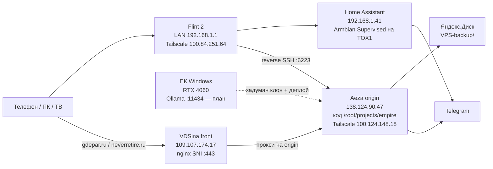
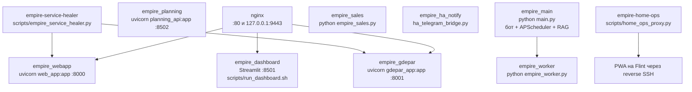
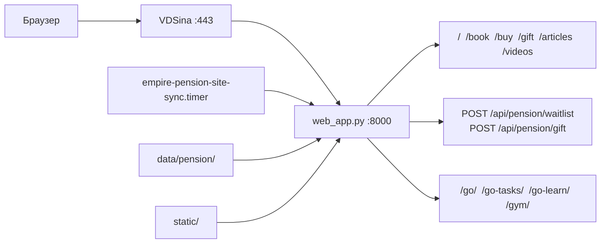
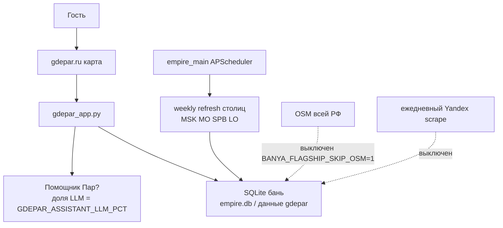
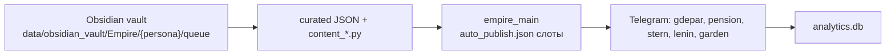
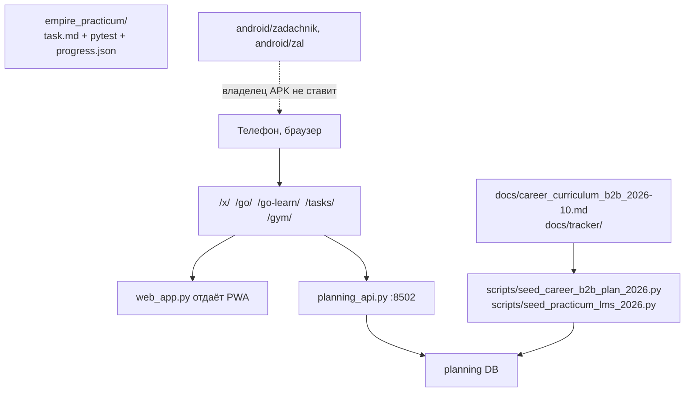
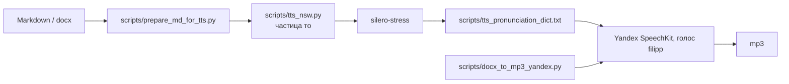
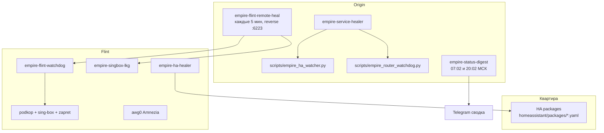
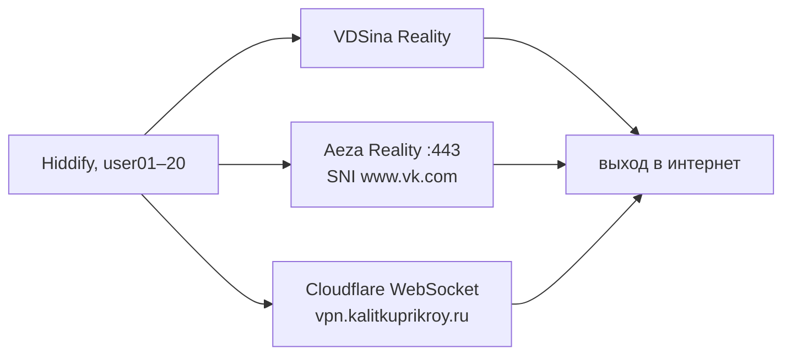

# Схемы ПО Empire

Срез 31.10.2026. Пути — от корня `/root/projects/empire`. Секреты и UUID в схемы не входят.

Как читать: сверху физические машины, дальше процессы на origin, потом потоки данных. Код правится в этом дереве. Прод-процессы поднимает systemd, не `docker-compose` (compose в корне — старый черновик Postgres + бот Степаныча, живой контур на SQLite и systemd).

---

## 1. Машины



| Контур | Адрес | Что делает |
|--------|--------|------------|
| Origin | `138.124.90.47` | Весь Python, nginx origin, VPN Reality, бэкапы, хилер |
| Front | `109.107.174.17` | Публичный вход сайтов. Старые IP `89…` и `109.107.186.214` не использовать. Переезд на `45.146.88.222` отменён |
| Дом | Flint `100.84.251.64`, HA `192.168.1.41` | YouTube / Telegram / ИИ, свет, домофон |
| ПК | Windows | Монтаж, локальные модели. Канон дня 1: `docs/LOCAL_AI_PC_SETUP_RU.md` |

Хост origin на момент среза: `rough-beige.ptr.network`. В старых доках встречается имя `moderate-amethys` и IP `193.233.232.48` — это прошлый VPS, nginx `sauron_direct` ещё помнит тот IP.

Канон решений: `AGENTS.md`, `docs/LOCAL_AI_RULES.md`, `docs/gdepar_checkpoints.md`.

---

## 2. Процессы на origin



Проверка с origin:

```bash
systemctl is-active empire_main empire_gdepar empire_webapp empire_dashboard empire_worker empire_planning
curl -sS http://127.0.0.1:8001/api/gdepar/health
curl -sS http://127.0.0.1:8000/api/health
curl -sS http://127.0.0.1:8502/api/planning/health
```

Юниты лежат в `/etc/systemd/system/empire*.service`. Код юнитов в репо дублируется не всегда: источник правды для «что запущено» — `systemctl show <unit> -p ExecStart`.

### Куда nginx отдаёт домены

Файл: `/etc/nginx/sites-enabled/empire_hub` (и `snegirinegiri.ru`, `sauron_direct`, `vpn.kalitkuprikroy.ru`).

| Домен | Куда |
|-------|------|
| `gdepar.ru`, `www`, `par.neverretire.ru` | `127.0.0.1:8001` |
| `neverretire.ru`, `www` | `127.0.0.1:8000` |
| `napensiyunikogda.ru`, punycode-алиасы | редирект / тот же сайт |
| `snegirinegiri.ru`, `snegirinegi.ru` | тот же `web_app` `:8000` — отдельного приложения нет |
| дашборд «Око Саурона» | `:8501`, сайт `sauron_direct` (старый IP и порт 8503) |
| `vpn.kalitkuprikroy.ru` | CDN-вход, не сайт-продукт |

Снаружи браузер бьёт во front VDSina. Front по SNI отдаёт сайты на origin `:9443`, остальное на этом порту — Reality. Детали чекпоинта: `docs/gdepar_checkpoints.md`, CP-20261018d и CP-20261020.

---

## 3. Сайт «На пенсию НИКОГДА»



| Кусок | Файл |
|-------|------|
| Приложение | `web_app.py` |
| Юнит | `empire_webapp.service` |
| Книга, сценарии, лонгриды | `data/pension/` |
| Синк TG → сайт | `scripts/pension_site_sync.py`, таймер `empire-pension-site-sync` |
| ТЗ публикации | `docs/pension_book_publish_tz.md` |
| Календарь контента | `docs/pension_content_calendar_2026.md` |
| Метрика | `docs/metrika_goals_setup.md` — ID нет, воронка слепая |

`/buy` и waitlist в коде есть. Продаж и роликов нет. Канал Pension в TG молчит с 2026-06-11 (срез 22.10).

---

## 4. «Где Пар»



| Кусок | Файл |
|-------|------|
| Сайт и API | `gdepar_app.py` |
| Юнит | `empire_gdepar.service` → порт 8001 |
| Контент канала | `gdepar_content.py`, `gdepar_duo_curated.py`, `gdepar_mono_curated.py` |
| Сводка парсинга | `scripts/empire_gdepar_parse_summary.py` |
| Недельный прогон | `scripts/run_banya_weekly.sh`, `scripts/run_flagship_banya.sh` |
| ТЗ помощника | `docs/gdepar_ai_assistant_tz.md` |
| Чеклист | `docs/EMPIRE_PIPELINE_CHECKLIST.md` блок gdepar |
| Напоминания | `docs/REMINDERS_gdepar.md` |

Срез 22.10, владелец отдельно не обновлял: ~1759 точек, телефон ~42%, цена и вместимость 0, лиды = тесты, выручка 0. Карта жива. Продукт «позвонил и понял цену» — нет.

---

## 5. Автопост пяти каналов



| Персона | Код | Деньги |
|---------|-----|--------|
| Где Пар | `gdepar_content.py` | флагман, касса ещё 0 |
| Пенсия | `pension_content.py` | флагман, канал молчит |
| Сад | `garden_content.py`, `empire_garden_bot.py` | бот продаж **inactive** |
| Штерн | `stern_content.py`, `empire_stern_bot.py` | бот курса **inactive** |
| Ленин | `lenin_content.py`, `empire_donate_bot.py` | донат-бот **inactive** |

Планировщик живёт внутри `main.py` (APScheduler), юнит `empire_main`. Отдельный `empire_worker.py` — очередь фоновых задач.

Аудиты постинга: `content_audit.py`, таймеры `empire-daily-audit`, `empire-weekly-content-audit`, `empire-weekly-posting-metrics`.

Нейрокомментинг (`neurocomment.py`) — только dry-run, пока флаг не включён.

Студия издателя (очередь, рубрики, картинки): пакет `publisher/` (`app.py`, `dispatch.py`, `ai_factory.py`, `schedule.py`). Док: `docs/publisher_studio.md`.

---

## 6. Задачник, практикум, карьера



Канонический вход, который владелец готов принять: один URL с телефона, урок, кнопка «дальше», прогресс и даты. Много входов (`/x/`, `/tasks/`, `/go/`, `/go-tasks/`, `/go-learn/`, `/gym/`) эту приёмку не закрыли. Service Worker на `/tasks/` давал чёрный экран. Разбор: `docs/zadachnik_fix_prompt_2026-10-22.md`, `docs/OPEN_PROBLEMS_FOR_GEMINI_2026-10-22.md` пункт 1.

Локальный курс на диске (не сайт): `empire_practicum/README.md`. Ментор не пишет `solution.py` за студента: `.cursor/rules/empire-practicum-mentor.mdc`.

Карьерный ментор: `.cursor/rules/career-practicum-mentor.mdc`. Лимит deep work 20–24 ч/нед.

Android-клиенты есть в репо (`android/zadachnik`, `android/zal`) и как APK. Рабочая поверхность владельца — PWA, не APK.

---

## 7. Озвучка книг



Доки: `docs/TTS_PRONUNCIATION_PIPELINE.md`, `docs/TTS_ALGORITHM_FOR_GEMINI.md`. Бот PDF→аудио: `bots/stepanich/pdf_audio_bot.py` (это озвучка, не садовый автопост).

Ухо владельца 23.10 не приняло результат: «много» → «мново», кривые ударения, частица «то» слипается. Словарь пополнен, приёмки нет.

---

## 8. Дом: HA + хилеры



Исходники хилеров Flint (деплоятся на роутер, в git — копия): `scripts/flint2/`.

| Пакет HA | Комната / функция |
|----------|-------------------|
| `empire_vannaya_dimmer_fix.yaml`, `empire_vannaya_failsafe.yaml`, `empire_motion_light.yaml` | Ванная |
| `empire_prihozhaya.yaml` | Прихожая, диммер TS0052, инверсия |
| `empire_tualet_hobeian.yaml`, `empire_motion_light_tualet.yaml` | Туалет |
| `empire_kuhnya_zbeacon.yaml`, `empire_kuhnya_rozetka_schedule.yaml` | Кухня |
| `empire_domofon.yaml` | Домофон: Telegram + TTS |
| `empire_balkon_srw_th01.yaml` | Балкон, датчик часто offline |
| `empire_device_watchdog.yaml` | Сторож устройств |
| `empire_alice_scripts.yaml` | Алиса |
| `empire_telegram.yaml` | Уведомления HA |

Контракты комнат: `docs/HA_ROOM_CONTRACTS.md`. Инверсия диммера: `docs/HA_DIMMER_INVERT.md`. Архитектура хилеров: `docs/HEALER_ARCHITECTURE.md`. Домофон: `docs/HA_SMARTINTERCOM_MQTT.md`.

Ждёт рук, код это не закроет: кнопка SNZB-06P ванной, кнопка и DHCP балкона SRW-TH01, QR интеграции Yandex Station.

**Маршруты Flint не трогать** без прямой команды. Смотреть статус можно: `awg show`, логи healthcheck.

На срезе 31.10 remote-heal пишет `FAIL still bad after ensure` и шлёт Telegram. Это наблюдение, не разрешение переписывать podkop.

---

## 9. VPN для своих пользователей

Высокий уровень, без профилей и UUID. Профили лежат вне git: `/root/empire-secrets/profiles/user01.txt` … `user20.txt`. Гайд: `docs/VPN_USER_GUIDE_RU.md`, `docs/VPN_20USERS_HIDDIFY_RU.md`.

Три входа в профиле (JustHost `194.87.108.209` в профили не входит — с домашнего интернета РФ не открывался):



Проверка: `empire-vpn-healthcheck.timer` (юнит смотрит YouTube и Telegram). DNS-исключение для внутреннего резолвера: `empire-vpn-dnsnat.service`.

Менять nginx stream / Reality только по явной просьбе и с ручным ревью (`AGENTS.md`).

---

## 10. Данные и бэкап

| Хранилище | Зачем | Связывать SQL между файлами |
|-----------|--------|------------------------------|
| `empire.db` | контент, бани | нет |
| `analytics.db` | события | нет |
| `sales.db` | деньги | нет |
| planning DB | задачи, курс | нет |
| `data/*.json` | KPI, ledger, рубрики | — |
| `data/rag_*` / FAISS внутри `main.py` | RAG постов | — |

Ночной контур: `scripts/empire_night_pipeline.sh` → `scripts/vps_backup_to_yandex.sh`. Восстановление: `docs/VPS_RESTORE_RUNBOOK.md`, оглавление `docs/RESTORE_INDEX.md`.

Obsidian: `data/obsidian_vault/`, синк `scripts/sync_empire_obsidian.py`, гайд `docs/obsidian_sync_empire_ru.md`.

---

## 11. Карта каталогов

| Путь | Смысл |
|------|--------|
| `main.py` | Telegram-бот Empire, слоты автопоста, RAG, планировщик бань |
| `web_app.py` | neverretire.ru + PWA входы задачника |
| `gdepar_app.py` | gdepar.ru |
| `planning_api.py` | API задач, чеклистов, тела, импорт TickTick |
| `dashboard.py` + `sauron/` | Око Саурона |
| `empire_worker.py` | фон |
| `empire_sales.py` | вебхук оплаты, заглушка YooKassa |
| `publisher/` | студия издателя |
| `bots/stepanich/` | садовый бот и PDF-аудио |
| `homeassistant/` | YAML для HA, деплой на хост HA отдельно от systemd VPS |
| `scripts/flint2/` | скрипты роутера |
| `scripts/empire_service_healer.py` | хилер VPS |
| `empire_practicum/` | уроки Python |
| `android/` | APK-клиенты, владелец ими не пользуется как основной поверхностью |
| `docs/` | канон ТЗ и гайдов |
| `kb_sources/` | источники RAG |
| `portfolio/` | карьерное портфолио |
| `deploy/` | скрипты выкладки |

Мастер-ТЗ: `docs/TZ_OMNI_MEDIA_EMPIRE_FINAL.md`. Портфель простым языком: `docs/EMPIRE_PORTFOLIO_AUDIT_2026-07.md`. Бизнес-план: `docs/empire_business_plan_2026.md`.

---

## 12. Что крутится по расписанию

Таймеры `empire-*` в systemd. Смысл, не crontab целиком:

| Таймер | Зачем |
|--------|--------|
| `empire-vpn-healthcheck` | живы ли три входа VPN |
| `empire-flint-remote-heal` | дымковая проверка Flint каждые 5 мин |
| `empire-service-healer` | сайты, HA, юниты |
| `empire-status-digest` | сводка в Telegram утро/вечер |
| `empire-night-pipeline` | ночь: бэкап и тяжёлое |
| `empire-vps-backup-yandex` | снимок на Диск |
| `empire-pension-site-sync` | RSS/сайт пенсии |
| `empire-daily-audit`, `empire-weekly-*` | посты и отчёты |
| `empire-banya-weekly` | бани, если не перехвачено планировщиком `empire_main` |
| `empire-morning-brief` | утренний бриф |
| `empire-main-py-guard` | защита от затирания `main.py` |
| `empire-disk-cleanup-night` | место на диске |
| `empire-tox1-supervisor` | присмотр за хостом HA |
