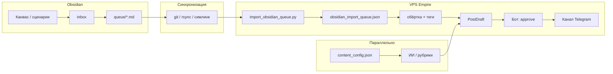

# Obsidian + Empire: как писать и как это попадает в Telegram

Один документ на вашу задачу: **в Obsidian** — сценарии, канвас, сырые тексты по шаблону; **в Empire** — расписание, обёртка, черновик в боте, **approve**, публикация в канал.

**Что создать вам (папки, env, VPS):** `docs/obsidian_what_you_create.md`  
Технические детали импорта: `docs/empire_obsidian_integration.md`.  
Матрицы тем: Gdepar — `docs/gdepar_posting_matrix_2026.md`, Сад — `docs/garden_posting_matrix_2026.md`.

---

## 1. Вариант A и вариант B (не путать)

У Empire **два источника** постов. Obsidian — **вариант A**; расписание на сервере — **вариант B**. Они работают параллельно.

| | Вариант A (Obsidian) | Вариант B (расписание Empire) |
|--|----------------------|-------------------------------|
| **Откуда текст** | Файлы `.md` в `queue/` | `content_config.json` — слоты 08:00, 11:00… |
| **Когда** | По полю `scheduled` в заметке (автомат каждую минуту) или `/obsidian now <id>` | Каждый день в заданное время на VPS |
| **Кто пишет смысл** | **Вы** — сырой или почти готовый текст | **ИИ** (тема из слота) или **готовые рубрики** (классика баня, Ленин, Штерн) |

**Итог:** вариант A — посты, которые **вы уже написали**. Вариант B — **поток по матрице тем**, когда текста заранее нет.

Оба варианта сходятся здесь: **черновик в Telegram → вы жмёте «Опубликовать»** (автопост в канал для curated и Obsidian выключен).

---

## 2. Как устроен vault в Obsidian (рекомендуемая структура)

```text
Empire/
  README.md                 ← правила: что куда класть
  _canvas/                  ← сценарии, блоки «что и как» — только для вас
    gdepar-pipeline.canvas
    pension-ideas.canvas
  _scenarios/               ← текстовые сценарии (не импортируются сами)
    gdepar-14-треков.md
    garden-рубрики.md
  pension/
    inbox/                  ← мысли, обрывки, «потом допишу»
    queue/                  ← готово к импорту → Telegram «На пенсию никогда»
    published/              ← после выхода поста переносите сюда
  garden/
    inbox/
    queue/
    published/
  gdepar/
    inbox/
    queue/
    published/
  stern/
    queue/
  lenin/
    queue/
```

### Что куда

| Папка | Назначение |
|-------|------------|
| **`_canvas/`** | Карта: «идея → тезисы → какой канал → какой слот». Бот **не читает** `.canvas`. |
| **`_scenarios/`** | Ваши же 14 тем Gdepar, 14 рубрик Сада — справочник при написании. |
| **`inbox/`** | Свободная письменная работа, без обязательного frontmatter. |
| **`queue/`** | **Единственная папка**, из которой Empire забирает посты (см. импорт ниже). |
| **`published/`** | Архив: чтобы `queue/` не раздувался и импорт не тащил старое снова. |

---

## 3. Как писать в Obsidian (три уровня)

### Уровень 1 — Сырой текст (как вы и хотели)

Пишете **как в блокноте**: абзацы, без заботы о HTML. В шапке файла — только служебные поля (см. §4).

- Не нужны хештеги внизу — для pension/gdepar/garden Empire при сборке поста может добавить теги сам (`finalize_public_post` и аналоги).
- Не нужны эмодзи в заголовке — обёртка добавит `📌` там, где заложено в коде.
- Можно писать **длинно** — в Telegram длинные посты режутся на часть 1 (с фото) + продолжение (см. правки для Штерна/Gdepar).

### Уровень 2 — По шаблону Obsidian

В репозитории Empire: **`templates/obsidian_empire_post.md`**.

Скопируйте в Obsidian → **Settings → Core plugins → Templates** (или Templater).

Шаблон подставляет заголовок, `persona`, дату. Вы заполняете **тело** и при необходимости правите `title` / `scheduled`.

### Уровень 3 — С канваса и сценария

Типичный поток:

1. На **канвасе** — блоки: тема, канал, дата, крючок, «нужно фото веника».  
2. Когда готовы публиковать — **одна заметка `.md`** в `queue/` (не экспорт канваса).  
3. В теле — уже связный текст; в frontmatter — `persona` и `scheduled`.

Канвас = **планирование**; `.md` в `queue/` = **контракт с Empire**.

---

## 4. Формат файла для импорта (обязательно для варианта A)

В начале файла — блок между `---`:

```markdown
---
id: gdepar-fizika-para-01
persona: gdepar
title: "Почему пар бьёт в лицо"
scheduled: "2026-06-03 21:00"
status: ready
image: optional/local/path.jpg
---

Михалыч сегодня гонял веником воздух так, что у Кириллыча уши в трубочку свернулись.

Правильный пар держится под потолком, а не бьёт в лицо при входе.
```

### Поля

| Поле | Зачем |
|------|--------|
| `id` | Уникальный ключ поста (латиница, дефисы). |
| `persona` | Канал: `pension`, `gdepar`, `garden`, `stern`, `lenin`. |
| `title` | Заголовок для обёртки в Telegram. |
| `scheduled` | Когда **хотите** выйти (пока напоминание + планирование; автослот по времени — следующий этап кода). |
| `status` | `draft` — ещё не в очереди; `ready` — импортировать. |
| `image` | Пока опционально, поддержка в коде может дорасти; иначе фото после approve вручную / генерация. |

**Парсер простой:** только плоские строки `ключ: значение`, без сложного YAML.

---

## 5. От Obsidian до Telegram — полная цепочка



### Шаг за шагом (вариант A — ваш текст)

| Шаг | Кто | Действие |
|-----|-----|----------|
| 1 | Вы | Пишете в Obsidian → файл в **`persona/queue/`**, `status: ready`. |
| 2 | Вы | Доставляете файлы на сервер (git pull, Obsidian Sync + симлинк, rsync). |
| 3 | VPS | `export OBSIDIAN_EMPIRE_INCOMING=…/Empire/gdepar/queue` (или симлинк в `data/obsidian_incoming`). |
| 4 | VPS | Импорт: автомат каждые ~10 мин или `./venv/bin/python scripts/import_obsidian_queue.py` → **`data/obsidian_import_queue.json`**. |
| 5 | Empire | По `scheduled` (или `/obsidian due` / `/obsidian now id`) — сборка HTML, **PostDraft**, сообщение в бот. За 2 ч до времени — напоминание в Telegram. |
| 6 | Вы | В Telegram: читаете, при необходимости правки / «Другая картинка» (рубрики варианта B). |
| 7 | Вы | **«Опубликовать»** → пост в канал. |
| 8 | Вы | Файл из `queue/` → **`published/`** (импорт эту папку не сканирует). |

### Шаг за шагом (вариант B — расписание без вашего текста)

| Канал | Слоты (пример) | Что приходит в бот |
|-------|----------------|-------------------|
| **Garden** | 08 / 12 / 16 / 20 | 08 и 20 — план и луна; 12/16 — ИИ по теме из JSON |
| **Gdepar** | 11 / 15 / 21 | 15:00 — **Классическая баня** (готовые цитаты); 11/21 — ИИ + матрица 14 тем |
| **Pension** | по конфигу | ИИ-разбор или сырые новости `[RAW:…]` |
| **Lenin** | 10 / 12 / 19 | 12:00 — рубрики с фото; остальное — ИИ/календарь |
| **Stern** | 09:00 | Рубрики (силачи, гири…) с фото, approve обязателен |

Расписание **не читает** Obsidian. Если в тот же день и слот вы хотите **свой** текст из Obsidian — задайте `scheduled` на другое время или отключите дублирующий слот в `content_config.json` на этот день (редакторское решение).

---

## 6. Обёртка поста в Telegram (что добавит Empire, не Obsidian)

Зависит от канала; в Obsidian пишете **середину**, шапку и теги часто добавляет код.

| Канал | Обёртка (пример) |
|-------|------------------|
| **Pension** | Ваш текст + строка хештегов `#финансы #мысль #экономика`; для видео — блок ссылок YouTube/VK из `data/post_format.json`. |
| **Gdepar** | Можно в стиле Михалыча; классика 15:00 — цитата в blockquote + источник + комментарий Кириллыча. |
| **Garden** | Тон Степаныча; теги `#огород #дача #урожай`. |
| **Lenin / Stern** | Рубрики: blockquote, источник, картинка обязательна перед approve. |

Для **сырца из Obsidian** разумно в frontmatter завести опционально:

```yaml
wrap: pension_fmt
```

*(поле пока на будущее; сейчас обёртка по `persona`.)*

---

## 7. Как совместить с матрицами тем (Gdepar, Сад)

В Obsidian в **`_scenarios/`** держите копию матриц:

- Gdepar: 14 треков (физика пара, веники, фауна…) — `docs/gdepar_posting_matrix_2026.md`
- Сад: 14 рубрик (томаты, агрофитнес…) — `docs/garden_posting_matrix_2026.md`

**Связка:**

| Задача | Где планируете | Где фиксируете пост |
|--------|----------------|---------------------|
| «На этой неделе 2 поста про веники» | Канвас / сценарий | Два `.md` в `gdepar/queue/` с `title` и телом |
| «Промо gdepar.ru в понедельник» | Календарь | Либо слот `promo_map` (вариант B), либо свой текст в Obsidian с `scheduled` на понедельник 11:00 (вариант A) |
| «Сад: чек-лист на майские» | Сценарий G14 | `garden/queue/` + `persona: garden` |

Так **матрица** = меню тем; **Obsidian queue** = конкретные написанные посты; **Empire schedule** = автозаполнение дыр, когда вы не успели написать сами.

---

## 8. Практический недельный ритм

| День | Obsidian | Empire / Telegram |
|------|----------|-------------------|
| Пн | План недели на канвасе; 1–2 файла в `queue/` | Проверить промо Gdepar (вариант B) + approve вчерашних |
| Вт–Чт | Дописать сырцы в `inbox` → перенос в `queue/` | По расписанию приходят ИИ-черновики — approve |
| Пт | `git push` / sync на VPS → **import** | Просмотр `obsidian_import_queue.json`, ожидание черновиков |
| Сб–Вс | Длинные байки/пенсия — писать без слотов | Меньше постов или только ручные из очереди |

---

## 9. Настройка связи vault ↔ сервер (один раз)

**Способ 1 — симлинк на VPS**

```bash
ln -s "/home/ВЫ/Obsidian/Empire/pension/queue" /root/projects/empire/data/obsidian_incoming
```

**Способ 2 — переменная на конкретный queue**

```bash
export OBSIDIAN_EMPIRE_INCOMING=/home/ВЫ/Obsidian/Empire/pension/queue
cd /root/projects/empire
./venv/bin/python scripts/import_obsidian_queue.py
```

**Способ 3 — git**

Приватный репозиторий vault → на VPS `git pull` в каталог → `OBSIDIAN_EMPIRE_INCOMING` на `Empire/.../queue`.

---

## 10. Чеклист «готово к посту в TG»

- [ ] Файл в **`queue/`**, не в `inbox/` и не только на канвасе.  
- [ ] В frontmatter: **`persona`**, **`id`**, **`title`**, при желании **`scheduled`**.  
- [ ] Текст читается как законченный пост (не «TODO»).  
- [ ] Импорт на VPS выполнен после последней правки.  
- [ ] После публикации файл перенесён в **`published/`**.  
- [ ] Не два поста на одно и то же время в одном канале (Obsidian + ИИ-слот) без решения редактора.

---

## 11. Что уже работает

| Функция | Статус |
|---------|--------|
| Импорт `.md` → JSON | ✅ `scripts/import_obsidian_queue.py` |
| Вариант B: расписание → ИИ / рубрики → approve → TG | ✅ |
| Вариант A: `scheduled` → черновик в бот | ✅ `check_obsidian_queue` + `obsidian_content.py` |
| Команды бота `/obsidian import|list|due|now <id>` | ✅ |
| Напоминание за 2 ч до `scheduled` | ✅ (настройка `data/obsidian_config.json`) |
| Картинка из поля `image:` в заметке | ✅ копия в `media/<persona>/obsidian/` |
| Обёртка, хештеги, длинные посты | ✅ |

---

## 12. Шпаргалка команд на VPS

```bash
cd /root/projects/empire
export OBSIDIAN_EMPIRE_INCOMING=/path/to/Empire/pension/queue
./venv/bin/python scripts/import_obsidian_queue.py
cat data/obsidian_import_queue.json | head -80
sudo systemctl restart empire_main   # после обновлений кода
```

В Telegram: вариант B — по слотам; вариант A — по `scheduled` или `/obsidian now <id>`.

Команды в боте (только админ): `/obsidian import`, `/obsidian list`, `/obsidian due`, `/obsidian now 2026-05-20-zagolovok`.

---

## 13. Файлы в репозитории Empire

| Файл | Зачем |
|------|--------|
| `templates/obsidian_empire_post.md` | Шаблон новой заметки |
| `scripts/import_obsidian_queue.py` | Импорт queue → JSON |
| `content_config.json` | Расписание варианта B |
| `obsidian_content.py` | Вариант A: очередь, scheduled, обёртка |
| `data/obsidian_config.json` | Интервал импорта, напоминания |
| `data/post_format.json` | Хвосты pension (видео, ссылки) |
| `docs/obsidian_practical_guide_ru.md` | Этот гайд |
| `docs/obsidian_geminese_setup_ru.md` | Geminese + Gemini CLI на ПК |
| `templates/obsidian_plugins/geminese/` | Файлы плагина 0.9.1 |

Если нужен **один лист для вставки в Obsidian** (`Empire/README.md` в vault) — скопируйте §2, §3, §4 и §10 в свою заметку-правила в корне vault.
