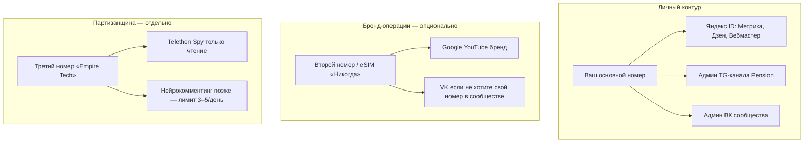

# Pension: Метрика на сайте, аккаунты соцсетей, телефоны, куда сводить аналитику

**Проект:** «На пенсию НИКОГДА» · `neverretire.ru`  
**Дашборд Empire:** [hub.neverretire.ru](https://hub.neverretire.ru) — «Око Саурона» (Streamlit)  
**Связь:** `docs/pension_book_publish_tz.md` §6, `docs/metrika_setup_guide.md`, `docs/spy_setup_gdepar_stern.md`, `docs/pension_youtube_launch_guide.md`

---

## Часть A. Яндекс.Метрика на neverretire.ru (полная настройка)

> **Сейчас в коде:** счётчик есть для **gdepar.ru** (`gdepar_metrika.inc.html`). Для **neverretire.ru** (`web_app.py`) — **ещё не подключён** (задача S1 в `pension_book_publish_tz.md`). Ниже — что сделать в Метрике и на сервере.

### A.1. Архитектура

```
Посетитель → neverretire.ru
    → tag.js (если YANDEX_METRIKA_ID в env webapp)
    → ym(id, "init")
    → pensionMetrikaReach("имя_цели", params)
    → ym(id, "reachGoal", "имя_цели")
```

| Счётчик | Домен | Env | Не смешивать |
|---------|-------|-----|--------------|
| Gdepar | gdepar.ru | `/etc/empire/gdepar.env` | `YANDEX_METRIKA_ID` |
| **Pension** | neverretire.ru | `/etc/empire/webapp.env` или общий `.env` | **отдельный номер счётчика** |

### A.2. Шаг 1 — создать счётчик в Метрике

1. [metrika.yandex.ru](https://metrika.yandex.ru) — Яндекс ID (тот же, что Вебмастер / Дзен, удобно).
2. **Добавить счётчик** (+).

| Поле | Значение |
|------|----------|
| Имя | `neverretire.ru` или «На пенсию никогда» |
| Сайт | `https://neverretire.ru` |
| Часовой пояс | Europe/Moscow |
| Другие домены | Включить, если трафик с `napensiyunikogda.ru` / `www` (зеркала с 301 на канон — обычно один счётчик) |

3. Включить: **Вебвизор**, **Карта кликов**, **Хеш в URL** (если появятся якоря). **E-commerce** — только когда заработает `/buy` с dataLayer (фаза 2).
4. Скопировать **номер счётчика** (только цифры).

### A.3. Шаг 2 — цели в интерфейсе Метрики

**Тип:** JavaScript-событие · **Идентификатор** = имя ниже (буква в букву).

Создайте все из таблицы (можно партиями: сначала 6 жирных).

| Идентификатор | Назначение | Приоритет |
|---------------|------------|-----------|
| `pension_book_toc_open` | Открыт `/book` | P0 |
| `pension_book_chapter_read` | Глава: scroll ≥70% или ≥180 с | P0 |
| `pension_book_cta_buy` | Клик «Купить книгу» | P0 |
| `pension_buy_page_open` | Страница `/buy` | P0 |
| `pension_payment_start` | Клик «Оплатить» | P1 |
| `pension_payment_success` | Успешная оплата (return URL) | P1 |
| `pension_email_submit` | Форма pre-launch | P1 |
| `pension_article_read` | Статья `/articles/*` | P1 |
| `pension_video_play` | Старт YouTube embed | P2 |
| `pension_tg_click` | Клик ссылка Telegram | P2 |
| `pension_vk_click` | Клик ВК | P2 |
| `pension_page_view` | Опционально: page в params | P2 |

### A.4. Шаг 3 — код на сайте ✅ (в репозитории)

Реализовано:

- `templates/pension_metrika.inc.html` + `templates/base.html`
- `web_app.py` — `YANDEX_METRIKA_ID`, `pensionMetrikaReach`, цели по scroll/click
- `GET /api/health` → `metrika_id_set`
- Кнопки: `data-pension-goal="..."` на CTA

**Вам осталось:** прописать ID в `.env` и создать цели в кабинете Метрики (§A.3).

Env на VPS (пример):

```bash
# /etc/empire/webapp.env или .env empire_webapp
YANDEX_METRIKA_ID=12345678
```

```bash
sudo systemctl restart empire_webapp
curl -sI https://neverretire.ru/ | head -5
# В HTML страницы: mc.yandex.ru/metrika/tag.js
```

### A.5. Шаг 4 — UTM (обязательно для всех ссылок из соцсетей)

Шаблон:

```
https://neverretire.ru/book/introduction?utm_source=SOURCE&utm_medium=MEDIUM&utm_campaign=CAMPAIGN
```

| Источник | utm_source | utm_medium | utm_campaign (пример) |
|----------|------------|------------|-------------------------|
| Telegram канал | telegram | post | pension_20260521_post42 |
| VK пост | vk | post | pension_vk_launch |
| VK клип | vk | clip | pension_clip_ep01 |
| Дзен статья | dzen | article | pension_ch03_teaser |
| YouTube описание | youtube | video | pension_ep01 |
| Email | email | newsletter | pension_w12 |
| Книга launch | vk / dzen / telegram | cta | book_launch_2026 |

В Метрике: **Отчёты → Источники → UTM-метки** — главный отчёт «откуда пришли читатели книги».

### A.6. Шаг 5 — воронки в Метрике (ручные)

Создать 2–3 воронки:

1. **Книга:** визит `/book` → `pension_book_chapter_read` → `pension_book_cta_buy` → `pension_payment_success`
2. **Контент:** `/articles` → `pension_article_read` → клик на `/book`
3. **Pre-launch:** главная → `pension_email_submit` → (позже) покупка с `utm_medium=email`

### A.7. Шаг 6 — Вебмастер и цели в поиске

1. [webmaster.yandex.ru](https://webmaster.yandex.ru) — сайт `neverretire.ru`.
2. Подтверждение DNS (Cloudflare) или HTML-файл.
3. Sitemap: `https://neverretire.ru/sitemap.xml` (уже отдаёт `web_app.py`).
4. Связать счётчик Метрики с Вебмастером.

### A.8. Шаг 7 — проверка (чеклист)

- [ ] Счётчик создан, ID в env
- [ ] tag.js в исходнике главной
- [ ] «Посетители онлайн» — визит с телефона
- [ ] Цели P0 созданы в кабинете
- [ ] Тест: клик CTA → цель сработала (отладчик Метрики / расширение)
- [ ] Пост в TG с UTM → в Метрике виден `utm_source=telegram`
- [ ] Вебвизор: запись сессии на `/book/introduction`

### A.9. KPI сайта (смотреть раз в неделю)

| KPI | Где в Метрике |
|-----|----------------|
| Сессии / пользователи | Стандартные → Посещаемость |
| Топ страницы | Содержание → Страницы входа |
| CR в покупку | Воронка §A.6 |
| Источники | UTM |
| Отказы на `/book` | Вебвизор + время на странице |

---

## Часть B. Аккаунты в соцсетях: где заводить, как называть, что писать

### B.1. Принцип «один бренд — много входов»

| Элемент | Единообразие |
|---------|--------------|
| Название | **На пенсию НИКОГДА** (или «На пенсию никогда» — выбрать один регистр везде) |
| Персона | Иосиф Борода (автор книги / голос канала) |
| Домен | **neverretire.ru** в био и закрепе |
| Дисклеймер | «Не является ИИР» — в описании ВК/YouTube/Дзен |
| Email | info@neverretire.ru (Cloudflare Email Routing) |

### B.2. Матрица площадок (РФ 2026)

| Площадка | Заводить? | Приоритет | Аккаунт входа | Handle / URL |
|----------|-----------|-----------|---------------|--------------|
| **Сайт** | Уже есть | P0 | — | neverretire.ru |
| **Telegram** | Канал есть | P0 | Ваш TG (админ) | @… канал Pension |
| **Дзен** | Да | P0 (без VPN) | Яндекс ID = Метрика | Дзен-канал «На пенсию никогда» |
| **ВК** | Да | P0 (без VPN) | VK ID / отдельный если нужно | Сообщество «На пенсию никогда» |
| **YouTube** | Да | P1 | **Отдельный Google** «Никогда» | @neverretire или близко |
| **MAX** | Позже | P3 | — | после ВК |
| **Rutube** | Опционально | P2 | тот же бренд | дубль для без VPN |
| **Boosty** | Позже | P2 | — | донаты / PDF |

**Не плодить:** отдельный Instagram/TikTok на старте — распыление. **Не** второй Telegram «только для книги» — один канал Pension.

### B.3. Что писать в профилях (шаблоны)

#### Telegram (описание канала)

```
На пенсию НИКОГДА — манифест против пенсии как капитуляции.
Разбор новостей, антихрупкость, смысл денег без инфобизнеса.
Книга и статьи → neverretire.ru
Не является индивидуальной инвестиционной рекомендацией.
```

Закреп: ссылка на введение книги с UTM `utm_source=telegram&utm_medium=pinned`.

#### ВК (сообщество)

- **Тип:** тематическое сообщество / публичная страница (страница проще для медиа).
- **Описание:** то же + кнопка «Сайт» → neverretire.ru.
- **Контакты:** info@neverretire.ru.
- **Первые 10 постов:** цитаты из книги, одна новость недели, ссылка на Дзен/сайт — не стена рекламы.

#### Дзен

- **Название канала:** На пенсию НИКОГДА.
- **Описание:** 2 абзаца УТП + ссылка на сайт и ВК.
- **Рубрики:** Финансы · Экономика · Личный опыт (на выбор).
- **Контент:** лонгриды 5–12 тыс. знаков, **не** полный текст книги — углы глав + новости.

#### YouTube

См. `docs/pension_youtube_launch_guide.md`:

- Отдельный Google-аккаунт бренда, 2FA.
- Баннер: УТП + «сайт в описании».
- Описание канала: neverretire.ru, ВК, Дзен, TG (пометка VPN для TG).

### B.4. Имена (@) — как выбрать

| Площадка | Рекомендация |
|----------|--------------|
| TG | Короткий @ канала: `neverretire`, `napensiyunikogda`, `pension_never` — что свободно |
| ВК | `vk.com/neverretire` или `vk.com/napensiyunikogda` |
| Дзен | Имя канала = бренд (латиница в URL не критична) |
| YouTube | `@neverretire` если свободен |

Проверить **занятость** и **одинаковое написание** в поиске Яндекса/Google.

### B.5. Что публиковать первые 30 дней (минимум)

| Неделя | TG | ВК | Дзен |
|--------|----|----|------|
| 1 | Оформление + закреп + 2 поста | Создать, 3 поста из tripwire/книги | Канал + 0–1 статья |
| 2 | 2 поста/нед | 2 поста + ссылка Дзен | 1 статья «7 мыслей из книги» |
| 3–4 | raw_news по расписанию Empire | 1 клип (если есть видео) | 1 статья/нед |

Тексты постов: Empire `pension` → approve → TG; ВК/Дзен — после `VK_ACCESS_TOKEN` и `dzen_rss`.

---

## Часть C. Телефоны и аккаунты: личный, бренд, партизанщина

### C.1. Три роли (не смешивать)



### C.2. Рекомендация (практичная)

| Контур | Номер | Зачем |
|--------|-------|-------|
| **Основной (ваш)** | Действующий смартфон | Админ каналов, 2FA Яндекс/Google, модерация в «Око Саурона», личная репутация |
| **Бренд (опционально)** | eSIM / второй слот | Только если не хотите светить личный номер в ВК/Google; YouTube «Никогда» |
| **Spy / партизанщина** | **Отдельный** номер, никому не известный | Telethon на VPS; **не** ваш основной TG; **не** админ канала Pension |

**Ответ на ваш вопрос:**

> Имеет ли смысл отдельный номер для соцсетей и через него spy, или соцсети на обычном номере, а spy на втором?

**Оптимально:**

1. **Соцсети и админка Pension** — на **обычном** номере / вашем Яндекс-Google (админ канала не = аккаунт spy).
2. **Партизанщина (Telethon Spy, позже нейрокомменты)** — **только второй («тех») номер**, не связанный публично с «Иосифом Бородой».
3. **Не вести spy с номера, который админит ваш канал** — при бане техаккаунта пострадает не личка, но лучше развязать: бан admin-session = катастрофа.

Отдельный номер **на каждую** соцсеть **не нужен** — это дорого и неудобно. Достаточно **1 личный + 1 тех** (2 SIM).

### C.3. Что НЕ делать с тех-аккаунтом Spy

- Не подписываться массово на 200 каналов за день.
- Не слать комментарии от имени бренда до готовности нейро + approve.
- Не логинить тех-сессию на личном телефоне как основной клиент (только `.session` на VPS).
- Не использовать VPN-фермы и покупные «живые» аккаунты.

Подробно: `docs/spy_setup_gdepar_stern.md` — **один** reader-аккаунт читает много публичных каналов Gdepar/Stern; **Pension в spy не входит**.

### C.4. Нейрокомментинг (когда включите)

| Вариант | Плюс | Минус |
|---------|------|-------|
| Тот же тех-аккаунт | Один `.session` | Бан = и spy и комменты |
| Второй тех-аккаунт | Изоляция | Два номера, два API |

Старт: **тот же тех**, 3–5 комментов/день, только dry-run → approve в дашборде.

### C.5. SIM: что купить

- **eSIM** «второй номер» на том же телефоне — достаточно для регистрации Google/тех-TG.
- Для **spy-only** — дешёвый prepaid / виртуальный номер **только для первого входа** Telegram; дальше сессия на VPS, SIM может не быть в телефоне постоянно.
- Хранить SIM тех-номера **отдельно** от основной (подпись «Empire Tech»).

---

## Часть D. Куда выводить метрики: Метрика, соцсети, Око Саурона

### D.1. Золотое правило: три слоя, не один дашборд

| Слой | Инструмент | Что хранит | Кто смотрит |
|------|------------|------------|-------------|
| **1. Поведение на сайте** | Яндекс.Метрика | Визиты, UTM, цели, вебвизор | Вы, раз в неделю |
| **2. Нативные кабинеты** | TG / VK / Дзен / YouTube Studio | Охваты, подписчики, ER, удержание | Вы, раз в неделю |
| **3. Операции Empire** | `analytics.db` + `sales.db` + **Око Саурона** | Публикации, spy, заказы, события ботов | Ежедневно редактор |

**Не пытаться** перенести всё из Метрики и YouTube в Streamlit на первом этапе — API, квоты, разные модели данных.

### D.2. Что уже есть в «Око Саурона» (hub.neverretire.ru)

| Вкладка | Данные |
|---------|--------|
| Модерация постов | `empire.db` черновики |
| Пенсия · новости | RSS, разборы |
| Разведка · Gdepar/Stern | `spy_signals` (не Pension) |
| Аналитика | `analytics.db` — счётчики событий |
| AI Insights | сводка 7 дней + гипотезы |
| Продажи | `sales.db` (когда продукты книги) |
| Мониторинг | systemd, размер БД |

**Нет пока:** графиков Метрики, подписчиков VK, просмотров YouTube — это нормально для MVP.

### D.3. Целевая схема (куда всё в итоге)

```
                    ┌─────────────────────┐
                    │  Яндекс.Метрика     │ ← сайт, UTM, цели книги
                    │  (отчёты в UI)      │
                    └──────────┬──────────┘
                               │ раз в сутки API (фаза 2)
┌──────────────┐    ┌──────────▼──────────┐    ┌─────────────┐
│ VK / Дзен /  │───►│   analytics.db      │◄───│ sales.db    │
│ YT / TG      │    │   (события Empire)  │    │ заказы книги│
│ (ручной      │    └──────────┬──────────┘    └─────────────┘
│  ввод 1/нед) │               │
└──────────────┘    ┌──────────▼──────────┐
                    │  Око Саурона        │
                    │  вкладка «Pension   │
                    │   · сводка» (новая) │
                    └─────────────────────┘
```

### D.4. Что вести в Око Саурона vs вне

| Метрика | Где основной источник | В Око Саурона |
|---------|----------------------|---------------|
| Сессии сайта, UTM, цели книги | Метрика UI | Ссылка + 3–5 цифр после API (P2) |
| Просмотры поста TG | TG статистика | Ручной ввод / будущий cron |
| Подписчики VK/Дзен/YT | Кабинеты площадок | `daily_subs` в analytics.db (ручной или API) |
| Заказы книги | sales.db | **Да** — вкладка Продажи |
| Опубликовано постов pension | analytics `pension_post_published` | **Да** — Аналитика |
| Spy Gdepar/Stern | spy_signals | **Да** — Разведка |
| Вебвизор, карта кликов | Только Метрика | Ссылка в sidebar |

### D.5. Еженедельный ритуал (30–45 мин)

1. **Метрика** (10 мин): сессии, топ UTM, воронка книги, 1 сессия вебвизора.
2. **Соцсети** (10 мин): подписчики + лучший пост недели — внести в таблицу (см. ниже).
3. **Око Саурона** (10 мин): pending черновики, продажи, события analytics.
4. **Решение** (5 мин): одна гипотеза на следующую неделю (уже есть шаблон в AI Insights).

Таблица (Google Sheets или `data/pension_weekly_metrics.json` вручную):

| week | tg_subs | vk_subs | dzen_reads | yt_views | site_sessions | book_toc | buy_clicks | orders | revenue_rub | top_utm |

### D.6. Roadmap интеграции в дашборд (код)

| Фаза | Задача | Статус |
|------|--------|--------|
| P0 | Вкладка **«Pension · сводка»** в Око Саурона | ✅ |
| P0 | `log_event("pension_post_published")` при publish | ✅ `empire_publish.py` |
| P0 | Waitlist email → `data/pension_waitlist.json` | ✅ |
| P1 | Форма метрик недели → `data/pension_weekly_metrics.json` | ✅ |
| P1 | Ручной снимок подписчиков → `daily_subs` | ✅ |
| P2 | Metrika Reporting API → cron → `analytics.db` | ⬜ |
| P3 | TG channel statistics API | ⬜ |

### D.7. Имеет ли смысл «всё в Око Саурона»?

**Да, но как единый операционный центр**, не замена Метрики:

- **Да:** модерация, публикация, продажи книги, spy, сводные KPI, гипотезы AI.
- **Нет (пока):** полный веб-аналитик и YouTube Analytics внутри Streamlit.
- **Компромисс:** в дашборде блок **«Pension KPI»** — 8 цифр + ссылки на внешние кабинеты.

---

## Часть E. Чеклисты

### E.1. Метрика neverretire (один раз)

- [ ] Счётчик создан
- [ ] Цели P0 созданы
- [ ] ID в env, webapp перезапущен
- [ ] tag.js на сайте
- [ ] UTM в закрепе TG и первом посте ВК
- [ ] Вебмастер + sitemap
- [ ] Воронка «книга» в Метрике

### E.2. Аккаунты соцсетей (один раз)

- [ ] Единое имя бренда
- [ ] Дзен-канал + описание + ссылка на сайт
- [ ] ВК сообщество + 5 постов
- [ ] Google «Никогда» + YouTube оформление (или в очереди)
- [ ] info@neverretire.ru работает
- [ ] Дисклеймер ИИР везде

### E.3. Телефоны (один раз)

- [ ] Решение: 1 или 2 SIM (личный + тех)
- [ ] Тех-номер: зарегистрирован TG для Telethon
- [ ] `.session` spy только на VPS, не на личном телефоне как основной аккаунт
- [ ] Админ канала Pension — личный TG, не тех

### E.4. Аналитика (еженедельно)

- [ ] Метрика: UTM + воронка
- [ ] Таблица недели заполнена
- [ ] Око Саурона: черновики + продажи
- [ ] Одна гипотеза в AI Insights / блокнот

---

## Связанные файлы

| Документ |
|----------|
| `docs/pension_book_publish_tz.md` |
| `docs/metrika_setup_guide.md` |
| `docs/metrika_goals_setup.md` |
| `docs/pension_youtube_launch_guide.md` |
| `docs/spy_setup_gdepar_stern.md` |
| `docs/dashboard_external_access.md` |
| `web_app.py` · `dashboard.py` · `analytics_db.py` |

---

*Версия 1.0 — май 2026.*
