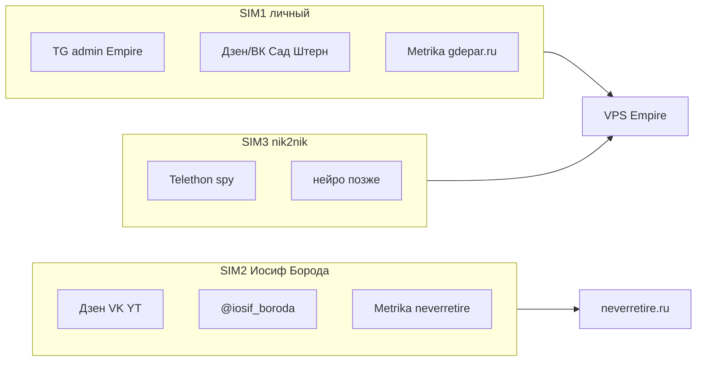

# SIM и аккаунты Empire (РФ, 2026)

**Статус:** зафиксировано владельцем.  
**Связано:** `docs/growth_rf_no_max_2026.md`, `docs/empire_master_plan_rf_2026.md`, `docs/spy_setup_gdepar_stern.md`

> Номера телефонов — только для вашей операционки. **Не коммитить** в git (`.env` и Obsidian «Личное»).

---

## SIM 1 — личный (операции)

| Роль | Что вешать |
|------|------------|
| TG | **Админ** всех каналов Empire (черновики, approve) |
| Яндекс ID | Дзен/ВК **Сад**, **Штерн**, **Ленин**; Метрика **gdepar.ru** |
| Не смешивать | Pension-бренд «Иосиф Борода» (это SIM 2) |

---

## SIM 2 — «Иосиф Борода» / Pension

**Номер:** +7 916 952-68-23  
**Изоляция:** отдельный Яндекс/Google; не пересекать с Садом и «Снегири НЕ ГИРИ».

| Площадка | URL / @ | Env / сайт |
|----------|---------|------------|
| **Дзен** | [dzen.ru/user/n6syfdkcdr3eki-y_clnwz1c0dk](https://dzen.ru/user/n6syfdkcdr3eki-y_clnwz1c0dk) | `PENSION_DZEN_URL` |
| **ВК** | [vk.com/id1116951081](https://vk.com/id1116951081) | `PENSION_VK_URL` |
| **YouTube** | [Иосиф Борода](https://www.youtube.com/channel/UC-XdhgaT-gXZPJpODed8Ksw) | `PENSION_YOUTUBE_URL`, `data/site/videos.json` |
### Два Telegram (решение зафиксировано)

| Аккаунт | Роль | SIM | Empire / сайт |
|---------|------|-----|---------------|
| **[@pensiya_nikogda](https://t.me/pensiya_nikogda)** | Канал про пенсию, автопост, контент | Админ **SIM 1** | `PENSION_TG_URL`, футер «Канал TG» |
| **[@iosif_boroda](https://t.me/iosif_boroda)** | Личный TG автора «Иосиф Борода» | **SIM 2** | `PENSION_TG_PERSONAL_URL`, «О проекте» |

**Перекрёстные ссылки (ручная настройка в TG):**
- В **@pensiya_nikogda** (закреп / описание): «Автор — [@iosif_boroda](https://t.me/iosif_boroda)», ссылка на [neverretire.ru](https://neverretire.ru)
- В **@iosif_boroda** (bio): «Канал про пенсию — [@pensiya_nikogda](https://t.me/pensiya_nikogda)», neverretire.ru, YouTube

Автопост Pension в Empire **только** в `@pensiya_nikogda` — не менять.

### Env (neverretire / empire_webapp)

```bash
PENSION_TG_URL=https://t.me/pensiya_nikogda
PENSION_TG_PERSONAL_URL=https://t.me/iosif_boroda
PENSION_DZEN_URL=https://dzen.ru/user/n6syfdkcdr3eki-y_clnwz1c0dk
PENSION_VK_URL=https://vk.com/id1116951081
PENSION_YOUTUBE_URL=https://www.youtube.com/channel/UC-XdhgaT-gXZPJpODed8Ksw
```

---

## SIM 3 — Spy / Empire Tech

**Номер:** +7 933 276-65-35  
**Telegram:** [@nik2nik](https://t.me/nik2nik)

| Роль | Правило |
|------|---------|
| Telethon spy | Только **Gdepar + Stern**; Pension **не** в spy |
| Нейрокомментинг | Позже, dry-run; 3–5 комм/день |
| **Не** | Админ ваших каналов, массовые подписки, личный основной TG |

### VPS (после `python scripts/telethon_login.py`)

```bash
TELETHON_API_ID=...
TELETHON_API_HASH=...
TELETHON_SESSION=/root/projects/empire/empire_spy
```

Логин Telethon — **один раз** с аккаунта @nik2nik; дальше `.session` на сервере, SIM может не быть в телефоне.

Пока сессии нет: `stop_spy: true` в конфиге worker.

---

## Схема (кратко)



---

## Чеклист после регистрации

- [x] `PENSION_VK_URL` / `PENSION_DZEN_URL` в env → футер + `/about` на neverretire
- [ ] `VK_ACCESS_TOKEN` (SIM 2) → автопост на стену ВК при approve
- [ ] Дзен Studio: RSS `https://neverretire.ru/rss/pension.xml`
- [ ] Telethon @nik2nik (SIM 3) → `docs/spy_neuro_runbook_2026.md`
- [ ] Метрика neverretire.ru — счётчик с **SIM 2** Яндекс ID → `YANDEX_METRIKA_ID`
- [ ] YouTube: описание канала + ссылка neverretire.ru
- [ ] Дзен: 2–4 статьи из Pension-постов (контент-петля)
- [ ] Telethon: `telethon_login.py` с @nik2nik на VPS
- [ ] Не логинить @nik2nik в Telegram на основном телефоне как daily driver
