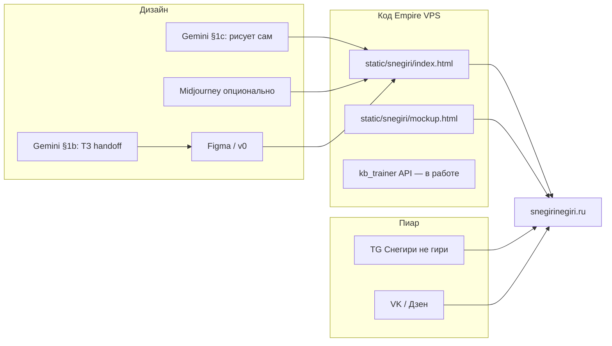

# Пайплайн «Снегири не гири» — где что лежит и куда передавать

**Статус:** старт июль 2026 · домен регистрируется сегодня–завтра

---

## Схема потока

---

## Карта файлов (источник правды)

| Что | Путь | Кто правит |
|-----|------|------------|
| **ТЗ продукта** | `docs/stern_kettlebell_ai_trainer_tz.md` | Cursor + вы (решения) |
| **Промпты Gemini** | `docs/snegiri_gemini_prompts.md` | Cursor |
| **Финмодель Gemini** | `docs/snegiri_finmodel_gemini.md` | Gemini → сверка в Cursor |
| **Письма тренерам** | `docs/snegiri_trainers_outreach.md` | Вы (отправка) |
| **Shot list съёмки** | `docs/snegiri_shot_list.md` | → тренеру как PDF |
| **Гайд съёмки** | `docs/snegiri_filming_guide.md` | — |
| **Деплой nginx** | `docs/snegiri_deploy_vps.md` | Cursor после DNS |
| **Лендинг (код)** | `static/snegiri/index.html` + `landing.css` | Cursor |
| **Макет приложения** | `static/snegiri/mockup.html` + `styles.css` | Cursor |
| **Матрица постинга TG** | `docs/content_factory/stern_POST_MATRIX_2026.md` | база |
| **Матрица запуска** | `docs/content_factory/stern_POST_MATRIX_SNEGIRI_LAUNCH.md` | **новое** |
| **Расписание автопоста** | `content_config.json` → `stern` | Cursor при внедрении слотов |
| **CV прототип R1** | `tools/snegiri_cv_probe.py` | Cursor |
| **Задачи** | `planning.db` → проект «Штерн · ИИ-тренер гири» | Empire Tasks |

---

## На чём остановились (июль 2026)

| Этап | Статус |
|------|--------|
| ТЗ v0.3, финмодель Gemini | ✅ |
| Лендинг HTML v0.1 (рабочий черновик) | ✅ |
| Макет PWA v0.1 | ✅ |
| Gemini wireframe + тексты | ✅ (внедрено в HTML) |
| **Визуальный пакет (handoff 1b + Gemini PNG)** | ✅ |
| DNS + nginx + SSL | ⬜ **вы, сегодня–завтра** |
| ЮKassa | ⬜ после DNS |
| Договор тренера (K0) | ⬜ письма готовы |
| CV R1 CLI | 🟡 старт |
| Матрица TG под запуск | ✅ документ launch |

---

## Куда что передавать

| Из | В | Действие |
|----|---|----------|
| Gemini §1b (визуал) | **Figma** или **v0.dev** | Сверстать/доработать UI |
| Figma export / картинки hero | `static/snegiri/assets/` | Cursor подставит в `index.html` |
| Готовый лендинг на VPS | **TG / VK / Дзен** | CTA → snegirinegiri.ru |
| Shot list | **Тренер** | PDF + договор |
| Ответ тренера (гонорар) | `docs/snegiri_finmodel_gemini.md` | Пересчёт при необходимости |
| Ваши правки текстов лендинга | `static/snegiri/index.html` | Сообщить в чат Cursor |

---

## URL после DNS

| URL | Содержимое |
|-----|------------|
| `https://snegirinegiri.ru/` | Лендинг |
| `https://snegirinegiri.ru/mockup.html` | Макет приложения (beta) |
| `https://snegirinegiri.ru/api/...` | API (позже) |

**До DNS:** `https://<IP-VPS>/static/snegiri/index.html`

---

## Следующий шаг после регистрации домена

Напишите в чат: «DNS готов, IP прописан» — подключим nginx по `snegiri_deploy_vps.md` и certbot.
