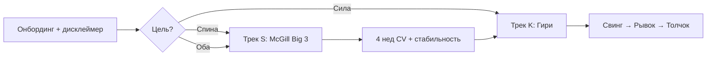

# ТЗ: ИИ-тренер по гире · «Снегири не гири»

**Статус:** v0.3 · июль 2026  
**Домен:** **snegirinegiri.ru**  
**Дизайн:** жёсткая ч/б графика, суровый утилитарный стиль  
**Бренд:** канал TG «Снегири не гири», персона **Штерн Ян Игоревич**  
**Связь:** Empire persona `stern`, `sales.db`, `analytics.db`  
**Планирование:** проект `Штерн · ИИ-тренер гири` в `planning.db`

---

## 0. Зафиксированные решения заказчика (июль 2026)

| Решение | Значение |
|---------|----------|
| Tripwire «Железная спина» (офис) | **Отменён** |
| Продукт | **Двухтрековая подписка:** Макгилл (спина) → Гири (силовой блок) |
| Kill-metric #1 | **Нет договора на съёмку** (хотя бы 1 тренер гири + 1 блок McGill) к **01.11.2026** → стоп |
| Эталонные видео | **Мужчина + женщина** (разные или один пакет) |
| Modic1 | **Не в продукте** — личное ограничение заказчика, не УТП |
| Платформы | Сайт PWA + TG Mini App + VK/Дзен (та же PWA) + Android TWA (фаза 3) |
| Методология | Заказчик: 5 лет с гирей, сейчас не тренируется; **программу согласует**, эталон — тренер |
| Юр./видео | Согласие на обработку видео — да |
| Бюджет | Готов вложить (см. §12 финмодель) |
| Режим разработки | Заказчик: домен, почта, ключи, поиск тренера; **агент (Cursor) — весь код и деплой** |
| Приоритет vs Pension | Stern — **отдельный денежный проект**, не блокер Pension |

### Почему отказ от TG-first

В РФ значительная часть аудитории **не сидит в TG без VPN**. Продажи через бот при малой базе подписчиков = дорогие посевы. **Сайт + ЮKassa + PWA** доступны всем; TG-канал «Снегири не гири» — вторичный канал трафика.

---

## 1. Проблема и ниша

### 1.1. Гипотеза (v0.3)
Продукт **шире гири**: воронка **«спина → сила»**.
1. Пользователь с больной/слабой спиной начинает с **Большой тройки Макгилла** + CV-контроль.
2. После 4–8 недель стабильности — **разблокировка блока гирь** (свинг → рывок → толчок).
3. Аудитория шире: рынок «здоровая спина» в РФ **больше**, чем ниша гиревиков.

**Главный актив для неизвестного бренда:** лица **известных тренеров** в лендинге и эталонных видео (покупка съёмки или RevShare).

### 1.2. Целевая аудитория
- **Трек S (Spine):** 30–55, дискомфорт в спине, сидячая работа, домашние тренировки.
- **Трек K (Kettlebell):** 25–45, 1–2 гири дома, база по спине уже есть или нет острых болей.
- География: РФ, без VPN-зависимости (сайт + VK/Дзен).

### 1.3. USP
1. **Единственное приложение** с CV по Макгиллу + гирям в одной прогрессии.
2. Асинхронный разбор видео (не real-time).
3. Эталоны от **реальных тренеров** (м/ж).
4. Персона **Штерн** — методология и голос; тренеры — «отснято при участии».
5. Ч/б суровый UX — отстройка от «розового фитнеса».

---

## 2. Продуктовая лестница

| Ступень | Продукт | Цена | Статус |
|---------|---------|------|--------|
| 0 | Лендинг snegirinegiri.ru + 1 бесплатный CV-разбор | 0 | ⬜ |
| 1 | Подписка: **трек S** (Макгилл 4 нед) | в подписке | ⬜ MVP |
| 2 | Разблокировка **трек K** (гири) | в подписке | ⬜ MVP |
| 3 | ИИ-питание | v0.2 | ⬜ |

**Архив:** tripwire «Железная спина» и курс 21 день — **сняты с roadmap**. Бот `empire_stern_bot` остаётся как редирект на сайт или лист ожидания (без разработки офисного контента).

**Тарифы:** 590 / 1 490 / 3 990 ₽ (без изменений).

### 2.1. Прогрессия «Спина → Гиря»



**Разблокировка K:** 3 недели без «красных» флагов CV в треке S ИЛИ самооценка «спина ок» + тест bird-dog 60 сек.

---

## 3. MVP — обязательный функционал

### 3.1. Must-have (релиз v0.1)
- [ ] Онбординг: вес, опыт, инвентарь (кг гири), цель, дисклеймер (расширить текущий).
- [ ] Запись видео подхода в **PWA** (MediaRecorder API, мобильный браузер).
- [ ] **Макет UI:** `static/snegiri/mockup.html` (v0.1, интерактивный).
- [ ] Загрузка в S3-совместимое хранилище → очередь → разбор.
- [ ] CV **McGill:** curl-up, side plank, bird-dog (прогиб, ротация, шея).
- [ ] CV **Гири:** свинг, рывок, толчок.
- [ ] Отчёт: оценка 1–10, текстовые подсказки, ключевые кадры с углами.
- [ ] Программа тренировок на неделю (LLM + шаблон тренера).
- [ ] Дневник: вес/талия (график), связка с объёмом тренировок.
- [ ] Оплата: ЮKassa рекуррент / годовой чек (приоритет годового для сценария без тренера).
- [ ] Аналитика: `source_id` → `analytics.db` → конверсия воронки.

### 3.2. Should-have (v0.2, +2 мес)
- [ ] ИИ-питание: фото/текст тарелки → оценка ккал/БЖУ.
- [ ] Генерация меню на неделю (промпт + ограничения пользователя).
- [ ] Интеграция `health.db` / Health Connect (вес с весов).
- [ ] Реферальная модель для тренера (25% RevShare).

### 3.3. Won't-have в MVP
- Real-time CV на устройстве.
- База продуктов / штрих-коды (как MyFitnessPal).
- iOS/Android нативные сторы.
- Детекция траектории гири (velocity-based) — **фаза 2**, требует custom model.

---

## 4. Мультиплатформенная архитектура

**Принцип:** один backend, один код PWA, разные оболочки.

| Платформа | Фаза | Реализация | VPN |
|-----------|------|------------|-----|
| **snegirinegiri.ru** | MVP (R2) | PWA + лендинг, ЮKassa | Не нужен |
| **VK** | R2 | Ссылка на PWA + клипы; позже VK Mini App | Не нужен |
| **Дзен** | R2 | CTA на сайт; у вас уже есть канал | Не нужен |
| **Telegram** | R2 | Mini App (тот же URL в WebApp) + бот уведомлений | Нужен для TG |
| **Android** | R3–R4 | **TWA** (Chrome wrapper PWA) → RuStore | Не нужен |

**Не делаем в MVP:** отдельный React Native. Android = TWA от того же PWA (экономия 2–3 мес).

```
                    ┌─────────────────────────────────┐
                    │  FastAPI + RQ + MediaPipe       │
                    │  sales.db · kb_trainer.db · S3  │
                    └───────────────┬─────────────────┘
                                    │
        ┌───────────┬───────────────┼───────────────┬───────────┐
        ▼           ▼               ▼               ▼           ▼
   snegirinegi   VK/Дзен        TG WebApp      empire_stern   RuStore
     .ru PWA      CTA→сайт      (опционально)    _bot push      TWA
```

### 4.1. Дизайн-система
- **Палитра:** #000, #FFF, акцент #E8E8E8 / #1A1A1A только.
- **Типографика:** моноширинный или гротеск (Inter/IBM Plex Sans), без засечек.
- **Иконки:** контурные SVG, 1.5px stroke.
- **Фото:** ч/б, высокий контраст; цвет только в CV-оверлее углов (опционально один цвет #FF3300 для ошибок).
- **Тон:** «железо, не wellness» — как советовал Gemini.
| Слой | Технология | Обоснование |
|------|------------|-------------|
| API | FastAPI (существующий) | Уже в Empire |
| Очередь | Redis + RQ | Проще Celery для solo-dev |
| CV | MediaPipe Pose Landmarker | CPU, хорошо знаком LLM |
| Хранилище видео | S3-compatible | Дешёво, отдельно от VPS |
| LLM | OpenRouter | Уже в бюджете Empire |
| Платежи | YooKassa + `sales.db` | Уже спроектировано |
| Фронт | **PWA** (HTML/JS, mobile-first) | Работает без VPN и без сторов |
| Уведомления | Email + опционально TG-бот | Push без установки приложения |
| Деплой | Docker + systemd | Как остальной Empire |

### 4.3. Ограничения из мастер-ТЗ
- Бюджет LLM+S3: **≤ 3 000 ₽/мес** на весь Empire — CV-проект должен укладываться или обосновать превышение.
- VPS 4/8/120 — воркеры CV на CPU; при >500 активных/день — горизонтальное масштабирование или GPU-воркер (триггер §10 FINAL).
- НПД лимит **2,4 млн ₽/год** — при успехе нужен план перехода на ИП УСН.

---

## 5. Юридические и safety-требования
- Расширить дисклеймер `empire_stern_bot.py`: баллистические движения, нагрузка на поясницу/плечи.
- Явный отказ от медицинских обещаний.
- Согласие на обработку видео (хранение, срок, удаление по запросу).
- Договор с тренером: лицензия на видео, RevShare, ответственность за методику.
- Возврат: политика как у Кононова (рекомендация из конкурентного анализа) — обсудить до запуска.

---

## 6. Go-to-market (РФ)

### 6.1. Сценарий A — с тренером (приоритет)
- 2–3 эксперта уровня 2 (50–150k подписчиков) или микро (10–30k).
- RevShare 20–25%, промокод, контент-тесты.
- CAC ≈ 0 на старте.

### 6.2. Сценарий B — без тренера
- Профессиональные эталонные видео (КМС/мастер спорта, без бренда).
- Платный трафик VK/Telegram Ads: CAC **1 500–2 000 ₽**.
- Обязателен **годовой** апселл после триала (иначе кассовый разрыв).

### 6.3. Каналы (приоритет)
1. **Сайт** — SEO, ЮKassa, Метрика (основная воронка).
2. **Партнёр-тренер** — RevShare, его VK/TG/YouTube → сайт.
3. **VK / Дзен** — статьи и клипы «Снегири не гири» → сайт (без VPN).
4. **TG-канал** — контент для ядра; CTA на сайт, не WebApp внутри TG.

---

## 7. Kill-metrics (v0.3 — по решению заказчика)

| # | Метрика | Дедлайн | 🛑 СТОП |
|---|---------|---------|--------|
| **K0** | **Договор на съёмку:** ≥1 тренер гири (м/ж) + блок McGill | **01.11.2026** | Нет контракта → **полный стоп** проекта |
| K1 | CV McGill: точность vs тренер | R1 | < 50% → только гири или только контент |
| K2 | CV гири: точность vs тренер | R1 | < 50% → убрать CV, оставить видео-курс |
| K3 | Beta NPS (15+ человек) | R3 | < 20 → не запускать рекламу |
| K4 | Cash burn без договора тренера | ongoing | **> 150k ₽** без K0 → пауза |

**Главный kill-metric = K0.** Остальные — уточнение пивота, не обязательно полный стоп.

---

## 8. Риски

| Риск | Митигация |
|------|-----------|
| MediaPipe не видит гирю | MVP = углы тела, не траектория снаряда; честный маркетинг |
| Перегруз VPS | Очередь, лимит длины видео (60 сек), async only |
| Churn неделя 3 | Питание + замеры как якорь |
| Конфликт с ресурсами Empire | Жёсткий лимит 15–20 ч/нед, не параллелить с Pension launch |
| НПД потолок | Мониторинг в `Empire · Финансы` |

---

## 9. Фазы реализации

См. `planning.db` → **«Штерн · ИИ-тренер гири»**.

| Фаза | Срок | Агент (Cursor) | Заказчик (руками) |
|------|------|----------------|-------------------|
| **R0** | 2 нед | ТЗ v0.2, письма тренерам, CLI-спека CV | Домен, почта, список 10 тренеров для питча |
| **R1** | 6 нед | CLI MediaPipe + отчёт по свингу | Договор + оплата пакета съёмок (после выбора тренера) |
| **R2** | 6 нед | Сайт, PWA, API, очередь, ЮKassa-интеграция | ЮKassa кабинет, DNS, тестовый платёж |
| **R3** | 4 нед | Beta-окружение, фиксы | 10 знакомых гиревиков на тест, ответы по программе |
| **R4** | 4 нед | Релиз, Метрика, аналитика | Запуск с тренером / первый посев |
| **R5** | 4 нед | LLM-питание | — |

**Итого:** ~26 нед. Параллельно Pension/Gdepar — по вашему графику.

---

## 9.1. Разделение ролей: что делает агент vs заказчик

### Агент делает сам (без ежедневного участия)
- Весь backend: FastAPI, SQLite, очередь, MediaPipe worker
- PWA: запись видео, дашборд, онбординг
- Лендинг (функциональный, mobile-first)
- Docker, nginx, systemd unit на VPS Empire
- Интеграция `sales.db` / `analytics.db`
- Шаблоны: оферта, согласие на видео, дисклеймер (на ревью юриста)
- Тесты, деплой, документация

### Заказчик — только точки контроля (~2–4 ч/нед)
| Действие | Когда | Частота |
|----------|-------|---------|
| Зарегистрировать домен, DNS на VPS | R0 | разово |
| Подключить ЮKassa (НПД) | R2 | разово |
| Выбрать тренера, подписать, оплатить съёмку | R0–R1 | разово |
| **Согласовать логику программы** (упражнения, прогрессия, противопоказания modic1-аудитории) | R1–R3 | по запросу |
| Тестовый платёж и прогон PWA на своём телефоне | R2–R3 | 1–2 раза |
| Привлечь 10 beta-тестеров | R3 | разово |
| Решения по пивоту (см. §7 kill-metrics) | R3 | по факту |

### Нельзя полностью делегировать агенту
- Переговоры с тренером и оплата съёмки
- Кабинет ЮKassa (верификация личности)
- Судебно значимые подписи на договорах
- Финальное «да/нет» по методике для людей с больной спиной

**Вывод:** модель «вы платите Cursor, я пишу код, вы иногда уточняете программу» — **да, рабочая**, если принять 5–6 контрольных точек выше.

---

## 10. Промпт для доработки финмодели в Gemini

Скопировать в Gemini после ответов на уточняющие вопросы:

```
Пересчитай финансовую модель ИИ-тренера по гире для РФ со следующими вводными:

Контекст: solo-разработчик, 15–20 ч/нед, существующий VPS (4 CPU/8GB), 
бюджет LLM 3000 ₽/мес на весь холдинг, НПД лимит 2.4 млн ₽/год.

Продукт: подписка 590/1490/3990 ₽, Telegram WebApp (без комиссии сторов 15%), 
эквайринг 4%. Tripwire 390 ₽ уже существует отдельно.

Три сценария:
A) 2 тренера, 40k аудитория, 1% конверсия мес 4, RevShare 25%
B) Тот же, но консервативно: 0.3% конверсия, 15% M3 retention
C) Без тренера, CAC 1800 ₽, только годовые 3990 ₽, реклама 150k ₽/мес с мес 6

Учти: COGS на видео (CPU 10 сек/мин видео, 8 подходов/мес), LLM 15 ₽/активный юзер, 
инфра 5000→50000 ₽ по мере роста, churn 8%/мес для фитнеса.

Выведи: помесячный cashflow 18 мес, точку безубыточности, 
чувствительность к churn и CAC, момент упора в НПД.
```

---

## 11. Открытые вопросы

1. ✅ Tripwire отменён · сайт-first · бренд «Снегири не гири»
2. ⬜ Подтвердить kill-metrics K1–K6 (§7)
3. ⬜ Домен: `snegiri-giri.ru` / `snegirinegiri.ru` / другой
4. ⬜ Бюджет на пакет съёмки тренера: ориентир 40–80k ₽ — ок?
5. ⬜ В программе: явный трек «берегём спину / modic-friendly» как отдельная ветка?

---

## 12. Финмодель v0.3 (Макгилл + гири, опора на тренеров)

### Почему двухтрековая модель выгоднее

| Метрика | Только гири | Спина → Гири |
|---------|-------------|--------------|
| TAM (оценка РФ) | ~300k активных гиревиков | **~5–8 млн** с регулярной болью в спине |
| Конверсия лендинга | 1–2% | **3–5%** (боль = мотивация) |
| CAC без тренера | 1 500–2 000 ₽ | 1 200–1 800 ₽ |
| LTV (удержание) | 4–6 мес | **6–9 мес** (длиннее трек S) |
| Нужен известный тренер | Желательно | **Обязательно** (доверие) |

### CAPEX до релиза

| Статья | ₽ |
|--------|---|
| Съёмка гири (м + ж, или 2 тренера) | 60 000–90 000 |
| Съёмка McGill-блока | 25 000–40 000 |
| Домен snegirinegiri.ru + почта | 2 000 |
| Юр. пакет | 12 000 |
| Инфра 8 мес | 24 000 |
| **Итого** | **123 000–168 000** |

### Сценарии (год 1)

**Сценарий T (Trainer-led) — базовый**
- 1–2 тренера, суммарная аудитория 30–80k
- RevShare 25%, конверсия 0,5%
- Мес 12: **350 платящих**, MRR **168k ₽**, EBITDA **~55k ₽/мес**

**Сценарий T+ (тренер + ваш VK/Дзен)**
- +50 лидов/мес органики
- Мес 12: **450 платящих**, MRR **216k ₽**

**Сценарий F (Fail K0 — нет тренера)**
- Не тратить >150k на код после R1
- **Стоп** — не сценарий «реклама без лица»

### Юнит-экономика (с тренером, ARPU 480 ₽)

| Статья | ₽/юзер/мес |
|--------|------------|
| ARPU | 480 |
| RevShare 25% | −120 |
| Налог+эквайринг | −48 |
| COGS (CV+LLM) | −22 |
| **Маржа** | **290** |

Окупаемость CAPEX ~150k при **T-сценарии:** месяц **10–12**.

### Целесообразность McGill-блока

| За | Против |
|----|--------|
| ×3–5 шире воронка | +25–40k съёмки |
| Дольше LTV | +2 нед dev CV |
| Логичный путь к гире | Нельзя писать «лечим modic» — только «укрепление кора» |
| Ольга Суворова = один партнёр на оба трека | McGill — trademark, писать «по мотивам Big 3» |

### Итог: **делать стоит**, при условии K0 (договор с тренером).

**Сверка с Gemini (июль 2026):** см. [`snegiri_finmodel_gemini.md`](snegiri_finmodel_gemini.md)  
- BE CAPEX ~130k: **месяц 2–4** (оптимистичнее нашей оценки 10–12)  
- COGS пересмотрен: **12–25 ₽/юзер** (не 5 ₽) — очередь async, без real-time  
- Инфра M6+: **15–20k ₽** при росте; GPU-триггер при >300 разборов/день  
- НПД: ~1.9–2.0 млн за год 1 — лимит не пробит; ИП с месяца 8–10
